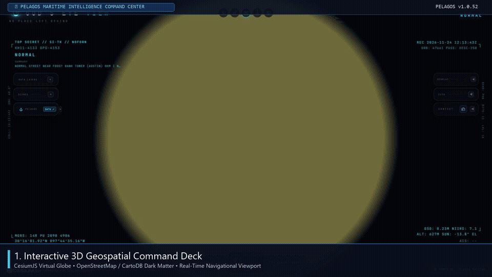
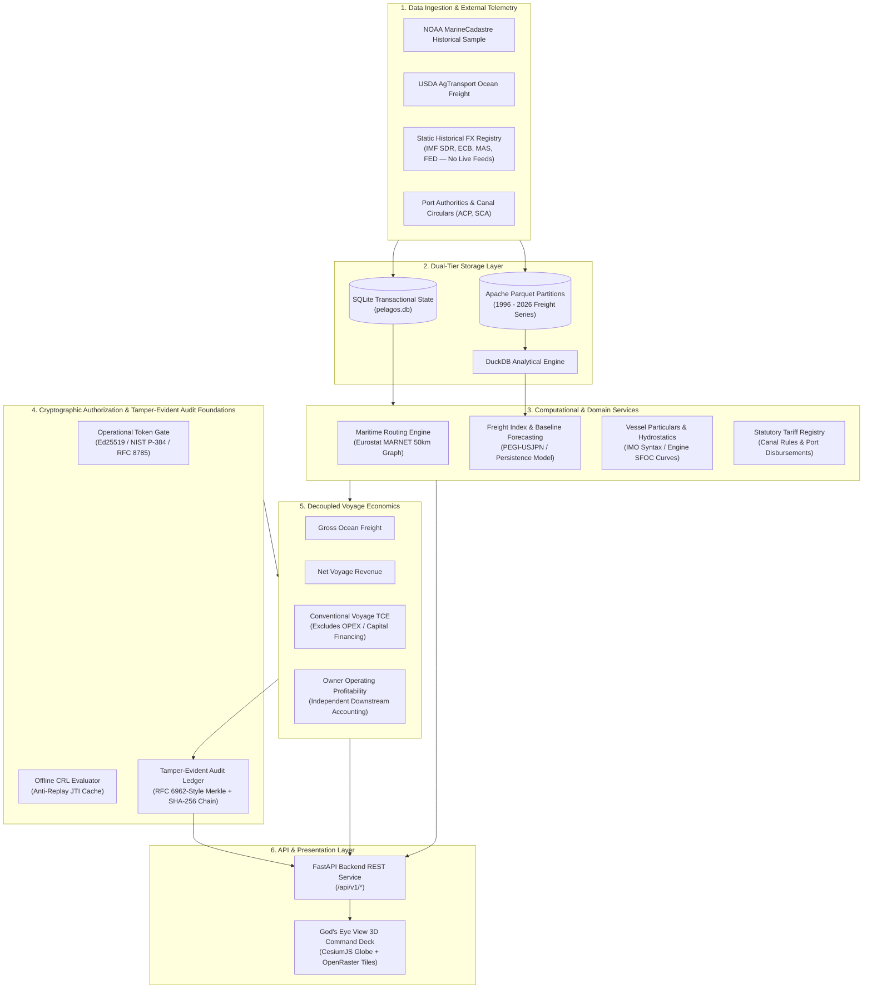
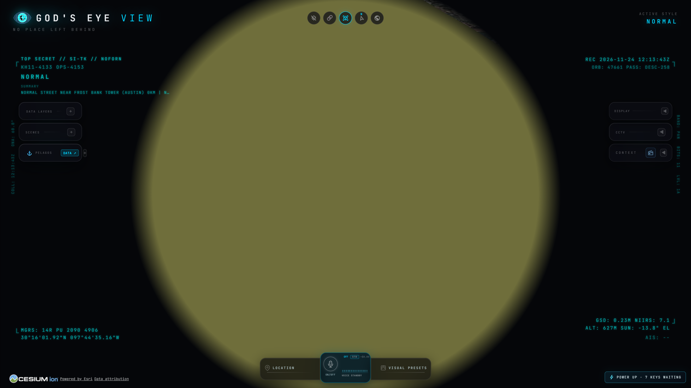
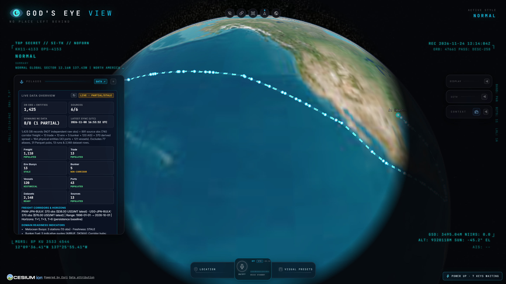
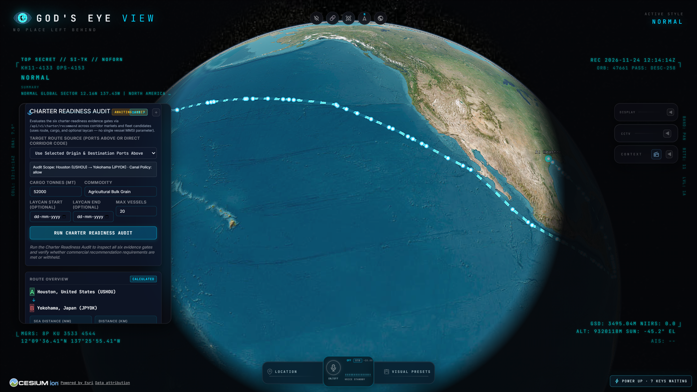
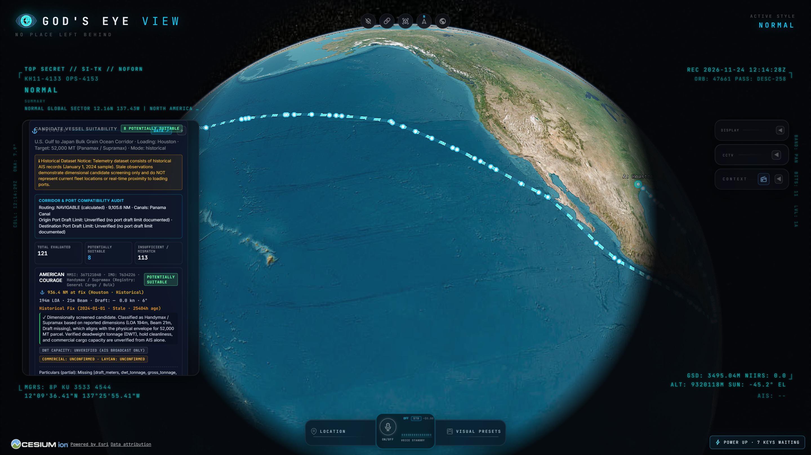
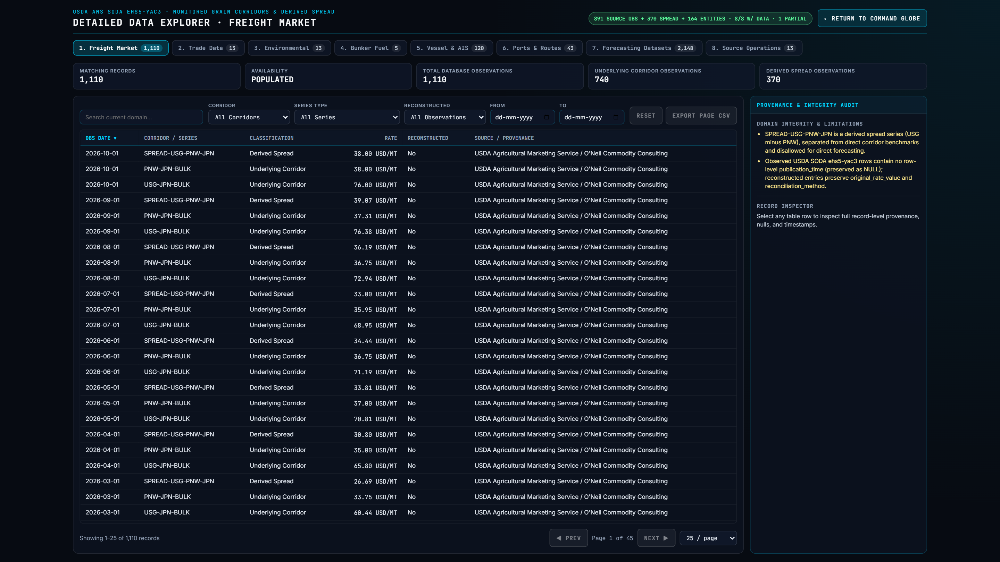

# Pelagos
**Maritime Intelligence Command Center**

An intelligent maritime freight forecasting and vessel chartering optimization platform bringing together maritime data intelligence, historical freight analytics, route intelligence, vessel suitability, and voyage economics.

<p align="center">
  
  <br>
  <em>Interactive demonstration of the Pelagos 3D Maritime Intelligence Command Center, Eurostat MARNET corridor routing, charter readiness gates, and multi-domain data exploration.</em>
</p>

---

## 1. Project Overview

### The Maritime Commercial Challenge
Global maritime commercial shipping operates within volatile, high-stakes spot and contract chartering markets. For dry bulk commodities (iron ore, coal, grain, bauxite) and liquid bulk energy trades, chartering a commercial vessel—such as a Capesize (180,000 DWT) or Panamax (75,000 DWT)—represents a multimillion-dollar commercial commitment.

Historically, the information required to evaluate, negotiate, and execute a commercial fixture has been profoundly fragmented:
- **Freight Rate Indicators:** Spot index assessments and broker recap reports scattered across disparate market reporting desks.
- **Port Disbursements & Canal Tolls:** Static, complex tariff regulations published in varying local currencies, often buried in administrative circulars with conditional surcharges.
- **Vessel Suitability & Hydrostatics:** Incomplete vessel particulars, unverified questionnaire data (Q88), and unmodeled engine fuel consumption curves (SFOC).
- **Navigational Routeing:** Disconnect between geometric shortest paths and real-world maritime fairways, canal transit limitations, and seasonal weather allowances.
- **Financial Conversion:** Foreign exchange conversion volatility without standardized statutory lookback governance.

This fragmentation introduces friction, calculation drift, and commercial risk, often forcing charterers, shipowners, and commodity trading desks to rely on static spreadsheets that conflate top-line revenue with operational profitability.

### What Pelagos Unifies
Pelagos unifies these disparate operational domains into a cohesive, deterministic, and cryptographically auditable platform:
1. **Multi-Domain Maritime Ingestion:** Ingests and normalizes historical vessel telemetry (NOAA MarineCadastre sample), marine weather observations (NOAA NDBC), statutory port/canal tariffs, bunker fuel benchmarks, and multi-decade agricultural freight publications (USDA AgTransport).
2. **Dual-Tier Analytical Storage:** Combines transactional relational state in SQLite with columnar, partition-pruned Apache Parquet datasets queried via DuckDB.
3. **Statistical Freight Forecasting:** Evaluates multi-horizon freight rate projections (`T+1`, `T+3`, `T+6`) grounded in statistical significance testing (Diebold-Mariano, Holm-Bonferroni).
4. **Navigable Maritime Routing:** Models real ocean corridors using compiled Eurostat MARNET graphs with dynamic canal bypass and antimeridian crossing logic for commercial distance estimation.
5. **Vessel Readiness & Hydrostatics:** Reconciles statutory dimensions, verifies IMO syntax checksums, and calculates fuel oil consumption using parameterized engine load curves.
6. **Decoupled Voyage Economics:** Computes Gross Ocean Freight, Net Voyage Revenue, Conventional Voyage Time Charter Equivalent (TCE), and Owner Operating Profitability under strict mathematical separation. All economic outputs are strictly dependent on input cost completeness, currency freshness (lookback limits), and underlying evidence quality.
7. **Cryptographic Authorization and Tamper-Evident Audit Foundations:** Enforces role-based operational token gates (Ed25519 and NIST P-384) with RFC 8785 canonical serialization, an RFC 6962-style domain-separated Merkle tree over sorted record sets, and sequential SHA-256 monotonic audit chaining.

### Implemented Foundation vs. Commercial Vision
Pelagos is currently a **comprehensive research and engineering platform foundation**. It has achieved rigorous deterministic verification across its computational, economic, and cryptographic modules:
- **Level 2 Research & Simulation Foundations:** Implemented and verified across a 206-test reported milestone inventory (comprising 44 Phase 2 tests and 162 expanded predecessor tests).
- **Level 3 Operational Readiness Remains Strictly Blocked:** The system hardcodes `is_ready_for_operations = False`. Full operational clearance is barred pending expansion of global port tariff coverage, automated live central bank data feeds, enterprise PostgreSQL persistence, hardware-backed key custody (HSM), and dual-control governance workflows.

---

## 2. Key Capabilities

Pelagos organizes its verified technical capabilities across ten discrete domains, explicitly classifying the implementation maturity of each component:

| Capability Domain | Implemented Scope | Maturity Classification | Governing Module |
|---|---|---|---|
| **1. Data Ingestion & Provenance** | Bounded NOAA MarineCadastre historical AIS sample ingestion, USDA ocean freight rates, NOAA NDBC buoy data, port directories; quarantine filtering; explicit provenance attribution. *(USCG NAIS and live automated AIS streams are not active integrations.)* | **Implemented & Verified** | `pelagos.ingestion` |
| **2. Historical Freight Intelligence** | Multi-decade ocean bulk rate ingestion; Pelagos Experimental Grain Index (`PEGI-USJPN`); Parquet export tasks; DuckDB analytical aggregations. | **Implemented & Verified** | `pelagos.storage`, `pelagos.forecasting` |
| **3. Freight Forecasting & Evaluation** | Multi-horizon (`T+1`, `T+3`, `T+6`) forecasting baseline engine; `persistence` benchmark active; Diebold-Mariano and Holm-Bonferroni statistical testing suites. | **Implemented (Baseline) / Experimental (ML)** | `pelagos.forecasting` |
| **4. Maritime Route Intelligence** | Dual-graph routing (prototype corridor graph + 50 km Eurostat MARNET graph with >60,000 edges); canal bypass logic; antimeridian handling; fail-closed route validation. *(Commercial distance estimation only; not certified navigation.)* | **Implemented & Verified (Research)** | `pelagos.routing` |
| **5. Vessel Identity & Suitability** | IMO checksum verification (MOD-11); particulars reconciliation; provenance classification (`DIRECTLY_VERIFIED` vs `SOURCE_REPORTED`); 7-parameter berth/canal suitability checks. *(Historical AIS does not establish forward commercial open-tonnage availability; no live broker feeds.)* | **Implemented & Verified (Readiness Gated)** | `pelagos.readiness`, `pelagos.registry` |
| **6. Port & Canal Tariff Intelligence** | Panama Canal Authority (ACP 2024–2025) and Suez Canal Authority (SCA 7/2023 & 1/2024 SDR basket) rules; Singapore (`SGSIN`), Rotterdam (`NLRTM`), Houston (`USHOU`) port disbursements. *(Rotterdam and Houston contain partial pilotage components; global coverage is incomplete.)* | **Partially Supported (3 Ports, 2 Canals)** | `pelagos.registry`, `pelagos.readiness` |
| **7. Voyage Disbursement Integration** | Aggregates port dues, pilotage, towage, canal tolls, and bunker fuel costs; 10-criteria statutory validation gate; static central bank FX conversion controls with lookback limits. *(Daily automated FX ingestion is not deployed.)* | **Implemented & Verified (Bounded Scope)** | `pelagos.registry`, `pelagos.currency` |
| **8. Voyage Economics & Decoupled TCE** | Mathematical separation of Gross Freight, Net Revenue, Conventional TCE, and Owner Operating Profitability; 7-component voyage duration accounting; Decimal monetary precision. Economic outputs depend on input cost completeness, currency freshness, and statutory evidence quality. | **Implemented & Verified** | `pelagos.optimization.voyage_economics` |
| **9. Commercial Readiness Controls** | Fail-closed validation gates (`fixture_validation.py`, `tariff_validation.py`, `vessel_readiness.py`, `token_gate.py`); commission tier governance (`CONTRACT_VERIFIED`, `USER_RESEARCH_ASSUMPTION`, `MISSING`); operational token check; research vs. operational mode segregation. | **Implemented & Enforced (Level 2 Active / Level 3 Blocked)** | `pelagos.readiness.fixture_validation` |
| **10. Cryptographic Authorization & Tamper-Evident Audit Foundations** | Ed25519 & NIST P-384 signature engines; RFC 8785 JSON canonicalization; anti-replay cache; offline CRL evaluation; RFC 6962-style domain-separated Merkle tree over sorted records + monotonic SHA-256 audit ledger. *(Production keys and HSM custody are not deployed.)* | **Implemented (Test Primitives / Production Locked)** | `pelagos.security`, `pelagos.audit` |

---

## 3. High-Level Architecture

The Pelagos architecture employs a modular monolith pattern, isolating statutory data registries, computational economics, cryptographic authorization, and analytical storage from the presentation layer:



---

## 4. Technology Stack

Pelagos is built on proven open-source technologies, selected for mathematical precision, deterministic execution, and cryptographic verifiability:

### Backend & API
- **Python 3.10+ / 3.12:** Core language runtime.
- **FastAPI (0.110+):** Asynchronous RESTful service framework serving `/api/v1/*` endpoints.
- **Uvicorn (0.28+):** High-performance ASGI web server.
- **Pydantic (v2.7+) & Pydantic Settings:** Strict data contract validation and environment configuration.

### Persistence & Analytical Storage
- **SQLite 3:** Transactional application storage (`pelagos.db`) certified with append-only SQL triggers.
- **SQLAlchemy (2.0+):** Object-relational mapping (ORM) and declarative schema models.
- **Apache Parquet (via PyArrow 15+):** Partitioned columnar historical freight datasets.
- **DuckDB (1.0+):** In-process analytical OLAP SQL engine for sub-second aggregations over Parquet data.

### Geospatial & Navigational Intelligence
- **CesiumJS (1.124+):** 3D geospatial virtual globe powering the command deck interface.
- **Eurostat MARNET:** 50 km navigable ocean network graph comprising over 60,000 maritime edges for commercial distance estimation.
- **NetworkX / SciPy:** Graph traversal, Dijkstra shortest path routing, and spatial indexing.

### Forecasting & Statistics
- **NumPy & SciPy:** Scientific computing, HAC robust standard error estimation, and statistical distributions.
- **Scikit-Learn:** Machine learning benchmarking and feature preprocessing pipelines.
- **Diebold-Mariano & Holm-Bonferroni:** Multi-comparison hypothesis testing for forecasting models.

### Cryptography & Security
- **Python `cryptography`:** Implementation of Ed25519 (RFC 8032) and NIST P-384 / SECP384R1 (FIPS 186-4) digital signatures.
- **RFC 8785 JSON Canonicalization Scheme (JCS):** Deterministic payload serialization and Decimal string formatting.
- **RFC 6962-Style Merkle Tree:** Byte-level domain separation (`0x00` leaf, `0x01` interior node) over sorted record sets.
- **Monotonic SHA-256 Chaining:** Sequential audit record chaining with explicit `0x02` domain tags.

### Frontend Presentation
- **God's Eye View (GEV):** Open-source 3D situational awareness console repurposed as the maritime command viewport.
- **Vite (6.0+):** Modern ES-module frontend build tool and local development server.
- **Decoupled Raster Basemaps:** OpenStreetMap and CartoDB Dark Matter tile integration eliminating mandatory commercial Cesium Ion asset tokens.

### Verification & Testing
- **Pytest (8.0+):** Platform test runner executing unit, integration, and adversarial security suites.
- **AnyIO:** Asynchronous I/O testing framework.

---

## 5. How Pelagos Works

Pelagos operates as an integrated, eight-stage deterministic workflow. The platform enforces strict fail-closed validation at key statutory gates (`fixture_validation.py`, `tariff_validation.py`, `vessel_readiness.py`, and `token_gate.py`): if a required statutory parameter, certified vessel dimension, valid certificate, exchange rate within lookback limits, or cryptographic signature is missing or expired, the validation gate aborts execution rather than outputting an unsubstantiated estimate.

```
[1. Acquisition] ──► [2. Validation] ──► [3. Storage] ──► [4. Forecasting]
                                                                  │
[8. Audit Log]   ◄── [7. Economics]  ◄── [6. Tariffs] ◄── [5. Route/Vessel]
```

1. **Data Acquisition & Static Registries:** Ingests authentic bounded datasets (historical NOAA AIS telemetry sample, agricultural freight publications, historical buoy observations) and references static historical central bank FX registry entries (IMF SDR, ECB, MAS, Federal Reserve) rather than automated daily feeds.
2. **Validation & Provenance:** Quarantines malformed records. Assigns evidence classifications (`DIRECTLY_VERIFIED`, `SOURCE_REPORTED`, `PARTIALLY_VERIFIED`, `MISSING`) and verifies source distribution permissions (`PERMITTED_STATUTORY_DISCLOSURE`).
3. **Storage & Normalization:** Persists transactional entities into relational tables while writing historical time series into partitioned Parquet files.
4. **Historical Analysis & Forecasting:** Computes freight index benchmarks (`PEGI-USJPN`) and generates point forecasts across horizons (`T+1`, `T+3`, `T+6`) using the validated `persistence` baseline model.
5. **Maritime Route & Vessel Assessment:** Solves commercial sea routes via Eurostat MARNET with chokepoint bypass rules. Reconciles vessel IMO syntax and checks seven statutory dimensions against canal and berth restrictions.
6. **Statutory Port & Canal Cost Assessment:** Evaluates official tariff circulars for Panama and Suez canal transits and port disbursements for Singapore, Rotterdam, and Houston against 10 statutory validation criteria, resolving static historical FX registry entries under provider-specific lookback windows (IMF 4d, ECB 4d, MAS 5d) rather than live automated feeds.
7. **Decoupled Voyage Economics:** Computes Gross Freight, subtracts verified commissions, voyage disbursements, and bunker expenses to derive Net Voyage Revenue, then computes Conventional Voyage TCE over the 7-component voyage duration. Computes Owner Operating Profitability as a separate downstream model. These financial outputs are strictly dependent on input cost completeness, currency rate freshness within lookback limits, and the evidentiary backing of all cost items.
8. **Readiness Controls & Tamper-Evident Audit:** Enforces commission governance and operational token verification. Emits an append-only, tamper-evident audit record containing an RFC 6962-style line-item Merkle tree and appends it to the monotonic SHA-256 audit chain.

---

## 6. Project Progress & Milestone History

Pelagos has progressed through a sequence of formal design, implementation, agent-led verification, and remediation milestones:

| Milestone / Stage | Code | Scope & Description | Status |
|---|---|---|---|
| **Stage C** | `C1.1` – `C3.3` | Historical freight ingestion, PEGI-USJPN index engine, baseline forecasting, ML benchmarking, and regime investigation. | **Completed & Verified** |
| **Stage D** | `D1` – `D10.2` | Vessel suitability matching, Eurostat MARNET 50 km routing graph, canal bypass, and 6-gate chartering engine. | **Completed & Verified** |
| **Stage E1** | `API-001` | Platform Data Overview and 8-domain Data Explorer integrated into `#pelagos-panel` and hash-routed `#/explorer`. | **Completed & Verified** |
| **Stage F1.4.1** | `DISC-F141-001` | Global bunker fuel intelligence and voyage economics source discovery. | **Completed & Verified** |
| **Stage F1.4.2.2a/b/c** | `SPEC-F1422B/C` | Engine SFOC load curve parameterization and vessel fuel consumption hydrostatics modeling. | **Completed & Verified** |
| **Stage F1.4.2.3a/b** | `DOC-F1423A/B` | Canal Tariff Registry (Panama & Suez) and Global Port Disbursement Foundation (Singapore, Rotterdam, Houston). | **Completed & Verified** |
| **Stage F1.4.2.4** | `DOC-F1424-001` | Voyage disbursement integration and preliminary TCE calculation framework. | **Completed & Verified** |
| **Stage F1.4.3 Phase 1** | `REPORT-F143-PHASE1` | 10-criteria statutory tariff validation, provider-specific FX lookbacks (IMF 4d, ECB 4d, MAS 5d), Decimal monetary precision. | **Completed & Published (`fdd70b8`)** |
| **Stage F1.4.3 Phase 2** | `REPORT-F143-PHASE2` | Commercial fixture validation engine, Ed25519/P-384 cryptographic token gate, decoupled voyage economics, Merkle audit ledger. | **Completed & Published (`9e001a3`)** |
| **Stage F1.4.3 Phase 3** | `PROP-F143-PHASE3` | Proposed milestone for commercial evidence verification, top 15 bulk ports, automated FX/telemetry, PostgreSQL append-only persistence, and dual-control multi-sig. | **Proposed (Awaiting Owner Review)** |

---

## 7. Screenshots & Interface Visuals

Pelagos utilizes the God's Eye View 3D geospatial engine as its interactive command deck. The platform unifies real-time 3D situational awareness, Eurostat MARNET sea-lane routing, multi-gate chartering audits, and tabular analytical exploration.

### Interactive Demonstration

<p align="center">
  
</p>

> [!TIP]
> **Full-HD Video Demonstration Available:**  
> A high-definition, 1080p recording of the complete interactive workflow is available in the repository at:  
> [▶ **`docs/media/videos/pelagos_demo.mp4`**](docs/media/videos/pelagos_demo.mp4) (H.264 / 24 FPS with detailed technical captions).

---

### Interface Gallery & Capabilities

#### 1. 3D Geospatial Maritime Command Deck
Global 3D maritime situational awareness console powered by CesiumJS, featuring decoupled CartoDB Dark Matter and OpenStreetMap raster basemaps, telemetry HUD, and real-time navigational layers.



*Figure 1: Full-screen CesiumJS 3D command deck displaying global telemetry HUD, docked navigational panels, and coordinate tracking.*

---

#### 2. Navigable Sea-Lane Corridors & Eurostat MARNET Routing
Commercial sea routing evaluated over the 50 km Eurostat MARNET graph (>60,000 maritime edges), modeling canal passage through the Panama Canal, dynamic antimeridian Pacific seam sanitization, and speed-over-ground duration accounting.



*Figure 2: Plotted 9,363 NM navigable bulk route from Port Houston (USHOU) to Yokohama (JPYOK) transiting the Panama Canal with real-time waypoint metrics and antimeridian crossing resolution.*

---

#### 3. Six-Gate Commercial Charter Readiness Audit
Rigorous fail-closed validation evaluating proposed fixtures across six sequential evidence gates before commercial recommendations or operational commitments can be authorized.



*Figure 3: Charter Readiness Audit drawer evaluating Gate 1 (Freight Market), Gate 2 (Forecast Edge), Gate 3 (Operational Route), Gate 4 (Physical Particulars), Gate 5 (Open Tonnage), and Gate 6 (Bunker Economics).*

---

#### 4. Candidate Vessel Suitability & Hydrostatic Matching
Automated screening of candidate bulk carriers against port berth geometry, draft limits, canal dimensions, and fuel consumption curves parameterized from ClassNK surveys and MAN Energy Solutions SFOC load data.



*Figure 4: Candidate vessel suitability matching interface classifying tonnage compatibility, laycan feasibility, and hydrodynamic fuel oil consumption.*

---

#### 5. Multi-Domain Tabular Platform Data Explorer
Analytical tabular explorer accessible via hash routing (`#/explorer`), powered by DuckDB running sub-second analytical queries over partitioned Apache Parquet datasets and relational SQLite registries.



*Figure 5: High-performance tabular data explorer inspecting statutory port disbursements (Singapore, Rotterdam, Houston, Yokohama), ACP canal circulars, and multi-decade freight series.*

---

## 8. Installation & Local Development

### Prerequisites
- **Python:** Version `3.10`, `3.11`, or `3.12` installed.
- **Node.js:** Version `24.14.0+` or `26.x` with `npm` installed.
- **Git:** Version `2.30+`.

### 1. Repository Setup & Virtual Environment
```bash
# Clone the repository
git clone https://github.com/Sanchay0123/Pelagos.git
cd Pelagos

# Create and activate Python virtual environment
python -m venv .venv

# On Windows PowerShell:
.venv\Scripts\Activate.ps1
# On Windows Command Prompt:
# .venv\Scripts\activate.bat
# On Linux / macOS:
# source .venv/bin/activate

# Upgrade package manager
python -m pip install --upgrade pip
```

### 2. Environment Configuration & PYTHONPATH Setup
Pelagos uses a modular package structure located in the `backend/` directory. Set `PYTHONPATH` to ensure the `pelagos` package imports correctly:

**Windows PowerShell:**
```powershell
$env:PYTHONPATH = "backend"
```

**Windows Command Prompt:**
```cmd
set PYTHONPATH=backend
```

**Linux / macOS:**
```bash
export PYTHONPATH=backend
```

### 3. Backend Installation & Database Initialization
```bash
# Install backend dependencies
pip install -r backend/requirements.txt

# Install test dependencies
pip install pytest anyio

# Initialize the SQLite database schema non-destructively
python -c "import sys; sys.path.insert(0, 'backend'); from pelagos.database import init_db; init_db()"
```

### 4. Running the Backend API Server
```bash
# Start FastAPI server on port 8000 with auto-reload (requires PYTHONPATH=backend)
python -m uvicorn pelagos.api.main:app --host 127.0.0.1 --port 8000 --reload
```
Once started, the interactive OpenAPI documentation is available at:
`http://127.0.0.1:8000/docs`

### 5. Running the Frontend Command Deck
```bash
# Navigate to the frontend directory
cd gods-eye-view-main

# Install Node.js dependencies
npm install

# Start the Vite development server
npm run dev
```
The command deck will be accessible at:
`http://localhost:5173`

### 6. Executing Verified Test Suites
The accepted Stage F1.4.3 Phase 2 milestone verification is documented across **206 distinct platform tests** (`RECON-F143-PHASE2-001`), consisting of **44 Phase 2 tests** and the **162 expanded predecessor platform tests** (of which the 73 focused disbursement/readiness tests are a subset).

Contributors can reproduce these exact test suites using the following commands:

#### A. Phase 2 Component & Adversarial Suite (44 Tests, 100% Pass)
```bash
pytest tests/test_p2a_commercial_fixture.py tests/test_p2b_cryptographic_primitives.py tests/test_p2c_voyage_economics.py tests/test_p2d_audit_ledger.py tests/test_p2_adversarial.py tests/test_database_isolation.py
```

#### B. Focused Predecessor Regression Suite (73 Tests, 100% Pass)
```bash
pytest tests/test_canal_tariffs.py tests/test_port_disbursements.py tests/test_voyage_disbursements.py tests/test_f143_readiness.py
```

#### C. Full Expanded Predecessor Regression Inventory (162 Tests, 100% Pass)
```bash
pytest tests/test_canal_tariffs.py tests/test_port_disbursements.py tests/test_voyage_disbursements.py tests/test_f143_readiness.py tests/test_vessel_registry.py tests/test_vessel_fuel_model.py tests/test_voyage_calculator.py tests/test_charter_intelligence.py tests/test_machinery_registry.py tests/test_engine_sfoc.py
```

> [!NOTE]
> ### Repository-Wide Test Discovery
> Running an unparameterized `pytest` or `pytest tests/` command collects 773 historical test items spanning all prior development stages (Stages C, D, E, F), including historical model training routines, legacy fixtures, and research exploration suites that are not part of the active Phase 2 milestone verification baseline. The verified milestone baseline consists of the 206 tests detailed above (44 Phase 2 component/adversarial tests + 162 expanded predecessor platform tests, all passing 100%). Contributors should run the targeted milestone commands above.

### 7. Using the Command-Line Interface (CLI)
Pelagos provides a unified CLI for data ingestion, schema reconciliation, and operational audit. View available subcommands and options:
```bash
# Display top-level CLI help and available subcommands
python backend/pelagos/cli.py --help

# Display subcommand-specific parameters
python backend/pelagos/cli.py status --help
python backend/pelagos/cli.py coverage-summary --help
```

> [!IMPORTANT]
> ### Database Isolation for CLI Ingestion
> Execution subcommands that ingest data (e.g. `ingest-sample`, `freight-ingest`, `ports-ingest`) write to the configured database. To prevent unintentional mutation of the baseline `pelagos.db`, operational ingestion subcommands should always be supplied with an explicit isolated database URL via the `--db-url` flag (e.g. `--db-url sqlite:///./temp_isolated.db`) or run in dry-run mode (`--dry-run`).

---

## 9. Repository Structure

```
Pelagos/
├── backend/
│   ├── pelagos/
│   │   ├── api/                 # FastAPI routes (vessels, freight, calculator, platform_data)
│   │   ├── audit/               # Tamper-evident audit ledger and verification engine
│   │   ├── forecasting/         # Freight index calculation and baseline forecasting models
│   │   ├── ingestion/           # Ingestion pipelines (NOAA, USDA, trade, ports, buoys)
│   │   ├── optimization/        # Voyage economics, chartering matchers, and fuel models
│   │   ├── readiness/           # Statutory fixture validation and vessel readiness services
│   │   ├── registry/            # Port disbursements, canal tariffs, and engine SFOC registries
│   │   ├── routing/             # MARNET 50km ocean graph traversal and canal bypass rules
│   │   ├── security/            # Ed25519/P-384 token gate, RFC 8785 JCS, and CRL evaluator
│   │   ├── storage/             # Parquet writer, outbox sync, and DuckDB analytical catalog
│   │   ├── cli.py               # Ingestion, status, and governance CLI
│   │   ├── config.py            # Pydantic configuration settings
│   │   ├── currency.py          # Central bank FX conversions with statutory lookbacks
│   │   ├── database.py          # SQLAlchemy engine, session management, and SQL triggers
│   │   └── models.py            # Relational database models
│   └── requirements.txt         # Core backend Python dependencies
├── docs/                        # Canonical architecture specs, ADRs, and verification reports
│   ├── DOCUMENTATION_STANDARD.md
│   ├── INDEX.md                 # Master documentation catalog
│   ├── PROJECT_OVERVIEW.md      # High-level product overview
│   ├── F1_4_3_PHASE2_ARCHITECTURE.md
│   ├── F1_4_3_NEXT_PHASE_GAP_ASSESSMENT.md
│   └── F1_4_3_NEXT_PHASE_PROPOSAL.md
├── gods-eye-view-main/          # CesiumJS 3D geospatial virtual globe command deck
├── parquet_data/                # Partition-pruned annual historical freight datasets (1996–2026)
├── scripts/                     # Reproducible dataset ingestion and graph compilation scripts
├── tests/                       # Unit, integration, adversarial, and regression test suites
└── pelagos.db                   # Authenticated baseline SQLite database (1,875,968 bytes)
```

---

## 10. Data Governance & Engineering Principles

Pelagos adheres to strict engineering principles that distinguish it from conventional analytics prototypes:

1. **Genuine Source-Backed Data:** No synthetic observations, mock market freight rates, or fabricated vessel positions are used to train models or claim system coverage.
2. **Strict Provenance & Traceability:** Every database record stores origin metadata: `source_name`, `source_record_id`, `source_url`, and `retrieval_timestamp`.
3. **Explicit Evidence Classification:** Data attributes are categorized as `DIRECTLY_VERIFIED`, `SOURCE_REPORTED`, `PARTIALLY_VERIFIED`, or `MISSING`.
4. **No Fabricated Commercial Availability:** AIS observations are never conflated with commercial vessel availability. Open-tonnage lists and laycan dates must be explicitly provided.
5. **No Unsupported Predictions:** Freight forecasts are statistically bounded; when sample sizes or horizons fail non-inferiority criteria, the system retains the `persistence` baseline.
6. **Fail-Closed Validation Gates:** In statutory validation gates (`fixture_validation.py`, `tariff_validation.py`, `vessel_readiness.py`, `token_gate.py`), if a required statutory certificate, draft limitation, or exchange rate is absent or expired, validation fails immediately rather than substituting unverified defaults.
7. **Permanent Separation and Evidentiary Dependency of Voyage Economics:** Conventional Voyage TCE isolates voyage-specific costs (freight, commissions, disbursements, bunkers) from capital debt and OPEX (accounted downstream in Owner Profitability). All economic outputs strictly depend on input cost completeness, currency freshness within lookback limits, and verified evidence quality.

---

## 11. Current Limitations

Prospective users, researchers, and partners must understand the platform's current boundary conditions:

- **Limited Port Tariff Coverage:** Deterministic statutory disbursement algorithms are currently implemented for only three ports: Singapore (`SGSIN`), Rotterdam (`NLRTM`), and Houston (`USHOU`). Calculations calling unmonitored ports fail closed (`UNREGISTERED_PORT_CALL`). Furthermore, Rotterdam and Houston pilotage models currently contain partial components (missing shifting S-rates and draft overage brackets).
- **Incomplete Canal Hydrology & Baseline Evidence:** Panama Canal transit calculations require external manual entry of Gatun Lake elevation. Suez Canal baseline dues brackets retain `PARTIALLY_VERIFIED` classification pending SCA archival reconciliation.
- **Incomplete Commercial Open-Tonnage Data:** The current vessel position table holds a 120-row historical observation sample from NOAA MarineCadastre (2024-01-01). Forward vessel schedules, commercial broker position lists, and live AIS streams are not connected.
- **Static Central Bank FX Fixings:** Foreign exchange rates in `pelagos.db` are static historical registry entries used for conversion controls; an automated daily SDMX/XML ingestion pipeline is not deployed.
- **Research-Level Route Intelligence:** Routing is based on Eurostat MARNET 50 km graphs for commercial distance intelligence. It is **not certified for SOLAS navigational collision avoidance**.
- **Contractual Agency Fees & Bunker Evidence:** Agency fees are not automatically estimated and require explicit contractual inputs. Bunker costs rely on caller-supplied estimates or static benchmarks rather than physical bunker delivery receipts.
- **SQLite Persistence Certified Scope:** The current certified persistence tier is SQLite. While protected by internal SQL triggers that abort UPDATE and DELETE operations within the database engine, SQLite cannot defend against OS-level administrator file tampering and suffers single-writer concurrency bottlenecks under multi-user loads.
- **Development/Test Cryptographic Keys:** Digital signatures currently utilize software-generated keys in application memory. Hardware Security Modules (FIPS 140-3 Level 3 HSM) and formal key ceremonies are not yet implemented.
- **Level 3 Operational Readiness Remains Locked:** The software hardcodes `is_ready_for_operations = False`. Operational execution tokens are strictly blocked in application code (`PRODUCTION_TOKEN_PROHIBITED_IN_PHASE_2`).

---

## 12. Commercial Roadmap

Pelagos is advancing toward commercial dependability through formally governed development stages:

### Stage F1.4.3 Phase 3 (Proposed Milestone — Awaiting Owner Authorization)
*Note: Phase 3 is a proposed milestone under owner review; implementation has not yet commenced.*
- **Top 15 Global Bulk Ports:** Proposed expansion of deterministic port disbursement algorithms to the top 15 bulk export/import terminals (including Dampier, Port Hedland, Tubarão, Richards Bay, Newcastle, Qingdao, Santos).
- **Statutory Data Ingestion Pipelines:** Proposed automated daily ingestion pipelines for IMF (SDR via SDMX), ECB (XML), MAS (API), and Fed FX fixings, plus Panama Canal Gatun Lake hydrology telemetry.
- **PostgreSQL Enterprise Persistence:** Proposed PostgreSQL adapter featuring PL/pgSQL append-only triggers (`BEFORE UPDATE OR DELETE RAISE EXCEPTION`) and PgBouncer connection pooling.
- **Dual-Control Multi-Signature Governance:** Proposed four-eyes commercial approval engine requiring joint cryptographic authorization from `CHARTERING_MANAGER` and `OPERATIONS_DIRECTOR`.
- **Real-World Commercial Benchmarking:** Proposed end-to-end reconciliation against two fully closed, audited historic commercial bulk fixtures with real banking disbursement statements.

### Future Stages (Towards Production Operational Authorization)
- **Hardware Security Module (HSM) Deployment:** Migrate signing keys to cloud-managed or physical FIPS 140-3 Level 3 HSMs via PKCS#11.
- **Enterprise Identity Binding:** Bind operational token claims to corporate identity providers via OIDC, SAML 2.0, or mTLS.
- **Commercial Broker Schedule Ingestion:** Connect verified shipowner open-tonnage lists and commercial cargo laycan orders.
- **Level 3 Operational Activation:** Conduct an external multi-party audit to authorize `is_ready_for_operations = True`.

---

## 13. Contributing

Contributions to the Pelagos research and engineering baseline are welcome from maritime domain experts, computational economists, and software engineers:

1. **Adherence to Documentation Standards:** All new architectural decisions must follow [DOCUMENTATION_STANDARD.md](docs/DOCUMENTATION_STANDARD.md) and be registered in [INDEX.md](docs/INDEX.md).
2. **Zero Synthetic Data Policy:** Pull requests containing fabricated port tariffs, mock vessel particulars, or synthetic market rates will be rejected.
3. **Test Integrity:** All modifications must maintain 100% pass rates across existing regression suites.
4. **Preservation of Decoupled Invariants:** New voyage calculation logic must not conflate Conventional Voyage TCE with vessel OPEX or capital financing.

---

## 14. Safety & Legal Disclaimer

> [!CAUTION]
> **IMPORTANT NOTICE:** Pelagos is an experimental maritime research and engineering platform foundation.
> 
> - **NOT FOR NAVIGATION:** Pelagos is explicitly **NOT a certified navigation system** and does not fulfill International Maritime Organization (IMO) or Safety of Life at Sea (SOLAS) carriage requirements. It must never be used for live navigational route planning, waypoint guidance, or maritime collision avoidance.
> - **RESEARCH AND SIMULATION ONLY:** Pelagos has not achieved Level 3 Operational Readiness. Calculations, suitability assessments, and freight forecasts are experimental simulations conducted for research and validation purposes and do not constitute commercial advice, binding chartering commitments, or operational instructions.
