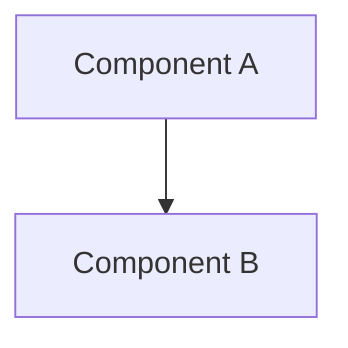

# Pelagos Documentation Standard

## 1. Purpose
This document establishes the canonical Markdown documentation standard for the Pelagos project. It defines a strict, maintainable convention compatible with Obsidian vaults, GitHub-rendered Markdown, and Git-based version control.

## 2. Scope
This standard applies to all substantive documentation within the Pelagos project, including architecture, requirements, decisions, specifications, and operational guides. It governs document identity, structure, formatting, traceability, and lifecycle.

## 3. Document Identity and Metadata

### 3.1 YAML Frontmatter
All substantive documents MUST include YAML frontmatter.

**Required Fields:**
* `title`: The human-readable title of the document.
* `document_id`: A unique identifier (e.g., `DOC-YYYYMMDD-XXXX`, `ADR-001`, `REQ-001`).
* `type`: The document type (see Permitted Document Types below).
* `status`: The current lifecycle state (see Permitted Statuses below).
* `created`: Creation date in `YYYY-MM-DD` format.
* `updated`: Last modification date in `YYYY-MM-DD` format.
* `tags`: A YAML list of relevant tags for knowledge graph discoverability.

**Conditional Fields:**
* `version`: Required for specifications, ADRs, and requirements. Uses Semantic Versioning (e.g., `1.0.0`) or simple versioning (e.g., `v1`).

**Example Frontmatter:**
```yaml
---
title: Initial Storage Architecture
document_id: ADR-001
type: adr
status: approved
version: 1.0
created: 2026-10-10
updated: 2026-10-10
tags:
  - architecture
  - database
  - postgresql
---
```

### 3.2 Permitted Values
**Document Types:** `project_overview`, `requirements`, `architecture_spec`, `adr`, `dataset_spec`, `api_spec`, `ml_spec`, `operational_routing`, `security_spec`, `testing_spec`, `runbook`, `research_notes`, `glossary`, `documentation_standard`.
**Statuses:** `planned`, `drafting`, `under_review`, `approved`, `rejected`, `superseded`, `deprecated`, `archived`.

### 3.3 Filename Conventions
Filenames must use `kebab-case.md` (e.g., `initial-storage-architecture.md`).

## 4. Canonical Document Structure

A baseline document template consists of the following sections. Sections may be marked as N/A but should not be arbitrarily omitted unless defined as inappropriate for the specific document type.

1. **Purpose** (Mandatory): What this document achieves.
2. **Scope** (Mandatory): The boundaries of what is covered.
3. **Background and Context** (Conditional): History and reasoning.
4. **Requirements and Constraints** (Conditional): Operational or technical limits.
5. **Design or Specification** (Conditional): Core technical content.
6. **Dependencies and Interfaces** (Conditional): Upstream/downstream links.
7. **Failure Modes and Limitations** (Conditional): What happens when things break.
8. **Security, Privacy and Licensing** (Conditional): Compliance and risks.
9. **Testing and Verification** (Conditional): How to prove correctness.
10. **Traceability** (Mandatory for specs/ADRs): Links to parent requirements or ADRs.
11. **Open Questions** (Mandatory if `status` is `drafting` or `under_review`): Unresolved items.
12. **Change History** (Mandatory): Table of revisions.

*Note: Short reference documents (like glossaries or quick runbooks) do not need to force every conditional section.*

## 5. Obsidian and GitHub Compatibility

To ensure dual compatibility between Git-based hosting (GitHub) and local knowledge graphs (Obsidian):

* **Markdown Links (Primary):** Standard relative Markdown links are MANDATORY for GitHub-compatible navigation.
  * Example: `[Architecture Spec](./architecture-spec.md)`
* **Wikilinks (Supplementary):** Obsidian wikilinks MAY supplement standard Markdown links for knowledge-graph traversal.
  * Example: `[[architecture-spec]]`
* **Cross-Document Relationships:** Important relationships should use both formats where appropriate to satisfy both platforms.
* **No Absolute Local Paths:** Links must never depend on absolute local machine paths (e.g., `/Users/name/...` or `C:\...`). Use relative paths.
* **Moves and Renames:** Moving or renaming a document requires reference validation across the repository.
* **Planned Documents:** Documents that do not exist yet must be explicitly identified as "Planned" and not silently treated as existing files in links.
* **Heading Anchors:** Link to headings using standard GitHub slugification: `[Section](#background-and-context)`.
* **Images and Attachments:** Use standard relative markdown embedding: ``.
* **Mermaid Diagrams:** Use standard triple-backtick mermaid blocks compatible with both platforms.



## 6. Document Types and Specialized Templates

* **Project Overview:** High-level vision. Must trace to top-level requirements.
* **Requirements (Functional/Nonfunctional):** Must be clear, testable, and explicitly distinguish planned vs. implemented features.
* **Architecture Specifications:** High-level design mapping components. Requires traceability to ADRs.
* **Architecture Decision Records (ADRs):** Must include Context, Decision, Consequences, and Alternatives Considered.
* **Dataset and Data-Provider Specifications:** Must trace to data sources, licenses, and API contracts.
* **API Specifications:** Defines endpoints, contracts, and error states.
* **ML Model Specifications:** Defines inputs, outputs, limitations, and traces to training data evidence.
* **Operational Maritime Routing Specifications:** Specific requirements regarding maritime routing logic and geopolitical risk awareness.
* **Security Specifications:** Threat models, mitigations, and boundary definitions.
* **Testing Specifications:** Test plans and coverage expectations.
* **Runbooks:** Actionable operational procedures.
* **Research Notes:** Experimental findings. *Must explicitly state they are not approved architecture decisions.*
* **Glossaries:** Domain terminology definitions.

## 7. Traceability and Source of Truth

Documents must explicitly link to their justifying sources. 

* Specifications must link to **Requirements** and **ADRs**.
* Implementation documentation must link to **Architecture Components** and **API contracts**.
* Dataset usage must link to **Data Sources and Licenses**.
* Features must link to **Tests and Implementation Evidence**.

**Authority Hierarchy:**
If documents conflict, authority flows in this order:
`Accepted Decisions (ADRs) > Requirements > Architecture Specifications > Implementation Contracts > Operational Documentation > Research Notes`.

Contradictory documents must not coexist without an explicit resolution process (e.g., opening a new ADR to supersede an old one). 

## 8. Documentation Quality Gates

All documentation is subject to the following policy validation requirements:

1. **Markdown and Frontmatter:** Must be syntactically valid and match this standard's schema.
2. **Duplicate IDs:** `document_id` fields must be strictly unique across the repository.
3. **Broken Links:** No broken relative links or heading anchors.
4. **Broken Wikilinks:** Wikilinks must point to valid nodes.
5. **Required Metadata:** Missing required YAML fields is a failure.
6. **Mermaid Diagrams:** Must be syntactically valid.
7. **Missing References:** Documents referenced in Traceability sections must exist.
8. **Secret Leakage:** No credentials, tokens, or personal machine paths may be committed.
9. **Traceability Validation:** Specs and decisions must link to upstream requirements.

*Note: These are policy requirements; automated CI validation tooling implementation is deferred.*

## 9. Document Lifecycle and Review

* **Drafting and Review:** Documents begin in `drafting`. When ready for peer feedback, they move to `under_review`. Open questions must be documented.
* **Approval and Rejection:** Only Project Overseers or designated maintainers may move a document to `approved` or `rejected`.
* **Superseding Documents:** When a document replaces another, the old document's status becomes `superseded`, and it must link to the new document.
* **Deprecation and Archival:** Outdated but historically relevant documents are marked `deprecated` or `archived`.
* **Change History:** Every document must maintain a change history table tracking revisions.
* **Truth in Status:** Documents must clearly distinguish between *planned*, *implemented*, *tested*, and *verified* functionality. Actual implementation, testing, and data availability must never be claimed without evidence.
* **Research Boundary:** Research findings and AI-generated explorations must not automatically become approved architecture decisions without formal ADR review.

## 10. Existing Project Decisions

This documentation standard operates within the boundaries of the following existing project decisions. These are confirmed constraints, not newly approved decisions created by this standard:

* **Frontend Foundation:** God's Eye View remains the frontend foundation, and its existing directory structure and content must be preserved.
* **Routing and Scope:** Pelagos is intended to support global routes and arbitrary vessel characteristics, subject to actual data coverage. Operational commercial-voyage routing is required; a shortest-sea-path line alone is insufficient.
* **Data Availability:** Prediction availability is dynamic per route; insufficient data must produce an explicit unavailable state.
* **Evidence and Integrity:** No synthetic observations may be used to fabricate training or evaluation evidence. Actual implementation, testing, and data availability must never be claimed without evidence.
* **Geopolitical Risk:** Geopolitical factors are in scope through a maritime risk and disruption capability.
* **Safety Class:** Pelagos is not a navigation-grade safety system.
* **Core Dependencies:** No OpenAI dependency is permitted in the core system.
* **Storage Technologies:** PostgreSQL and Parquet remain the intended initial storage technologies, subject to their approved architectural boundaries.
* **Architecture:** The modular-monolith approach should remain separable into services later if justified.
* **Deployment:** Kubernetes is not part of the initial deployment.
