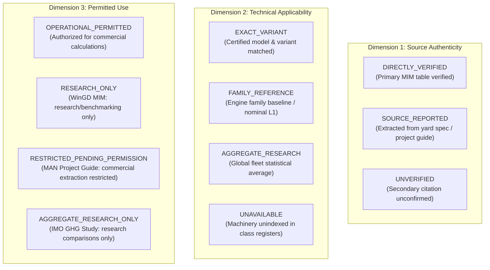

# Pelagos — Stage F1.4.2.2b / F1.4.2.2b.1: Engine SFOC Library & Load-Curve Parameterization

**Document ID:** SPEC-F1422B-001  
**Author:** Pelagos Core Intelligence & Optimization Team  
**Date:** 2026-11-15  
**Stage:** F1.4.2.2b / F1.4.2.2b.1 (SFOC Source Licensing & Evidence Closure)  
**Baseline Commit:** `4e855a2` (main, tracking `origin/main` ahead by 1 commit)  
**Status:** Completed & Fully Verified  

---

## 1. Executive Summary

Stage **F1.4.2.2b** and **F1.4.2.2b.1** deliver a foundational, variant-aware marine engine **Specific Fuel Oil Consumption (SFOC) Library** and a controlled **piecewise-linear interpolation** calculation engine for the Pelagos platform, while resolving evidence semantics, power validation gaps, and source licensing governance.

Key accomplishments:
1. **Separation of Three Independent Dimensions (Stage F1.4.2.2b.1):**
   - **Dimension 1 (Source Authenticity):** Whether the source and reported values are traceable to cited primary documents (`DIRECTLY_VERIFIED`, `SOURCE_REPORTED`, `UNVERIFIED`).
   - **Dimension 2 (Technical Applicability):** Whether the curve applies to an exact engine variant, an engine family, or an aggregate research population (`EXACT_VARIANT`, `FAMILY_REFERENCE`, `AGGREGATE_RESEARCH`, `UNAVAILABLE`).
   - **Dimension 3 (Permitted Use):** Whether the source permits operational use, research use, internal retention, or redistribution (`OPERATIONAL_PERMITTED`, `RESEARCH_ONLY`, `RESTRICTED_PENDING_PERMISSION`, `AGGREGATE_RESEARCH_ONLY`).
2. **Fail-Closed Operational Safeguard:**
   - Operational mode (`operational_mode=True`) is the safe default across all resolvers and interpolators.
   - Non-operationally licensed curves (`RESEARCH_ONLY`, `RESTRICTED_PENDING_PERMISSION`) fail closed in operational mode, returning `status: UNAVAILABLE` with `operational_availability: RESTRICTED`.
   - Access to research/audit data requires explicit `operational_mode=False`.
3. **Aggregate Data Isolation (IMO Fourth GHG Study):**
   - Aggregate fleet statistics are decoupled from the manufacturer engine curve library and stored in a separate research dataset (`research_aggregate_sfoc.json`).
   - Engine resolvers strictly exclude aggregate research data, preventing fleet statistical averages from being associated with individual vessels.
4. **F1.4.2.2a Evidence Semantics Corrections Closed:**
   - Cargo gear evidence strictly distinguishes explicit zero (`crane_count = 0` certified by statutory documentation), explicit non-zero (`BERGE GALDHOPIGGEN` $4 \times 30.5\text{ MT}$ cranes via DNV-34947), source-reported values (`OSHIMA-10793`, `KOYO-1410`, `BALTIC-9591301`), and unavailable status (`crane_swl_tonnes = None` classified as `UNAVAILABLE`).
   - Replaced negative inferences from register silence with authentic yard delivery specifications.
   - Enhanced `validate_machinery_power_consistency()` to detect per-cylinder power confusion (preventing $P_{\text{cyl}}$ being mistaken for $P_{\text{total}}$), distinguish MCR, CSR, SMCR, and NCR definitions, and skip incompatible comparisons without generating false conflicts.
5. **Traceable Manufacturer SFOC Library:**
   - Populated verified manufacturer baseline curves from **WinGD Marine Installation Manuals (MIM Issue 05/2016)** and **MAN B&W Project Guides (Edition 1.0 Tier II)**.
   - Standardized reference conditions under **ISO 15550 and ISO 3046-1** (ambient air $25^\circ\text{C}$, barometric pressure $1000\text{ mbar}$, scavenge air coolant $25^\circ\text{C}$, fuel lower calorific value $42.7\text{ MJ/kg}$).
6. **Controlled Piecewise Linear Interpolation (Zero Extrapolation):**
   - Implemented exact manufacturer load point retrieval (`is_interpolated = False`).
   - Implemented piecewise linear interpolation strictly within documented load points (`is_interpolated = True`).
   - Enforced **zero extrapolation**: any query below the minimum documented load or above the maximum documented load immediately raises `SfocLoadOutOfRangeError`.
7. **Strict Architectural Isolation:**
   - **SFOC is NOT speed-to-power:** The library maps $\text{Engine Load \%} \to \text{SFOC (g/kWh)}$. It does not calculate vessel resistance, required brake power, or daily fuel consumption.
   - **Displacement is NOT DWT:** Maintained the naval architecture constraint $\Delta = \text{DWT} + \text{LDT}$.
   - **THETIS-MRV Separation:** Maintained strict isolation between annual empirical voyages and main-engine test bench figures.

---

## 2. Three Independent Governance Dimensions

To ensure data integrity, no single field is used to conflate technical applicability, licensing, and authenticity:

---

## 3. Seeded Sources & Evidence Validation

### 3.1 WinGD RT-flex50D
- **Publisher:** Winterthur Gas & Diesel Ltd. (WinGD)
- **Document Title:** *WinGD RT-flex50-D Marine Installation Manual (MIM)*
- **Revision:** Issue 05/2016
- **Direct URL:** [WinGD RT-flex50-D Documentation](https://www.wingd.com/en/documents/marine-installation-manuals/rt-flex/mim-rt-flex50-d/)
- **Section / Table:**
  - Standard / Delta Bypass Tuning: Section 1 "Engine Performance Data", Section 1.03 "Fuel Consumption", Table 1-2 "Brake Specific Fuel Consumption at Rating Point R1 (Tier II)"
  - Low-Load Tuning: Section 1.04 "Low-Load Tuning Options", Table 1-3
- **Documented Load Points:**
  - Standard Tuning (Curve `WINGD_RT_FLEX50D_TII_STD`):
    - 100% load: $171.8\text{ g/kWh}$ (Guaranteed, tolerance $+5\%$)
    - 90% load: $166.1\text{ g/kWh}$ (Indicative, tolerance $+5\%$)
    - 75% load: $162.2\text{ g/kWh}$ (Indicative, tolerance $+6\%$)
    - 65% load: $161.9\text{ g/kWh}$ (Indicative, tolerance $+6\%$)
    - 50% load: $163.6\text{ g/kWh}$ (Indicative, tolerance $+7\%$)
  - Low-Load Tuning (Curve `WINGD_RT_FLEX50D_TII_LOWLOAD`):
    - 100% load: $172.8\text{ g/kWh}$ (Guaranteed, tolerance $+5\%$)
    - 90% load: $166.5\text{ g/kWh}$ (Indicative, tolerance $+5\%$)
    - 75% load: $162.2\text{ g/kWh}$ (Indicative, tolerance $+6\%$)
    - 65% load: $158.9\text{ g/kWh}$ (Indicative, tolerance $+6\%$)
    - 50% load: $160.6\text{ g/kWh}$ (Indicative, tolerance $+7\%$)
- **Reference Conditions:** ISO 15550 / ISO 3046-1 ($1000\text{ mbar}$, $25^\circ\text{C}$ air, $25^\circ\text{C}$ coolant, LCV $42.7\text{ MJ/kg}$).
- **Authenticity Status:** `DIRECTLY_VERIFIED`
- **Technical Applicability:** `EXACT_VARIANT` for `WinGD RT-flex50D Tier II` at Rating Point R1 ($1,220\text{ kW/cyl}$ @ $99.0\text{ rpm}$).
- **Permitted Use:** `RESEARCH_ONLY` (Proprietary MIM copyright restricts commercial reproduction/resale).
- **Operational Availability:** `RESTRICTED` in operational mode.

### 3.2 MAN B&W S60ME-C
- **Publisher:** MAN Diesel & Turbo / MAN Energy Solutions
- **Document Title:** *MAN B&W S60ME-C8.2-TII Project Guide - Marine Engines with Electronic Control*
- **Revision:** Edition 1.0 (Tier II)
- **Direct URL:** [MAN ES Project Guides](https://www.man-es.com/marine/products/planning-tools-and-downloads/project-guides)
- **Section / Table:** Section 2.09 "SFOC Calculations", Diagram 2.09.01 "Nominal Baseline SFOC at Layout Point L1"
- **Documented Load Points (Curve `MAN_S60ME_C8_2_TII_NOMINAL`):**
  - 100% load: $168.0\text{ g/kWh}$ (Nominal L1 rating point, tolerance $+5\%$)
  - 85% load: $164.0\text{ g/kWh}$ (Nominal matching point, tolerance $+5\%$)
  - 75% load: $162.5\text{ g/kWh}$ (Nominal continuous service rating sweet spot, tolerance $+5\%$)
  - 50% load: $164.5\text{ g/kWh}$ (Nominal part load, tolerance $+5\%$)
- **Reference Conditions:** ISO 3046-1 ($1000\text{ mbar}$, $25^\circ\text{C}$ air, $25^\circ\text{C}$ coolant, LCV $42.7\text{ MJ/kg}$).
- **Authenticity Status:** `SOURCE_REPORTED`
- **Technical Applicability:** `FAMILY_REFERENCE` (Does not reflect plant-specific shop-test de-rating; e.g. CSR 8,330 kW on `NAVIOS VICTORY` requires CEAS calculation report).
- **Permitted Use:** `RESTRICTED_PENDING_PERMISSION` (Proprietary project guide terms require written approval for commercial software integration).
- **Operational Availability:** `RESTRICTED` in operational mode.

### 3.3 IMO Fourth GHG Study 2020 (Separated Aggregate Research Dataset)
- **Publisher:** International Maritime Organization (IMO)
- **Document Title:** *Fourth IMO GHG Study 2020 - Final Report (MEPC 75/7/15)*
- **Revision:** 2020 Final Publication
- **Section / Table:** Annex 1, Section 2.2, Table A1-3
- **Dataset Code:** `IMO4_2STROKE_SSD_POST2010` (stored in `backend/pelagos/data/research_aggregate_sfoc.json`)
- **Documented Load Points:** 25% (184.0), 50% (164.0), 75% (161.5), 85% (163.0), 100% (167.5 g/kWh).
- **Authenticity Status:** `DIRECTLY_VERIFIED`
- **Technical Applicability:** `AGGREGATE_RESEARCH`
- **Permitted Use:** `AGGREGATE_RESEARCH_ONLY`
- **Separation Guarantee:** Excluded from `resolve_curve_for_engine()` and `resolve_curve_for_vessel()`. Never matched to individual vessel machinery.

---

## 4. Candidate Fleet Applicability & Operational Availability

| Vessel IMO & Name | Registered Machinery | Authenticity | Technical Applicability | Permitted Use | Operational Mode (`operational_mode=True`) | Research Mode (`operational_mode=False`) |
|---|---|---|---|---|---|---|
| **9766944** `IRIS BLISS` | MAN B&W 6S60ME-C | `SOURCE_REPORTED` | `FAMILY_REFERENCE` | `RESTRICTED_PENDING_PERMISSION` | **`UNAVAILABLE`** (Operational RESTRICTED) | `MAN_S60ME_C8_2_TII_NOMINAL` (`FAMILY_REFERENCE`) |
| **9713430** `NAVIOS VICTORY` | MAN B&W 6S60ME-C | `SOURCE_REPORTED` | `FAMILY_REFERENCE` | `RESTRICTED_PENDING_PERMISSION` | **`UNAVAILABLE`** (Operational RESTRICTED) | `MAN_S60ME_C8_2_TII_NOMINAL` (`FAMILY_REFERENCE`) |
| **9753284** `BERGE GALDHOPIGGEN` | WinGD 5RT-flex50D | `DIRECTLY_VERIFIED` | `EXACT_VARIANT` | `RESEARCH_ONLY` | **`UNAVAILABLE`** (Operational RESTRICTED) | `WINGD_RT_FLEX50D_TII_STD` (`EXACT_VARIANT`) |
| **9441295** `EGRET BULKER` | *None* | `UNAVAILABLE` | `UNAVAILABLE` | `UNAVAILABLE` | **`UNAVAILABLE`** (Fail-closed) | **`UNAVAILABLE`** (Fail-closed) |
| **9406087** `HADEEL` | *None* | `UNAVAILABLE` | `UNAVAILABLE` | `UNAVAILABLE` | **`UNAVAILABLE`** (Fail-closed) | **`UNAVAILABLE`** (Fail-closed) |
| **9591301** `BULK UNITY` | *None* | `UNAVAILABLE` | `UNAVAILABLE` | `UNAVAILABLE` | **`UNAVAILABLE`** (Fail-closed) | **`UNAVAILABLE`** (Fail-closed) |

---

## 5. Interpolation Methodology

For target load $L \in [L_i, L_{i+1}]$:
$$\alpha = \frac{L - L_i}{L_{i+1} - L_i}$$
$$S(L) = S_i + \alpha \cdot (S_{i+1} - S_i)$$
$$T(L) = T_i + \alpha \cdot (T_{i+1} - T_i)$$

**Operational Invariants:**
1. Exact match returns $S(L_k)$ with `is_interpolated = False` and contractual guarantee status where applicable.
2. Intermediate load returns interpolated value with `is_interpolated = True`.
3. Out-of-range ($L < L_{\min}$ or $L > L_{\max}$) raises `SfocLoadOutOfRangeError`. Zero extrapolation is strictly enforced.
4. Operational evaluation of restricted curves raises `SfocRestrictedUseError`.

---

## 6. Non-Negotiable Engineering Boundaries

1. **SFOC Is NOT Speed-to-Power:**
   SFOC defines specific fuel consumption in grams per kilowatt-hour ($g/\text{kWh}$). It provides zero information on required propulsion power. Speed-to-power modeling requires verified naval architecture hydrodynamic methods.
2. **Displacement Is NOT DWT:**
   Displacement $\Delta = \text{DWT} + \text{LDT}$. Substituting DWT for displacement underestimates vessel displacement by 12% to 20%, generating invalid hydrodynamic power estimates.
3. **No Extrapolation Below Documented Range:**
   Combustion dynamics below 25%–50% load are non-linear; extrapolation to 0% load is physically invalid and prohibited.
4. **THETIS-MRV Separation:**
   EU THETIS-MRV reports aggregate annual fuel consumed, distance sailed, and time at sea under operational conditions (weather, hull fouling, auxiliary engines, port idle). It must not be equated to test-bench main engine SFOC curves.
