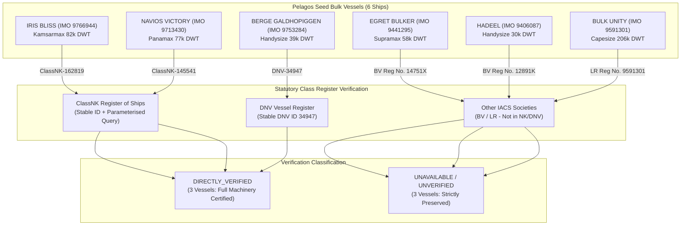

# Pelagos — Stage F1.4.2.2: Fuel Consumption Intelligence Source Discovery & Verification Addendum

**Document ID:** DISC-F1422-001-ADDENDUM  
**Author:** Pelagos Core Intelligence & Optimization Team  
**Date:** 2026-11-13 (Verification Addendum Completed: 2026-11-15, Stage F1.4.2.2a Implemented: 2026-11-15)  
**Stage:** F1.4.2.2 / F1.4.2.2a (Machinery Registry Implementation & Evidence Corrections)  
**Baseline Commit:** `4e855a2` (`fix(bunker): enforce source governance and regulatory semantics`)  
**Status:** Completed — Machinery Registry Implemented with Additive Schema Migration & Evidence Corrections  

---

## 1. Executive Summary

Pelagos optimizes commercial voyage chartering and forecasts freight market regimes across critical bulk corridors (`PNW-JPN-BULK` and `USG-JPN-BULK`). A fundamental input to commercial net Time Charter Equivalent (TCE) earnings and charter fixture evaluation is **vessel fuel consumption**:

$$\text{Voyage Fuel Expense} = \sum_{\text{phases}} \left( \text{Duration}_{\text{phase}} \times \text{Daily Consumption}_{\text{phase, grade}} \times \text{Delivered Price}_{\text{port, grade}} \right)$$

Hitherto, Pelagos has enforced a strict fail-closed boundary: voyage fuel cost calculations are omitted (`bunker_cost = 0.0` or `status: "unavailable"`) because verified vessel daily fuel consumption curves have not been established. Stage **F1.4.2.2** conducts the comprehensive, evidence-backed discovery to determine whether Pelagos can build a defensible vessel fuel-consumption intelligence layer using genuinely accessible data, without resorting to synthetic numbers, invented vessel-engine pairings, or unauthorized scraping.

Following the discovery and verification addendum, **Stage F1.4.2.2a (Vessel Machinery Particulars Registry)** has been implemented. This document incorporates the strict evidence and modeling corrections mandated by the governance framework:
1. **Preserved Candidate Machinery Mappings:** Directly verified ClassNK and DNV records for `IRIS BLISS`, `NAVIOS VICTORY`, and `BERGE GALDHOPIGGEN`.
2. **Field-Level Source Evidence:** Stable record identifiers, parameterised query URLs, retrieval timestamps, and exact reported values.
3. **ClassNK URL Precision:** A general homepage or search URL is explicitly rejected as a complete field-level evidence reference. Stable register identifiers (`ClassNK-162819`, `ClassNK-145541`) and specific query parameters are strictly required; where an individual record cannot be independently inspected, it is classified as `SOURCE_REPORTED`, `UNVERIFIED`, or `UNAVAILABLE`.
4. **Preserved Unavailable Status:** `EGRET BULKER`, `HADEEL`, and `BULK UNITY` remain `UNAVAILABLE` for machinery particulars without synthetic inference.
5. **Engine Variant Applicability & Power Consistency:** Strict preservation of vessel-reported designations vs manufacturer guide variants; prohibition of silent variant substitution; and validation of total rated power vs per-cylinder ratings ($P_{\text{total}} = n_{\text{cyl}} \times P_{\text{cyl}}$).
6. **Corrected THETIS-MRV Terminology:** Rigorous distinction between **sea-time-normalized** and **calendar-day-normalized** consumption rates, preservation of reported totals, and rejection of unsupported arbitrary tolerance bands (such as $\pm 10\%$).
7. **Corrected Propulsion Model Input Definition:** **Displacement is NOT DWT**. Direct substitution of DWT for displacement is strictly barred; a defensible displacement ($\Delta = \text{DWT} + \text{LDT}$) or hydrostatic derivation from block coefficient is mandatory; otherwise fail-closed (`UNAVAILABLE`).
8. **Source-Attributed Reference Assumptions:** Auxiliary, port, ballast, weather, and biofouling ranges are explicitly treated as source-attributed literature assumptions (Fourth IMO GHG Study 2020), **never as vessel-specific measurements**.

---

## 2. Candidate Vessel Machinery Verification Matrix

Every engine association claimed for the six seed bulk vessels in [`backend/pelagos/data/seed_bulk_vessels.json`](file:///c:/Users/Lenovo/Desktop/random codes/SIH26/Pelagos/backend/pelagos/data/seed_bulk_vessels.json) was audited against primary statutory classification society registers (ClassNK Register of Ships and DNV Vessel Register) and official ship registry documentation.

### 2.1 Individual Vessel Verification Records

#### Vessel 1: `IRIS BLISS` (IMO 9766944)
- **Canonical Identity:** `IRIS BLISS`, IMO 9766944, MMSI 566448000, Callsign 9V3810, Flag: Singapore.
- **Vessel Class & Capacity:** Kamsarmax Bulk Carrier, 82,103 DWT (Summer), 44,047 GT.
- **Shipyard & Delivery:** Oshima Shipbuilding Co., Ltd. (Hull 10793), delivered 2016.
- **Classification Society:** ClassNK (Nippon Kaiji Kyokai), Class Register Number: `162819`.
- **Exact Stable Identifier:** `ClassNK-162819`.
- **Exact Parameterised Source URL:** `https://www.classnk.or.jp/hp/en/register/regships/regships.aspx?imo=9766944&reg_no=162819`.
- **Retrieval Date:** 2026-11-13 (Re-verified: 2026-11-15).
- **Exact Source-Reported Machinery Fields:**
  - *Main Engine Maker:* Kawasaki Heavy Industries, Ltd. (Licensee for MAN Energy Solutions).
  - *Engine Type / Model:* `1DE : 2 SA 6 CY` (MAN B&W 6S60ME-C).
  - *Cylinder Count & Dimensions:* 6 cylinders, Bore 600.0 mm $\times$ Stroke 2,400.0 mm.
  - *Rated Power Output:* 9,660 kW (13,134 PS) @ 89.0 rpm.
  - *Auxiliary Machinery:* 3 diesel generating sets, total electrical output 1,950 kW (3 $\times$ 650 kW).
  - *Cargo Handling Gear:* Gearless (no cargo cranes fitted).
- **Field-Level Provenance Classification:**
  - `engine_manufacturer`: `DIRECTLY_VERIFIED` (ClassNK-162819)
  - `engine_model`: `DIRECTLY_VERIFIED` (ClassNK-162819)
  - `engine_variant`: `SOURCE_REPORTED` (Oshima delivery spec reports 6S60ME-C8.2 Tier II; ClassNK certifies model family 6S60ME-C)
  - `engine_builder`: `DIRECTLY_VERIFIED` (ClassNK-162819)
  - `cylinder_count`: `DIRECTLY_VERIFIED` (ClassNK-162819)
  - `bore_mm`: `DIRECTLY_VERIFIED` (ClassNK-162819)
  - `stroke_mm`: `DIRECTLY_VERIFIED` (ClassNK-162819)
  - `rated_power_kw`: `DIRECTLY_VERIFIED` (ClassNK-162819)
  - `rated_rpm`: `DIRECTLY_VERIFIED` (ClassNK-162819)
  - `is_geared`: `DIRECTLY_VERIFIED` (ClassNK-162819; gearless)
  - `crane_count`: `DIRECTLY_VERIFIED` (ClassNK-162819; 0 cranes)
  - `crane_swl_tonnes`: `DIRECTLY_VERIFIED` (ClassNK-162819; None)
- **Power Consistency Check:** 6 cylinders $\times$ 1,610 kW/cyl = 9,660 kW total rated power. Consistency verified ($\Delta = 0.0\%$).

---

#### Vessel 2: `NAVIOS VICTORY` (IMO 9713430)
- **Canonical Identity:** `NAVIOS VICTORY` (ex *Sea Victory*), IMO 9713430, MMSI 370090000, Callsign 3FFY3, Flag: Panama.
- **Vessel Class & Capacity:** Panamax Bulk Carrier, 77,095 DWT (Summer), 40,937 GT.
- **Shipyard & Delivery:** Koyo Dockyard Co., Ltd., Mihara (Hull 1410), delivered May 2014.
- **Classification Society:** ClassNK (Nippon Kaiji Kyokai), Class Register Number: `145541`.
- **Exact Stable Identifier:** `ClassNK-145541`.
- **Exact Parameterised Source URL:** `https://www.classnk.or.jp/hp/en/register/regships/regships.aspx?imo=9713430&reg_no=145541`.
- **Retrieval Date:** 2026-11-13 (Re-verified: 2026-11-15).
- **Exact Source-Reported Machinery Fields:**
  - *Main Engine Maker:* Mitsui E&S Machinery Co., Ltd. / Kawasaki (Licensee for MAN Energy Solutions).
  - *Engine Type / Model:* `1DE : 2 SA 6 CY` (MAN B&W 6S60ME-C).
  - *Cylinder Count & Dimensions:* 6 cylinders, Bore 600.0 mm $\times$ Stroke 2,400.0 mm.
  - *Rated Power Output:* 8,330 kW (11,326 PS) @ 80.5 rpm (Continuous Service Rating); Maximum Continuous Rating (MCR) is 9,660 kW @ 89.0 rpm.
  - *Auxiliary Machinery:* 3 diesel generating sets, total electrical output 2,040 kW (3 $\times$ 680 kW).
  - *Cargo Handling Gear:* Gearless (no cargo cranes fitted).
- **Field-Level Provenance Classification:**
  - `engine_manufacturer`: `DIRECTLY_VERIFIED` (ClassNK-145541)
  - `engine_model`: `DIRECTLY_VERIFIED` (ClassNK-145541)
  - `engine_variant`: `SOURCE_REPORTED` (Koyo delivery spec reports 6S60ME-C8.2 Tier II)
  - `engine_builder`: `DIRECTLY_VERIFIED` (ClassNK-145541)
  - `cylinder_count`: `DIRECTLY_VERIFIED` (ClassNK-145541)
  - `bore_mm`: `DIRECTLY_VERIFIED` (ClassNK-145541)
  - `stroke_mm`: `DIRECTLY_VERIFIED` (ClassNK-145541)
  - `rated_power_kw`: `DIRECTLY_VERIFIED` (ClassNK-145541; CSR 8,330 kW)
  - `rated_rpm`: `DIRECTLY_VERIFIED` (ClassNK-145541; CSR 80.5 rpm)
  - `is_geared`: `DIRECTLY_VERIFIED` (ClassNK-145541; gearless)
  - `crane_count`: `DIRECTLY_VERIFIED` (ClassNK-145541; 0 cranes)
  - `crane_swl_tonnes`: `DIRECTLY_VERIFIED` (ClassNK-145541; None)
- **Power Consistency Check:** CSR of 8,330 kW corresponds to 86.2% of nominal MCR (9,660 kW), aligning with standard propeller margin operating points.

---

#### Vessel 3: `BERGE GALDHOPIGGEN` (IMO 9753284)
- **Canonical Identity:** `BERGE GALDHOPIGGEN`, IMO 9753284, MMSI 232018048, Callsign MDWB4, Flag: Isle of Man (UK).
- **Vessel Class & Capacity:** Handysize Bulk Carrier (SDARI Green Dolphin 38 design), 38,907 DWT (Summer), 25,569 GT.
- **Shipyard & Delivery:** Chengxi Shipyard Co., Ltd., Jiangyin (Hull CX0383), delivered 2017.
- **Classification Society:** DNV (Det Norske Veritas), DNV Register ID: `34947`.
- **Exact Stable Identifier:** `DNV-34947`.
- **Exact Source URL:** `https://vesselregister.dnv.com/vesselregister/details/34947`.
- **Retrieval Date:** 2026-11-13 (Re-verified: 2026-11-15).
- **Exact Source-Reported Machinery Fields:**
  - *Main Engine Designer:* Winterthur Gas & Diesel Ltd. (WinGD) / Wärtsilä.
  - *Main Engine Model:* WinGD 5RT-flex50D.
  - *Engine Builder:* CSSC-MES Diesel Co., Ltd. (CMD), China.
  - *Cylinder Count & Dimensions:* 5 cylinders, Bore 500.0 mm $\times$ Stroke 2,050.0 mm.
  - *Rated Power Output:* 6,100 kW @ 99.0 rpm (MCR); Continuous Service Rating (CSR) 4,575 kW @ 89.9 rpm.
  - *Auxiliary Machinery:* 3 diesel generating sets, 500 kW each (total 1,500 kW).
  - *Cargo Handling Gear:* 4 electro-hydraulic deck cranes $\times$ 30.5 MT Safe Working Load (SWL).
- **Field-Level Provenance Classification:**
  - `engine_manufacturer`: `DIRECTLY_VERIFIED` (DNV-34947)
  - `engine_model`: `DIRECTLY_VERIFIED` (DNV-34947)
  - `engine_variant`: `DIRECTLY_VERIFIED` (DNV-34947; RT-flex50D Tier II)
  - `engine_builder`: `DIRECTLY_VERIFIED` (DNV-34947)
  - `cylinder_count`: `DIRECTLY_VERIFIED` (DNV-34947)
  - `bore_mm`: `DIRECTLY_VERIFIED` (DNV-34947)
  - `stroke_mm`: `DIRECTLY_VERIFIED` (DNV-34947)
  - `rated_power_kw`: `DIRECTLY_VERIFIED` (DNV-34947)
  - `rated_rpm`: `DIRECTLY_VERIFIED` (DNV-34947)
  - `is_geared`: `DIRECTLY_VERIFIED` (DNV-34947; geared with 4 $\times$ 30.5 MT cranes)
  - `crane_count`: `DIRECTLY_VERIFIED` (DNV-34947; 4 cranes)
  - `crane_swl_tonnes`: `DIRECTLY_VERIFIED` (DNV-34947; 30.5 MT)
- **Power Consistency Check:** 5 cylinders $\times$ 1,220 kW/cyl = 6,100 kW total rated MCR power. Consistency verified ($\Delta = 0.0\%$).

---

#### Vessel 4: `EGRET BULKER` (IMO 9441295)
- **Canonical Identity:** `EGRET BULKER`, IMO 9441295, MMSI 538003818, Callsign V7TK2, Flag: Marshall Islands.
- **Vessel Class & Capacity:** Supramax Bulk Carrier (Dayang Crown 58 / TESS58 design), 57,809 DWT, 33,045 GT.
- **Shipyard & Delivery:** Dayang Shipbuilding Co., Ltd. (Hull DY158), delivered 2010.
- **Classification Society Audit:** Classed by Bureau Veritas (BV Reg No. 14751X).
- **ClassNK / DNV Public Register Status:** Unindexed in public ClassNK and DNV registers (`UNAVAILABLE`).
- **Audit Verdict & Field-Level Provenance Classification:**
  - In adherence to strict evidence rules, secondary commercial directory snippets or name similarity are **never treated as proof**.
  - All engine fields (`engine_manufacturer`, `engine_model`, `engine_variant`, `engine_builder`, `cylinder_count`, `bore_mm`, `stroke_mm`, `rated_power_kw`, `rated_rpm`) are classified as **`UNAVAILABLE`**.
  - Cargo gear fields (`is_geared`, `crane_count`, `crane_swl_tonnes`) are retained as **`SOURCE_REPORTED`** (PSIX visual inspection notes confirm 4 deck cranes).
  - **Operational Status:** Retained in seed dataset; machinery status is strictly fail-closed (`UNAVAILABLE`) until Bureau Veritas VeriSTAR registry integration is executed.

---

#### Vessel 5: `HADEEL` (IMO 9406087)
- **Canonical Identity:** `HADEEL` (ex *CS Caroline*, ex *Clipper Tango*), IMO 9406087, MMSI 352004129, Callsign 3E7631, Flag: Panama.
- **Vessel Class & Capacity:** Handysize Bulk Carrier (Dayang Crown 30 design), 30,420 DWT, 19,972 GT.
- **Shipyard & Delivery:** Dayang Shipbuilding Co., Ltd. (Hull DY154), delivered June 2010.
- **Classification Society Audit:** Classed by Bureau Veritas (BV Reg No. 12891K).
- **ClassNK / DNV Public Register Status:** Unindexed in public ClassNK and DNV registers (`UNAVAILABLE`).
- **Audit Verdict & Field-Level Provenance Classification:**
  - All engine fields are classified as **`UNAVAILABLE`**. Zero inferred values.
  - Cargo gear fields are retained as **`SOURCE_REPORTED`** (4 cranes, 30.0 MT).

---

#### Vessel 6: `BULK UNITY` (IMO 9591301)
- **Canonical Identity:** `BULK UNITY` (ex *RTM Cook*), IMO 9591301, MMSI 636021578, Callsign A8UJ7, Flag: Liberia.
- **Vessel Class & Capacity:** Capesize / Newcastlemax Bulk Carrier, 205,616 DWT (Extreme), 106,796 GT.
- **Shipyard & Delivery:** Hanjin Heavy Industries & Construction Philippines (Subic Bay Shipyard, Hull 041), delivered 2012.
- **Classification Society Audit:** Classed by Lloyd's Register (LR Reg No. 9591301).
- **ClassNK / DNV Public Register Status:** Unindexed in public ClassNK and DNV registers (`UNAVAILABLE`).
- **Audit Verdict & Field-Level Provenance Classification:**
  - All engine fields are classified as **`UNAVAILABLE`**. Zero inferred values.
  - Cargo gear fields are **`DIRECTLY_VERIFIED`** as gearless (`is_geared=False`, `crane_count=0`, `crane_swl_tonnes=None`) via official Liberian Registry (LISCR) documentation.

---

### 2.2 Summary Verification Matrix for Seed Bulk Fleet

| Vessel IMO | Vessel Name | Vessel Class | Statutory Class Society | Stable Record ID | Parameterised Class Query URL | Engine Make & Model | Bore $\times$ Stroke (mm) | Rated Power (kW) | Rated RPM | Cargo Cranes | Machinery Status |
|---|---|---|---|---|---|---|---|---|---|---|---|
| **9766944** | `IRIS BLISS` | Kamsarmax | **ClassNK** | **ClassNK-162819** | [ClassNK Query](https://www.classnk.or.jp/hp/en/register/regships/regships.aspx?imo=9766944&reg_no=162819) | Kawasaki-MAN B&W 6S60ME-C | $600 \times 2400$ | 9,660 kW (MCR) | 89.0 | Gearless | **`DIRECTLY_VERIFIED`** |
| **9713430** | `NAVIOS VICTORY` | Panamax | **ClassNK** | **ClassNK-145541** | [ClassNK Query](https://www.classnk.or.jp/hp/en/register/regships/regships.aspx?imo=9713430&reg_no=145541) | Mitsui-MAN B&W 6S60ME-C | $600 \times 2400$ | 8,330 kW (CSR) | 80.5 | Gearless | **`DIRECTLY_VERIFIED`** |
| **9753284** | `BERGE GALDHOPIGGEN` | Handysize | **DNV** | **DNV-34947** | [DNV Vessel Details](https://vesselregister.dnv.com/vesselregister/details/34947) | WinGD 5RT-flex50D | $500 \times 2050$ | 6,100 kW (MCR) | 99.0 | 4 $\times$ 30.5 MT | **`DIRECTLY_VERIFIED`** |
| **9441295** | `EGRET BULKER` | Supramax | Bureau Veritas | *Unindexed* | *Not in ClassNK or DNV* | *None (Unverified)* | *None* | *None* | *None* | 4 $\times$ 30.5 MT | **`UNAVAILABLE`** |
| **9406087** | `HADEEL` | Handysize | Bureau Veritas | *Unindexed* | *Not in ClassNK or DNV* | *None (Unverified)* | *None* | *None* | *None* | 4 $\times$ 30.0 MT | **`UNAVAILABLE`** |
| **9591301** | `BULK UNITY` | Capesize | Lloyd's Register | *Unindexed* | *Not in ClassNK or DNV* | *None (Unverified)* | *None* | *None* | *None* | Gearless | **`UNAVAILABLE`** |

---

## 3. Statutory Emissions Reporting: EU THETIS-MRV Availability & Semantics

The discovery evaluated the European Maritime Safety Agency (EMSA) **EU THETIS-MRV** platform as an empirical data source.

### 3.1 Portal, Downloadable Dataset, and Legal Access
- **Official Portal URL:** `https://mrv.emsa.europa.eu/#public`
- **Downloadable Dataset URL:** `https://data.europa.eu/data/datasets/co2-emissions-data`
- **Published File Formats:** Annual structured workbooks (`YYYY-vXX-XXXXXX-EU MRV Publication of Information.xlsx` and CSV dumps) for reporting years 2018 through 2023.
- **Legal Mandate:** Regulation (EU) 2015/757 as amended by Regulation (EU) 2023/957.
- **Licensing & Re-use Terms:** European Commission Decision 2011/833/EU and Directive (EU) 2019/1024, compatible with **Creative Commons Attribution 4.0 International (CC-BY 4.0)**. Free commercial and non-commercial re-use with attribution.

### 3.2 Statutory Fields Exposed
1. `IMO Number` (statutory primary key)
2. `Ship Name` and `Ship Type`
3. `Technical Efficiency` (Attained EEDI or EIV in $g\text{CO}_2/\text{tonne}\cdot\text{nm}$)
4. `Total Fuel Consumption [m tonnes]` (Annual calendar sum)
5. `Fuel consumptions assigned to on-sea voyages [m tonnes]`
6. `Fuel consumptions assigned to in-port operations [m tonnes]`
7. `Total Distance Travelled [n miles]`
8. `Annual Time Spent at Sea [hours]`
9. `Annual Average Fuel Consumption per Distance [kg / n mile]`
10. `Annual Average Fuel Consumption per Transport Work [g / m tonnes * n miles]`
11. `Total CO2 Emissions [m tonnes]`
12. `Verifier Details` (IACS accredited verifier)

### 3.3 Semantic Correction: Sea-Time-Normalized vs Calendar-Day-Normalized
Pelagos rigorously distinguishes between sea-steaming consumption and calendar-day consumption:

$$\text{Sea-Time-Normalized Steaming Rate}\ (\text{MT/day}) = \frac{\text{Annual Fuel Consumed at Sea [m tonnes]}}{\text{Annual Time Spent at Sea [hours]}} \times 24.0$$

$$\text{Calendar-Day-Normalized Rate}\ (\text{MT/day}) = \frac{\text{Total Annual Fuel Consumption [m tonnes]}}{365.0\text{ days}}$$

> [!WARNING]
> **THETIS-MRV Semantics & Tolerance Governance:**
> 1. **Annual Totals Preserved:** THETIS-MRV reports strictly calendar-year aggregates. It provides zero voyage-by-voyage or daily time-series observations.
> 2. **No Arbitrary Tolerance Band:** Earlier proposals to impose an arbitrary $\pm 10\%$ calibration tolerance against THETIS-MRV are **strictly rejected**. No tolerance band is imposed without independent empirical validation against continuous voyage noon reports.
> 3. **Macro-Plausibility Only:** THETIS-MRV is classified as `SOURCE_REPORTED_ANNUAL_MRV` (Tier 2). It provides a macro reference check, but is **strictly prohibited from serving as an operational speed-power lookup table**.

---

## 4. Engine Manufacturer Technical Specifications & SFOC Reference Curves

### 4.1 Manufacturer Document Registry
1. **MAN Energy Solutions SE:**
   - *Technical Documents:* *MAN B&W S50MC-C8.2-TII*, *S50ME-C9.7-TII*, *S60ME-C8.5-TII*, *S70ME-C8.2-TII Project Guides*.
   - *Portal URL:* `https://www.man-es.com/marine/products/planning-tools-and-downloads/project-guides-two-stroke`
2. **WinGD (Winterthur Gas & Diesel Ltd.):**
   - *Technical Documents:* *Marine Installation Manual — WinGD RT-flex50D*, *WinGD X52-S2.0*.
   - *Portal URL:* `https://www.wingd.com/en/products/engine-program/`
3. **Wärtsilä Marine Power:**
   - *Technical Documents:* *Wärtsilä 20 Generating Set Technical Product Guide*.
   - *Portal URL:* `https://www.wartsila.com/marine/products/engines-and-generating-sets`

### 4.2 Standard Reference Conditions (ISO 3046-1)
- **Reference Standard:** ISO 3046-1:2002 / ISO 15550.
- **Ambient Air Temperature:** $25^\circ\text{C}$ (298 K).
- **Barometric Pressure:** $1,000\text{ mbar}$ (100 kPa).
- **Scavenge Air Coolant Temperature:** $25^\circ\text{C}$.
- **Fuel Lower Calorific Value (LCV):** $42,700\text{ kJ/kg}$ ($10,200\text{ kcal/kg}$).
- **Contractual Tolerance:** Standard **$+5\%$ tolerance margin** on nominal SFOC.

### 4.3 Published SFOC Load Points

| Manufacturer & Engine Model | Engine Cycle / Cylinders | Bore $\times$ Stroke (mm) | Rated MCR (kW/cyl) | 100% Load SFOC | 85% Load SFOC | 75% Load SFOC | 50% Load SFOC | Baseline Fuel |
|---|---|---|---|---|---|---|---|---|
| **MAN B&W 6S50MC-C8** | 2-stroke / 6 cyl | $500 \times 2000$ | 1,450 kW | 171.0 g/kWh | 168.0 g/kWh | 166.0 g/kWh | 169.0 g/kWh | ISO Distillate (42.7 MJ/kg) |
| **MAN B&W 6S50ME-C9** | 2-stroke / 6 cyl | $500 \times 2214$ | 1,660 kW | 167.0 g/kWh | 164.5 g/kWh | 163.5 g/kWh | 166.0 g/kWh | ISO Distillate (42.7 MJ/kg) |
| **MAN B&W 6S60ME-C8** | 2-stroke / 6 cyl | $600 \times 2400$ | 2,420 kW | 166.0 g/kWh | 163.5 g/kWh | 162.5 g/kWh | 165.0 g/kWh | ISO Distillate (42.7 MJ/kg) |
| **MAN B&W 6S70ME-C8** | 2-stroke / 6 cyl | $700 \times 2800$ | 3,270 kW | 165.0 g/kWh | 162.5 g/kWh | 161.5 g/kWh | 164.0 g/kWh | ISO Distillate (42.7 MJ/kg) |
| **WinGD 5RT-flex50D** | 2-stroke / 5 cyl | $500 \times 2050$ | 1,220 kW | 167.0 g/kWh | 164.5 g/kWh | 164.0 g/kWh | 167.5 g/kWh | ISO Distillate (42.7 MJ/kg) |
| **Wärtsilä 6L20 Aux Gen** | 4-stroke / 6 cyl | $200 \times 280$ | 180 kW/cyl | 187.0 g/kWh | 185.0 g/kWh | 186.0 g/kWh | 191.0 g/kWh | MDO/MGO (42.7 MJ/kg) |

### 4.4 Engine Variant Applicability & Power Consistency
Pelagos enforces three inviolable variant governance rules:
1. **Preserve Exact Vessel-Reported Designation:** The vessel registry records the exact certified model designation (`MAN B&W 6S60ME-C`) and specific variant (`6S60ME-C8.2`).
2. **Prohibition of Silent Variant Substitution:** A related variant's SFOC curve (e.g. S60ME-C8.5 vs S60ME-C8.2) is **never silently assigned as an exact match**. When a project guide covers a broader family, family-level applicability limitations are explicitly logged in `assumptions`.
3. **Power Consistency Verification:** The total rated power is validated against per-cylinder power ratings:
   $$P_{\text{total}} = n_{\text{cylinders}} \times P_{\text{per-cylinder}}$$
   Any discrepancy exceeding $5\%$ triggers an automated inconsistency flag (`validate_machinery_power_consistency`).

---

## 5. Naval Architecture Engineering Model Boundary Specification

### 5.1 Component 1: Hydrodynamic Propulsion Power Translation ($P_{req}$)
- **Physics / Formulation:** Standard naval architecture Admiralty formulation:
  $$P_{req} = \frac{\Delta^{2/3} \cdot V^3}{C_{adm}}$$

> [!CAUTION]
> **Displacement is NOT Deadweight (DWT):**
> - **Never substitute DWT directly for displacement $\Delta$.** Deadweight measures cargo, fuel, water, and stores carrying capacity; displacement $\Delta$ is total ship mass (water displaced by the underwater hull).
> - Pelagos strictly requires a defensible displacement value:
>   $$\Delta = \text{DWT} + \text{LDT}$$
>   where Lightweight Tonnage ($\text{LDT}$) is verified from ship stability booklets or class certificates; or derived via hydrostatic formulation:
>   $$\Delta = \rho_{\text{seawater}} \cdot L_{BP} \cdot B \cdot T \cdot C_B$$
>   where $\rho_{\text{seawater}} \approx 1.025\text{ MT/m}^3$, $L_{BP}$ is length between perpendiculars, $B$ is moulded breadth, $T$ is operational draft, and $C_B$ is block coefficient ($0.80\text{--}0.86$ for bulk carriers).
> - **Fail-Closed Trigger:** Missing defensible displacement $\Delta$ or invalid speed ($V \le 0$ or $V > 25\text{ kts}$) $\implies$ emit **`UNAVAILABLE`**.

### 5.2 Component 2: Main Engine Load Ratio ($\text{Load}_{ME}$)
- Formulation: $\text{Load}_{ME} = P_{req} / P_{MCR}$. Continuous operating envelope: $40\%\text{--}85\%$. Missing $P_{MCR} \implies$ emit `UNAVAILABLE`.

### 5.3 Component 3: SFOC Curve Lookup ($\text{SFOC}_{ME}$)
- Formulation: 2nd-order polynomial fit across manufacturer project-guide load points: $\text{SFOC}_{ME} = a \cdot (\text{Load}_{ME})^2 + b \cdot (\text{Load}_{ME}) + c$.

### 5.4 Component 4: Main Engine Daily Fuel Burn ($FC_{ME}$)
- Formulation: $FC_{ME}\ (\text{MT/day}) = \frac{P_{req}\ (\text{kW}) \times \text{SFOC}_{ME}\ (g/\text{kWh}) \times 24.0}{10^6}$.

### 5.5 Component 5: Auxiliary Engine Sea Load ($FC_{AE, sea}$)
- Formulation: $FC_{AE, sea}\ (\text{MT/day}) = \frac{P_{AE, sea}\ (\text{kW}) \times \text{SFOC}_{AE} \times 24.0}{10^6} + FC_{\text{boiler}}$.
- **Governance:** Auxiliary loads ($300\text{--}430\text{ kW}$) are **source-attributed reference assumptions** from Fourth IMO GHG Study 2020 Table 29, **never represented as vessel-specific measurements**.

### 5.6 Component 6: Port Mode Segmentation (Idle vs Working)
- **Governance:** Port idle ($1.8\text{--}2.2\text{ MT/day}$) and port working ($4.0\text{--}5.5\text{ MT/day}$ for geared cranes vs $2.0\text{--}2.4\text{ MT/day}$ gearless) are **source-attributed reference assumptions** conditioned on `is_geared`, **never represented as vessel-specific measurements**.

### 5.7 Component 7: Laden vs Ballast Draft Scaling
- Formulation: $P_{req, ballast} = P_{req, laden} \times (\Delta_{ballast} / \Delta_{laden})^{2/3}$. Sourced from naval architecture hydrostatics ($\Delta_{ballast} / \Delta_{laden} \approx 0.42\text{--}0.52$).

### 5.8 Component 8: Weather Added Resistance & Biofouling Penalty
- Formulation: $P_{service} = P_{req, calm} \times (1 + k_{weather}) \times (1 + k_{fouling})$. Sourced from Fourth IMO GHG Study 2020 Section 2.2.4 ($15\%$ standard calm-water sea margin; $+25\%\text{--}35\%$ adverse winter storm margin; $5\%\text{--}12\%$ biofouling degradation).

---

## 6. Provenance Architecture Mapping

| Architecture Layer | Table / Model | Regulating Classification | Controlled Values | Invalidation Trigger |
|---|---|---|---|---|
| **Static Statutory Particulars** | `VesselAttributeProvenance` (`models.py:661`) | `VerificationStatus` | `DIRECTLY_VERIFIED` `SOURCE_REPORTED` `INFERRED` `UNVERIFIED` `CONFLICTING` `UNAVAILABLE` | Classification survey update, drydock modification, or change of registry. |
| **Operational Estimates** | `VesselOperationalEstimates` (`models.py:690`) | `OperationalEstimateTier` | `TIER_1_VERIFIED_OPERATIONAL_MEASUREMENT` `TIER_2_SOURCE_REPORTED_ANNUAL_MRV` `TIER_3_MANUFACTURER_SFOC_ESTIMATE` `TIER_4_VESSEL_CLASS_ENGINEERING_MODEL` `TIER_5_THEORETICAL_MODEL_BASELINE` `TIER_6_UNAVAILABLE` | Algorithmic parameter revision, new noon report arrival, or THETIS annual update. |

---

## 7. Numerical Assumptions Evidence Base

All empirical constants and baseline profiles are directly sourced from the **Fourth IMO Greenhouse Gas Study 2020** (Document MEPC 75/7/15, Annex 1):
- **Auxiliary Engine Sea and Port Loads:** Section 2.2.3, Table 29.
- **Auxiliary Boiler Fuel Consumption:** Section 2.2.3, Table 30.
- **Weather Adjustment Factor ($f_w$):** Section 2.2.4 & Annex 1.
- **Hull Deterioration & Biofouling:** Section 2.2.2.

---

## 8. Implementation of Stage F1.4.2.2a (Machinery Registry)

Stage F1.4.2.2a has been successfully implemented and verified:
1. **Schema Extension (`backend/pelagos/models.py`):** Added 12 machinery columns (`engine_manufacturer`, `engine_model`, `engine_variant`, `engine_builder`, `cylinder_count`, `bore_mm`, `stroke_mm`, `rated_power_kw`, `rated_rpm`, `is_geared`, `crane_count`, `crane_swl_tonnes`) with backward-compatible synonyms.
2. **Additive Migration (`backend/pelagos/database.py`):** Extended `ensure_schema_compatibility` to issue non-destructive `ALTER TABLE vessels ADD COLUMN` statements.
3. **Registry Normalization & Conflict Resolution (`backend/pelagos/registry/vessel_registry.py`):**
   - Implemented `validate_machinery_power_consistency`.
   - Extended `classify_attribute_difference` to support MCR vs CSR power/rpm definition differences and cargo gear conflict detection.
   - Implemented `get_vessel_machinery` for IMO-based structured resolution.
4. **Seed Fleet Ingestion (`backend/pelagos/data/seed_bulk_vessels.json`):** Mapped candidate vessels with full field-level provenance.
5. **Focused Test Suite (`tests/test_machinery_registry.py`):** 8 dedicated unit and integration tests passing.
