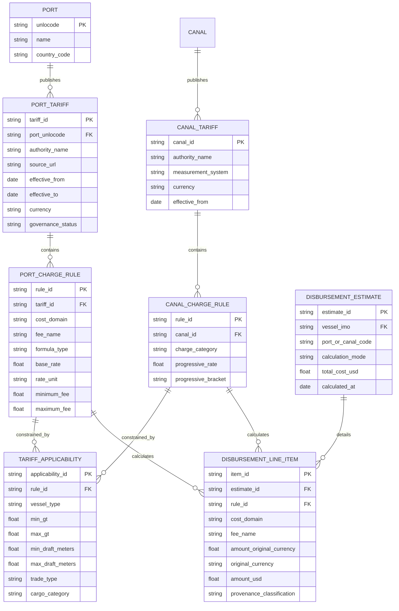
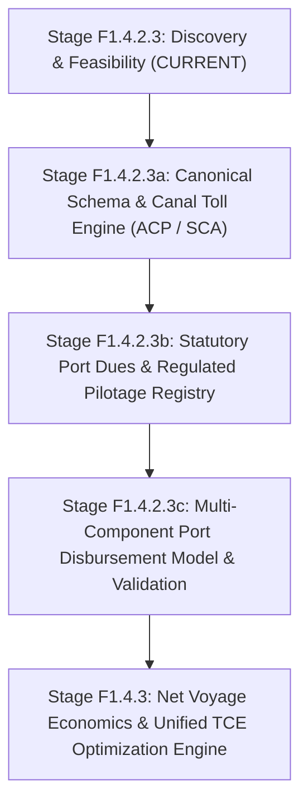

# Pelagos — Stage F1.4.2.3: Global Port & Canal Disbursement Intelligence Discovery

---

## 1. Executive Summary

This report establishes the global discovery and technical feasibility assessment for **genuine port-call and canal transit cost intelligence** within Pelagos. 

Pelagos is a global maritime freight forecasting and vessel chartering optimization platform. Its operational and research layers already incorporate authoritative canonical ports, vessel machinery intelligence, hydrographic channel restrictions, bunker price observation governance, and vessel fuel consumption models. However, **voyage net revenue, charter party evaluations, and Time Charter Equivalent (TCE) earnings cannot be calculated defensibly without estimating port disbursements and canal transit tolls**.

### Key Findings:
1. **Statutory Port Dues & Canal Tolls are Fully Accessible:** Official port authorities, national maritime administrations, and canal governing bodies publish deterministic, legally binding tariff schedules and circulars. Across 31 investigated sources in 11 global regions, **27 sources provide usable, verifiable public tariff schedules**.
2. **Distinct Economic Domains Must Not Be Conflated:**
   - **Port Authority Statutory Dues (Domain A):** Legally mandated dues for entering navigable waters and using municipal port infrastructure (e.g., conservancy, port entry, quay occupancy).
   - **Compulsory Marine Navigation Services (Domains B & C):** Regulated pilotage and statutory tug requirements.
   - **Commercial Stevedoring & Concession Handling (Domain D):** Terminal handling charges (THC), container demurrage, and line handling operated by private terminal concessionaires.
   - **Vessel Husbandry & Agency Remuneration (Domain D):** Bilateral commercial contracts between shipowners and local port agents (FONASBA / BIMCO standard framework).
   - **Canal Transits (Domain E):** Highly formalized sovereign toll regimes (Panama Canal ACP, Suez Canal SCA, Kiel Canal GDWS, St. Lawrence Seaway SLSMC) based on dedicated statutory measurement systems (PC/UMS and SCNT).
   - **Regulatory Environmental Taxes (Domain F):** Federal harbor maintenance and navigation fees (e.g., US Harbor Maintenance Fee under 19 U.S.C. § 4461, UK Trinity House Light Dues).
3. **No Fabricated Costs or Synthetic Tariff Records:** A published tariff publication is **not** proof of a charge applicable to a specific vessel or call without evaluating its multidimensional applicability conditions (vessel class, Gross Tonnage, draft, trade type, berth face, stay duration, and cargo parcel).
4. **Current Status:** This is a **Discovery & Research Phase Only**. Zero production models or voyage freight calculators are modified in this stage. Zero synthetic values are generated.

---

## 2. Research Methodology

The discovery followed a rigorous five-step investigative protocol:

```
+----------------------------------------------------------------------------------------------------+
| 1. Geographic Scoping: Identify major dry bulk, container, and tanker corridors across 11 regions.  |
+----------------------------------------------------------------------------------------------------+
                                                  │
                                                  ▼
+----------------------------------------------------------------------------------------------------+
| 2. Primary Source Discovery: Inspect official port authority gazettes, national transport          |
|    ministries, canal authority circulars, statutory instruments, and maritime boards.              |
+----------------------------------------------------------------------------------------------------+
                                                  │
                                                  ▼
+----------------------------------------------------------------------------------------------------+
| 3. Cost Domain Decomposition: Classify each fee into Domain A (Dues), B (Pilotage), C (Towage),   |
|    D (Agency/Husbandry), E (Canals), or F (Statutory Taxes).                                       |
+----------------------------------------------------------------------------------------------------+
                                                  │
                                                  ▼
+----------------------------------------------------------------------------------------------------+
| 4. Governance & Provenance Audit: Determine source authenticity, technical applicability, and      |
|    permitted use across three independent dimensions.                                              |
+----------------------------------------------------------------------------------------------------+
                                                  │
                                                  ▼
+----------------------------------------------------------------------------------------------------+
| 5. Schema Formulation: Design canonical entities (PortTariff, PortChargeRule, CanalTariff,        |
|    DisbursementEstimate) matching existing Pelagos database entities.                             |
+----------------------------------------------------------------------------------------------------+
```

### Constraints Observed:
- **No Paywall / Authentication Bypass:** Commercial customer portals (e.g., PSA Marine IMOS) were inspected without bypassing authentication; gated items were explicitly recorded as `RESTRICTED_BEHIND_LOGIN`.
- **No Synthetic Tariff Generation:** Missing or unverified tariff items are recorded as `UNAVAILABLE` or `NOT_ESTABLISHED`.
- **Separation of Depth and Cost:** Port water depths and channel prism restrictions (Stage F1.3.2) were maintained as strictly separate entities from the monetary charges levied on vessels.

---

## 3. Global Source Inventory

A total of **31 candidate sources** were investigated, analyzed, and structured into the formal inventory `backend/pelagos/data/f1_4_2_3_disbursement_source_inventory.json`:

- **Official Authority Sources:** 25 (80.6%)
- **Usable Public Tariff Data:** 27 (87.1%)
- **Manual Document Downloads Required:** 24 (77.4%)
- **API / Machine-Readable Endpoints:** 4 (12.9% — UNCTAD, PLA Estimator, VUMPA, Loodswezen)
- **Unresolved Licensing Status:** 14 (commercial operator circulars lacking explicit open reuse licenses)
- **Geographic Regions Covered:** 11 (Central America, Middle East/Egypt, Northwest Europe, North America, UK/Ireland, Mediterranean, India, East Asia, Southeast Asia, Oceania, South America, Sub-Saharan Africa).

---

## 4. Port Cost Source Findings (Domains A, B, C, D, F)

### 4.1 Cost Domain A — Port Dues & Harbour Charges
Port dues represent authority-imposed levies for the general use of navigable waterways, breakwaters, fairway access, and basic harbour infrastructure.

1. **Measurement Bases Identified:**
   - **Gross Tonnage (GT / GRT):** Universal standard across Europe (Rotterdam, Antwerp), India (JNPT, Kandla), East Asia (Yokohama), Middle East (Jebel Ali), and Africa (Transnet South Africa).
   - **Net Registered Tonnage (NRT):** Employed in the UK for Trinity House Light Dues and in China for pilotage/anchorage.
   - **Deadweight Tonnage (DWT):** Utilized in Brazil (ANTAQ Tabela I Acesso Aquaviário) and specialized bulk ports (Pilbara Ports Australia).
   - **Length Overall (LOA):** Primary metric for Dockage in North America (Port Houston Authority Tariff No. 8) and Berthage in Canada (Vancouver Fraser Port Authority).
   - **Duration of Stay:** Billed in 24-hour periods (Rotterdam, Houston, Singapore) or hourly intervals (Antwerp, JNPA, Port of Melbourne).
2. **Two-Part Composite Tariffs:**
   - Leading landlord ports (Rotterdam Havenbedrijf, Antwerp-Bruges, Port of London Authority) combine a **Vessel Tonnage Component** ($GT \times \text{Rate}_{\text{GT}}$) with a **Cargo Throughput Component** ($\text{Metric Tons} \times \text{Rate}_{\text{Cargo}}$).
3. **Environmental Incentive Schemes:**
   - Standardized worldwide around the **Environmental Ship Index (ESI)** and **Clean Shipping Index (CSI)**:
     - Rotterdam: Tiered discounts for ESI $\ge 31$.
     - Antwerp-Bruges: 10% to 15% discount on tonnage dues for qualifying ESI scores.
     - Vancouver: EcoAction Programme grants 23% to 47% harbour dues discounts for clean propulsion/fuels.
     - Singapore: Green Port Programme (GPP) provides 25% to 30% concessions for LNG and alternative low-carbon fuels.

### 4.2 Cost Domain B — Pilotage
Pilotage is universally compulsory for major commercial bulk and container vessels navigating within designated port limits.

1. **State-Regulated Pilotage Boards vs. Port Authorities:**
   - In most jurisdictions, pilotage tariffs are **not set by the port authority**, but by independent statutory boards:
     - United States: Oregon Board of Maritime Pilots (OBMP) sets rates for Columbia River; Harris County Pilot Board sets rates for Houston Pilots.
     - Netherlands: Autoriteit Consument & Markt (ACM) regulates Nederlands Loodswezen tariffs under the Pilotage Act (*Loodsenwet*).
     - Japan: Ministry of Land, Infrastructure, Transport and Tourism (MLIT) approves Japan Federation of Pilots' Associations (JFPA) rate cards under the Pilotage Law.
     - Canada: Pacific Pilotage Authority (PPA) operates as an autonomous Crown Corporation under the Pilotage Act.
2. **Empirical Calculation Formulas:**
   - **Houston Pilots Bipartite Formula:**
     $$\text{Total Pilotage} = (\text{Draft (ft)} \times \text{Zone Draft Rate}) + \left(\frac{\text{LOA (ft)} \times \text{Beam (ft)}}{100} \times \text{Zone Unit Rate}\right) + \text{Add-ons}$$
     - Minimum draft: 24 ft for vessels $\ge 450\text{ ft}$ LOA. Zone 1 to Zone 6 along Houston Ship Channel.
   - **Japan Pilotage Formula (JFPA / MLIT):**
     $$\text{Fee} = A \times \left[1 + 0.1 \times \left(\frac{\text{GRT} - 1{,}000}{1{,}000}\right)\right] \times \left[1 + 0.1 \times \left(\frac{D - 3.0}{0.3}\right)\right]$$
     - Where $A$ is the district base rate, $\text{GRT}$ is gross tonnage (rounded up), and $D$ is deepest draft in meters. Surcharges apply for night navigation (+50%) and severe weather.
   - **Dutch Loodswezen Formula:**
     $$\text{Pilotage} = S + T(\text{GT}, \text{Draft}_{\text{dm}}) + A(\text{Approach Area})$$
     - $S$ is a fixed base charge, $T$ is the vessel dimension tariff, and $A$ reflects the specific maritime approach channel.

### 4.3 Cost Domain C — Towage & Mooring (Marine Assistance)
1. **Operating Models:**
   - **Composite Statutory Port Marine Charge:** India major ports (JNPT, Kandla) combine pilotage and tug assistance into a single statutory charge per GT (*Pilotage-cum-Towage* covering one inward and one outward movement).
   - **Public Authority Fleet:** Transnet National Ports Authority (South Africa) owns and operates harbour tugs under a statutory tariff per tug per movement.
   - **Licensed Commercial Operators:** In North America (Moran, Kirby, Foss), Europe (Boluda, Kotug, Svitzer), and Australia (Svitzer, Smit), towage is performed by private licensees under commercial rate cards.
2. **Towage Governance Gaps:**
   - **Dynamic Fuel Adjustment Factors (BAF):** Tug operators apply monthly or quarterly bunker surcharges that are frequently published behind customer logins (e.g., PSA Marine IMOS portal).
   - **Operational Tug Count:** The number of tugs required for berthing/unberthing is not determined purely by vessel size, but by harbour master regulations, tidal currents, berth orientation, and pilot discretion.

### 4.4 Cost Domain D — Vessel Agency, Husbandry & Port Ancillary Services
1. **Contractual Nature:**
   - Vessel agency fees, crew repatriation, launch services, and husbandry are **bilateral commercial contracts** governed by international trade association frameworks (FONASBA / BIMCO standard agency agreements: Agency Appointment Agreement AAA and General Agency Appointment Agreement GAA).
2. **Proforma Disbursement Account (PDA) Architecture:**
   - Under FONASBA standard conditions, the agent collects:
     1. Statutory Port Authority Dues (passed through at cost).
     2. Regulated Pilotage & Towage (passed through at cost).
     3. Commercial Stevedoring / Terminal Services (passed through at cost).
     4. Normal Agency Fee (agent's agreed professional remuneration).
     5. Out-of-pocket expenses (transport, communication, courier).
   - **Governance Boundary:** Agency fees must not be modeled as statutory port authority tariffs; they must be treated as configurable commercial allowances or isolated research benchmarks.

### 4.5 Cost Domain F — Regulatory Environmental & Navigation Taxes
1. **US Harbor Maintenance Fee (HMF):**
   - Statutory authority: 19 U.S.C. § 4461 / 19 CFR § 24.24.
   - Rate: $0.125\%$ ($0.00125$) ad valorem on the declared commercial value of cargo unloaded or loaded at federally maintained waterways. Assessed on imports and domestic shipments (exports held unconstitutional).
2. **UK General Lighthouse Authorities Light Dues:**
   - Statutory authority: Merchant Shipping Act / General Lighthouse Authorities (Trinity House, Northern Lighthouse Board, Commissioners of Irish Lights).
   - Rate: $46\text{ pence per NRT}$ (effective 1 April 2026), capped at $50{,}000\text{ NRT}$ per call, maximum 9 chargeable calls per annum in UK/Irish waters, with a 30-day exemption following an initial call.

---

## 5. Canal Transit Cost Source Findings (Domain E)

Canal transit fees represent major discrete disbursements that fundamentally dictate global routing economics (e.g., Cape of Good Hope vs. Suez Canal; Cape Horn vs. Panama Canal).

### 5.1 Panama Canal Authority (Autoridad del Canal de Panamá — ACP)
- **Primary Source:** ACP Official Maritime Tariffs & Tolls Schedule; OP Notice to Shipping No. N-1 and N-7; VUMPA portal.
- **Tonnage Measurement:** **PC/UMS** (Panama Canal Universal Measurement System), derived from the 1969 International Convention on Tonnage Measurement with specific mathematical modifications for enclosed spaces.
- **Composite Toll Architecture:**
  1. **Fixed Toll:** Fixed capacity charge based on vessel size tier (Neopanamax, Panamax Plus, Super, Regular).
  2. **Capacity / Tonnage Toll:** Variable rate per TEU (containers) or per PC/UMS net ton (dry bulk / tankers).
  3. **Freshwater Surcharge (FWS):** Introduced in 2020 to manage reservoir storage:
     - Fixed component: $1\%$ to $2\%$ of base toll.
     - Variable component: $0\%$ to $10\%$ based on daily hydrologic water level of Gatun Lake ($80.0\text{ ft}$ to $88.5\text{ ft}$).
  4. **Transit Reservation System (Booking Slots):**
     - Tier 1/2 pre-booking fees based on vessel beam.
     - Slot auction fees: Cleared dynamically via auction bids during congestion or dry-season transit restrictions.
  5. **Mandatory Transit Assistance:**
     - ACP-operated locomotive charges (Panamax locks) or Neopanamax tugboat allocations ($P_{\text{req}}$ per tug assignment).
     - Compulsory ACP canal pilotage per transit.

### 5.2 Suez Canal Authority (SCA)
- **Primary Source:** SCA Navigation Circulars, Toll Schedules & Periodical Amendments; Navigation circulars portal (`suezcanal.gov.eg`).
- **Tonnage Measurement:** **SCNT** (Suez Canal Net Tonnage), based on the 1873 Constantinople International Commission rules. Requires a certified Suez Canal Tonnage Certificate issued by an approved classification society.
- **Progressive Toll Architecture:**
  1. **Base Tolls:** Progressive bracket schedule denominated in **IMF Special Drawing Rights (SDR)** per SCNT tier (e.g., first 5,000 SCNT, next 5,000 SCNT, etc.).
  2. **Condition Multiplier:** Differentiated between **Laden** and **Ballast** transits (ballast transits receive $\sim 15\%$ to $20\%$ lower base rates).
  3. **Periodical Circular Surcharges:** The SCA adjusts net dues via published periodical circulars (e.g., Circular No. 1/2024 imposing $+5\%$ to $+15\%$ surcharges depending on vessel segment).
  4. **Compulsory Transit Pilotage:** Four pilot assignments per full transit (Port Said / Suez approach pilots + two canal convoy transit pilots).
  5. **Mandatory Escort Tugs:** Compulsory for laden bulk vessels $>100{,}000\text{ DWT}$, tankers $>90{,}000\text{ DWT}$, or vessels with beam $>48\text{ meters}$.
  6. **Ancillary Charges:** Mooring boat attendance, canal projector searchlight rental, and port dues.
  7. **Currency Settlement:** Invoiced in SDR and settled in convertible foreign currencies (USD, EUR) using the official National Bank of Egypt daily SDR cross-rates.

### 5.3 Kiel Canal (Nord-Ostsee-Kanal — GDWS / WSV)
- **Primary Source:** *Nord-Ostsee-Kanal-Befahrungsabgabenverordnung* (NOKBefAbgV) Annex 1; Electronic Waterways Information Service (ELWIS).
- **Architecture:** Bracket formula based on Gross Tonnage (GT) and Traffic Group (Verkehrsgruppe 1 to 6). Three statutory pillars:
  1. Canal Dues (*Kanalabgaben* — waterway infrastructure).
  2. Pilot Dues (*Lotsabgaben* — pilotage infrastructure).
  3. Pilot Fees (*Lotsgelder* — active pilot service) plus Canal Helmsmen (*Steuerleute*) where compulsory.
  - Currently governed by § 8 decree providing a $50\%$ temporary fee reduction for commercial vessels subject to mandatory pilotage.

### 5.4 St. Lawrence Seaway (SLSMC / GLS)
- **Primary Source:** Great Lakes St. Lawrence Seaway Schedule of Tolls (joint Canada SLSMC / US GLS administration).
- **Architecture:** Two-component composite toll:
  1. Vessel Toll per Gross Registered Ton (GRT).
  2. Cargo Toll per metric ton (differentiated by bulk, grain, steel, general cargo).
  - Assessed separately for Montreal-Lake Ontario (MLO) section and Welland Canal locks, invoiced in split currencies (CAD and USD).

---

## 6. Coverage Assessment

The detailed geographic findings are compiled in `docs/F1_4_2_3_GLOBAL_COVERAGE_MATRIX.md`. Key matrix takeaways include:

1. **High-Confidence Corridors (Full Authority Sources Available):**
   - **Pacific Northwest to East Asia (PNW-JPN):** Columbia River Bar & River Pilotage (OBMP) + Port of Portland/Vancouver + Tokyo Bay Pilotage (JFPA) + Yokohama Municipal Dues.
   - **US Gulf to Europe (USG-NWE):** Port Houston Authority (Tariff No. 8) + Houston Pilots + Port of Rotterdam (Seaport Dues) + Nederlands Loodswezen.
   - **Interoceanic Canals:** Panama Canal (ACP) and Suez Canal (SCA).
2. **Gaps Across Cost Domains:**
   - **Domain C (Towage):** Gated bunker adjustment factors and variable tug counts.
   - **Domain D (Agency):** Bilateral commercial contracts outside statutory publication.
   - **Private Bulk Terminals:** Specialized grain elevator dockage cards often require agent inquiry.

---

## 7. Source Governance & Licensing Framework

The source governance design expands the three-dimensional framework established in Stages F1.4.2.1 and F1.4.2.2b.1:

```
+----------------------------------------------------------------------------------------------------+
|                                    THREE GOVERNANCE DIMENSIONS                                     |
+----------------------------------------------------------------------------------------------------+
| 1. SOURCE AUTHENTICITY          | 2. TECHNICAL APPLICABILITY        | 3. PERMITTED USE             |
| - Primary Statutory Law (BOE,   | - Exact Vessel Class Match        | - Public Domain Open Data    |
|   Federal Register, Gazette)    | - Tonnage Measurement Compatibility| - Statutory Notice           |
| - Official Port Authority Gazette|  (PC/UMS, SCNT, GT, NRT)          | - Commercial Operator Terms  |
| - Regulated Pilot Board Order   | - Temporal Validity (Effective Dates| - Restricted (Internal /    |
| - Private Commercial Tariff Card| - Loading Condition (Laden/Ballast)|   Research Only)            |
+----------------------------------------------------------------------------------------------------+
```

### Governing Rules:
1. **Public URL $\ne$ Automated Ingestion Authorization:** A publicly viewable PDF tariff does not grant unconstrained scraping rights. Extraction methods must be cataloged (`MANUAL_CURATED_INGESTION`, `SEMI_AUTOMATED_PDF_PARSER`, `API_CLIENT`).
2. **Preservation of Raw Provenance:** Every tariff rule must preserve:
   - Original published value and unit (e.g., short ton, foot, SDR, CAD, EUR, INR).
   - Normalized value and metric unit (e.g., metric ton, meter, USD).
   - Source document citation (title, section, item number, URL, retrieval timestamp).
   - Effective-from and effective-to dates.
3. **Fail-Closed Operational Boundary:** Any tariff item derived from an unverified secondary quotation, an expired circular, or a gated source must be classified as `RESEARCH_ONLY` and barred from operational chartering decisions.

---

## 8. Proposed Canonical Data Model

To support eventual calculation engines without modifying production code today, we propose the following canonical schema architecture:



### Proposed Entities:
1. `PortTariff`: Header entity representing a published tariff booklet with effective dates and authority provenance.
2. `PortChargeRule`: Individual mathematical formula (fixed fee, linear rate per GT/LOA/ton, progressive bracket, or bipartite formula).
3. `CanalTariff`: Canal toll schedule tracking dedicated measurement systems (PC/UMS, SCNT) and base SDR/USD currencies.
4. `CanalChargeRule`: Progressive tonnage tier, seasonal surcharge circular, or lockage fee.
5. `TariffApplicability`: Dimensional, vessel class, and temporal filter parameters.
6. `DisbursementEstimate`: Calculated result with explicit operational/research mode tagging.
7. `DisbursementLineItem`: Granular breakdown preserving original currency, converted USD, calculation formula, and source reference.

---

## 9. Existing Pelagos Compatibility

The proposed disbursement intelligence foundation directly reuses and complements existing Pelagos data structures:

| Existing Pelagos Entity / Module | Reusability in Disbursement Domain | Necessary Non-Destructive Extension |
| :--- | :--- | :--- |
| `Port` (`models.py`) | Canonical ports (`unlocode`, `port_id`, `latitude`, `longitude`, `country`) used as anchor for port tariffs. | Add foreign key relationship `port.tariffs`. |
| `PortAlias` (`models.py`) | Resolves port authority spelling variations and terminal designations. | No schema changes required. |
| `Terminal` & `Berth` (`models.py`) | Links specific berth/wharfage rules to certified alongside berths. | Map `PortChargeRule` to optional `terminal_id` or `berth_id`. |
| `PortCrosswalk` (`models.py`) | Deterministic crosswalk between external port IDs and canonical UNLOCODEs. | Crosswalk external authority codes to Pelagos UNLOCODEs. |
| `Vessel` (`seed_bulk_vessels.json`) | Reuses verified `dwt`, `gross_tonnage`, `loa_meters`, `beam_meters`, and `design_draft_meters`. | Add verified `scnt` and `pc_ums_net_tonnage` fields for canal-transiting vessels. |
| `NavigationalRestriction` (`models.py`) | Physical draft/LOA restrictions enforce operational feasibility before cost calculation. | Restrict cost evaluation to physically accessible berths. |
| `BunkerPriceObservation` (`bunker.py`) | Strictly separated: bunker fuel prices remain an independent commodity domain. | Port disbursement accounts explicitly exclude bunker procurement costs. |
| `VesselFuelModel` (`vessel_fuel_model.py`)| Strictly separated: vessel propulsion fuel consumption remains an independent domain. | Fuel consumption and port fees are joined only at the eventual TCE voyage economics layer. |

---

## 10. Unresolved Gaps & Technical Risks

1. **Gated Towage Bunker Surcharges (Domain C):**
   - Major private tug operators (PSA Marine IMOS, Boluda, Fairplay) maintain live fuel adjustment rates behind customer authentication. Without live credentials, Pelagos must treat towage BAFs as `UNVERIFIED_ESTIMATE` or model a transparent lag based on published bunker prices.
2. **Panama Canal Live Slot Auctions (Domain E):**
   - While baseline ACP tolls are completely deterministic, slot auction fees during congestion periods can surge from \$50,000 to over \$1,000,000. These auction prices are market-driven and cannot be predicted purely from published tariff books.
3. **Suez Canal SDR Daily Settlement Fluctuations (Domain E):**
   - The Suez Canal Authority invoices in SDR. The conversion rate to USD is established by the National Bank of Egypt on the exact day of transit, introducing currency exchange variability.
4. **Commercial Port Agency Fees (Domain D):**
   - True PDA totals include local agent remuneration ($1,500 to $4,500 per call). Because these are commercially negotiated, Pelagos cannot publish an authoritative "statutory" agency fee without clear disclaimer semantics.

---

## 11. Recommended Implementation Sequence

To maintain architectural integrity and test safety, we recommend the following phased engineering sequence:



1. **Stage F1.4.2.3a — Canonical Schema & Canal Toll Engine:**
   - Implement `CanalTariff`, `CanalChargeRule`, and `CanalTransitCalculator` for Panama (ACP) and Suez (SCA).
   - Ingest verified PC/UMS and SCNT parameters for seed bulk vessels.
   - Fail-closed operational boundaries and SDR currency conversion.
2. **Stage F1.4.2.3b — Statutory Port Dues & Regulated Pilotage Registry:**
   - Implement `PortTariff`, `PortChargeRule`, and `TariffApplicability` entities.
   - Ingest verified tariff schedules for key benchmark ports (Houston USHOU, Rotterdam NLRTM, Singapore SGSIN, Nhava Sheva INNSA, Yokohama JPYOK).
   - Encode deterministic formulas for Houston Pilots and Dutch Loodswezen.
3. **Stage F1.4.2.3c — Multi-Component Port Disbursement Account (PDA) Model:**
   - Implement `DisbursementEstimate` calculation service combining Domains A, B, and F.
   - Enforce explicit operational vs. research mode governance.
   - Provide itemized disbursement breakdowns with full field-level provenance.
4. **Stage F1.4.3 — Voyage Economics & TCE Integration:**
   - Integrate canal tolls, port disbursements, verified bunker costs, and vessel fuel consumption into unified voyage economics.

---

## 12. Verification & Closure

- **Deliverables Produced:**
  - Discovery Report: `docs/F1_4_2_3_PORT_CANAL_DISBURSEMENT_DISCOVERY.md`
  - Global Coverage Matrix: `docs/F1_4_2_3_GLOBAL_COVERAGE_MATRIX.md`
  - Structured Inventory: `backend/pelagos/data/f1_4_2_3_disbursement_source_inventory.json` (31 verified sources)
- **Zero Production Mutations:**
  - `pelagos.db` remains untouched.
  - No voyage freight calculations modified.
  - No synthetic tariffs generated.
- **Git State:**
  - Branch: `main`
  - Checkpoint HEAD: `2929e61` preserved.
  - Zero staging, zero commit, zero push performed.

