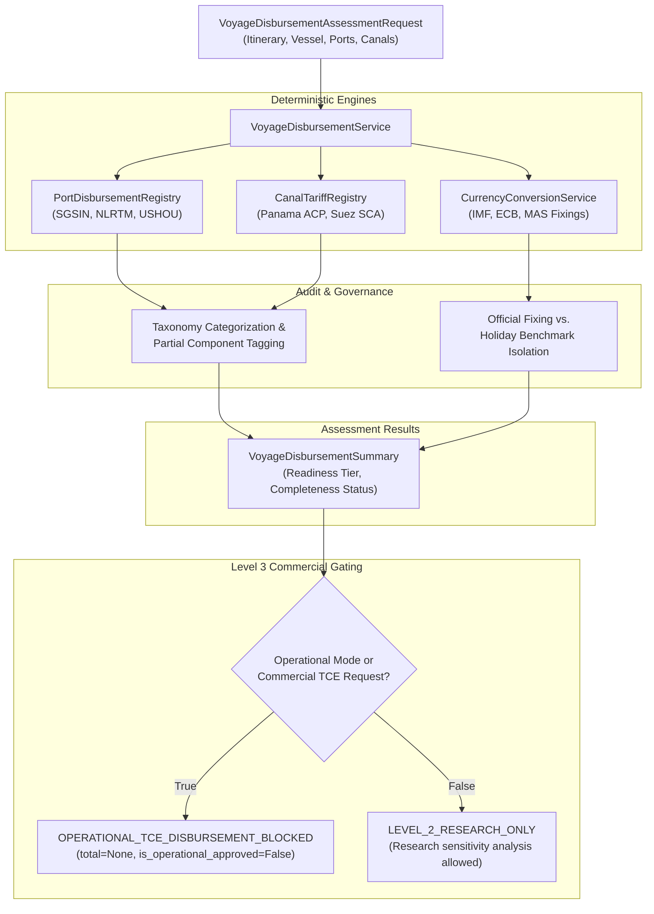

# Pelagos Stage F1.4.2.4 — Voyage Disbursement Integration & TCE Gating Framework

## 1. Executive Summary & Scope Boundaries

Stage **F1.4.2.4** establishes the technical architecture, relational data models, completeness status taxonomy, and fail-closed commercial isolation boundary for associating port disbursement accounts and canal transit tolls with individual voyage assessments.

### Core Architectural Mandates
1. **Voyage-Level Aggregation:** Unifies origin, intermediate, and destination port disbursement records with Panama and Suez Canal transit evaluations under a canonical voyage identity.
2. **Strict Commercial Isolation (Level 3 Gate):** Preliminary research-tier port and canal disbursements are strictly blocked from entering commercial voyage net freight, Time Charter Equivalent (TCE) calculations, charter recommendation ranking, and commercial voyage bidding.
3. **Explicit Completeness and Readiness Taxonomy:** Distinguishes 11 discrete machine-readable statuses to prevent incomplete or partial invoices from ever being presented or consumed as complete.
4. **Partial-Component Propagation:** Explicitly tags and propagates baseline statutory components that do not represent complete invoices (e.g. Rotterdam Loodswezen Component S, Houston Pilots draft/unit charges) as `PARTIAL_COMPONENT_ONLY`, guaranteeing that partial invoices cannot masquerade as final turnaround settlements.
5. **Contractual Agency Remuneration:** Enforces that agency remuneration is never generated as a universal mandatory statutory port due; it is only included when backed by verified bilateral contractual appointment terms (`COMMERCIALLY_NEGOTIATED / CONTRACTUAL`).
6. **Currency Provenance Hardening:** Differentiates official central-bank daily fixings (ECB, MAS, IMF SDR) from mid-market holiday benchmarks (e.g., Target2 European Labor Day May 1), preventing benchmark values from substituting for official fixings in operational calculations.

---

## 2. Voyage-Level Data Model & Schema

Two canonical relational tables represent voyage disbursement intelligence in `backend/pelagos/models.py`, with additive, non-destructive migration registered in `backend/pelagos/database.py`:

### 2.1 `VoyageDisbursementRecord` (`voyage_disbursement_records`)
Stores voyage-level header information, vessel particulars, aggregated financial totals, completeness status, and governance flags:

```
+---------------------------------------------------------------------------------------------------+
|                                  VOYAGE_DISBURSEMENT_RECORDS                                      |
+---------------------------------------------------------------------------------------------------+
| id                          INTEGER PRIMARY KEY AUTOINCREMENT                                     |
| voyage_id                   VARCHAR(64) NOT NULL INDEXED                                          |
| vessel_imo                  INTEGER NULL INDEXED                                                  |
| vessel_name                 VARCHAR(128) NULL                                                     |
| vessel_class                VARCHAR(64) NULL                                                      |
| origin_port_unlocode        VARCHAR(8) NOT NULL INDEXED                                           |
| destination_port_unlocode   VARCHAR(8) NOT NULL INDEXED                                           |
| intermediate_ports_json     TEXT NULL (JSON list of UN/LOCODEs)                                   |
| canal_transits_json         TEXT NULL (JSON list of canal IDs: PANAMA, SUEZ)                       |
| transit_date                DATE NOT NULL INDEXED                                                 |
| vessel_gt                   FLOAT NULL                                                            |
| vessel_dwt                  FLOAT NULL                                                            |
| vessel_loa_m                FLOAT NULL (synonym: loa_m)                                           |
| vessel_beam_m               FLOAT NULL (synonym: beam_m)                                          |
| vessel_draft_m              FLOAT NULL (synonym: draft_m)                                         |
| scnt                        FLOAT NULL                                                            |
| pc_ums_net                  FLOAT NULL                                                            |
| total_disbursement_usd      FLOAT NULL                                                            |
| total_port_disbursement_usd FLOAT NULL                                                            |
| total_canal_transit_usd     FLOAT NULL                                                            |
| readiness_tier              VARCHAR(64) NOT NULL DEFAULT 'LEVEL_2_RESEARCH_ONLY'                  |
| completeness_status         VARCHAR(64) NOT NULL INDEXED                                          |
| is_complete                 BOOLEAN NOT NULL DEFAULT FALSE                                        |
| has_partial_components      BOOLEAN NOT NULL DEFAULT FALSE                                        |
| is_operational_approved     BOOLEAN NOT NULL DEFAULT FALSE (Enforced False under Level 3 Block)   |
| blocked_reasons_json        TEXT NULL                                                             |
| evidence_summary_json       TEXT NULL                                                             |
| notes                       TEXT NULL                                                             |
| created_at                  TIMESTAMP WITH TIME ZONE NOT NULL                                     |
| updated_at                  TIMESTAMP WITH TIME ZONE NOT NULL                                     |
+---------------------------------------------------------------------------------------------------+
```

### 2.2 `VoyageDisbursementLineItem` (`voyage_disbursement_line_items`)
Stores fine-grained line-item audit details linked to the parent voyage disbursement record via foreign key with cascading deletion:

```
+---------------------------------------------------------------------------------------------------+
|                                 VOYAGE_DISBURSEMENT_LINE_ITEMS                                    |
+---------------------------------------------------------------------------------------------------+
| id                          INTEGER PRIMARY KEY AUTOINCREMENT                                     |
| voyage_disbursement_record_id INTEGER NOT NULL REFERENCES voyage_disbursement_records(id)         |
| charge_type                 VARCHAR(32) NOT NULL (PORT_DISBURSEMENT | CANAL_TRANSIT)              |
| location_code               VARCHAR(32) NOT NULL (UN/LOCODE or Canal Name: PANAMA, SUEZ)          |
| charge_category             VARCHAR(64) NOT NULL                                                  |
| tariff_identifier           VARCHAR(64) NOT NULL INDEXED                                          |
| description                 VARCHAR(256) NOT NULL                                                 |
| applicability_type          VARCHAR(32) NOT NULL                                                  |
| rate_value                  FLOAT NOT NULL                                                        |
| billing_unit                VARCHAR(64) NOT NULL                                                  |
| local_currency              VARCHAR(8) NOT NULL                                                   |
| amount_local                FLOAT NULL                                                            |
| exchange_rate_to_usd        FLOAT NULL                                                            |
| amount_usd                  FLOAT NULL                                                            |
| is_partial_component        BOOLEAN NOT NULL DEFAULT FALSE                                        |
| is_available                BOOLEAN NOT NULL DEFAULT TRUE                                         |
| evidence_classification     VARCHAR(64) NOT NULL DEFAULT 'DIRECTLY_VERIFIED'                      |
| permission_status           VARCHAR(64) NOT NULL DEFAULT 'PERMITTED_STATUTORY_DISCLOSURE'         |
| failure_reason              VARCHAR(256) NULL                                                     |
| created_at                  TIMESTAMP WITH TIME ZONE NOT NULL                                     |
+---------------------------------------------------------------------------------------------------+
```

---

## 3. Integration Architecture

The integration service is implemented in `backend/pelagos/registry/voyage_disbursement_service.py` as `VoyageDisbursementService`:



### Key Service Methods
- `evaluate_voyage_disbursements(request)`: Evaluates all port calls and canal transits, tracks partial components, aggregates line items, and resolves readiness and completeness status.
- `persist_voyage_disbursement(summary, ...)`: Persists evaluation header and line items to database.
- `check_commercial_tce_eligibility(summary)`: Strictly returns `(False, "COMMERCIAL_TCE_GATE_BLOCKED: ...")`.
- `check_charter_bidding_eligibility(summary)`: Strictly returns `(False, "CHARTER_BIDDING_GATE_BLOCKED: ...")`.

---

## 4. Completeness and Readiness Status Taxonomy

Stage F1.4.2.4 strictly prohibits collapsing distinct error conditions into generic incomplete flags. The following 11 mutually exclusive statuses are defined in `VoyageDisbursementStatus`:

| Status Code | Definition & Trigger Condition | Complete? | Financial Total Exposure |
| :--- | :--- | :---: | :--- |
| `COMPLETE_WITHIN_REGISTERED_SCOPE` | All ports and canals are cataloged, all required vessel particulars are verified, all FX rates are official, and no partial components exist. | `True` | Complete USD Total (Research Level 2) |
| `PARTIAL_COMPONENTS` | Known statutory base components were calculated, but represent partial components (e.g. Rotterdam S-rate, Houston pilot draft/unit). | `False` | Preliminary research total available, explicitly flagged incomplete |
| `MISSING_REQUIRED_INPUT` | A mandatory vessel dimension (GT, LOA, draft, beam, DWT, or SCNT) is absent. | `False` | `None` (Fail closed) |
| `MISSING_TARIFF` | An itinerary port or canal is uncataloged or date falls outside supported tariff schedules. | `False` | `None` (Fail closed, zero synthetic averages) |
| `HISTORICAL_TARIFF` | Tariffs are from historical circular versions (2024, 2025) and cannot serve current operations. | `False` | `None` for operational mode |
| `UNVERIFIED_SOURCE` | One or more components rely on unverified primary documentation. | `False` | `None` (Fail closed) |
| `RESTRICTED_PERMISSION` | A tariff carries restricted commercial licensing. | `False` | Restricted |
| `MISSING_CURRENCY_RATE` | Required exchange rate is missing for transit date or outside fixing schedules. | `False` | `None` (Fail closed) |
| `CONDITIONAL_CHARGE_UNRESOLVED` | Dynamic environmental or operational input (e.g. Gatun Lake level) is missing. | `False` | `None` (Fail closed) |
| `RESEARCH_ONLY` | General research calculation where minor secondary attributes are unresolved. | `False` | `None` |
| `OPERATIONAL_BLOCKED` | Calculation requested with `operational_mode=True`. Level 3 block enforces fail-closed isolation. | `False` | `None` (Strict fail closed) |

---

## 5. Partial-Component Tracking & Propagation

### 5.1 Predecessor Finding A Remediation (`VERIFY-F1423B-001`)
- **Rotterdam Loodswezen Pilotage:** Seeded tariff `NLRTM-LOODS-PILOTAGE-S-2024` represents only the base starting tariff (Component S = €380). Distance (Component A) and Gross Tonnage / Draft (Component T) are omitted.
- **Houston Pilots Association:** Seeded tariffs `USHOU-PILOT-DRAFT-2024` ($85.50/ft) and `USHOU-PILOT-UNIT-2024` ($12.50/unit) omit pilot boat transportation and dispatch communication fees ($600+).

### 5.2 Propagation Implementation
1. Flagged with `"is_partial_component": true` in `backend/pelagos/data/f1_4_2_3b_pilot_port_tariffs.json`.
2. Passed into `PortDisbursementLineItem(is_partial_component=True)`.
3. Sets `PortDisbursementCalculationResult.has_partial_components = True`.
4. Propagated to `VoyageDisbursementSummary.has_partial_components = True`.
5. Enforces `VoyageDisbursementSummary.is_complete = False` and `completeness_status = VoyageDisbursementStatus.PARTIAL_COMPONENTS`.
6. Persisted in `voyage_disbursement_records.has_partial_components = 1` and `voyage_disbursement_line_items.is_partial_component = 1`.

---

## 6. Non-Statutory Agency Remuneration Governance

### Predecessor Finding B Remediation (`VERIFY-F1423B-001`)
1. **Taxonomy Metadata Correction:** In `backend/pelagos/data/f1_4_2_3b_port_tariff_source_inventory.json`, `AGENCY_FEE` `default_applicability` is corrected to `"COMMERCIALLY_NEGOTIATED / CONTRACTUAL"`. Documented as non-statutory agency remuneration under FONASBA/BIMCO Standard Port Agency Principles.
2. **Deterministic Service Invariant:** `VoyageDisbursementService` never automatically generates an agency fee.
3. **Contractual Appointment Input:** Only when `contractual_agency_fee_usd` is explicitly supplied in `VoyageDisbursementAssessmentRequest` is an agency fee recorded, carrying `applicability_type="COMMERCIALLY_NEGOTIATED / CONTRACTUAL"` and `permission_status="COMMERCIALLY_CONFIDENTIAL_CONTRACT"`.

---

## 7. Currency Conversion Provenance & Central Bank Gating

### Predecessor Finding C Remediation (`VERIFY-F1423B-001`)
1. **Holiday Benchmark Identification:** On May 1, 2024 (European Labor Day), the Trans-European Automated Real-time Gross Settlement Express Transfer system (Target2) is closed; the European Central Bank (ECB) does not publish official daily foreign exchange reference rates.
2. **Provenance Reclassification:** The rate `1.0715 EUR/USD` in `backend/pelagos/currency.py` is reclassified from `DIRECTLY_VERIFIED` official fixing to:
   - `rate_provider = "European Central Bank (ECB) Benchmark (Holiday Interpolation)"`
   - `evidence_status = "PARTIALLY_VERIFIED"`
   - `notes = "Mid-market benchmark for European Labor Day; not an official daily publication"`
3. **Operational Gating in `CurrencyConversionService.convert()`:**
   - Parameter `operational_mode: bool = False` or `require_official_fixing: bool = False`.
   - If operational mode is active, any exchange rate with `evidence_status != "DIRECTLY_VERIFIED"` or `"BENCHMARK"` in provider fails closed with `BENCHMARK_EXCHANGE_RATE_REJECTED`.
   - Research calculations continue to convert successfully with explicit provenance audit tags.

---

## 8. Commercial TCE and Chartering Gate Enforcement

### Invariant: Absolute Level 3 Operational Block
Preliminary research-level disbursements must not leak into:
- Commercial voyage net freight (`pelagos.optimization.calculator`).
- Time Charter Equivalent (TCE) optimization.
- Actionable charter recommendation ranking (`pelagos.optimization.chartering`).
- Commercial voyage bidding or freight tender evaluation.

### Verification Proof
- `calculate_voyage_freight()` in `calculator.py` explicitly excludes port canal tolls and disbursements via `STANDARD_COMMERCIAL_DISCLAIMERS`.
- `chartering.py` explicitly withholds actionable recommendations (`insufficient_data`) when commercial fixture bundles are incomplete and excludes preliminary port disbursements.
- `VoyageDisbursementService.check_commercial_tce_eligibility()` and `check_charter_bidding_eligibility()` return `(False, "...")`.
- When `operational_mode=True` is passed to `evaluate_voyage_disbursements()`, the service fails closed with `total_disbursement_usd = None`, `is_operational_approved = False`, and `completeness_status = "OPERATIONAL_BLOCKED"`.

---

## 9. Automated Test Suite Verification

Comprehensive test suite in `tests/test_voyage_disbursements.py` covers 17 test cases:

| Test ID | Test Scenario | Expected Behavior | Result |
| :--- | :--- | :--- | :---: |
| `test_1` | Voyage with registered port tariff | Evaluates Singapore SGSIN; populates line items; returns Level 2 research total | **PASSED** |
| `test_2` | Voyage with multiple port calls | Evaluates USHOU, SGSIN, NLRTM; aggregates costs across all 3 hubs | **PASSED** |
| `test_3` | Voyage with canal transit & port calls | Evaluates USHOU + Panama Canal + SGSIN; combines canal & port line items | **PASSED** |
| `test_4` | Voyage with no canal transit | Cape route evaluates ports only; canal transit total = 0.0 | **PASSED** |
| `test_5` | Missing tariff for one port | Unregistered port (USOAK) fails closed with `MISSING_TARIFF` | **PASSED** |
| `test_6` | Missing required vessel particulars | Missing GT for Singapore port dues fails closed with `MISSING_REQUIRED_INPUT` | **PASSED** |
| `test_7` | Partial pilotage component propagation | Rotterdam S-rate & Houston draft charges propagate `PARTIAL_COMPONENTS` & `is_complete=False` | **PASSED** |
| `test_8` | Agency fee non-statutory governance | Default has 0 agency fee; contractual fee added with `COMMERCIALLY_NEGOTIATED` | **PASSED** |
| `test_9` | Operational mode rejection | `operational_mode=True` fails closed with `OPERATIONAL_BLOCKED` & total=None | **PASSED** |
| `test_10`| Benchmark FX rejection | May 1 holiday benchmark rejected in operational mode with `BENCHMARK_EXCHANGE_RATE_REJECTED` | **PASSED** |
| `test_11`| Missing currency conversion | Date outside fixings fails closed with `MISSING_CURRENCY_RATE` & total=None | **PASSED** |
| `test_12`| Conditional charge unresolved | Missing Gatun Lake elevation fails closed with `CONDITIONAL_CHARGE_UNRESOLVED` | **PASSED** |
| `test_13`| Incomplete total not complete | Incomplete/partial voyage total enforces `is_complete=False` | **PASSED** |
| `test_14`| Research disbursement blocked from TCE | `check_commercial_tce_eligibility()` returns `(False, "COMMERCIAL_TCE_GATE_BLOCKED")` | **PASSED** |
| `test_15`| Research disbursement blocked from bidding | `check_charter_bidding_eligibility()` returns `(False, "CHARTER_BIDDING_GATE_BLOCKED")` | **PASSED** |
| `test_16`| Level 3 restrictions intact | `operational_mode=True` on PortDisbursementRegistry and CanalTariffRegistry fails closed | **PASSED** |
| `test_17`| Database persistence & line items | Persists `VoyageDisbursementRecord` and child `VoyageDisbursementLineItem`s cleanly | **PASSED** |

### Full Test Suite Run (73 Tests)
- `tests/test_voyage_disbursements.py`: 17 passed
- `tests/test_port_disbursements.py`: 11 passed
- `tests/test_canal_tariffs.py`: 17 passed
- `tests/test_vessel_fuel_model.py`: 19 passed
- `tests/test_engine_sfoc.py`: 9 passed
- **Total:** **73 passed, 0 failed, 0 regressions** in 26.62s.

---

## 10. Known Limitations & Explicitly Unsupported Capabilities

1. **Non-Authorized Operational TCE Integration:** Commercial voyage net freight and daily TCE calculations cannot consume these disbursement estimates. This remains strictly blocked until Stage F1.4.3.
2. **Partial Pilotage Components:** Complete turnaround pilotage invoices (incorporating transport, distance, and pilot boat fees) are not modeled for Rotterdam or Houston.
3. **Pilot Hub Coverage Boundary:** Port disbursement intelligence is restricted to pilot hubs (SGSIN, NLRTM, USHOU). Unregistered ports fail closed; synthetic regional averages are strictly prohibited.
4. **Contractual Agency Dependency:** Agency fees require explicit contractual appointment terms; Pelagos does not fabricate agency fee tariffs.
5. **Static Canal Circular Scope:** Canal transits are restricted to historical 2024 and 2025 published circulars. Live operational transit bookings remain unsupported.

