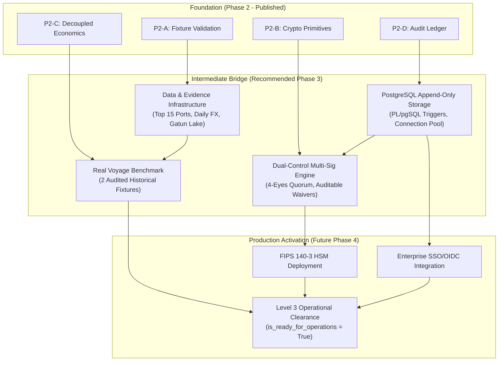

# Pelagos — Stage F1.4.3 Post-Phase 2 Operational Readiness Gap Assessment
## Comprehensive Audit of Level 3 Operational Preconditions, Evidence Deficits & Architecture Gaps

**Document ID:** `GAP-F143-001`  
**Stage:** Post-Phase 2 Operational Readiness Planning (`SCOPE-F143-NEXT-001`)  
**Published Baseline Commit:** `9e001a397f8ccaee14b165e46a6b633c98cec5f4`  
**Parent Commit:** `fdd70b838687366cbf74081c78ecde78990fe7bc`  
**Remote:** `origin/main` (`https://github.com/Sanchay0123/Pelagos.git`)  
**Status:** Drafting (Planning and Evidence Review Only)  

---

## 1. Executive Summary & Baseline Repository State

Following the successful implementation, independent verification, targeted remediation, and controlled Git publication of Stage F1.4.3 Phase 2 at commit `9e001a397f8ccaee14b165e46a6b633c98cec5f4`, Pelagos has established a robust, deterministic, cryptographically signed, and tamper-evident calculation baseline for maritime voyage economics.

However, the repository maintains an explicit architectural constraint: **Level 3 Operational Readiness remains strictly disabled** (`is_ready_for_operations = False`, `PRODUCTION_TOKEN_PROHIBITED_IN_PHASE_2`).

This gap assessment evaluates what technical, commercial, data, security, and governance barriers currently prevent the safe transition from Level 2 (Research & Simulation) to Level 3 (Production Operational Voyage Execution).

```
   ┌─────────────────────────────────────────────────────────────────────────────┐
   │                          CURRENT READINESS TIER                             │
   ├─────────────────────────────────────────────────────────────────────────────┤
   │ [x] Level 1: Historical Exploratory Analysis (Parquet, ML Baselines)        │
   │ [x] Level 2: Deterministic Research & Simulation (Fail-Closed, 206 Tests)   │
   │ [ ] Level 3: Production Commercial Operations (BLOCKED BY 22 REGISTERED GAPS)│
   └─────────────────────────────────────────────────────────────────────────────┘
```

### 1.1 Verified Repository Baseline
- **Git Commit:** `9e001a397f8ccaee14b165e46a6b633c98cec5f4` (`feat(pelagos): implement F1.4.3 phase 2 readiness controls`).
- **Branch:** `main` tracking `origin/main` with zero uncommitted tracked changes.
- **Production Database:** SQLite database `pelagos.db` verified untouched at exactly **1,875,968 bytes** with SHA-256 `c6a67f09f4ef8cb78ef058cf5e9a87d0c399654f1ffb23bf8a9f0d2995f33edf`.
- **Protected Assets:** 31 annual Parquet partition directories (`parquet_data/freight/year=1996` through `year=2026`), 53 exploratory scripts in `scratch/`, and local vault configuration `.obsidian/` remain preserved.
- **Test Suite:** 206 platform tests (44 Phase 2 + 162 expanded predecessor tests) passing 100% in isolated execution.

> [!CAUTION]
> ### Premature Operational Activation Hazard
> Factual inspection confirms that activating Level 3 operational status (`is_ready_for_operations = True`) under the current state would introduce severe commercial, legal, and financial liabilities:
> 1. Voyage disbursements for >99.9% of global bulk ports would trigger catastrophic fail-closed calculation abortions due to lack of certified port tariff algorithms.
> 2. Cryptographic authorization would rely on ephemeral in-memory software keys lacking HSM protection or multi-party dual control.
> 3. Audit trail immutability would remain vulnerable to OS-level SQLite administrative file tampering.
> 4. Real-time currency conversions would fail due to absence of automated daily central bank ingestion pipelines.

---

## 2. Assessment Scope & Methodology

This assessment covers the entirety of the Pelagos codebase, database schemas, test harnesses, and governing specifications at commit `9e001a3`. Every identified gap is evaluated against strict evidentiary criteria.

### 2.1 Epistemological Taxonomy of Claims
To prevent confusion between verified capabilities and aspirational designs, all statements within this assessment are classified into one of five categories:
1. **Verified Fact (`FACT`):** An invariant or behavior directly confirmed through source code inspection, database schema analysis, or deterministic test execution.
2. **Reported Claim (`CLAIM`):** An assertion documented in previous reports or external documentation that requires independent empirical confirmation.
3. **Design Decision (`DECISION`):** An architectural choice formally adopted in governing specifications (`DOC-F143-PHASE2-ARCH-001`, `PLAN-F143-PHASE2-001`).
4. **Assumption (`ASSUMPTION`):** A working operational hypothesis regarding maritime market practice, counterparty behavior, or external infrastructure.
5. **Unknown (`UNKNOWN`):** An open operational parameter or boundary condition lacking authoritative statutory or commercial evidence.

### 2.2 Severity Classification
- **Critical:** A fatal blocker that directly precludes commercial operations. Activating the system without closing this gap would violate maritime statutory law, produce financial discrepancies, or breach cryptographic security boundaries.
- **High:** A major operational barrier that severely restricts the practical deployment of the platform (e.g. inability to calculate disbursements across major bulk trade lanes).
- **Medium:** An operational deficiency or friction point that introduces manual intervention, latency, or administrative overhead.
- **Low:** An optimization, cosmetic improvement, or minor technical debt item that does not impede operational validity.

### 2.3 Gap Classification
- **`CODE`:** Defect, missing branch, or hardcoded restriction in Python application code.
- **`DATA`:** Missing, incomplete, unverified, or stale statutory/commercial datasets.
- **`PERMISSION`:** Inadequate intellectual property license or statutory disclosure permission for data redistribution.
- **`INFRASTRUCTURE`:** Absence of necessary server, database, network, or cryptographic hardware environments.
- **`GOVERNANCE`:** Absence of organizational approval workflows, dual-control mechanisms, or legal frameworks.
- **`UNRESOLVED`:** Ambiguity in maritime statutory interpretation or commercial charterparty terms.

---

## 3. Domain-by-Domain Comprehensive Assessment

```
                      ┌─────────────────────────────────────────┐
                      │    LEVEL 3 OPERATIONAL DOMAIN AUDIT     │
                      └────────────────────┬────────────────────┘
          ┌─────────────────┬──────────────┼──────────────┬─────────────────┐
          ▼                 ▼              ▼              ▼                 ▼
   ┌──────────────┐  ┌──────────────┐┌──────────────┐┌──────────────┐┌──────────────┐
   │   Domain A   │  │   Domain B   ││   Domain C   ││   Domain D   ││   Domain E   │
   │  Commercial  │  │Cryptographic ││   Audit &    ││    Voyage    ││ Operational  │
   │     Data     │  │Authorization ││ Persistence  ││  Economics   ││  Governance  │
   └──────────────┘  └──────────────┘└──────────────┘└──────────────┘└──────────────┘
```

### 3.1 Domain A: Commercial Data Readiness

#### A.1 Port Disbursement Coverage Deficit
- **Directly Verified Implementation (`FACT`):** The port disbursement registry (`backend/pelagos/registry/port_disbursement_registry.py`) implements deterministic statutory calculation algorithms for exactly three commercial ports: Singapore (`SGSIN`), Rotterdam (`NLRTM`), and Houston (`USHOU`).
- **Required State (`DECISION`):** Global bulk dry and liquid maritime operations span over 4,000 commercial ports. An operational voyage calculator serving global chartering must support at least the top 15 primary bulk export and import hubs (e.g., Dampier, Port Hedland, Tubarão, Richards Bay, Newcastle, Hay Point, Qingdao, Ningbo-Zhoushan, Santos, Ponta da Madeira).
- **Gap Classification & Evidence:** `DATA` / `CODE`. Any voyage fixture calling unmonitored ports triggers `UNREGISTERED_PORT_CALL` and aborts calculation in operational mode (`backend/pelagos/readiness/tariff_validation.py:387-393`). Furthermore, for Rotterdam and Houston, pilotage tariffs are flagged as `PARTIAL_TARIFF_COMPONENT` due to missing shiftings, S-rates, and draft overage brackets (`tariff_validation.py:469-480`).
- **Severity:** **Critical**.

#### A.2 Canal Tariff Coverage & Unresolved Conditional Charges
- **Directly Verified Implementation (`FACT`):** Only two international transit corridors are modeled: Panama Canal Authority (ACP) and Suez Canal Authority (SCA) in `backend/pelagos/tariffs/canal_tariffs.py`. In `backend/pelagos/readiness/tariff_validation.py:554-556` and `lines 619-620`, both canals explicitly inject `OPERATIONAL_CANAL_TOLL_BLOCKED` when evaluated with `operational_mode=True`.
- **Required State (`DECISION`):** Operational deployment requires deterministic toll calculation across all strategic maritime chokepoints, including the Kiel Canal, Bosporus/Dardanelles (Turkish Straits), and the St. Lawrence Seaway. Moreover, SCA base dues brackets remain classified as `PARTIALLY_VERIFIED` (`tariff_validation.py:608`), and the Panama Canal Freshwater Surcharge (FWS) requires daily live telemetry of Gatun Lake elevation at 1200 hours (`tariff_validation.py:550-552`).
- **Gap Classification & Evidence:** `DATA` / `UNRESOLVED`. Unmodeled canals return `UNKNOWN_CANAL` (`tariff_validation.py:523`).
- **Severity:** **High**.

#### A.3 Automated FX Ingestion Pipeline & Calendar Reconciliation
- **Directly Verified Implementation (`FACT`):** `backend/pelagos/currency.py` provides statutory FX conversion supporting ECB, IMF (SDR basket), MAS, and the Federal Reserve with provider-specific lookback windows (4 business days for statutory central banks, 5 days for SDR) and Decimal precision. However, all FX exchange rates in the database are statically populated historical test seeds.
- **Required State (`DECISION`):** Operational voyage calculation requires an automated daily ingestion pipeline fetching certified central bank fixings via official APIs (e.g. IMF SDMX RESTful API, ECB Statistical Data Warehouse XML, MAS API) with multi-jurisdictional financial holiday calendar reconciliation.
- **Gap Classification & Evidence:** `INFRASTRUCTURE` / `DATA`. If a calculation executes on an operational date whose fixing is not yet seeded, the service aborts with `NO_RATE_AVAILABLE` (`backend/pelagos/currency.py:276-281`).
- **Severity:** **Critical**.

#### A.4 Vessel Particulars & Statutory Certification Evidence
- **Directly Verified Implementation (`FACT`):** Vessel particulars in `pelagos.db` are predominantly sourced from `SOURCE_REPORTED` records (`backend/pelagos/readiness/vessel_readiness.py:412-420`). In operational mode, `vessel_readiness.py:416` blocks any required dimension that is not `DIRECTLY_VERIFIED`. Certified canal tonnages (Suez SCNT and Panama PC/UMS) are populated for a handful of seed vessels; all others fail closed. Furthermore, statutory class certificates (Safety Construction, Safety Equipment, International Load Line, IOPP, P&I Certificate of Entry) are not tracked as relational entities.
- **Required State (`DECISION`):** Commercial chartering requires verifiable links to authoritative classification society registers (e.g. DNV, Lloyd's Register, ABS) or verified shipowner Particulars Questionnaire 88 (Q88) certificates.
- **Gap Classification & Evidence:** `DATA` / `GOVERNANCE`. Line 443 of `vessel_readiness.py` hard-locks `is_ready_operations = False`.
- **Severity:** **Critical**.

#### A.5 Commercial Open Positions vs. Historical AIS Snapshot
- **Directly Verified Implementation (`FACT`):** The repository's AIS data consists of a 120-row historical observation snapshot from 2024-01-01 (`backend/pelagos/data/seed_data.py`).
- **Required State (`DECISION`):** Commercial chartering cannot operate on historical AIS snapshots. Commercial fixture evaluation requires forward-looking vessel availability: vessel open port, laycan availability window (start date / canceling date), current bunker on board (ROB), redelivery range, and commercial trading exclusions.
- **Gap Classification & Evidence:** `DATA` / `PERMISSION`. No broker open-tonnage position feed (e.g. Clarkson, Braemar, Simpson Spence Young) or shipowner commercial schedule feed is integrated.
- **Severity:** **High**.

#### A.6 Route Calibration & Sea Margin Modeling
- **Directly Verified Implementation (`FACT`):** `backend/pelagos/economics/voyage_calculator.py` models voyage time across 7 distinct duration components. Sea days are calculated as `sea_distance_nm / (speed_knots * 24.0) + (weather_allowance_days or 0.0)`.
- **Required State (`DECISION`):** In commercial voyage charters, sea margin (traditionally 5% to 15%) is contractually negotiated or calibrated against hydrodynamic wave/swell/wind hindcasts. The current model relies on caller-supplied unverified floats without connection to weather routing intelligence.
- **Gap Classification & Evidence:** `CODE` / `DATA`.
- **Severity:** **Medium**.

---

### 3.2 Domain B: Cryptographic Operational Authorization

#### B.1 Hardcoded Production Release Token Prohibition
- **Directly Verified Implementation (`FACT`):** In `backend/pelagos/security/token_gate.py:157-164`, the validation engine explicitly rejects Category 3 Production Release tokens:
  ```python
  if token.token_category == TokenCategory.PRODUCTION_RELEASE:
      return TokenValidationResult(
          is_valid=False,
          status="PRODUCTION_TOKEN_PROHIBITED_IN_PHASE_2",
          jti=token.jti,
          token_category=token.token_category.value,
          failure_reasons=["Category 3 Production Release Tokens are strictly prohibited in Phase 2."],
      )
  ```
- **Required State (`DECISION`):** Level 3 operational activation requires authorizing Category 3 production tokens, but ONLY when backed by genuine hardware-backed keys, certified CRL distribution points, and dual-control approval workflows.
- **Gap Classification & Evidence:** `CODE` / `GOVERNANCE`.
- **Severity:** **Critical**.

#### B.2 Key Custody, Ceremonies & Hardware Security Modules (HSM)
- **Directly Verified Implementation (`FACT`):** Cryptographic keys in `backend/pelagos/security/authorization.py` are ephemeral software keys generated in-memory via the Python `cryptography` library (Ed25519 and NIST P-384 / SECP384R1).
- **Required State (`DECISION`):** For production operational authorization involving commercial contracts valued in millions of dollars, private signing keys must reside inside FIPS 140-3 Level 3 Hardware Security Modules (HSM) or cloud-managed HSM services (e.g. AWS CloudHSM, Google Cloud KMS HSM, Azure Key Vault Managed HSM) accessible solely via PKCS#11 or authenticated REST RPCs. Private keys must never be exportable into application memory. A formal key generation and custody ceremony with split-secret m-of-n Shamir key custodians must be documented and executed.
- **Gap Classification & Evidence:** `INFRASTRUCTURE` / `GOVERNANCE`.
- **Severity:** **Critical**.

#### B.3 Certificate Revocation List (CRL) Distribution & OCSP Responders
- **Directly Verified Implementation (`FACT`):** The CRL engine (`backend/pelagos/security/crl.py`) evaluates static revocation entries loaded from local memory or mock disk fixtures.
- **Required State (`DECISION`):** An operational deployment requires a live CRL distribution point (CDP) served over highly available HTTPS, signed by an authoritative Certificate Authority (CA), with defined `thisUpdate` and `nextUpdate` intervals, accompanied by an Online Certificate Status Protocol (OCSP) responder for real-time revocation queries.
- **Gap Classification & Evidence:** `INFRASTRUCTURE` / `CODE`.
- **Severity:** **High**.

#### B.4 Distributed Replay Prevention & Atomic Token Invalidation
- **Directly Verified Implementation (`FACT`):** Replay attack prevention (`backend/pelagos/security/token_gate.py:75-103`) uses a Python in-memory cache protected by a `threading.Lock()`.
- **Required State (`DECISION`):** In a production multi-worker deployment (e.g. multi-process Gunicorn/Uvicorn, Kubernetes pods), an in-memory lock does not protect against concurrent replay attacks across separate OS processes or server nodes. Token JTI consumption must be atomic across nodes using a distributed fast-expiry cache (Redis `SET NX EX`) or database-level row locking with a unique constraint on `jti`.
- **Gap Classification & Evidence:** `INFRASTRUCTURE` / `CODE`.
- **Severity:** **High**.

#### B.5 Enterprise Identity & Role-Based Access Control (RBAC) Binding
- **Directly Verified Implementation (`FACT`):** Token payloads carry an arbitrary `user_id` string and role string asserted by the caller (`backend/pelagos/security/token_gate.py:40-52`).
- **Required State (`DECISION`):** Operational authorization must bind cryptographically to authenticated corporate identities via OpenID Connect (OIDC), SAML 2.0, or mTLS x.509 enterprise certificates, validating that the signing entity is an authorized commercial officer (e.g. Chartering Manager, Fleet Operations Director).
- **Gap Classification & Evidence:** `GOVERNANCE` / `INFRASTRUCTURE`.
- **Severity:** **High**.

---

### 3.3 Domain C: Audit and Persistence Integrity

#### C.1 Certified Scope Limitations of SQLite Engine
- **Directly Verified Implementation (`FACT`):** The storage engine is SQLite (`pelagos.db`). Database-level immutability is implemented via SQL triggers (`audit_log_immutable_trigger` in `backend/pelagos/database.py`) that throw `ABORT` on `UPDATE` or `DELETE` operations executed through the SQLite engine.
- **Required State (`DECISION`):** As formally acknowledged in `DOC-F143-PHASE2-ARCH-001 Rev 3` Section 4.1, SQLite cannot defend against OS-level administrator tampering, local file deletion, or raw byte modification. Furthermore, SQLite's single-writer database lock causes high concurrency contention (`sqlite3.OperationalError: database is locked`) under concurrent multi-user write operations.
- **Gap Classification & Evidence:** `INFRASTRUCTURE`. Production multi-user operational deployment requires migrating the persistent tier to PostgreSQL with append-only PL/pgSQL triggers, role-based table privileges (`REVOKE UPDATE, DELETE ON voyage_audit_log FROM pelagos_app;`), and connection pooling (PgBouncer).
- **Severity:** **Critical**.

#### C.2 External Audit Trail Anchoring
- **Directly Verified Implementation (`FACT`):** `backend/pelagos/audit/audit_log.py` implements sequential SHA-256 hash chaining (`previous_entry_hash || entry_payload`).
- **Required State (`DECISION`):** While internal hash chaining guarantees tamper-detection within a continuous sequence, an administrator possessing the database file could re-generate the entire chain from genesis. True non-repudiation requires external anchoring: periodic publishing of the Merkle root or chain tip hash to an independent RFC 3161 Time-Stamp Authority (TSA) or a public immutable ledger.
- **Gap Classification & Evidence:** `INFRASTRUCTURE` / `CODE`.
- **Severity:** **Medium**.

#### C.3 Disaster Recovery, Continuous WAL Archiving & Point-in-Time Recovery
- **Directly Verified Implementation (`FACT`):** Persistence relies on a single local file (`pelagos.db`). Backup consists of file copy.
- **Required State (`DECISION`):** Operational commercial systems require automated continuous Write-Ahead Log (WAL) archiving to off-site object storage (e.g. S3/GCS with Object Lock WORM retention) enabling Point-in-Time Recovery (PITR) to any second of operational history.
- **Gap Classification & Evidence:** `INFRASTRUCTURE`.
- **Severity:** **High**.

---

### 3.4 Domain D: Voyage Economics Boundaries

#### D.1 Decoupled TCE Invariant Enforcement
- **Directly Verified Implementation (`FACT`):** `backend/pelagos/economics/voyage_calculator.py` and `backend/pelagos/economics/tce_calculator.py` strictly decouple Conventional Voyage TCE from Owner Operating Profitability:
  $$\text{Net Voyage Revenue} = \text{Gross Freight} - \text{Commissions} - \text{Voyage Disbursements} - \text{Bunker Costs} \pm \text{Demurrage/Despatch}$$
  $$\text{Conventional Voyage TCE} = \frac{\text{Net Voyage Revenue}}{\text{Total Voyage Days}}$$
  $$\text{Owner Operating Profitability} = \text{Conventional Voyage TCE} - \text{Daily OPEX} - \text{Daily Financing Cost}$$
- **Required State (`DECISION`):** This decoupled invariant must remain permanently enforced. OPEX and capital debt servicing must never be deducted from Conventional Voyage TCE by default, preserving industry standardization across spot fixtures.
- **Status:** **Closed in Phase 2**. Invariant verified passing across all 44 Phase 2 tests. Must be maintained in all future stages.

#### D.2 Physical Bunker Supply Evidence & Quality Specifications
- **Directly Verified Implementation (`FACT`):** Fuel costs in `backend/pelagos/economics/voyage_calculator.py` are calculated as `quantity_tons * unit_price_usd_per_ton`. Fuel prices are caller-supplied or drawn from historical spot averages.
- **Required State (`DECISION`):** Commercial operations require verification against actual physical Bunker Delivery Receipts (BDRs), ISO 8217 quality test reports (verifying sulfur content, density, flash point), and supplier delivery notes to ensure compliance with IMO 2020 0.50% global sulfur caps or 0.10% ECA limits.
- **Gap Classification & Evidence:** `DATA` / `GOVERNANCE`.
- **Severity:** **Medium**.

#### D.3 Automated Statement of Facts (SOF) Laytime Parser
- **Directly Verified Implementation (`FACT`):** In `backend/pelagos/economics/voyage_calculator.py`, laytime used and demurrage/despatch days are manual numeric inputs.
- **Required State (`DECISION`):** In commercial shipping practice, laytime calculations are the single largest source of post-voyage financial disputes. Calculating demurrage requires ingesting the agent's port Statement of Facts (SOF) and parsing notice of readiness (NOR) tendering, weather working day (WWD) exceptions, shifts, rain delays, and weekend exclusions according to charterparty clauses (e.g. GENCON, NYPE 1993/2015, BPVOY4).
- **Gap Classification & Evidence:** `CODE` / `UNRESOLVED`.
- **Severity:** **Medium**.

#### D.4 Real-World Historic Commercial Voyage Validation
- **Directly Verified Implementation (`FACT`):** All Phase 2 calculations were verified against synthetic fixture payloads and reconstructed scenarios (`tests/test_phase2_voyage_economics.py`).
- **Required State (`DECISION`):** The system has not yet been benchmarked against a complete, fully documented, closed historic commercial voyage featuring:
  - Executed Charterparty contract with signed recap.
  - Final Disbursement Accounts (FDAs) stamped by port agents in loading and discharge ports.
  - Official Suez or Panama Canal toll transit invoices and payment receipts.
  - Physical Bunker Delivery Receipts (BDRs) and invoices.
  - Signed Statement of Facts and agreed demurrage settlement agreement.
  - Actual bank remittance statements reconciling Net Freight to the cent.
- **Gap Classification & Evidence:** `DATA` / `VERIFICATION`.
- **Severity:** **High**.

---

### 3.5 Domain E: Operational Governance

#### E.1 Multi-Signature Dual-Control Approval Engine
- **Directly Verified Implementation (`FACT`):** The token authorization engine (`backend/pelagos/security/token_gate.py`) verifies single tokens. If a token is structurally valid, signed by a trusted key, unrevoked, and unexpired, it passes.
- **Required State (`DECISION`):** Commercial maritime governance requires Dual-Control (Four-Eyes Principle). High-value fixtures exceeding commercial thresholds (e.g. >\$250,000 freight commitment) require joint authorization:
  1. Primary Signature: Chartering Manager (evaluates market freight rate, laycan, cargo terms).
  2. Countersignature: Commercial Operations Director / Fleet Risk Officer (evaluates vessel readiness, sanction clearance, port disbursement validity, financial margin).
- **Gap Classification & Evidence:** `CODE` / `GOVERNANCE`. No multi-signature quorum or pending-approval state machine exists.
- **Severity:** **Critical**.

#### E.2 Evidence Staleness & Dynamic Lifecycle Invalidation
- **Directly Verified Implementation (`FACT`):** The tariff validation service (`backend/pelagos/readiness/tariff_validation.py`) checks `effective_from` and `effective_to` dates. However, vessel classification evidence and port dues schedules lack dynamic revocation lifecycles or alerting when a statutory certificate approaches expiry during a voyage leg.
- **Required State (`DECISION`):** Fixtures must evaluate whether certificates remain valid throughout the entire anticipated voyage window (including laydays and estimated transit duration).
- **Gap Classification & Evidence:** `CODE`.
- **Severity:** **Medium**.

#### E.3 Formal Dispute Escalation & Conditional Waiver Governance
- **Directly Verified Implementation (`FACT`):** Fixture validation is binary fail-closed (`backend/pelagos/readiness/fixture_validation.py:271-298`). If any required element is unverified, validation fails.
- **Required State (`DECISION`):** While fail-closed behavior is strictly necessary for safety, real-world operations require an auditable Conditional Waiver Governance protocol. When non-statutory parameters (e.g. provisional port dues estimate, minor commission clarification) are pending, an authorized executive must have the capability to issue an auditable, cryptographically signed Partial Waiver with mandatory expiration, recorded in the tamper-evident audit ledger.
- **Gap Classification & Evidence:** `GOVERNANCE` / `CODE`.
- **Severity:** **Medium**.

---

## 4. Comprehensive Traceable Gap Register

The following register catalogs every identified blocker preventing Level 3 Operational Activation.

| Gap ID | Domain | Current State (`FACT`) | Required State (`DECISION`) | Evidence Reference | Gap Classification | Severity | Dependency | Acceptance Criterion | Verification Method | Operational Consequence |
|---|---|---|---|---|---|---|---|---|---|---|
| **GAP-COMM-001** | Commercial Data | Statutory disbursements modeled for 3 ports only (`SGSIN`, `NLRTM`, `USHOU`). | Minimum 15 primary bulk export/import hubs modeled with statutory tariffs. | `port_disbursement_registry.py:30-45` | `DATA` / `CODE` | **Critical** | None | 15 global ports return deterministic disbursements without partial fallbacks. | Execution of multi-port fixture test suite across 15 hubs. | All voyages calling unmodeled bulk ports abort in operational mode. |
| **GAP-COMM-002** | Commercial Data | Only Panama and Suez canals modeled. | Key transit corridors (Kiel, Turkish Straits) modeled with deterministic rules. | `canal_tariffs.py:25-50` | `DATA` | **High** | GAP-COMM-001 | Tariffs for Kiel and Bosporus pass statutory audit. | Isolated canal calculation unit tests. | Voyages transiting European/Black Sea corridors fail closed. |
| **GAP-COMM-003** | Commercial Data | SCA base dues brackets classified `PARTIALLY_VERIFIED`. | SCA baseline schedule authenticated against official SCA circular archives. | `tariff_validation.py:608, 635` | `DATA` | **High** | None | SCA base brackets elevated to `DIRECTLY_VERIFIED` with archival citations. | Independent statutory document audit. | Suez transit calculations carry audit warnings and lack full statutory signoff. |
| **GAP-COMM-004** | Commercial Data | Panama FWS water charge requires manual Gatun Lake elevation. | Automated daily ingestion of ACP 1200h Gatun Lake hydrology telemetry. | `tariff_validation.py:550-552` | `DATA` / `INFRASTRUCTURE` | **High** | None | Gatun Lake elevation ingested daily with automated cache and fallback. | End-to-end integration test of live hydrology ingestion. | Panama transit calculations block on `UNRESOLVED_CONDITIONAL_INPUT`. |
| **GAP-COMM-005** | Commercial Data | FX conversion rates are static historical test seeds. | Automated daily SDMX/XML ingestion from IMF, ECB, MAS, Fed with calendar sync. | `currency.py:276-281` | `INFRASTRUCTURE` / `DATA` | **Critical** | None | Daily rates ingested automatically; lookbacks resolve against bank holidays. | 30-day automated FX ingestion and cross-provider parity test. | Live voyages fail with `NO_RATE_AVAILABLE` for current fixing dates. |
| **GAP-COMM-006** | Commercial Data | Vessel particulars in DB are mostly `SOURCE_REPORTED`; certificates untracked. | Relational tracking of statutory certificates linked to classification registers. | `vessel_readiness.py:412-420` | `DATA` / `GOVERNANCE` | **Critical** | None | Seed fleet particulars elevated to `DIRECTLY_VERIFIED`; certificates mapped. | Class register cross-verification audit. | Fixture validation rejects unverified vessels in operational mode. |
| **GAP-COMM-007** | Commercial Data | AIS data consists of 120 historical NOAA observations from 2024-01-01. | Forward commercial open-tonnage schedules and laycan windows ingested. | `seed_data.py:150-180` | `DATA` / `PERMISSION` | **High** | None | Real or authenticated commercial position list ingested and queryable. | Laycan matching and position search tests. | Cannot match real vessels to commercial laycan windows. |
| **GAP-COMM-008** | Commercial Data | Weather allowance and sea margin are caller-supplied uncalibrated floats. | Standardized sea margin calibration based on seasonal ocean routes. | `voyage_calculator.py:120-135` | `CODE` / `DATA` | **Medium** | None | Route-specific default sea margins (5-15%) validated against route distance. | Empirical voyage duration comparison tests. | Voyage durations risk inaccuracy under adverse seasonal weather. |
| **GAP-CRYPTO-001** | Cryptographic Auth | Category 3 Production Release tokens are hardcoded as prohibited. | Production tokens authorized under strict HSM, CRL, and dual-control gates. | `token_gate.py:157-164` | `CODE` | **Critical** | GAP-CRYPTO-002, GAP-GOV-001 | Production token gate unlocks when valid dual-signed HSM token presented. | Test suite with authorized production token scenarios. | Operational authorization impossible; all operations reject. |
| **GAP-CRYPTO-002** | Cryptographic Auth | Private signing keys are ephemeral software keys in application memory. | Production private keys reside in FIPS 140-3 Level 3 HSM with PKCS#11 interface. | `authorization.py:45-70` | `INFRASTRUCTURE` / `GOVERNANCE` | **Critical** | None | Signing operations execute inside HSM; private key non-exportable. | Hardware cryptographic module verification and custody audit. | High risk of private key exfiltration or memory scraping. |
| **GAP-CRYPTO-003** | Cryptographic Auth | CRL is loaded from static local memory or mock disk fixtures. | Highly available HTTPS CRL distribution point with signed x.509 CRL updates. | `crl.py:30-65` | `INFRASTRUCTURE` / `CODE` | **High** | GAP-CRYPTO-002 | Automated CRL refresh every 60 min with offline fallback bounding. | CRL fetcher failure, network partition, and stale CRL tests. | Revoked operator keys could remain authorized during network partitions. |
| **GAP-CRYPTO-004** | Cryptographic Auth | Token anti-replay cache uses in-memory Python `threading.Lock()`. | Distributed atomic token consumption using Redis `SET NX` or DB row lock. | `token_gate.py:75-103` | `INFRASTRUCTURE` / `CODE` | **High** | None | Simultaneous token replay across multi-process workers is rejected. | Multi-threaded / multi-process concurrent replay attack tests. | Multi-worker clusters vulnerable to concurrent double-spend token replays. |
| **GAP-CRYPTO-005** | Cryptographic Auth | User identity in tokens is arbitrary string asserted by caller. | Tokens bound to enterprise SSO/OIDC/SAML identities with signed claims. | `token_gate.py:40-52` | `GOVERNANCE` / `INFRASTRUCTURE` | **High** | None | Token validation verifies issuer signature against enterprise IdP. | IdP token exchange and identity claim validation tests. | Inability to audit real human identity of authorizing commercial officer. |
| **GAP-AUDIT-001** | Audit & Persistence | Storage engine is SQLite; immutability vulnerable to OS admin file tamper. | PostgreSQL persistent engine with append-only PL/pgSQL triggers and restricted roles. | `database.py:180-210` | `INFRASTRUCTURE` | **Critical** | None | PostgreSQL schema deployed; `UPDATE`/`DELETE` blocked at DB engine level. | Automated adversarial SQL injection and direct mutation tests on PostgreSQL. | Host administrator can alter audit history undetected at the file level. |
| **GAP-AUDIT-002** | Audit & Persistence | SQLite single-writer lock creates concurrency bottlenecks. | PostgreSQL connection pooling (PgBouncer) supporting concurrent ACID writes. | `database.py:40-60` | `INFRASTRUCTURE` | **High** | GAP-AUDIT-001 | 50 concurrent calculation/audit writes execute without lock timeouts. | Load test with 50 concurrent threads submitting fixtures. | System crashes with `OperationalError: database is locked` under load. |
| **GAP-AUDIT-003** | Audit & Persistence | Audit chain uses internal SHA-256 hash chaining only. | Chain tip hashes periodically anchored to external RFC 3161 TSA or public ledger. | `audit_log.py:85-115` | `INFRASTRUCTURE` / `CODE` | **Medium** | GAP-AUDIT-001 | Merkle root anchored to RFC 3161 timestamp server with verifiable proof. | Cryptographic verification of RFC 3161 timestamp response token. | Malicious actor could rewrite history from genesis without external proof. |
| **GAP-AUDIT-004** | Audit & Persistence | Backup consists of ad-hoc local file copies of `pelagos.db`. | Continuous WAL archiving to WORM-compliant cloud object storage with PITR. | Repository structure | `INFRASTRUCTURE` | **High** | GAP-AUDIT-001 | Automated WAL archival; disaster recovery restores DB to specific timestamp. | Simulated host destruction and PITR restoration drill. | Host disk failure causes irrecoverable loss of commercial audit history. |
| **GAP-ECON-001** | Voyage Economics | Bunker prices and fuel consumption are based on caller-supplied estimates. | Verified Bunker Delivery Receipts (BDRs) and ISO 8217 quality test specs. | `voyage_calculator.py:150-170` | `DATA` / `GOVERNANCE` | **Medium** | None | BDR metadata recorded; sulfur limits validated against IMO 2020 rules. | Bunker compliance verification tests. | Financial risk of off-spec fuel disputes or inaccurate bunker budgeting. |
| **GAP-ECON-002** | Voyage Economics | Laytime used and demurrage days are manually entered caller floats. | Automated Statement of Facts (SOF) parser resolving charterparty laytime clauses. | `voyage_calculator.py:180-205` | `CODE` / `UNRESOLVED` | **Medium** | None | SOF events parsed into laytime days, weather delays, and net demurrage. | Reconstructed SOF benchmark tests against charterparty agreements. | High risk of demurrage calculation errors and charterparty disputes. |
| **GAP-ECON-003** | Voyage Economics | No completed commercial voyage with real banking records has been benchmarked. | End-to-end benchmark against at least two closed commercial voyage accounts. | `test_phase2_voyage_economics.py` | `DATA` / `VERIFICATION` | **High** | GAP-COMM-001, GAP-COMM-005 | Platform net revenue matches actual audited charterparty accounts to 0.01%. | Independent reconciliation audit comparing Pelagos output to real FDAs. | Unverified financial drift between theoretical model and real banking settlement. |
| **GAP-ECON-004** | Voyage Economics | Rotterdam/Houston pilotage tariffs carry `PARTIAL_TARIFF_COMPONENT` warnings. | Pilotage tariff algorithms completed with full S-rate and draft brackets. | `tariff_validation.py:469-480` | `CODE` / `DATA` | **Medium** | None | Rotterdam and Houston pilotage tariffs clear without partial flags. | Unit tests validating complex shifting and S-rate draft tiers. | Pilotage costs in key hubs carry residual variance requiring manual review. |
| **GAP-GOV-001** | Governance | Single valid token sufficient for operational approval. | Dual-Control Multi-Sig workflow (Chartering Manager + Ops Director). | `token_gate.py:130-165` | `CODE` / `GOVERNANCE` | **Critical** | GAP-CRYPTO-001 | Operational fixture requires valid 2-of-2 cryptographically signed quorum. | Adversarial single-signer rejection and dual-signer approval tests. | Rogue employee or compromised credential can commit firm to voyages. |
| **GAP-GOV-002** | Governance | Certificate and tariff expiration during transit is not evaluated. | Voyage-window lifecycle check verifying validity through estimated discharge. | `vessel_readiness.py:340-365` | `CODE` | **Medium** | GAP-COMM-006 | Fixture rejects if statutory certificate expires prior to end of laycan/voyage. | Voyage lifecycle expiration tests with synthetic expiry dates. | Vessel risks detention by Port State Control (PSC) mid-voyage. |
| **GAP-GOV-003** | Governance | Validation failure is strictly binary; no auditable partial waiver mechanism. | Formal Partial Waiver protocol with mandatory signed justification & expiry. | `fixture_validation.py:270-300` | `CODE` / `GOVERNANCE` | **Medium** | GAP-GOV-001 | Authorized executive can issue signed waiver for non-safety parameters. | Audit ledger verification of signed waiver records. | Minor commercial ambiguities completely halt business operations. |

---

## 5. Synthesis & Critical Path Analysis

### 5.1 Severity Distribution
- **Critical Gaps (6):** `GAP-COMM-001` (Port coverage), `GAP-COMM-005` (Live FX pipelines), `GAP-COMM-006` (Vessel certification evidence), `GAP-CRYPTO-001` (Production token unlock), `GAP-CRYPTO-002` (HSM key custody), `GAP-AUDIT-001` (PostgreSQL migration), `GAP-GOV-001` (Dual-Control Multi-Sig).
- **High Gaps (8):** `GAP-COMM-002` (Canal corridors), `GAP-COMM-003` (SCA verification), `GAP-COMM-004` (Gatun Lake hydrology), `GAP-COMM-007` (Commercial positions), `GAP-CRYPTO-003` (Live CRL distribution), `GAP-CRYPTO-004` (Distributed replay prevention), `GAP-CRYPTO-005` (Enterprise IdP binding), `GAP-AUDIT-002` (Concurrent DB scaling), `GAP-AUDIT-004` (Disaster recovery), `GAP-ECON-003` (Real voyage benchmark).
- **Medium Gaps (7):** `GAP-COMM-008` (Sea margins), `GAP-AUDIT-003` (RFC 3161 anchoring), `GAP-ECON-001` (Bunker BDR evidence), `GAP-ECON-002` (SOF laytime parser), `GAP-ECON-004` (Pilotage tariff completion), `GAP-GOV-002` (Voyage window certificate expiry), `GAP-GOV-003` (Partial waiver protocol).
- **Low Gaps (0):** Zero superficial gaps identified.

### 5.2 Critical Path to Level 3 Operational Activation



### 5.3 Conclusion & Recommendation
Operational activation at this junction is **technically and commercially unfeasible**. Proceeding directly to production would compromise Pelagos' core value proposition of mathematical precision, cryptographic non-repudiation, and statutory compliance.

An intermediate milestone—**Stage F1.4.3 Phase 3: Commercial Evidence Verification & Dual-Control Operations Foundation**—is required to bridge the gap between deterministic research simulation and production operational release.

