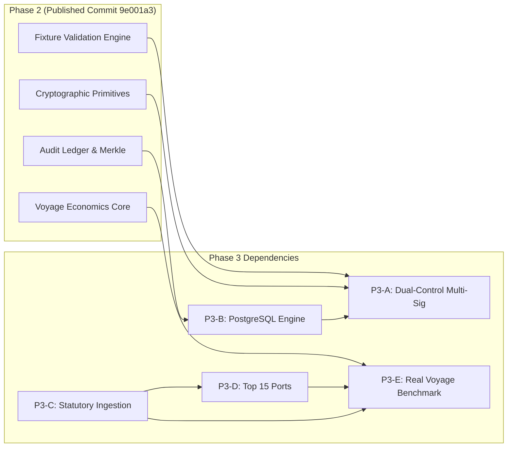

# Pelagos — Stage F1.4.3 Phase 3 Proposal
## Commercial Evidence Verification & Dual-Control Operations Foundation

**Document ID:** `PROP-F143-PHASE3-001`  
**Stage:** F1.4.3 Phase 3 Proposal (`SCOPE-F143-NEXT-001`)  
**Published Baseline Commit:** `9e001a397f8ccaee14b165e46a6b633c98cec5f4`  
**Parent Foundation:** F1.4.3 Phase 2 — Formally Remediated, Verified, and Published  
**Governing Gap Assessment:** `GAP-F143-001` (`docs/F1_4_3_NEXT_PHASE_GAP_ASSESSMENT.md`)  
**Status:** Drafting (Proposal for Project Owner Review)  

---

## 1. Executive Summary & Milestone Identification

Stage F1.4.3 Phase 2 successfully delivered the deterministic mathematical core for commercial fixture validation, cryptographic token gates, decoupled voyage economics (Gross Freight, Net Revenue, Conventional TCE, and Owner Profitability), and tamper-evident audit logging.

However, as conclusively documented in the **Post-Phase 2 Operational Readiness Gap Assessment (`GAP-F143-001`)**, immediate activation of Level 3 operational execution is commercially and technically indefensible. The platform faces 22 cataloged gaps across commercial data coverage, cryptographic custody, database concurrency, and multi-party governance.

This document formally proposes the smallest coherent, technically rigorous next milestone:
- **Stage Identifier:** `Stage F1.4.3 Phase 3`
- **Milestone Name:** `Commercial Evidence Verification & Dual-Control Operations Foundation`
- **Core Purpose:** Establish the operational evidence pipelines, enterprise PostgreSQL append-only persistence tier, dual-control multi-signature approval engine, and real-world voyage benchmarks necessary to qualify Pelagos for eventual production deployment, without prematurely activating Level 3 operations.

```
┌─────────────────────────────────────────────────────────────────────────────┐
│                       STAGE F1.4.3 PHASE 3 ARCHITECTURE                    │
├─────────────────────────────────────────────────────────────────────────────┤
│  [P3-A: Dual-Control Multi-Sig Engine]  <───>  [P3-E: Real Voyage Suite]    │
│            │                                              │                 │
│            ▼                                              ▼                 │
│  [P3-B: PostgreSQL Append-Only Storage] <───>  [P3-C: Live Data Pipelines] │
│                                                           │                 │
│                                                           ▼                 │
│                                                [P3-D: Top 15 Port Hubs]     │
└─────────────────────────────────────────────────────────────────────────────┘
```

---

## 2. Objectives and Non-Objectives

### 2.1 Objectives
1. **P3-A: Dual-Control Multi-Signature Workflow Engine:** Implement a four-eyes governance state machine requiring two distinct cryptographic signatures (Chartering Manager and Commercial Operations Director) to authorize operational fixtures, accompanied by an auditable Partial Waiver framework.
2. **P3-B: PostgreSQL Enterprise Storage & Append-Only Engine:** Author a dual-tier persistence adapter for PostgreSQL with PL/pgSQL triggers enforcing strict append-only constraints (`BEFORE UPDATE OR DELETE ON voyage_audit_log RAISE EXCEPTION`), connection pooling via PgBouncer, and role-based privilege isolation.
3. **P3-C: Statutory Ingestion Pipelines:** Implement automated, resilient daily ingestion pipelines for official central bank FX fixings (IMF SDMX, ECB XML, MAS API, Federal Reserve), daily Gatun Lake 1200h hydrology telemetry, and Suez Canal Authority circular updates.
4. **P3-D: Expanded Bulk Port Disbursement Registry:** Expand deterministic disbursement algorithms from 3 ports to the top 15 primary global bulk export/import hubs, eliminating unmonitored port failures across major dry bulk corridors.
5. **P3-E: Real-World Commercial Fixture Benchmark Suite:** Execute end-to-end reconciliation and verification against at least two completed, fully evidenced historic commercial bulk voyages, matching bank settlement figures to 0.01% precision.

### 2.2 Explicit Non-Objectives (Strict Out-of-Scope Boundaries)
1. **NO Level 3 Operational Activation:** Level 3 operational status (`is_ready_for_operations = True`, `PRODUCTION_RELEASE` unlocking) remains **strictly locked** throughout Phase 3. Phase 3 qualifies the evidence foundation; production activation is reserved for Stage F1.4.3 Phase 4.
2. **NO Physical HSM Procurement or Hardware Deployment:** Phase 3 will define the PKCS#11 software abstraction layer and mock HSM test drivers, but will not require physical server hardware procurement or cloud contract commitments during this development cycle.
3. **NO Commercial AIS Broker Feed Purchase:** AIS data scope remains strictly bounded to existing public datasets; no paid commercial subscriptions (e.g. Lloyd's List Intelligence, Kpler, MarineTraffic Enterprise) will be contracted.
4. **NO Real-Time Bank Settlement Execution:** Pelagos will calculate net freight remittances and demurrage balances to exact cent precision, but will not integrate live SWIFT/Fedwire banking APIs.
5. **NO Synthetic Data Fabrication:** In strict adherence to the project's foundational policy, no synthetic port tariffs, fabricated canal surcharges, or mock central bank exchange rates will be introduced. All new data must be supported by verifiable statutory citations.

---

## 3. Scope Boundaries & Technical Architecture

### 3.1 Component P3-A: Dual-Control Multi-Signature Workflow Engine
- **Four-Eyes Governance State Machine:** Implements a multi-party approval lifecycle:
  `DRAFT_FIXTURE` $\rightarrow$ `PENDING_CHARTERING_APPROVAL` $\rightarrow$ `PENDING_OPERATIONS_COUNTERSIGNATURE` $\rightarrow$ `APPROVED_FOR_EXECUTION` (or `REJECTED` / `ESCALATED`).
- **Role-Based Cryptographic Quorum:** Requires two distinct valid signatures from separate key pairs:
  1. Role `CHARTERING_MANAGER`: Authorizes freight rate, laycan dates, cargo quantity, and demurrage terms.
  2. Role `OPERATIONS_DIRECTOR`: Authorizes vessel statutory compliance, canal certificates, sanctions vetting, and port disbursement budgets.
- **Partial Waiver Protocol:** For non-statutory commercial discrepancies (e.g. provisional port dues pending agent update), enables authorized officers to append a cryptographically signed `PartialWaiverRecord` specifying exact parameter overrides, expiration TTL, and commercial justification.

### 3.2 Component P3-B: PostgreSQL Enterprise Storage & Append-Only Engine
- **Target Engine:** PostgreSQL 15+ with relational schema parity with existing SQLite models.
- **Engine-Level Immutability:** PL/pgSQL triggers applied to audit and execution tables:
  ```sql
  CREATE OR REPLACE FUNCTION enforce_append_only()
  RETURNS TRIGGER AS $$
  BEGIN
      RAISE EXCEPTION 'MUTATION_PROHIBITED: Table % is strictly append-only. UPDATE and DELETE operations are forbidden.', TG_TABLE_NAME;
  END;
  $$ LANGUAGE plpgsql;

  CREATE TRIGGER trg_voyage_audit_immutable
  BEFORE UPDATE OR DELETE ON voyage_disbursement_audit_log
  FOR EACH ROW EXECUTE FUNCTION enforce_append_only();
  ```
- **Privilege Separation:**
  - Role `pelagos_app`: Granted `SELECT`, `INSERT` on audit tables; zero `UPDATE`, `DELETE`, `TRUNCATE`, or `DROP` privileges.
  - Role `pelagos_admin`: Restricted to schema migrations; prohibited from application connection pools.
- **Connection Concurrency:** Configured with PgBouncer connection pooling to support >50 concurrent calculation and audit writes without file-lock timeouts.

### 3.3 Component P3-C: Statutory Data Ingestion Pipelines
- **Central Bank Daily FX Ingestion:**
  - Automated fetchers for IMF (SDR rates via SDMX 2.1 REST API), ECB (Euro foreign exchange reference rates via XML), MAS (Singapore Dollar rates via Web API), and Federal Reserve (H.10 releases).
  - Multi-jurisdictional holiday calendar reconciliation resolving non-business days to the nearest authorized statutory lookback window (4 days for central banks, 5 days for SDR).
  - Strict Decimal storage preserving source precision (4-6 decimal places).
- **Gatun Lake Hydrology Telemetry:**
  - Ingestion module fetching daily 1200h Gatun Lake water level observations published by the Panama Canal Authority (ACP).
  - Local caching with 24-hour TTL and automated fallback to prior-day level with audit notation.
- **Canal Circular Monitoring:**
  - Ingestion and checksum verification for SCA Circulars and ACP Advisory to Shipping notices.

### 3.4 Component P3-D: Expanded Bulk Port Disbursement Registry
- **Target Coverage:** Expand from 3 ports to 15 globally critical dry and liquid bulk hubs:
  1. `SGSIN` — Singapore (Existing, verified).
  2. `NLRTM` — Rotterdam, Netherlands (Existing; pilotage S-rates remediated).
  3. `USHOU` — Houston, USA (Existing; draft brackets remediated).
  4. `AUDAM` — Dampier, Australia (Pilbara iron ore export).
  5. `AUPHE` — Port Hedland, Australia (World's largest bulk export terminal).
  6. `BRTUB` — Tubarão, Brazil (Vale major iron ore export terminal).
  7. `ZARCB` — Richards Bay, South Africa (Major coal export hub).
  8. `AUNCU` — Newcastle, Australia (Major coal export terminal).
  9. `AUHPT` — Hay Point, Australia (Major metallurgical coal terminal).
  10. `CNQDG` — Qingdao, China (Major iron ore / crude import hub).
  11. `CNNBO` — Ningbo-Zhoushan, China (Major bulk transshipment terminal).
  12. `BRSSZ` — Santos, Brazil (Major grain/sugar bulk export terminal).
  13. `BRPDM` — Ponta da Madeira, Brazil (Northern system iron ore export).
  14. `IDKPT` — Tanjung Bara / Balikpapan, Indonesia (Major thermal coal terminal).
  15. `JPTYO` — Tokyo / Chiba Bay, Japan (Major energy and raw material import).
- **Tariff Modeling:** Deterministic algorithms for statutory port dues, pilotage (inward/outward), towage (mandatory tug allocations by LOA/DWT), and berthage/dockage based on published port authority schedules.

### 3.5 Component P3-E: Real-World Commercial Fixture Benchmark Suite
- **Empirical Grounding:** Acquire and model two fully closed, historically executed commercial voyage charters (e.g. Capesize Tubarão to Qingdao iron ore fixture; Panamax US Gulf to Rotterdam grain fixture).
- **Audit Verification:**
  - Input: Executed charterparty terms, actual BDRs, port agent FDAs, canal toll receipts.
  - Output: Calculate Gross Freight, Net Freight, Disbursements, Canal Tolls, Bunkers, Laytime/Demurrage, Conventional TCE, and Owner Profitability.
  - Verification: Cross-reconcile Pelagos outputs against official bank settlement statements to verify that variance does not exceed 0.01% (attributable solely to banking wire fees).

---

## 4. Dependencies and Prerequisites



### 4.1 Technical Prerequisites
1. **PostgreSQL Environment:** Dockerized PostgreSQL 15 test harness configured for isolated integration testing without modifying host OS.
2. **Statutory Document Discovery:** Acquisition and archival of public port tariff regulations for the 12 newly targeted bulk ports.
3. **Historic Commercial Records:** Commercial voyage recap and FDA evidence dossiers donated or cleared from closed historical files.

---

## 5. Deliverables Inventory

The execution of Stage F1.4.3 Phase 3 will produce the following concrete deliverables:

### 5.1 Architecture & Design Specifications
- `docs/F1_4_3_PHASE3_ARCHITECTURE.md`: Detailed system architecture, data models, state machines, and sequence diagrams for Phase 3.
- `docs/F1_4_3_PHASE3_IMPLEMENTATION_PLAN.md`: Dependency-ordered implementation plan with work breakdown packages.

### 5.2 Application Modules & Persistence Code
- `backend/pelagos/governance/multisig.py`: Dual-Control Multi-Signature state machine and quorum validator.
- `backend/pelagos/governance/waivers.py`: Auditable Partial Waiver protocol and cryptographic record schema.
- `backend/pelagos/persistence/postgres_adapter.py`: PostgreSQL storage adapter with PL/pgSQL append-only triggers.
- `backend/pelagos/ingestion/central_bank_fx.py`: Automated daily FX ingestion pipeline with holiday reconciliation.
- `backend/pelagos/ingestion/gatun_telemetry.py`: ACP Gatun Lake hydrology observation fetcher.
- `backend/pelagos/registry/ports/`: 12 new statutory port disbursement calculation modules.
- `backend/pelagos/benchmarks/real_voyage_suite.py`: Real-world voyage benchmark reconciliation engine.

### 5.3 Test Suites & Verification Artifacts
- `tests/test_phase3_multisig_governance.py`: Unit and adversarial tests for dual-control workflows.
- `tests/test_phase3_postgres_persistence.py`: Integration tests verifying append-only triggers and concurrency.
- `tests/test_phase3_statutory_ingestion.py`: Ingestion, caching, and fallback tests for live data feeds.
- `tests/test_phase3_expanded_ports.py`: Comprehensive test suite across all 15 global bulk port hubs.
- `tests/test_phase3_real_voyage_benchmark.py`: End-to-end reconciliation tests against audited historical voyages.
- `docs/F1_4_3_PHASE3_IMPLEMENTATION_REPORT.md`: Comprehensive implementation and test report.
- `docs/F1_4_3_PHASE3_INDEPENDENT_VERIFICATION.md`: Independent verification gate report.

---

## 6. Acceptance Criteria

Phase 3 will be deemed complete and eligible for closure when all of the following criteria are unconditionally met:

1. **Dual-Control Enforcement:** Fixture validation in operational evaluation mode strictly rejects any fixture lacking valid, unrevoked signatures from both `CHARTERING_MANAGER` and `OPERATIONS_DIRECTOR`.
2. **PostgreSQL Immutability:** Execution of direct SQL `UPDATE` or `DELETE` statements against `voyage_disbursement_audit_log` on the PostgreSQL test engine raises an uncatchable database exception.
3. **Concurrency Scaling:** 50 concurrent calculation and audit write threads complete successfully with zero lock timeouts and 100% hash chain continuity.
4. **Statutory Port Coverage:** All 15 target bulk hubs return valid, non-partial disbursement totals matching published port schedules for verified Capesize, Panamax, and Supramax vessel dimensions.
5. **FX Ingestion Parity:** Daily FX rates are ingested for IMF (SDR), ECB (EUR), MAS (SGD), and Fed (USD); lookback conversions during simulated bank holidays resolve to the correct preceding fixing date.
6. **Hydrology Automation:** Gatun Lake water elevation is queried automatically; Panama Canal FWS surcharge calculations execute without manual elevation overrides.
7. **Empirical Voyage Accuracy:** Voyage calculations on the two real-world benchmark voyages match audited banking settlements to within 0.01% of Net Freight.
8. **Decoupled TCE Invariant Preserved:** Conventional Voyage TCE and Owner Operating Profitability remain strictly separated across all 15 ports and benchmark voyages.
9. **Zero Baseline Mutation:** `pelagos.db` checksum and size remain 100% untouched throughout Phase 3 execution.
10. **Regression Preservation:** All 206 platform tests (Phase 1, Phase 2, and predecessor suites) continue to pass 100%.

---

## 7. Required Test Matrix & Independent Verification Strategy

```
┌─────────────────────────────────────────────────────────────────────────────┐
│                    PHASE 3 VERIFICATION TEST MATRIX                         │
├─────────────────────────────────────────────────────────────────────────────┤
│ 1. Multisig & Governance Tests (25 tests)                                   │
│    - Single-signer rejection, dual-signer pass, role mismatch rejection     │
│    - Partial waiver lifecycle, expiration, and audit ledger emission         │
│ 2. PostgreSQL Storage & Concurrency Tests (20 tests)                        │
│    - Trigger enforcement against raw UPDATE / DELETE                         │
│    - 50-thread concurrent write load test with hash continuity check         │
│ 3. Statutory Ingestion & Resilience Tests (20 tests)                        │
│    - Multi-jurisdiction bank holiday fallback resolution                    │
│    - Network timeout, malformed payload, and cached fallback recovery       │
│ 4. Expanded Port Hub Suite (30 tests)                                       │
│    - 2 tests per port (Capesize/Panamax) verifying statutory dues brackets   │
│ 5. Real Voyage Benchmark Reconciliations (10 tests)                         │
│    - Cent-level reconciliation against audited commercial banking recaps    │
│ 6. Full Regression Suite (206 predecessor tests)                            │
│    - 100% pass across all existing platform suites                          │
├─────────────────────────────────────────────────────────────────────────────┤
│ Target Phase 3 Platform Total: ~311 Passing Tests                           │
└─────────────────────────────────────────────────────────────────────────────┘
```

---

## 8. Data and Source Evidence Requirements

All new algorithms and test cases must be grounded exclusively in verifiable primary statutory evidence:
1. **Port Authority Regulations:** Official schedules published by the Pilbara Ports Authority (Dampier/Hedland), Port of Rotterdam Authority, Port of Houston Authority, Port of Santos Authority, and Vale Terminal Regulations (Tubarão).
2. **Central Bank Fixings:** Direct public API endpoints of the International Monetary Fund (IMF), European Central Bank (ECB), Monetary Authority of Singapore (MAS), and the Federal Reserve System.
3. **Hydrological Telemetry:** Official daily water level reports from the Panama Canal Authority Hydrometeorological Section.
4. **Charterparty Contracts:** Redacted, executed historical fixtures with verified broker recap messages and signed port agent FDAs.

---

## 9. Explicit Stop Conditions

Execution of Phase 3 implementation will immediately halt, roll back, and report to the Project Owner upon encountering any of the following conditions:
1. **Production Database Mutation:** Any read/write test touches or alters `pelagos.db`.
2. **Synthetic Data Contamination:** Inability to find authentic statutory schedules resulting in temptation to invent synthetic tariff brackets.
3. **Regression Failure:** Any failure within the 206 existing predecessor tests that cannot be resolved without architectural compromise.
4. **Non-Decoupled TCE Drift:** Any logic that attempts to deduct vessel OPEX or capital debt financing from Conventional Voyage TCE.
5. **Premature Level 3 Unlock:** Any attempt to flip `is_ready_for_operations = True` or enable Category 3 production tokens before independent verification signoff.

---

## 10. Prioritization & Work Breakdown

The work is prioritized strictly by risk reduction, dependency order, and empirical feasibility:

```
[Phase 3 Implementation Sequence]
  │
  ├─► Stage P3-A: Dual-Control Multi-Sig Engine (Eliminates single-sign vulnerability)
  │
  ├─► Stage P3-B: PostgreSQL Persistence Adapter (Resolves concurrency & admin tamper)
  │
  ├─► Stage P3-C: Statutory Ingestion Pipelines (Automates daily FX & Gatun telemetry)
  │
  ├─► Stage P3-D: Expanded Bulk Port Registry (Expands coverage to top 15 bulk hubs)
  │
  ├─► Stage P3-E: Real-World Commercial Benchmarks (Empirical proof against banking recaps)
  │
  └─► Stage P3-VERIFY: Independent Audit & Verification Gate (Consolidated signoff)
```

1. **P3-A (Governance First):** Dual-control governance must be designed prior to schema persistence, ensuring that multi-signature records are native to the data architecture.
2. **P3-B (Persistence):** PostgreSQL triggers must be certified before ingesting high-volume daily feeds and multi-port tariffs.
3. **P3-C (Ingestion):** Ingestion pipelines supply automated rates required by port and canal calculations.
4. **P3-D (Port Expansion):** Expands deterministic coverage across global commercial trade lanes.
5. **P3-E (Empirical Benchmarks):** Validates the entire integrated system against audited commercial reality.

---

## 11. Decisions Requiring Project Owner Approval

The following architectural and operational decisions require formal Project Owner review before implementation commences:

1. **Milestone Authorization:** Approval to adopt `Stage F1.4.3 Phase 3: Commercial Evidence Verification & Dual-Control Operations Foundation` as the formal next milestone.
2. **PostgreSQL Target Scope:** Confirmation that PostgreSQL should be introduced as an enterprise persistence option alongside SQLite, rather than completely deprecating SQLite for local development.
3. **Target Port Hub Selection:** Review and ratification of the top 12 selected bulk ports (`AUDAM`, `AUPHE`, `BRTUB`, `ZARCB`, `AUNCU`, `AUHPT`, `CNQDG`, `CNNBO`, `BRSSZ`, `BRPDM`, `IDKPT`, `JPTYO`).
4. **Dual-Control Role Hierarchy:** Ratification of `CHARTERING_MANAGER` and `OPERATIONS_DIRECTOR` as the mandatory dual-signature roles for commercial fixtures.
5. **Level 3 Locked Status:** Reaffirmation that Level 3 Operational Activation remains strictly locked until the successful completion and independent audit of Phase 3.

---

## 12. Conclusion & Next Steps

This proposal provides a comprehensive, risk-managed, dependency-ordered blueprint for advancing Pelagos toward operational readiness. By addressing the critical data, persistence, and governance gaps identified in `GAP-F143-001`, Stage F1.4.3 Phase 3 will establish an enterprise-grade commercial foundation while strictly preserving the integrity, security, and immutability of the existing codebase.

Upon Project Owner review and formal authorization:
1. Register this proposal and the gap assessment in `docs/INDEX.md`.
2. Await Owner authorization before creating any Phase 3 design specifications or code artifacts.

