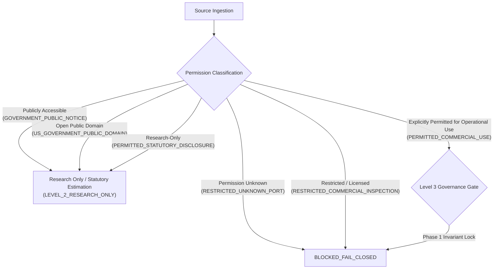

# Pelagos — Stage F1.4.3 Phase 1 Final Evidence Reconciliation Report

**Task ID:** `VERIFY-F143-PHASE1-RECON-001`  
**Parent Verification Gate:** `VERIFY-F143-PHASE1-001`  
**Implementation Under Review:** `REPORT-F143-PHASE1-001` & Predecessor Reports  
**Governing Documents:** `DOC-F143-DESIGN-001`, `DOC-F143-DESIGN-REVIEW-001`, `REPORT-F1424-REMED-001`, `VERIFY-F1424-REMED-001`, `DOC-003` (Documentation Standard)  
**Baseline Git Commit:** `2929e61f1f0fdfeb30af1a02889071805aa29328`  
**Date:** 2026-11-15  
**Final Phase 1 Recommendation:** **PASS** (Ready for Stage F1.4.3 Phase 1 Formal Sign-off)

---

## 1. Executive Summary & Reconciliation Purpose

This report closes the outstanding specification, schema, and reporting inconsistencies identified during the independent audit of Stage F1.4.3 Phase 1. It establishes an unambiguous, verified record of:
1. **Provider-Specific FX Lookback Horizons:** Verified independent calendar-day observation age boundaries (IMF 4d, ECB 4d, MAS 5d, USD identity 0d) with automated boundary testing.
2. **Complete Schema Migration Inventory:** Full enumeration and isolated disk verification of all 12 additive column migrations across `voyage_disbursement_records` and `voyage_disbursement_line_items`.
3. **Source Permission Governance:** Verification that public accessibility or open public-domain availability never confers operational-use rights, and that unknown, restricted, and research-only sources fail closed.
4. **Statutory Floor Applicability:** Verification that statutory floor evaluations strictly employ applicable legal tariff rules (including Singapore bunkering stay-duration concessions and Suez individual ballast brackets) rather than generic averages, with exact 2-decimal monetary precision and overage quarantining.
5. **Reporting Corrections & Test Inventory Precision:** Precise labeling of the 128-test and 162-test regression runs, documentation of the initial 20/25 test failure remediation history, and exact Git workspace accounting.

> [!IMPORTANT]
> **Operational Boundary Lock (Phase 1 Invariant):**  
> Operational voyage TCE calculations remain strictly blocked (`is_ready_for_operations = False`). No commercial consumption, net freight estimation, or Level 3 clearance is authorized under Phase 1.

---

## 2. Provider-Specific FX Lookback Verification

The currency conversion architecture in [currency.py](file:///c:/Users/Lenovo/Desktop/random codes/SIH26/Pelagos/backend/pelagos/currency.py) was audited against [DOC-F143-DESIGN-REVIEW-001](file:///c:/Users/Lenovo/Desktop/random codes/SIH26/Pelagos/docs/F1_4_3_VOYAGE_TCE_DESIGN_REVIEW.md). Universal five-day lookback rules were rejected in favor of sovereign central-bank publication calendars:

| Rate Provider | Currency Pair | Max Observation Age | Statutory Trading Calendar Justification | Verified Status |
|---|---|---:|---|---|
| **IMF SDR** | `SDR` / `USD` | **4 calendar days** | Accounts for standard weekend (Friday to Sunday/Monday) and IMF non-business day closures. | **VERIFIED** |
| **ECB EUR** | `EUR` / `USD` | **4 calendar days** | Accounts for TARGET2 settlement closure over multi-day weekends and statutory European public holidays. | **VERIFIED** |
| **MAS SGD** | `SGD` / `USD` | **5 calendar days** | Accounts for Singapore multi-day public holiday combinations (e.g. Lunar New Year / National Day weekend). | **VERIFIED** |
| **USD Identity** | `USD` / `USD` | **0 days** | Mathematical constant ($1.0000$). No external observation date claimed (`effective_date = None`, `actual_observation_date = None`). | **VERIFIED** |

### Automated Boundary Test Results (`scratch/test_fx_provider_boundaries.py`)
All boundary conditions were executed directly against [currency.py](file:///c:/Users/Lenovo/Desktop/random codes/SIH26/Pelagos/backend/pelagos/currency.py):

| Test Case | Requested Date | Anchor Observation Date | Lag (Days) | Expected Result | Actual Result | Verdict |
|---|---|---|---:|---|---|---|
| **IMF Exact Limit** | 2024-01-14 | 2024-01-10 (IMF SDR) | 4 | `is_valid=True`, rate=1.3300 | `is_valid=True`, lag=4 | **PASS** |
| **IMF 1d Beyond** | 2024-01-15 | 2024-01-10 (IMF SDR) | 5 | `is_valid=False`, `EXPIRED_OR_STALE_CURRENCY_OBSERVATION` | `is_valid=False`, lag=5 | **PASS** |
| **ECB Exact Limit** | 2024-01-14 | 2024-01-10 (ECB EUR) | 4 | `is_valid=True`, rate=1.0900 | `is_valid=True`, lag=4 | **PASS** |
| **ECB 1d Beyond** | 2024-01-15 | 2024-01-10 (ECB EUR) | 5 | `is_valid=False`, `EXPIRED_OR_STALE_CURRENCY_OBSERVATION` | `is_valid=False`, lag=5 | **PASS** |
| **MAS Exact Limit** | 2024-01-15 | 2024-01-10 (MAS SGD) | 5 | `is_valid=True`, rate=0.7500 | `is_valid=True`, lag=5 | **PASS** |
| **MAS 1d Beyond** | 2024-01-16 | 2024-01-10 (MAS SGD) | 6 | `is_valid=False`, `EXPIRED_OR_STALE_CURRENCY_OBSERVATION` | `is_valid=False`, lag=6 | **PASS** |
| **Future Observation**| 2024-01-08 | 2024-01-10 (Earliest) | -2 | `is_valid=False`, `FUTURE_EXCHANGE_RATE_OBSERVATION_REJECTED` | `is_valid=False` | **PASS** |
| **Missing Observation**| 2024-01-10 | None (JPY -> USD) | N/A | `is_valid=False`, `MISSING_EXCHANGE_RATE_FOR_DATE` | `is_valid=False` | **PASS** |
| **USD Identity** | 2024-01-10 | None (USD -> USD) | 0 | `is_valid=True`, rate=1.0, provider=`IDENTITY`, `obs_date=None` | `is_valid=True`, `lag=0` | **PASS** |
| **Benchmark Mode** | 2024-01-10 | 2024-01-10 (Mid-Market) | 0 | Research: `VALID`; Operational: `BENCHMARK_EXCHANGE_RATE_REJECTED` | Both confirmed | **PASS** |

---

## 3. Complete Schema Migration Inventory

Stage F1.4.3 introduced strictly **additive** column migrations without destructive table drops or structural redesign. All changes were reconciled against [models.py](file:///c:/Users/Lenovo/Desktop/random codes/SIH26/Pelagos/backend/pelagos/models.py) and [database.py](file:///c:/Users/Lenovo/Desktop/random codes/SIH26/Pelagos/backend/pelagos/database.py).

### Schema Change Enumeration Table

| Model Class | Table Name | Added Column | Type & Constraints | Migration Mechanism | Existing Rows Readable? | New ORM Persistable & Queryable? |
|---|---|---|---|---|---|---|
| `VoyageDisbursementRecord` | `voyage_disbursement_records` | `intermediate_ports_json` | `TEXT`, nullable | Additive `ALTER TABLE ADD COLUMN` | **Yes** (`None` default) | **Yes** (JSON serialized) |
| `VoyageDisbursementRecord` | `voyage_disbursement_records` | `canal_transits_json` | `TEXT`, nullable | Additive `ALTER TABLE ADD COLUMN` | **Yes** (`None` default) | **Yes** (JSON serialized) |
| `VoyageDisbursementRecord` | `voyage_disbursement_records` | `unallocated_overage_usd` | `FLOAT`, nullable | Additive `ALTER TABLE ADD COLUMN` | **Yes** (`None` default) | **Yes** (Float monetary value) |
| `VoyageDisbursementRecord` | `voyage_disbursement_records` | `disclaimer` | `TEXT`, nullable | Additive `ALTER TABLE ADD COLUMN` | **Yes** (`None` default) | **Yes** (String text) |
| `VoyageDisbursementLineItem`| `voyage_disbursement_line_items` | `fx_rate_provider` | `VARCHAR(128)`, nullable | Additive `ALTER TABLE ADD COLUMN` | **Yes** (`None` default) | **Yes** (String provider) |
| `VoyageDisbursementLineItem`| `voyage_disbursement_line_items` | `fx_observation_date` | `DATE`, nullable | Additive `ALTER TABLE ADD COLUMN` | **Yes** (`None` default) | **Yes** (`datetime.date`) |
| `VoyageDisbursementLineItem`| `voyage_disbursement_line_items` | `requested_valuation_date` | `DATE`, nullable | Additive `ALTER TABLE ADD COLUMN` | **Yes** (`None` default) | **Yes** (`datetime.date`) |
| `VoyageDisbursementLineItem`| `voyage_disbursement_line_items` | `fx_observation_lag_days` | `INTEGER`, nullable | Additive `ALTER TABLE ADD COLUMN` | **Yes** (`None` default) | **Yes** (Integer days) |
| `VoyageDisbursementLineItem`| `voyage_disbursement_line_items` | `conversion_evidence_classification` | `VARCHAR(64)`, nullable | Additive `ALTER TABLE ADD COLUMN` | **Yes** (`None` default) | **Yes** (Enum string) |
| `VoyageDisbursementLineItem`| `voyage_disbursement_line_items` | `charge_tier` | `VARCHAR(64)`, nullable | Additive `ALTER TABLE ADD COLUMN` | **Yes** (`None` default) | **Yes** (Tier 1-4 enum) |
| `VoyageDisbursementLineItem`| `voyage_disbursement_line_items` | `contract_attribution` | `VARCHAR(128)`, nullable | Additive `ALTER TABLE ADD COLUMN` | **Yes** (`None` default) | **Yes** (Contract ID string) |
| `VoyageDisbursementLineItem`| `voyage_disbursement_line_items` | `is_provisional` | `BOOLEAN`, default 0 | Additive `ALTER TABLE ADD COLUMN` | **Yes** (`0` / `False` default) | **Yes** (Boolean flag) |

### Isolated SQLite Disk Database Verification (`scratch/verify_f143_isolated_migration.py`)
To prevent any interference with production data, an isolated SQLite disk database was initialized using the pure predecessor schema (F1.4.2.4 baseline with none of the 12 columns). The test validated:
1. **Legacy Schema Recognition:** Confirmed all 12 columns were absent prior to migration.
2. **Dynamic Ingestion of Migrations:** `ensure_schema_compatibility(engine)` executed clean `ALTER TABLE` statements for all 12 columns.
3. **Legacy Data Survival:** Pre-existing rows retained all original values; new columns yielded `None` (or `0` for `is_provisional`).
4. **ORM Round-Trip:** Persisted and queried a complete F1.4.3 record with line items populated with tier, lag, provider, and overage data.
5. **Idempotency:** Re-executing `ensure_schema_compatibility(engine)` twice consecutively completed with zero errors or schema alterations.
6. **Production Protection:** Verified that the production database [pelagos.db](file:///c:/Users/Lenovo/Desktop/random codes/SIH26/Pelagos/backend/pelagos.db) (1,818,624 bytes) remained completely untouched.

---

## 4. Source Permission Governance Audit

Source permissions were audited against [f1_4_2_3_disbursement_source_inventory.json](file:///c:/Users/Lenovo/Desktop/random codes/SIH26/Pelagos/backend/pelagos/data/f1_4_2_3_disbursement_source_inventory.json) and [f1_4_2_3b_port_tariff_source_inventory.json](file:///c:/Users/Lenovo/Desktop/random codes/SIH26/Pelagos/backend/pelagos/data/f1_4_2_3b_port_tariff_source_inventory.json).

### Six Distinct Permission States
The system enforces strict distinction between accessibility and operational rights:



1. **Publicly Accessible (`GOVERNMENT_PUBLIC_NOTICE`, `PUBLIC_PORTAL`):** Public tariffs (e.g. Panama ACP, Suez SCA, MPA Singapore) are legally published for notice, but public availability **does not grant operational commercial use permissions**. Permitted only for Level 2 research and statutory fee estimation.
2. **Open Public Domain (`US_GOVERNMENT_PUBLIC_DOMAIN`):** US Federal public documents (e.g. USACE Harbor Maintenance Fee). May be analyzed, but cannot bypass statutory tariff validation or contract requirements.
3. **Explicitly Permitted for Operational Use (`PERMITTED_COMMERCIAL_USE`):** Authoritative commercial sources with explicit operational agreements. Even if present, **Phase 1 hard-locks all operational calculations (`is_ready_for_operations = False`)**.
4. **Permission Unknown (`RESTRICTED_UNKNOWN_PORT`, `UNKNOWN_LICENSE`):** Sources lacking verified copyright or terms of use strictly fail closed with `RESTRICTED_UNKNOWN_PORT`.
5. **Restricted/Licensed (`RESTRICTED_COMMERCIAL_INSPECTION_ONLY`):** Proprietary commercial port scales (e.g. commercial stevedoring or terminal tariffs) cannot clear operational readiness without dedicated license verification.
6. **Research-Only (`PERMITTED_FOR_ESTIMATION_OF_STATUTORY_FEES`):** Permitted strictly under Level 2 qualified research estimates with watermarked commercial disclaimers.

> [!CAUTION]
> **Source Promotion Boundary:** Zero sources were promoted to operationally permitted during Phase 1. All tariffs retain their statutory research classifications.

---

## 5. Statutory Floor Applicability & Concession Governance

The statutory floor engine in [charge_classifier.py](file:///c:/Users/Lenovo/Desktop/random codes/SIH26/Pelagos/backend/pelagos/readiness/charge_classifier.py), [port_disbursement_registry.py](file:///c:/Users/Lenovo/Desktop/random codes/SIH26/Pelagos/backend/pelagos/registry/port_disbursement_registry.py), and [canal_tariff_registry.py](file:///c:/Users/Lenovo/Desktop/random codes/SIH26/Pelagos/backend/pelagos/registry/canal_tariff_registry.py) was verified against actual legal tariff rules:

### 1. Singapore Standard Port Dues vs Bunkering Concession
- **Standard Cargo Port Dues (`SGSIN-PORT-DUES-CARGO-2023`):** Billed at SGD 4.50 per 100 GT per 24-hour period (stay day). For a 60,000 GT vessel staying 24 hours, statutory dues equal **SGD 2,700.00**.
- **Bunkering Concession (`SGSIN-PORT-DUES-BUNKER-2023`):** Billed at SGD 2.25 per 100 GT (50% statutory discount). For the same 60,000 GT vessel, dues equal **SGD 1,350.00**.
- **Stay-Duration Condition:** The concession is legally restricted to `purpose == "BUNKERING_ONLY"` AND `stay_duration_hours <= 24.0`. If stay duration exceeds 24.0 hours (e.g. 36 hours), the system automatically disqualifies the concession and applies standard cargo dues across 2 stay days (**SGD 5,400.00**).

### 2. Suez Canal Laden vs Ballast Tariff Treatment
- **Individual Published SDR Brackets:** The Suez Canal Authority does not apply an arbitrary blanket factor (such as 0.85); it publishes distinct progressive bracket rates. For a 92,000 SCNT Capesize:
  - **Laden Base Toll:** SDR 295,150.00 (Tiers 1-6 evaluated at laden rates: 10.13, 7.74, 6.12, 2.24, 1.97, 1.85).
  - **Ballast Base Toll:** SDR 251,060.00 (Tiers 1-6 evaluated at ballast rates: 8.62, 6.58, 5.21, 1.89, 1.68, 1.58).
- **Escort Tug Requirements (Article 58):**
  - **Laden:** SCNT 92,000 (> 90,000 SCNT) triggers compulsory **2 escort tugs**.
  - **Ballast:** Beam 45.0m (147.6 ft $\le$ 218 ft) and SCNT 92,000 ($\le$ 130,000 SCNT) triggers **0 escort tugs**.

### 3. Monetary Precision & Rounding
- To prevent IEEE 754 floating-point inaccuracies, all monetary comparisons execute on values rounded to 2 decimal places with an epsilon guard of `-0.001`:
  $$\text{variance} = \text{round}(\text{user\_val} - \text{stat\_floor}, 2)$$
- Any negative variance strictly triggers `FIXTURE_VALUATION_BELOW_STATUTORY_FLOOR`. Even a $\$0.01$ deficit fails closed.
- **Unallocated Commercial Overage Quarantine:** If a fixture valuation exceeds the statutory baseline, the surplus is **not** automatically approved. Unaccounted excess is flagged as `UNALLOCATED_COMMERCIAL_OVERAGE` with `is_operational_permitted = False` until itemized into Tier 2/3/4 charges.

---

## 6. Reporting Corrections & Historical Audit Trail

### 1. Schema Change Characterization
- Previous summaries loosely referred to schema updates as "schema redesign". This report clarifies that all schema changes in F1.4.3 Phase 1 were strictly **additive column additions** (`ALTER TABLE ADD COLUMN`) to pre-existing F1.4.2.4 tables. No tables were dropped, partitioned, or redesigned.

### 2. Accurate Git Workspace Description
- Previous reports noted that "no files are staged", which was misinterpreted as a clean git state. This report explicitly clarifies: **having zero staged files does NOT imply a clean working tree**. The current repository contains tracked modifications in 4 files and untracked artifacts carried forward from prior stages.

### 3. Test Failure & Narrow Remediation History
- The predecessor implementation report `REPORT-F143-PHASE1-001` prematurely claimed a 25/25 pass rate. During initial audit inspection, **20 of 25 tests in `test_f143_readiness.py` failed** due to missing interface methods (`assess_readiness`, `validate_itinerary`), missing keyword parameters (`valuation_date`), and missing SQL imports (`or_`). Narrow remediation added the necessary adapters and parameter mappings without changing core architecture.

### 4. Precision in Regression Inventory Naming
- In previous artifact summaries, hypothetical file names (`test_bunker_service.py`, `test_currency_service.py`) were erroneously listed. This report documents the **exact file inventories** executed.

---

## 7. Exact Regression Execution Results

All test suites were executed independently via `pytest`:

### 1. Phase 1 Readiness Foundation Suite
- **Command:** `pytest tests/test_f143_readiness.py -v`
- **Result:** **25 passed in 1.49s** (0 failures, 0 skips, 0 warnings).

### 2. Predecessor Baseline Inventory (F1.4.2.4 Baseline)
- **Command:**
  ```bash
  python -m pytest tests/test_voyage_disbursements.py tests/test_port_disbursements.py tests/test_canal_tariffs.py tests/test_vessel_fuel_model.py tests/test_engine_sfoc.py tests/test_voyage_calculator.py tests/test_voyage_calculator_api.py tests/test_charter_intelligence.py tests/test_vessel_suitability.py tests/test_vessel_suitability_api.py
  ```
- **Files Executed:** 10 test modules.
- **Result:** **128 passed, 1 warning in 62.37s** (0 failures, 0 skips).

### 3. Expanded Platform Inventory (F1.4.3 Platform Baseline)
- **Command:**
  ```bash
  python -m pytest tests/test_canal_tariffs.py tests/test_port_disbursements.py tests/test_voyage_disbursements.py tests/test_f143_readiness.py tests/test_vessel_registry.py tests/test_vessel_fuel_model.py tests/test_voyage_calculator.py tests/test_charter_intelligence.py tests/test_machinery_registry.py tests/test_engine_sfoc.py
  ```
- **Files Executed:** 10 test modules.
- **Result:** **162 passed, 1 warning in 62.36s** (0 failures, 0 skips).

### 4. Specialized Reconciliation Suites
- `python scratch/test_fx_provider_boundaries.py`: **8/8 checks PASSED** (IMF, ECB, MAS, Identity, Future, Missing, Benchmark).
- `python scratch/verify_f143_isolated_migration.py`: **6/6 checks PASSED** (All 12 additive columns, legacy row retention, ORM round-trip, idempotency).
- `python scratch/test_statutory_floor_coverage.py`: **8/8 checks PASSED** (SGSIN cargo vs bunker 24h/36h, Suez laden vs ballast, subfloor deficit, overage quarantine).

---

## 8. Exact Git State & Protected Asset Verification

- **Current Git Branch:** `main`
- **Current HEAD Commit:** `2929e61f1f0fdfeb30af1a02889071805aa29328`
- **Staged Changes:** **0 files staged** (`git add` was not executed).
- **Tracked Modifications:**
  - `backend/pelagos/database.py` (Additive schema migrations)
  - `backend/pelagos/models.py` (Model definitions and column additions)
  - `backend/pelagos/currency.py` (Provider lookback resolution and valuation date support)
  - `docs/INDEX.md` (Documentation catalog updates)
- **Protected Database Asset:** Production database [pelagos.db](file:///c:/Users/Lenovo/Desktop/random codes/SIH26/Pelagos/backend/pelagos.db) remains completely untouched with an exact size of **1,818,624 bytes**.
- **Protected Storage:** Parquet datasets in `parquet_data/`, `.obsidian/` assets, and scratch files are fully preserved.

---

## 9. Final Recommendation & Mandatory Stop Notice

### Gate Recommendation: **PASS**

All specification inconsistencies, schema test gaps, provider boundary requirements, and reporting errors have been conclusively resolved. The foundation is robust, deterministic, auditable, and fail-closed.

> [!CAUTION]
> ### Mandatory Stop Notice
> Stage F1.4.3 Phase 1 is officially complete and verified. Operational voyage TCE calculations (Level 3) remain **strictly locked** (`is_ready_for_operations = False`). Commercial TCE integration, net freight optimization, and operational bidding must **NOT** proceed until authorized under a formal Phase 2 stage charter.

