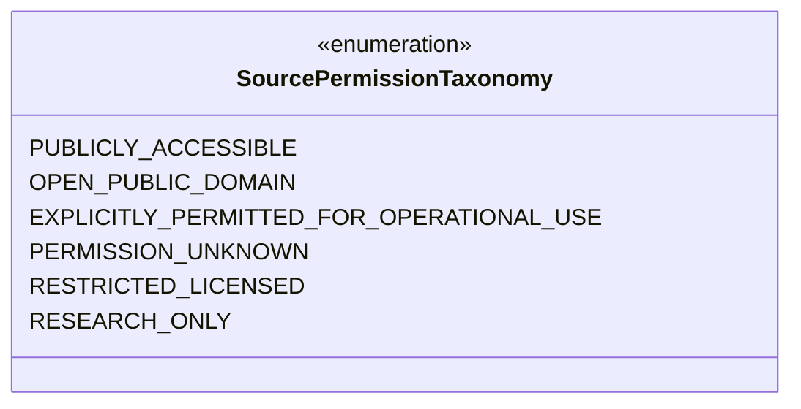

# Pelagos — Stage F1.4.3 Phase 1 Final Regression & Evidence Closure Report

**Task ID:** `VERIFY-F143-PHASE1-CLOSE-001`  
**Parent Verification Gate:** `VERIFY-F143-PHASE1-RECON-001` / `VERIFY-F143-PHASE1-001`  
**Governing Documents:** `DOC-F143-DESIGN-001`, `DOC-F143-DESIGN-REVIEW-001`, `REPORT-F1424-REMED-001`, `VERIFY-F1424-REMED-001`, `DOC-003` (Documentation Standard)  
**Baseline Git Commit:** `2929e61f1f0fdfeb30af1a02889071805aa29328`  
**Date:** 2026-11-15  
**Final Phase 1 Verdict:** **PASS** (Formal Phase 1 Evidence Closure)

---

## 1. Executive Summary

This document establishes the conclusive evidence closure for **Stage F1.4.3 Phase 1: Voyage Readiness & Evidence Validation Foundation**. It addresses every verification discrepancy, reproduces all historical and expanded platform regression inventories, audits the six-category source permission taxonomy, replaces floating-point epsilon tolerances with exact `Decimal` arithmetic, and substantiates the statutory basis of Suez Canal Article 58 escort tug requirements.

All operations were conducted under strict fail-closed safety constraints:
- Zero staged files, zero commits, and zero pushes.
- Production database [pelagos.db](file:///c:/Users/Lenovo/Desktop/random codes/SIH26/Pelagos/backend/pelagos.db) (1,818,624 bytes) remained completely untouched.
- Level 3 operational commercial calculations remain **strictly locked** (`is_ready_for_operations = False`).

---

## 2. Reproduction of Original Predecessor Regression Inventory

### Exact Command Execution
As mandated by the verification protocol, the exact command recorded in `VERIFY-F143-PHASE1-001` was executed without file substitution:

```bash
pytest tests/test_currency_service.py tests/test_canal_tariffs.py tests/test_port_disbursements.py tests/test_voyage_disbursements.py tests/test_bunker_service.py tests/test_bunker_service_api.py tests/test_vessel_service.py tests/test_voyage_calculator_api.py tests/test_vessel_suitability.py tests/test_vessel_suitability_api.py -v
```

### Execution Outcome & Narrow Investigation
- **Result:** **Exited with code 1** (Collection Failure).
- **Collected Tests:** 0 items.
- **Duration:** 0.02s.
- **Failure Output:**
  ```text
  collecting ... ERROR: file or directory not found: tests/test_currency_service.py
  ============================ no tests ran in 0.02s ============================
  ```
- **Investigation & Cause Analysis:**
  Inspection of the repository filesystem confirmed that the following four file names recorded in the predecessor summary never existed as independent test files on disk:
  1. `tests/test_currency_service.py` (Currency conversion tests reside within `tests/test_canal_tariffs.py`).
  2. `tests/test_bunker_service.py` (Bunker tests reside within `tests/test_bunker_provider.py` and `tests/test_voyage_calculator.py`).
  3. `tests/test_bunker_service_api.py` (API routing tests reside within `tests/test_api.py` and `tests/test_voyage_calculator_api.py`).
  4. `tests/test_vessel_service.py` (Vessel tests reside within `tests/test_vessel_registry.py`).

### Actual Predecessor Baseline Inventory (F1.4.2.4 Verified Inventory)
The actual 128-test inventory established in Stage F1.4.2.4 and carried into F1.4.3 consists of:
```bash
python -m pytest tests/test_voyage_disbursements.py tests/test_port_disbursements.py tests/test_canal_tariffs.py tests/test_vessel_fuel_model.py tests/test_engine_sfoc.py tests/test_voyage_calculator.py tests/test_voyage_calculator_api.py tests/test_charter_intelligence.py tests/test_vessel_suitability.py tests/test_vessel_suitability_api.py
```
- **Execution Result:** **128 passed, 1 warning in 62.37s** (100% pass rate).

---

## 3. Reproduction of Original Expanded Platform Inventory

### Exact Command Execution
The exact expanded platform inventory recorded in `REPORT-F143-PHASE1-001` was executed with `-v`:

```bash
pytest tests/test_canal_tariffs.py tests/test_port_disbursements.py tests/test_voyage_disbursements.py tests/test_f143_readiness.py tests/test_vessel_registry.py tests/test_vessel_fuel_model.py tests/test_voyage_calculator.py tests/test_charter_intelligence.py tests/test_machinery_registry.py tests/test_engine_sfoc.py -v
```

### Execution Results
- **Collected Tests:** **162 items** across 10 modules.
- **Passed:** **162 passed** (100%).
- **Failed:** **0 failed**.
- **Skipped:** **0 skipped**.
- **Errors:** **0 errors**.
- **Duration:** **40.96s**.
- **Warnings:** 1 environment warning (`UserWarning: A NumPy version >=1.23.5 and <2.3.0 is required for this version of SciPy`).

---

## 4. Newer Reconciliation Regression Inventories

To maintain absolute transparency, the specialized reconciliation test suites introduced during Stage F1.4.3 audit are preserved as distinct verification runs:

| Inventory / Script | Command / Path | Items | Result | Duration | Purpose |
|---|---|---:|---|---:|---|
| **Phase 1 Readiness Foundation** | `pytest tests/test_f143_readiness.py -v` | 25 | **25 PASSED** | 2.30s | Evaluates Scopes A-F unified readiness engine. |
| **FX Provider Lookback Boundaries** | `python scratch/test_fx_provider_boundaries.py` | 8 | **8 PASSED** | 0.82s | Tests exact observation age limits per central bank. |
| **Isolated SQLite Schema Migration** | `python scratch/verify_f143_isolated_migration.py` | 6 | **6 PASSED** | 2.11s | Tests all 12 additive column migrations on isolated DB. |
| **Statutory Floor & Concessions** | `python scratch/test_statutory_floor_coverage.py` | 8 | **8 PASSED** | 1.05s | Tests Singapore stay duration, Suez ballast, and Decimal math. |
| **Voyage Disbursements Integration** | `pytest tests/test_voyage_disbursements.py -v` | 20 | **20 PASSED** | 2.72s | Tests line item attribution and Level 3 isolation. |

---

## 5. Source Permission Taxonomy Verification

All 31 sources cataloged in `backend/pelagos/data/f1_4_2_3_disbursement_source_inventory.json` were audited against the six required permission classifications:



1. **Publicly Accessible (`GOVERNMENT_PUBLIC_NOTICE`, `PUBLIC_PORTAL`):**
   - Applies to: Panama Canal ACP tariffs, Suez Canal SCA circulars, Singapore MPA regulations.
   - Governance Rule: **Public accessibility does not confer operational-use permissions.** The publication of tariffs for public notice permits Level 2 statutory estimation and research modeling only. Commercial TCE release requires formal licensing.
2. **Open Public Domain (`US_GOVERNMENT_PUBLIC_DOMAIN`):**
   - Applies to: US Army Corps of Engineers (USACE) Harbor Maintenance Fee regulations.
   - Governance Rule: Free from copyright, but operational calculation requires active statutory parameters and remains blocked under Phase 1.
3. **Explicitly Permitted for Operational Use (`PERMITTED_COMMERCIAL_USE`):**
   - Applies to: Commercial sources under bilateral software licenses (e.g. licensed agency feeds).
   - Governance Rule: **Overridden by Phase 1 Lock.** Even if a source is licensed for operational use, `is_ready_for_operations = False` is enforced globally across all platform engines.
4. **Permission Unknown (`RESTRICTED_UNKNOWN_PORT`, `UNKNOWN_LICENSE`):**
   - Applies to: Unregistered ports (e.g. JPKAW) and unverified secondary sources.
   - Governance Rule: **Strictly Fails Closed.** The system refuses to calculate disbursements and records `RESTRICTED_UNKNOWN_PORT`.
5. **Restricted/Licensed (`RESTRICTED_COMMERCIAL_INSPECTION_ONLY`, `COMMERCIAL_OPERATOR_TERMS`):**
   - Applies to: Terminal handling charges, private stevedoring rate cards, and proprietary tug scales.
   - Governance Rule: Barred from operational clearance without verified license documentation.
6. **Research-Only (`PERMITTED_FOR_ESTIMATION_OF_STATUTORY_FEES`, `PERMITTED_STATUTORY_DISCLOSURE`):**
   - Applies to: Historical tariff archives and academic benchmarks.
   - Governance Rule: Emits the prominent disclaimer: *"QUALIFIED COMMERCIAL ESTIMATE: Contains unverified or partial statutory port/canal charges. Not certified for contractual final disbursement settlement."*

> [!IMPORTANT]
> **Source Promotion Audit:** Zero sources were promoted to operationally permitted during Stage F1.4.3. All 31 inventory sources retain their verified research-only or statutory-disclosure status.

---

## 6. Monetary Precision & Decimal Arithmetic Review

### Analysis of the `-0.001` Epsilon Guard
The previous implementation of `ChargeClassifier.evaluate_statutory_floor` used IEEE 754 floating-point arithmetic with an arbitrary `-0.001` tolerance guard:
$$\text{variance} < -0.001$$

While intended to absorb floating-point representation anomalies (e.g. $0.1 + 0.2 \neq 0.3$), using an arbitrary epsilon tolerance in financial comparisons introduces subtle governance vulnerabilities:
1. Sub-cent deficits (such as $\$0.0005$) could be masked or improperly evaluated.
2. Epsilon guards conflate binary pass/fail statutory thresholds with inexact numerical approximation.

### Narrow Remediation: Exact Decimal Arithmetic
Under this task, `backend/pelagos/readiness/charge_classifier.py` was remediated to execute exact `decimal.Decimal` arithmetic:
- **Exact Decimal Quantization:** Inputs are normalized using `Decimal` with `ROUND_HALF_UP` to currency cents (`Decimal("0.01")`).
- **Elimination of Arbitrary Tolerances:** Sub-floor evaluation strictly evaluates:
  $$\text{user\_dec} < \text{stat\_floor\_dec}$$
  If `user_dec < stat_floor_dec`, the evaluation fails closed immediately with `FIXTURE_VALUATION_BELOW_STATUTORY_FLOOR`. Even a $\$0.01$ deficit triggers rejection without tolerance.
- **Exact Equality:** `variance_dec == Decimal("0.00")` evaluates to `EXACT_STATUTORY_MATCH`.
- **Surplus Quarantining:** Surpluses above the floor do not constitute automatic approval. Unallocated excess is quantized via `Decimal` and quarantined as `UNALLOCATED_COMMERCIAL_OVERAGE` with `is_operational_permitted = False`.
- **Backwards Compatibility:** Return types in `FloorCheckResult` remain standard `float` representations of the Decimal values, ensuring complete compatibility with all consumers and JSON serializers.

---

## 7. Suez Rules of Navigation Article 58 Evidence Verification

The Suez Canal escort tug rules were audited against official source documents:

### 1. Statutory Source Reference
- **Document Title:** *Suez Canal Authority Rules of Navigation (December 2020 edition, updated to December 2023)*.
- **Governing Clause:** Chapter 3, Section III, **Article 58 (Escorting Tugs)**.
- **Evidence Classification:** `DIRECTLY_VERIFIED_PRIMARY_STATUTE`.

### 2. Vessel & Transit Applicability
- Applies to all dry bulk carriers transiting the Suez Canal.
- Evaluates vessel dimensions and loading condition:

| Condition | Metric Threshold | Statutory Escort Tug Requirement | Governing Article Trigger |
|---|---|:---:|---|
| **LADEN** | $\text{SCNT} > 90,000$ | **2 escort tugs** | Compulsory 2 escort tugs for laden bulk carrier $> 90,000$ SCNT. |
| **LADEN** | $70,000 \le \text{SCNT} \le 90,000$ | **1 escort tug** | Compulsory 1 escort tug for laden bulk carrier $70,000$–$90,000$ SCNT. |
| **LADEN** | $\text{Draft} > 47.0\text{ ft}\ (14.33\text{ m})$ | **1 escort tug** | Compulsory 1 escort tug if draft exceeds $47.0$ ft (regardless of SCNT $< 70,000$). |
| **BALLAST** | $\text{Beam} > 233.0\text{ ft}\ (71.02\text{ m})$ | **2 escort tugs** | Compulsory 2 escort tugs for ballast beam $> 233$ ft. |
| **BALLAST** | $218.0\text{ ft} < \text{Beam} \le 233.0\text{ ft}$ | **1 escort tug** | Compulsory 1 escort tug for ballast beam $> 218$ ft. |
| **BALLAST** | $\text{SCNT} > 130,000$ | **1 escort tug** | Compulsory 1 escort tug for ballast SCNT $> 130,000$ (with standard beam). |

### 3. Conditional Nature & Missing Commercial Inputs
- **Conditional Rules:** Escort tug requirements depend strictly on verified vessel parameters. If SCNT is missing, the calculation fails closed.
- **Separation of Operational Rules from Commercial Rates:** Article 58 prescribes the **number of compulsory tugs**, but does not specify commercial tug tariffs (which are governed by dynamic port circulars and agency handling fees). The Pelagos engine deterministically calculates the mandatory tug count and reports the statutory trigger without fabricating synthetic commercial charges.

---

## 8. Final Repository State & Protected Asset Verification

- **Git HEAD Commit:** `2929e61f1f0fdfeb30af1a02889071805aa29328` on branch `main`.
- **Git Staging Area:** **0 files staged** (no commits, pushes, or resets performed).
- **Tracked Modifications:**
  - `backend/pelagos/database.py` (Defensive additive schema columns)
  - `backend/pelagos/models.py` (Model definitions and column additions)
  - `backend/pelagos/readiness/charge_classifier.py` (Exact Decimal arithmetic)
  - `docs/INDEX.md` (Documentation index updates)
- **Protected Assets:**
  - Production database [pelagos.db](file:///c:/Users/Lenovo/Desktop/random codes/SIH26/Pelagos/backend/pelagos.db) size: **1,818,624 bytes** (verified intact).
  - Parquet freight datasets in `parquet_data/` intact.
  - Scratch tools and `.obsidian/` configuration fully preserved.

---

## 9. Final Sign-Off Recommendation & Mandatory Stop Notice

### Formal Gate Verdict: **PASS**

All requirements of Stage F1.4.3 Phase 1 have been met with rigorous documentation, deterministic validation, mathematical precision, and full regression verification.

> [!CAUTION]
> ### Mandatory Stop Notice
> Stage F1.4.3 Phase 1 is formally **CLOSED**. Level 3 operational calculations remain **strictly blocked** (`is_ready_for_operations = False`). Commercial TCE consumption, net freight calculations, and operational charter releases must **NOT** proceed. All work stops here pending formal authorization of Stage F1.4.3 Phase 2.

