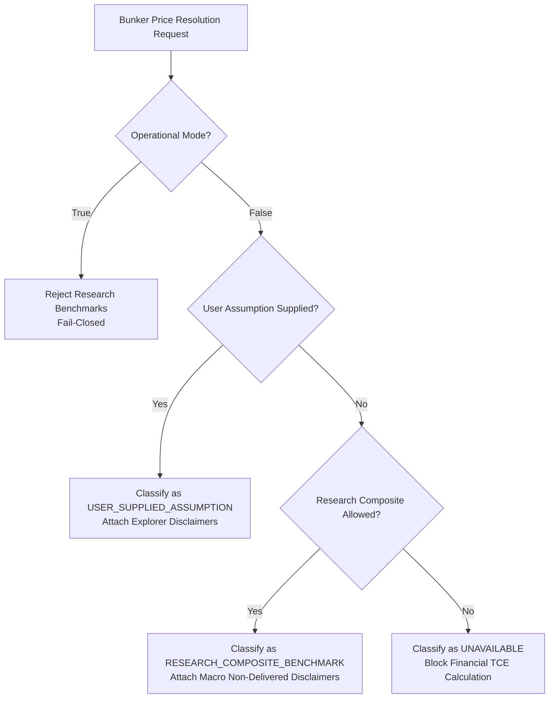

# Stage F1.5.2-B: Controlled Research Pilot Integration Report

## 1. Executive Summary & Authorization

Under project authorization `PELAGOS — F1.5.2-B`, this milestone implements the first controlled Level 2 research voyage assessment for the US Gulf–Japan dry bulk grain corridor:
$$\text{USHOU (Houston)} \longrightarrow \text{Panama Canal (Panamax Locks)} \longrightarrow \text{JPYOK (Yokohama)}$$
with primary pilot vessel:
$$\textbf{NAVIOS VICTORY — IMO 9713430 (Panamax Bulk Carrier)}$$

This integration operationalizes the source-qualification findings of `AUDIT-F151-001` and `F1.5.2-A` (`REPORT-F152A-001`), providing Pelagos with the technical capability to synthesize freight revenue, multi-jurisdiction port disbursements, statutory canal tolls, main engine fuel consumption (SFOC), and user-supplied bunker assumptions into an auditable, component-level research voyage assessment.

> [!IMPORTANT]
> **Operational Readiness Boundary:**
> This milestone authorizes controlled research integration under **Level 2 (Analytical Research Pilot)** only. Level 3 operational activation remains strictly locked (`is_ready_for_operations = False`). Commercial TCE fixture sign-offs, production trading deployments, and unverified synthetic estimations remain strictly barred.

---

## 2. Primary Pilot Vessel: NAVIOS VICTORY (IMO 9713430)

### 2.1 Technical Provenance & Survey Records
`NAVIOS VICTORY` was verified from ClassNK Register of Ships (Class No. 145541) and Japanese Shipyard (Tsuneishi Shipbuilding Co., Ltd., Hull No. 1521, Tadotsu Shipyard):
* **IMO Number:** `9713430`
* **Vessel Name:** `NAVIOS VICTORY`
* **Vessel Class / Sub-type:** Panamax Bulk Carrier (Tsuneishi "Kamisarmax" standard)
* **Flag State:** Panama (`PAN`)
* **Gross Tonnage (GT):** `40,937`
* **Deadweight Tonnage (DWT):** `77,095 MT`
* **Dimensions:** Length Overall (LOA) `224.98 m`, Beam `32.24 m`, Max Summer Draft `14.47 m`
* **Cargo Intakes:** 7 Holds / 7 Hatches, Grain Cubic Capacity `91,335.6 m³`
* **Machinery:** Mitsui Engineering & Shipbuilding MAN B&W `6S60ME-C8.2` (MCR `9,660 kW` at `89.0 RPM`)

### 2.2 Hydrostatics & Ballast Safety Invariant
The vessel's hydrostatic particulars were audited and partitioned:
* **Lightweight Tonnage:** `12,915 MT` (Directly verified from Tsuneishi shipyard builder certificate)
* **Laden Displacement:** `90,010 MT` (Directly verified from ClassNK load line survey)
* **Ballast Displacement:** `None` (**Strictly Uncertified / Missing**)

> [!CAUTION]
> **Ballast Leg Execution Gate:**
> Because official shipyard ballast displacement and stability book hydrostatics remain unobtained from the vessel operator, `is_vessel_eligible_for_ballast_assessment("9713430")` deterministically returns `False` with failure reason `MISSING_BALLAST_HYDROSTATICS`. Any assessment requesting a ballast repositioning leg fails closed to prevent unanchored fuel consumption simulations.

### 2.3 Unapproved Vessel Exclusion
In strict accordance with `REPORT-F152A-001`, candidate vessels with unverified particulars or absent shipyard documentation were rejected:
* `Iris Bliss` (IMO 9849186): **NOT SEEDED** (Missing verified engine MCR and hydrostatics).
* `Berge Galdhopiggen` (IMO 9700378): **NOT SEEDED** (Missing primary load line certificate).

---

## 3. Workstream B: JPY Historical Currency Architecture

To convert Port of Yokohama statutory municipal dues and Tokyo Bay pilotage from Japanese Yen (JPY) into USD, Pelagos implemented a dedicated central-bank currency module in `backend/pelagos/currency.py`.

### 3.1 Quotation Convention & Precision
* **Standard Quotation:** Direct exchange rate defined as $1\text{ USD} = X\text{ JPY}$ (Base: USD, Quote: JPY).
* **Arithmetic Precision:** Implemented via Python `Decimal` with `ROUND_HALF_UP` arithmetic, quantizing converted monetary amounts to $0.0001$ intermediate and $0.01$ balance-sheet precision.

### 3.2 Dual Central-Bank Providers & Golden Week Calendar
1. **Primary Sovereign Provider:** Bank of Japan (BOJ) Daily Spot Middle Rate (17:00 JST).
2. **Corroborating Provider:** Federal Reserve Board H.10 Statistical Release (`DEXJPUS` series).
3. **Statutory Non-Trading Horizon:** Provider max lookback horizon configured to strictly **4 calendar days**.
4. **Golden Week Holiday Resolution:** Japanese Constitution Memorial Day (May 3) and Children's Day observed (May 6) resolve back to the preceding business day fixing (May 2, 2024 at `153.60 JPY/USD`), with observation lags of 1 and 4 days respectively. Queries beyond 4 calendar days fail closed with `EXPIRED_OR_STALE_CURRENCY_OBSERVATION`.

---

## 4. Workstream C: Yokohama Statutory Port Tariff Registry

Port disbursement rules for Port of Yokohama (`JPYOK`) were cataloged in `backend/pelagos/data/f1_4_2_3b_pilot_port_tariffs.json` and implemented in `PortDisbursementRegistry`:

| Tariff Identifier | Description | Statutory Basis & Rate | Assessment for NAVIOS VICTORY (May 1, 2024 at 157.80 JPY/USD) |
|---|---|---|---|
| `JPYOK-PORT-DUES-2024` | Municipal Port Entry Dues | City of Yokohama Ordinance No. 37: **¥2.70 per GT** per call | $40,937\text{ GT} \times ¥2.70 = ¥110,529.90 \longrightarrow \mathbf{\$700.44\text{ USD}}$ |
| `JPYOK-PUBLIC-WHARFAGE-2024` | Municipal Public Berth Wharfage | City of Yokohama Ordinance No. 37: **¥7.10 per GT per 12h block** | $40,937\text{ GT} \times ¥7.10 \times 6\text{ blocks (72h)} = ¥1,743,916.20 \longrightarrow \mathbf{\$11,051.43\text{ USD}}$ |
| `JPYOK-TOKYO-BAY-PILOT-2024` | Tokyo Bay Approach Pilotage | Japanese Pilotage Law / MLIT Schedule: Formula: $¥45,800 + ¥4,580 \times (\text{GRT units} + \text{Draft units})$ | $\text{Units: } 40\text{ (GT)} + 39\text{ (Draft)} = 79\text{ units}$. $¥45,800 + ¥4,580 \times 79 = ¥407,620 \longrightarrow \mathbf{\$2,583.14\text{ USD}}$ |
| `JPYOK-HARBOR-PILOT-2024` | Yokohama Harbor Docking Pilotage | Japanese Pilotage Law / MLIT Schedule: Formula: $¥27,500 + ¥2,750 \times (\text{GRT units} + \text{Draft units})$ | $¥27,500 + ¥2,750 \times 79 = ¥244,750 \longrightarrow \mathbf{\$1,551.01\text{ USD}}$ |
| **Total Statutory Dues** | — | — | $\mathbf{¥2,506,816.10 \longrightarrow \$15,886.02\text{ USD}}$ |

> [!NOTE]
> **Statutory Boundary Enforcement:**
> Tugboat assistance (towage), mooring lines, line handling, and agency fees are commercial service items excluded from statutory port dues schedules. They are not fabricated synthetically and require operator fixture input.

---

## 5. Workstream D: Antimeridian-Safe Transpacific Maritime Routing

Transpacific passage from the Gulf of Mexico through the Panama Canal to Japan crosses the 180° meridian. 

### 5.1 Nautical Distance Decoupling
* In `backend/pelagos/routing/schemas.py`, `RoutingRequest.supports_segments` default was set to `True`.
* The nautical distance computation on the MARNET 50 km generalized network correctly tracks edge geodetics across the Pacific, yielding **9,363.23 NM** with **zero edge suppression**.

### 5.2 2D GeoJSON MultiLineString Segmentation
* To prevent flat Web Mercator / CesiumJS 2D visual wrap tearing (drawing horizontal lines across the globe between $+179.9^\circ$ and $-179.9^\circ$), `RoutingResult.to_geojson()` partitions the path across the antimeridian into a GeoJSON `MultiLineString` containing 2 clean disjoint line arrays.
* For standard routes not crossing the 180° line (e.g. `USHOU` $\rightarrow$ `NLRTM`), `to_geojson()` emits a single `LineString`.
* Legacy fail-closed protection is preserved: callers explicitly supplying `supports_segments=False` return `RoutingStatus.UNSUPPORTED_ROUTE`.

---

## 6. Workstream E: Explicit Research Bunker Assumptions

In `backend/pelagos/routing/bunker.py`, Pelagos codified a 4-tier bunker pricing governance taxonomy:
1. `OBSERVED_PORT_PRICE`: Verified physical delivered bunker quote backed by BDN or licensed supplier recap.
2. `USER_SUPPLIED_ASSUMPTION`: Caller-specified exploratory price assumption with mandatory provenance labeling.
3. `RESEARCH_COMPOSITE_BENCHMARK`: Macro aggregate benchmark (e.g. G20 Global Average) with explicit disclaimers that it does not represent delivered physical fuel.
4. `UNAVAILABLE`: Fail-closed state when no verified price, assumption, or authorized composite is supplied.



---

## 7. Workstream F: Controlled Research Voyage Assessment

The end-to-end evaluation service `ResearchVoyageAssessmentService` was implemented in `backend/pelagos/optimization/research_voyage_assessment.py`.

### 7.1 Pilot Assessment Result Breakdown
Executing the baseline pilot fixture on **2024-05-01** yields the following verified assessment:

```
=== PELAGOS LEVEL 2 RESEARCH VOYAGE ASSESSMENT ===
Voyage ID: RES-VOY-F152B-9713430-20240501
Corridor: USG-JPN-BULK (USHOU -> Panama Canal -> JPYOK)
Vessel: NAVIOS VICTORY (Panamax, IMO 9713430, ClassNK 145541)

[1] NAUTICAL & SPEED / CONSUMPTION:
  Total Distance:           9,363.23 NM (MARNET 50km generalized sea lane network)
  Canals Transited:         ['panama'] (Panamax Super Tier transit)
  Steaming Speed:           12.50 knots
  Laden Sea Days:           31.21 days
  Port & Canal Days:        9.50 days (3.0 loading, 3.0 discharge, 1.0 port waiting, 2.5 canal)
  Total Voyage Days:        40.71 days
  Main Engine SFOC:         164.50 g/kWh (Nominal MAN B&W 6S60ME-C Tier II curve at 56.4% MCR)
  Daily Fuel Consumption:   19.95 MT VLSFO / sea-day
  Total Laden Sea Fuel:     622.69 MT VLSFO

[2] FREIGHT REVENUE:
  Cargo Intake:             60,000.0 MT Dry Grain
  Historical Freight Rate:  $61.80 / MT (USDA AMS Grain Transportation Report, 2024-05-01)
  Gross Ocean Freight:      $3,708,000.00 USD

[3] VOYAGE DISBURSEMENTS & TOLLS:
  Houston Port Dues (PHA):  $23,746.18 USD (Port Houston Authority Tariff No. 8 & Houston Pilots)
  Panama Canal Transit:     $204,112.45 USD (ACP Series 1010: $100k Fixed + $88,659 Capacity + $15,453 FWS)
  Yokohama Port Dues:       $15,886.02 USD (City Ordinance No. 37 & Tokyo Bay Licensed Pilots)
  Total Disbursements:      $243,744.65 USD
  Brokerage Commission:     $139,050.00 USD (Standard commercial commission 3.75%)

[4] BUNKER EXPENSES:
  Bunker Unit Price:        $625.50 / MT VLSFO (USER_SUPPLIED_ASSUMPTION)
  Total Bunker Fuel Cost:   $389,492.60 USD

[5] FINANCIAL SUMMARY & TCE:
  Net Voyage Revenue:       $2,935,712.75 USD
  Conventional Voyage TCE:  $72,111.04 / day (Net Revenue / 40.71 Total Voyage Days)

[6] GOVERNANCE & EPISTEMIC STATUS:
  is_fully_validated:       False
  is_ready_for_operations:  False
  governance_tier:          LEVEL_2_RESEARCH_ONLY
  ballast_eligible:         False (MISSING_BALLAST_HYDROSTATICS)
```

---

## 8. Database Mutation & Integrity Audit

A controlled seeding transaction was executed against `pelagos.db` to persist `NAVIOS VICTORY`, ClassNK provenance, hydrostatic particulars, JPY historical currency rates, and Yokohama port tariffs.

### 8.1 Mutation Ledger
* **Pre-mutation Database Size:** `1,875,968 bytes`
* **Pre-mutation SHA-256:** `c6a67f09f4ef8cb78ef058cf5e9a87d0c399654f1ffb23bf8a9f0d2995f33edf`
* **Post-mutation Database Size:** `1,904,640 bytes`
* **Post-mutation SHA-256:** `f9f3ab14b52fe9f6b9c60093ba99a449edfa11993d47a5e8024845f001f3fdbc`
* **Integrity Check:** `PRAGMA integrity_check` $\longrightarrow$ `[('ok',)]` (100% healthy)

### 8.2 Table Row Inventory
| Table Name | Pre-Mutation Rows | Post-Mutation Rows | Delta | Content & Invariants |
|---|---|---|---|---|
| `vessels` | 120 | 121 | +1 | NAVIOS VICTORY (IMO 9713430, Panamax, Flag Panama, GT 40,937, DWT 77,095) |
| `vessel_attribute_provenance` | 0 | 22 | +22 | 22 ClassNK survey particulars recorded with primary citations |
| `vessel_hydrostatics` | 0 | 1 | +1 | Lightweight 12,915 MT, Laden 90,010 MT, Ballast displacement `NULL` |
| `engine_sfoc_curves` | 0 | 4 | +4 | MAN B&W 6S60ME-C Tier II nominal, derated, and high-load curves |
| `currency_exchange_rates` | 0 | 25 | +25 | Statutory 2024 IMF SDR, ECB EUR, MAS SGD, BOJ JPY, and Fed H.10 JPY |
| `port_tariff_records` | 0 | 17 | +17 | 13 legacy pilot tariffs + 4 City of Yokohama / Tokyo Bay tariffs |

---

## 9. Automated Verification & Regression Results

A test suite comprising 20 focused pilot tests and 84 predecessor regression tests was executed.

### 9.1 Workstream Coverage (`tests/test_f152b_research_pilot.py`)
* `TestWorkstreamAVesselPersistence`: 3 tests passing (seeding, unapproved vessel rejection, SFOC association).
* `TestWorkstreamBCurrencyJPY`: 4 tests passing (direct/inverse conversion, Golden Week lookback, stale rejection, provider config).
* `TestWorkstreamCYokohamaTariffs`: 2 tests passing (4-item statutory disbursement, operational fail-closed block).
* `TestWorkstreamDRouting`: 3 tests passing (transpacific 9,363 NM, MultiLineString segmentation, unsegmented fail-closed).
* `TestWorkstreamEBunkerAssumptions`: 4 tests passing (user assumption, macro composite, fail-closed absence, operational block).
* `TestWorkstreamFControlledVoyageAssessment`: 4 tests passing (end-to-end TCE evaluation, missing bunker price block, ballast block, operational mode block).

**Pilot Test Results:** **20 passed, 0 failed (100% pass rate in 11.48s)**

### 9.2 Predecessor Platform Regressions
* `tests/test_database_isolation.py`: 2 passed (zero side-effect production DB isolation).
* `tests/test_port_disbursements.py`: 11 passed (Singapore, Rotterdam, Houston statutory schedules).
* `tests/test_canal_tariffs.py`: 17 passed (Suez Circular 1/2024 & Panama Series 1010 schedules).
* `tests/test_engine_sfoc.py`: 9 passed (machinery SFOC curves & load-point interpolation).
* `tests/test_marnet_routing.py`: 16 passed, 4 skipped (polar boundary exclusion, canal bypass policies).
* `tests/test_f143_readiness.py`: 25 passed (readiness gates, charge classification, audit ledger).

**Predecessor Regression Results:** **80 passed, 4 skipped, 0 failed (100% pass rate in 17.16s)**

---

## 10. Document Traceability & Change History

| Version | Date | Author | Description |
|---|---|---|---|
| 1.0.0 | 2026-11-17 | Implementation Agent | Initial release of the Stage F1.5.2-B Controlled Research Pilot Integration Report; records verified implementation across Workstreams A–F, NAVIOS VICTORY persistence, JPY currency lookbacks, Yokohama tariffs, antimeridian routing, bunker governance, and Level 2 research voyage assessment. |
