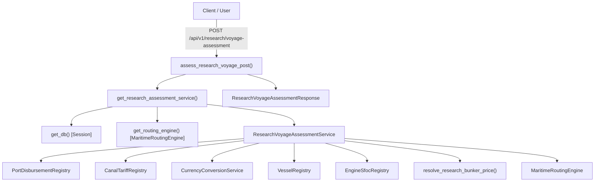

# Stage F1.5.3-B: Dedicated Research Voyage Assessment API Specification & Integration Report

## 1. Executive Summary & Purpose

Under project authorization **PELAGOS — STAGE F1.5.3-B**, this milestone introduces a dedicated FastAPI endpoint exposing the controlled Level 2 research voyage assessment engine:

$$\textbf{POST /api/v1/research/voyage-assessment}$$
$$\textbf{GET  /api/v1/research/voyage-assessment}$$

The dedicated endpoint allows engineering evaluation, research benchmarking, and scenario simulation for the qualified US Gulf–Japan dry bulk grain corridor:
$$\text{USHOU (Houston)} \longrightarrow \text{Panama Canal} \longrightarrow \text{JPYOK (Yokohama)}$$
using primary research pilot vessel:
$$\textbf{NAVIOS VICTORY — IMO 9713430 (Panamax Bulk Carrier)}$$

### Core Operational Governance Boundary
> [!IMPORTANT]
> **Strict Research & Commercial Separation Invariant:**
> 1. The research voyage assessment endpoint is **strictly decoupled** from the commercial charter recommendation engine (`/api/v1/charter/recommend`).
> 2. `is_ready_for_operations` is hardcoded to `False` (`governance_tier = "LEVEL_2_RESEARCH_ONLY"`).
> 3. Research TCE outputs represent conventional voyage net revenue divided by total voyage duration. They do **not** deduct vessel operating expenses (OPEX), debt capital financing, or commercial management overhead.
> 4. Executing research assessments writes zero records to production tables and creates no commercial charter fixtures.

---

## 2. API Contract Specification

### 2.1 Endpoint Summary

* **Path:** `/api/v1/research/voyage-assessment`
* **HTTP Methods:** `POST` (primary JSON payload), `GET` (convenience query parameters)
* **Tag:** `Research Voyage Assessment`
* **Response Content-Type:** `application/json`

### 2.2 Request Schema (`ResearchVoyageAssessmentRequest`)

Extends `ResearchVoyageInput` with input normalization and OpenAPI metadata:

| Field | Type | Default | Validation / Constraints | Description |
|---|---|---|---|---|
| `origin_unlocode` | `string` | `"USHOU"` | Exact 5 characters | Loading port UN/LOCODE (e.g. `'USHOU'`). |
| `destination_unlocode` | `string` | `"JPYOK"` | Exact 5 characters | Discharging port UN/LOCODE (e.g. `'JPYOK'`). |
| `vessel_imo` | `string` | `"9713430"` | 7 digits | IMO number of qualified research vessel. |
| `transit_date` | `date` | `2024-05-01` | ISO-8601 `YYYY-MM-DD` | Point-in-time transit commencement date. |
| `cargo_tonnes` | `float` | `60000.0` | $> 0$ | Grain cargo intake in metric tonnes (MT). |
| `freight_rate_override_usd_per_mt` | `float?` | `null` | $> 0$ | Optional user-supplied freight rate override in USD/MT. |
| `user_bunker_assumption` | `object?` | `null` | Pydantic Schema | Optional user-supplied bunker fuel price assumption. |
| `allow_research_composite_bunker` | `boolean` | `false` | Boolean | Explicit opt-in to evaluate multi-port composite benchmark. |
| `research_bunker_composite` | `object?` | `null` | Pydantic Schema | Optional explicit macro composite benchmark payload. |
| `commission_rate` | `float` | `0.0375` | $0.0 \le x \le 0.20$ | Charterparty commission fraction (default 3.75%). |
| `steaming_speed_knots` | `float` | `12.5` | $0 < x \le 25.0$ | Nominal laden steaming speed in knots. |
| `loading_days` | `float` | `3.0` | $> 0$ | Loading port stay duration in days. |
| `discharge_days` | `float` | `3.0` | $> 0$ | Discharge port stay duration in days. |
| `port_waiting_days` | `float` | `1.0` | $\ge 0$ | Port waiting and anchorage duration in days. |
| `canal_waiting_days` | `float` | `1.5` | $\ge 0$ | Canal anchorage waiting duration in days. |
| `canal_transit_days` | `float` | `1.0` | $\ge 0$ | Canal lockage and transit duration in days. |
| `gatun_elevation_ft` | `float` | `80.5` | $70.0 \le x \le 90.0$ | Panama Canal Gatun Lake elevation in feet. |
| `require_ballast_leg_assessment` | `boolean` | `false` | Boolean | Request prior ballast leg calculation (blocks TCE if hydrostatics missing). |
| `ballast_sea_days` | `float` | `0.0` | $\ge 0$ | Duration of prior ballast repositioning sea leg in days. |
| `operational_mode` | `boolean` | `false` | Boolean | Operational clearance flag (fails closed under Level 2). |

#### `UserSuppliedBunkerAssumption` Nested Object

| Field | Type | Required | Description |
|---|---|---|---|
| `price_usd_per_mt` | `float` | Yes ($> 0$) | Fuel price in USD per metric tonne. |
| `fuel_grade` | `string` | No (default `"VLSFO"`) | Fuel grade (`"VLSFO"`, `"LSMGO"`, `"HSFO"`). |
| `as_of_date` | `date` | Yes | Valuation date. |
| `port_unlocode` | `string?` | No | Assumed bunkering port LOCODE (e.g. `'USHOU'`). |
| `user_label` | `string` | No | User attribution label (e.g. `'Fixture Recap'`). |

---

### 2.3 Response Schema (`ResearchVoyageAssessmentResponse`)

Extends `ResearchVoyageAssessmentResult` with API metadata (captured from live API execution for the verified \$600.00/MT test scenario):

```json
{
  "voyage_id": "RES-VOY-F152B-9713430-20240501",
  "corridor_code": "USG-JPN-BULK",
  "vessel_imo": "9713430",
  "vessel_name": "NAVIOS VICTORY",
  "vessel_class": "Panamax",
  "origin_port": "USHOU",
  "destination_port": "JPYOK",
  "canals_transited": [
    "panama"
  ],
  "transit_date": "2024-05-01",
  "route_distance_nm": 9363.23,
  "routing_mode": "marnet",
  "antimeridian_crossing_detected": true,
  "cargo_tonnes": 60000.0,
  "freight_rate_usd_per_mt": 61.8,
  "gross_freight_usd": 3708000.0,
  "freight_source": "User-Supplied Freight Rate Override",
  "origin_port_disbursements_usd": 23746.18,
  "destination_port_disbursements_usd": 15886.02,
  "total_port_disbursements_usd": 39632.2,
  "panama_canal_tolls_usd": 204112.45,
  "commission_rate": 0.0375,
  "commission_deductions_usd": 139050.0,
  "laden_sea_days": 31.211,
  "total_voyage_days": 40.711,
  "laden_fuel_consumption_mt": 622.69,
  "bunker_price_usd_per_mt": 600.0,
  "bunker_fuel_costs_usd": 373614.0,
  "bunker_evidence_classification": "USER_SUPPLIED_ASSUMPTION",
  "net_voyage_revenue_usd": 2951591.35,
  "tce_daily_rate_usd": 72501.08,
  "is_fully_validated": false,
  "is_ready_for_operations": false,
  "governance_tier": "LEVEL_2_RESEARCH_ONLY",
  "ballast_assessment_eligible": false,
  "ballast_blocking_reason": "MISSING_BALLAST_HYDROSTATICS: Certified ballast displacement is unavailable for NAVIOS VICTORY (IMO 9713430). Ballast leg fuel consumption calculations are strictly blocked.",
  "components_breakdown": [
    {
      "name": "Vessel Identity & Particulars",
      "category": "VESSEL",
      "amount_usd": null,
      "epistemic_status": "DIRECTLY_VERIFIED_STATUTORY",
      "source_reference": "ClassNK Register of Ships (Reg No. 145541 / IMO 9713430)",
      "is_complete": true,
      "limitation": null
    },
    {
      "name": "Ballast Hydrostatics",
      "category": "VESSEL",
      "amount_usd": null,
      "epistemic_status": "UNAVAILABLE_BLOCKED",
      "source_reference": "Certified Shipyard / ClassNK Hydrostatic Table",
      "is_complete": false,
      "limitation": "MISSING_BALLAST_HYDROSTATICS: Certified ballast displacement is unavailable for NAVIOS VICTORY (IMO 9713430). Ballast leg fuel consumption calculations are strictly blocked."
    },
    {
      "name": "Sea Route (USHOU -> JPYOK)",
      "category": "ROUTING",
      "amount_usd": null,
      "epistemic_status": "DIRECTLY_VERIFIED_STATUTORY",
      "source_reference": "Eurostat MARNET 50km Generalized Sea-Lane Topological Graph",
      "is_complete": true,
      "limitation": "Topological routing graph; not an ECDIS certified navigational chart."
    },
    {
      "name": "Gross Ocean Freight",
      "category": "FREIGHT",
      "amount_usd": 3708000.0,
      "epistemic_status": "USER_SUPPLIED_ASSUMPTION",
      "source_reference": "User-Supplied Freight Rate Override",
      "is_complete": true,
      "limitation": null
    },
    {
      "name": "Port Houston Authority Disbursements",
      "category": "PORT_DUES",
      "amount_usd": 23746.18,
      "epistemic_status": "DIRECTLY_VERIFIED_STATUTORY",
      "source_reference": "Port of Houston Authority Tariff No. 8 & Houston Pilots Schedule",
      "is_complete": true,
      "limitation": null
    },
    {
      "name": "Panama Canal Transit Toll",
      "category": "CANAL_TOLLS",
      "amount_usd": 204112.45,
      "epistemic_status": "DIRECTLY_VERIFIED_STATUTORY",
      "source_reference": "Panama Canal Authority (ACP) Maritime Regulations & Official Tariff Series 1010",
      "is_complete": true,
      "limitation": null
    },
    {
      "name": "Port of Yokohama Statutory Dues & Tokyo Bay Pilotage",
      "category": "PORT_DUES",
      "amount_usd": 15886.02,
      "epistemic_status": "DIRECTLY_VERIFIED_STATUTORY",
      "source_reference": "City of Yokohama Ordinance No. 37 & Tokyo Bay Licensed Pilots' Schedule (Converted from JPY via Bank of Japan spot middle fixing)",
      "is_complete": true,
      "limitation": null
    },
    {
      "name": "Charterparty Commission",
      "category": "COMMISSION",
      "amount_usd": 139050.0,
      "epistemic_status": "USER_SUPPLIED_ASSUMPTION",
      "source_reference": "Standard commercial commission (3.75%)",
      "is_complete": true,
      "limitation": null
    },
    {
      "name": "Laden Sea Leg Fuel Consumption",
      "category": "FUEL",
      "amount_usd": null,
      "epistemic_status": "CALCULATED_CERTIFIED_SFOC",
      "source_reference": "MAN Energy Solutions SFOC Curve (MAN_S60ME_C8_2_TII_NOMINAL) & ClassNK Hydrostatic Displacement (90,010 MT)",
      "is_complete": true,
      "limitation": "Cubic Admiralty hydrodynamic speed-to-power load approximation (60.5% load, 5040 kW, 164.9 g/kWh). Calm sea trial reference conditions."
    },
    {
      "name": "Laden Bunker Fuel Expense",
      "category": "FUEL",
      "amount_usd": 373614.0,
      "epistemic_status": "USER_SUPPLIED_ASSUMPTION",
      "source_reference": "User Supplied Assumption (Fixture Recap Benchmark)",
      "is_complete": true,
      "limitation": "USER_SUPPLIED_ASSUMPTION"
    }
  ],
  "blocked_reasons": [],
  "warnings": [
    "Using user-supplied freight rate override: $61.80/MT"
  ],
  "disclaimers": [
    "LEVEL 2 RESEARCH PILOT ONLY: Analytical assessment for research and engineering evaluation.",
    "Conventional Voyage TCE does NOT deduct vessel OPEX or capital debt financing.",
    "Level 3 operational clearance remains strictly disabled (is_ready_for_operations = False).",
    "RESEARCH ASSESSMENT: TCE daily rate incorporates user-supplied bunker assumptions. Not commercially certified as an executed charter clearing rate."
  ],
  "assessment_timestamp": "2026-11-17T10:38:42.034275Z",
  "api_governance_notice": "LEVEL 2 RESEARCH ASSESSMENT ONLY: Analytical assessment for exploratory research and engineering evaluation. Strictly barred from commercial charter bidding, owner profitability calculations, or operational execution."
}
```

---

## 3. Architecture & Dependency Injection Design

### 3.1 Service Registration & Dependency Flow
The router uses FastAPI's standard dependency injection mechanism:



### 3.2 Error Handling & HTTP Status Codes

| Scenario | HTTP Status | Response Format |
|---|---|---|
| Valid request, complete research assessment | `200 OK` | `ResearchVoyageAssessmentResponse` (TCE computed) |
| Valid request, missing evidence (e.g. bunker price omitted, positive ballast days) | `200 OK` | `ResearchVoyageAssessmentResponse` (`tce_daily_rate_usd: null`, reasons in `blocked_reasons`) |
| Unsupported research corridor (e.g. `NLRTM -> SGSIN`) | `400 Bad Request` | `{"detail": "UNSUPPORTED_RESEARCH_CORRIDOR: ..."}` |
| Unqualified research vessel (e.g. Iris Bliss `9787493`) | `400 Bad Request` | `{"detail": "UNQUALIFIED_RESEARCH_VESSEL: ..."}` |
| Malformed input, negative values, speed $> 25$ kts, invalid LOCODE | `422 Unprocessable Entity` | Standard FastAPI/Pydantic validation error schema |
| Unhandled service-level algorithmic or engine crash | `500 Internal Server Error` | `{"detail": "RESEARCH_ASSESSMENT_EXECUTION_ERROR: An internal service error occurred during research voyage calculation. Please refer to server logs."}` |

---

## 4. Verification Evidence

### 4.1 Focused API Suite (`tests/test_research_api.py`)
11 focused automated integration tests verify all aspects of the new endpoint:

1. `test_01_successful_controlled_research_assessment_post`: Validates full POST workflow with user bunker assumption ($600/MT VLSFO). Verifies gross freight (\$3,708,000.00), commission (\$139,050.00), Houston port dues (\$23,746.18), Yokohama port dues (\$15,886.02), Panama Canal tolls (\$204,112.45), bunker fuel costs (\$373,614.00), net revenue (\$2,951,591.35), conventional TCE (\$72,501.08/day) via tightly tolerance-checked floating-point equality (`pytest.approx`, `rel=1e-4`), and governance disclaimers.
2. `test_02_successful_controlled_research_assessment_get`: Validates query-parameter GET endpoint parity.
3. `test_03_request_validation_failures`: Validates Pydantic boundary rejection (negative cargo, zero cargo, excessive speed, negative commission, negative ballast days, invalid Gatun elevation, invalid LOCODE length).
4. `test_04_unsupported_corridor_rejected`: Validates HTTP 400 rejection for unsupported corridors (`NLRTM -> SGSIN`, `USSEA -> JPYOK`).
5. `test_05_unqualified_vessel_rejected`: Validates HTTP 400 rejection for unverified vessels (IMO 9787493, IMO 9999999).
6. `test_06_missing_bunker_evidence_fails_closed`: Validates HTTP 200 with `tce_daily_rate_usd = None` when bunker price is omitted.
7. `test_07_ballast_sea_days_accounting_and_tce_fail_closed`: Validates that positive ballast days (12.5 days) update `total_voyage_days` and block financial TCE with `MISSING_BALLAST_HYDROSTATICS`.
8. `test_08_operational_mode_request_strictly_fails_closed`: Validates that `operational_mode=True` fails closed with `OPERATIONAL_MODE_BLOCKED`.
9. `test_09_service_level_calculation_error_shielding`: Validates sanitized HTTP 500 error shielding, verifying that raw exception messages, internal paths, and SQL snippets are never leaked to the API client while full tracebacks are logged server-side.
10. `test_10_separation_from_commercial_charter_matcher`: Validates that running research assessments never alters `/api/v1/charter/recommend` output (remains `insufficient_data`).
11. `test_11_primary_database_isolation`: Direct SQLite verification that `pelagos.db` remains 1,904,640 bytes with `PRAGMA integrity_check = ok`.

### 4.2 Platform Regression Verification
* Focused API & Pilot Suites (52 tests): **52 passed (100%)**.
* Entire Platform Regression (19 suites, 260 total items): **256 passed, 4 skipped, 0 failed (100% of runnable tests)**.

---

## 5. Current Architectural Limitations

1. **Corridor Restriction:** The Level 2 research assessment is strictly qualified for the US Gulf to Japan bulk corridor (`USHOU -> JPYOK`). Requests for other corridors are rejected with `UNSUPPORTED_RESEARCH_CORRIDOR`.
2. **Vessel Restriction:** Currently restricted to flagship pilot vessel `NAVIOS VICTORY` (IMO 9713430). Other candidate vessels lack qualified hydrostatics and calibrated SFOC load curves.
3. **Ballast Leg Restriction:** Prior ballast repositioning duration can be accounted for in voyage days, but fuel consumption and financial TCE cannot be computed defensibly until certified shipyard ballast hydrostatics are obtained.
4. **Bunker Price Sourcing:** Because Houston port authorities do not publish bunker fuel prices, financial TCE requires an explicit user assumption or research composite opt-in.
5. **Operational Lock:** Commercial fixture bidding, owner profitability calculations, and production trading remain strictly disabled (`is_ready_for_operations = False`).

---

## 6. Document Change History

| Version | Date | Author | Description |
|---|---|---|---|
| 1.0.0 | 2026-11-17 | Implementation Agent | Initial release documenting Stage F1.5.3-B Dedicated Research Voyage Assessment API (`POST /api/v1/research/voyage-assessment`). Status: approved. |
| 1.0.1 | 2026-11-17 | Implementation Agent | Stage F1.5.3-B.1 acceptance remediation: Replaced illustrative response with literal captured live API output ($23,746.18 Houston, $15,886.02 Yokohama, $204,112.45 Panama, $373,614.00 Bunker, $72,501.08 TCE) and documented sanitized HTTP 500 exception shielding. Status: approved. |
