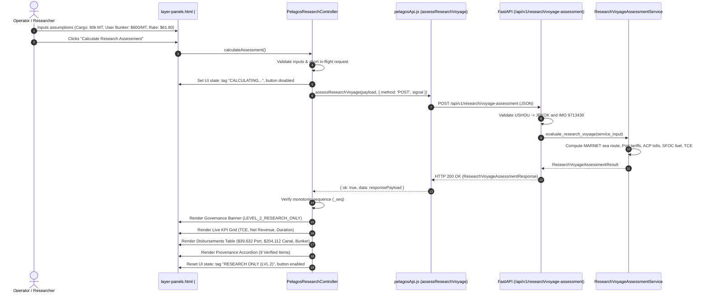

# Stage F1.5.3-C: Frontend Discovery & Integration Plan
## Dedicated Research Voyage Assessment User Interface

---

## 1. Executive Summary

Under project authorization **PELAGOS — STAGE F1.5.3-C (Frontend Discovery & Integration Planning)**, this document establishes the technical discovery and engineering integration plan for presenting the dedicated **Research Voyage Assessment API** (`/api/v1/research/voyage-assessment`, delivered in Stage F1.5.3-B) within the Pelagos maritime intelligence frontend (`gods-eye-view-main`).

Implementation of the design specified herein is reserved for **Stage F1.5.3-D (Proposed Frontend Implementation)** upon explicit operator authorization.

### 1.1 Context & Motivation
In Stage F1.5.2-B, Pelagos established its first controlled Level 2 research voyage assessment for the US Gulf–Japan dry bulk corridor (`USHOU → Panama Canal → JPYOK`) using flagship pilot vessel `NAVIOS VICTORY` (IMO 9713430). Stage F1.5.3-B exposed this engine via a dedicated, decoupled FastAPI route.

However, an engineering audit revealed an operational usability defect:
When operators entered Houston (`USHOU`) and Yokohama (`JPYOK`) into the existing "Charter Readiness Audit" UI card, the frontend executed `/api/v1/charter/recommend`. That endpoint evaluates commercial open-tonnage availability and market fixtures—data that does not exist in the research registry—resulting in withheld recommendations (`insufficient_data`). Operators had no visual interface to invoke the controlled Level 2 research assessment or inspect its verified statutory disbursements, transit tolls, and evidence-backed calculation.

### 1.2 Objective & Constraints
This plan provides the blueprint to integrate a dedicated **Level 2 Research Voyage Assessment** card into the Pelagos intelligence panel in Stage F1.5.3-D.

**Governing Constraints:**
1. **Zero Framework Churn:** Maintain the existing vanilla ES module + Vite architecture; no new dependencies or frameworks.
2. **Strict Epistemic Decoupling:** The research interface communicates exclusively with `/api/v1/research/voyage-assessment`. It never calls `/api/v1/charter/recommend` or `/api/v1/charter/assess`.
3. **Mandatory Governance Prominence & Non-Green Styling:** The interface must visibly enforce `LEVEL_2_RESEARCH_ONLY` and `is_ready_for_operations = false`. Research calculations must never be represented as commercial charter recommendations or operational fixtures. Styling must never use green operational success badges (`tag-ready` / `tag-verified`); distinct research styling (indigo/purple `.tag-model`) is mandatory.
4. **Honest Bunker Assumption Semantics:** A bunker price value (e.g. $600/MT) must never appear to be a verified market observation or live bunker quote. The input must prefer a blank default requiring explicit user entry/confirmation, clearly identified as a user-supplied research assumption.
5. **Fixed Pilot Corridor & Port Selector Isolation:** The research endpoint remains restricted strictly to `USHOU → JPYOK`. Global port selectors must not silently alter the research request. When global ports differ, an explicit compatibility restriction notice must be displayed.
6. **No Pre-Calculated Live Values:** The initial state of the card must display empty placeholders (`—`). Financial KPIs must only populate from a successful live API response; any example values in documentation must be explicitly labelled as illustrative.
7. **Honest Value Representation:** Missing or withheld financial values (e.g. when bunker price is omitted, ballast hydrostatics are uncertified, or operational mode is flagged) must display as "Withheld / Blocked", never as zero ($0.00).

---

## 2. Verified Frontend Architecture

An exhaustive inspection of `gods-eye-view-main/` confirms the following architecture:

### 2.1 Framework, Tooling & Build Pipeline
- **Runtime & Language:** Vanilla ECMAScript 2022+ Modules (`"type": "module"` in `package.json`). No React, Vue, Angular, or TypeScript runtime dependencies.
- **Build Tool:** Vite 6 (`"vite": "^6.0.0"`, `"vite-plugin-cesium": "^1.2.23"`). Fast HMR, Rollup production bundling.
- **Geospatial & 3D Visualization:** CesiumJS 1.124 (`"cesium": "^1.124.0"`).
- **Styling Pipeline:** Native CSS files imported into the DOM. Primary styles reside in `gods-eye-view-main/src/ui/styles/` (`pelagos.css`, `pelagos-explorer.css`, `foundation.css`, `command-dock.css`).
- **Test Runner:** Native Node.js test runner (`node:test`, `node:assert/strict`), orchestrated by `gods-eye-view-main/scripts/run-unit-tests.mjs`.

### 2.2 Entry Points & UI Structure
- **HTML Host:** `gods-eye-view-main/index.html` mounts the Cesium viewer, command dock, HUD elements, and sliding panel rails.
- **Panel Templates:** `gods-eye-view-main/src/ui/templates/layer-panels.html` defines the DOM for all sliding drawers, including the dedicated Pelagos Maritime Intelligence panel:
  - Container: `#pelagos-panel` (lines 206–1600).
- **Panel Rail Controller:** `gods-eye-view-main/src/ui/panelRails.js` and `panelLayoutController.js` manage panel docking, collapse, sliding animations, and mutual exclusion.

### 2.3 Pelagos Component Architecture
The Pelagos UI follows a modular controller pattern coordinated by `PelagosPanelController` (`gods-eye-view-main/src/ui/pelagosPanel.js`):
1. **`PelagosOverviewController`** (`pelagosOverview.js`): Manages the platform data overview card and triggers navigation to domain explorers.
2. **`PelagosAssessmentController`** (`pelagosAssessment.js`): Manages `#pelagos-assess-card` for single-vessel physical compatibility assessment via `/api/v1/charter/assess` (D2.1).
3. **`PelagosReadinessController`** (`pelagosReadiness.js`): Manages `#pelagos-readiness-card` for the six charter-readiness evidence gates via `/api/v1/charter/recommend` (D2.2).
4. **`PelagosVessels`** (`pelagosVessels.js`): Live AIS vessel streaming, proximity filtering along MARNET routes, and corridor fleet counts.
5. **`pelagosApi.js`** (`gods-eye-view-main/src/ui/pelagosApi.js`): Shared HTTP client containing serialization, request cancellation, HTTP error normalization, and caching helpers.

### 2.4 State Management & Data Fetching Patterns
- **In-Memory Component State:** Controllers store local state on `this` (`this.currentResult`, `this.isCalculating`, `this.lastSubmittedPayload`).
- **Asynchronous Cancellation:** `AbortController` instances (`this._abortController`) cancel in-flight requests on duplicate submissions or tab changes.
- **Sequence Guards:** Incrementing monotonic sequence integers (`this._seq++`) prevent race conditions from delayed network responses overwriting newer inputs.
- **DOM Binding:** Direct element queries stored in `this.elements` with explicit listener cleanup tracking via `this._boundListeners`.

---

## 3. Verified Backend API Contract

Based on verified code inspection of `backend/pelagos/api/routes/research.py`, `backend/pelagos/optimization/schemas.py`, and `backend/pelagos/optimization/research_voyage_assessment.py`:

### 3.1 Endpoint Definition
- **Primary:** `POST /api/v1/research/voyage-assessment` (JSON request body)
- **Convenience:** `GET /api/v1/research/voyage-assessment` (URL query parameters)

#### Why POST is the Primary Frontend Integration:
1. **Nested Assumption Structures:** POST accepts the complete `user_bunker_assumption` object (`price_usd_per_mt`, `fuel_grade`, `as_of_date`, `port_unlocode`, `user_label`). In GET, this is flattened to a bare `user_bunker_price` scalar, losing fuel grade, pricing port, and provenance audit labels.
2. **Payload Completeness & Safety:** Prevents commercial assumptions and voyage parameters from leaking into browser URL history, reverse proxy access logs, and referrer headers.
3. **Pydantic Type Precision:** Enables clean JSON schema serialization of dates, floating-point numbers, and booleans without string-coercion edge cases.

### 3.2 Request Contract (`ResearchVoyageAssessmentRequest`)

| Field | Type | Required | Default | Backend Validation & Constraints | Classification |
|---|---|---|---|---|---|
| `origin_unlocode` | `string` | Yes | `"USHOU"` | Exact 5 chars. Strict check: must equal `"USHOU"`. | Fixed Pilot Constraint |
| `destination_unlocode` | `string` | Yes | `"JPYOK"` | Exact 5 chars. Strict check: must equal `"JPYOK"`. | Fixed Pilot Constraint |
| `vessel_imo` | `string` | Yes | `"9713430"` | 7 digits. Strict check: must equal `"9713430"`. | Fixed Pilot Constraint |
| `operational_mode` | `boolean` | No | `false` | Must be `false`. If `true`, returns HTTP 200 with blocked reasons and suppressed net revenue/TCE. | Fixed Pilot Constraint |
| `transit_date` | `date` | No | `2024-05-01` | ISO-8601 (`YYYY-MM-DD`). | User Assumption |
| `cargo_tonnes` | `float` | No | `60000.0` | $gt 0.0$. Nominal Panamax grain cargo intake. | User Assumption |
| `freight_rate_override_usd_per_mt` | `float?` | No | `null` | $gt 0.0$ if present. (Illustrative pilot reference: $61.80/MT). | User Assumption |
| `user_bunker_assumption` | `object?` | No | `null` | Defaults to `null` (blank input in UI). If omitted, bunker costs and TCE fail closed to `null`. | User Assumption |
| `user_bunker_assumption.price_usd_per_mt` | `float` | Yes* | — | $gt 0.0$. Explicit user assumption in USD/MT. **Never a live market quote.** | User Assumption |
| `user_bunker_assumption.fuel_grade` | `string` | No | `"VLSFO"` | Standard marine bunker grade. | User Assumption |
| `user_bunker_assumption.as_of_date` | `date` | Yes* | — | Date of assumption observation. | User Assumption |
| `user_bunker_assumption.port_unlocode` | `string?`| No | `"USHOU"` | Assumed bunkering port. | User Assumption |
| `user_bunker_assumption.user_label` | `string` | No | `"User Supplied Commercial Assumption"` | Attribution audit label. | User Assumption |
| `commission_rate` | `float` | No | `0.0375` | $0.0 \le c \le 0.20$ (3.75% standard commercial commission). | User Assumption |
| `steaming_speed_knots` | `float` | No | `12.5` | $0.0 < s \le 25.0$. Speed over ground. | User Assumption |
| `ballast_sea_days` | `float` | No | `0.0` | $\ge 0.0$. If $>0.0$, blocks TCE due to missing hydrostatics. | User Assumption |
| `loading_days` | `float` | No | `3.0` | $gt 0.0$. Port laytime at origin. | User Assumption |
| `discharge_days` | `float` | No | `3.0` | $gt 0.0$. Port laytime at destination. | User Assumption |
| `port_waiting_days` | `float` | No | `1.0` | $\ge 0.0$. Anchorage waiting days. | User Assumption |
| `canal_waiting_days` | `float` | No | `1.5` | $\ge 0.0$. Canal transit queue days. | User Assumption |
| `canal_transit_days` | `float` | No | `1.0` | $\ge 0.0$. Canal lockage and passage days. | User Assumption |
| `gatun_elevation_ft` | `float` | No | `80.5` | $70.0 \le e \le 90.0$. Panama Gatun lake water level. | User Assumption |
| `allow_research_composite_bunker`| `boolean`| No | `false` | Explicit opt-in for macro composite bunker index. | User Assumption |

### 3.3 Response Contract & Verified Blocker / Financial-Field Semantics

An empirical verification of the backend service implementation (`ResearchVoyageAssessmentService.evaluate_research_voyage`) reveals that financial fields are **not all suppressed uniformly** when a blocker exists. Rather:
- Statutory port dues, canal tolls, freight revenue, and charterparty commissions are **independent of bunker and ballast evidence** and are always calculated and returned as numeric figures.
- Specific missing evidence blocks only the downstream metrics directly dependent upon that evidence.

The verified field nullability and blocker behaviors across three independent scenarios are summarized in the matrix below:

#### Verified Blocker & Financial-Field Semantics Matrix

| Response Field | Standard Baseline ($600 Bunker, 0 Ballast, Ops=False) | Scenario A (Missing Bunker Assumption) | Scenario B (Positive Ballast Days $> 0$) | Scenario C (`operational_mode=true`) |
|---|---|---|---|---|
| **HTTP Status Code** | `200 OK` | `200 OK` | `200 OK` | `200 OK` |
| **`gross_freight_usd`** | `$3,708,000.00` | `$3,708,000.00` (Numeric) | `$3,708,000.00` (Numeric) | `$3,708,000.00` (Numeric) |
| **`origin_port_disbursements_usd`** | `$23,746.18` | `$23,746.18` (Numeric) | `$23,746.18` (Numeric) | `$23,746.18` (Numeric) |
| **`panama_canal_tolls_usd`** | `$204,112.45` | `$204,112.45` (Numeric) | `$204,112.45` (Numeric) | `$204,112.45` (Numeric) |
| **`destination_port_disbursements_usd`** | `$15,886.02` | `$15,886.02` (Numeric) | `$15,886.02` (Numeric) | `$15,886.02` (Numeric) |
| **`total_port_disbursements_usd`** | `$39,632.20` | `$39,632.20` (Numeric) | `$39,632.20` (Numeric) | `$39,632.20` (Numeric) |
| **`commission_deductions_usd`** | `$139,050.00` | `$139,050.00` (Numeric) | `$139,050.00` (Numeric) | `$139,050.00` (Numeric) |
| **`bunker_price_usd_per_mt`** | `$600.00` | **`null`** | `$600.00` (Numeric) | `$600.00` (Numeric) |
| **`bunker_fuel_costs_usd`** | `$373,614.00` | **`null`** | `$373,614.00` (Laden Leg) | `$373,614.00` (Laden Leg) |
| **`net_voyage_revenue_usd`** | `$2,951,591.35` | **`null`** (Suppressed) | **`null`** (Suppressed) | **`null`** (Suppressed) |
| **`tce_daily_rate_usd`** | `$72,501.08` | **`null`** (Suppressed) | **`null`** (Suppressed) | **`null`** (Suppressed) |
| **`ballast_assessment_eligible`** | `false` | `false` | `false` | `false` |
| **`is_ready_for_operations`** | `false` | `false` | `false` | `false` |
| **Primary Blocker Reason (`blocked_reasons`)** | `[]` (None) | `"NO_BUNKER_PRICE_AVAILABLE: Verified delivered spot bunker price is unavailable for USHOU on 2024-05-01. ..."` | `"MISSING_BALLAST_HYDROSTATICS: Certified ballast displacement is unavailable for NAVIOS VICTORY (IMO 9713430). Ballast leg fuel consumption calculations are strictly blocked."` | `"OPERATIONAL_MODE_BLOCKED: Level 3 operational activation remains strictly locked. Research voyage assessments cannot be authorized for live fixture execution."` |

#### Detailed Narrative Analysis of Scenarios:
1. **Scenario A — Missing Bunker Assumption (Omitted `user_bunker_assumption`):**
   - **Available Figures:** Gross freight (\$3,708,000.00), Houston port dues (\$23,746.18), Panama Canal tolls (\$204,112.45), Yokohama port dues (\$15,886.02), total port disbursements (\$39,632.20), and commission deductions (\$139,050.00) remain fully calculated as numeric values because they do not depend on fuel pricing.
   - **Suppressed Figures:** `bunker_price_usd_per_mt` and `bunker_fuel_costs_usd` are `null`. Consequently, total voyage expenses cannot be closed, causing `net_voyage_revenue_usd` and `tce_daily_rate_usd` to be returned as `null`.
   - **Exact Blocker Reason:** `"NO_BUNKER_PRICE_AVAILABLE: Verified delivered spot bunker price is unavailable for USHOU on 2024-05-01. Silent fallback to composite benchmarks is strictly disabled. Supply an explicit user_assumption or enable allow_research_composite with an explicit benchmark."`
2. **Scenario B — Positive Ballast Days (`ballast_sea_days > 0.0`):**
   - **Available Figures:** Gross freight, all port dues, canal tolls, commission deductions, and laden bunker fuel costs (\$373,614.00 for 622.69 MT) are fully calculated and numeric. Total voyage days correctly increments by the ballast days (e.g. 40.711 + 12.5 = 53.211 days).
   - **Suppressed Figures:** Because certified shipyard displacement tables are unavailable for NAVIOS VICTORY at ballast draft, ballast leg fuel consumption is uncalculable. The service strictly refuses to calculate net revenue or TCE using only laden fuel, suppressing `net_voyage_revenue_usd` and `tce_daily_rate_usd` to `null`.
   - **Exact Blocker Reason:** `"MISSING_BALLAST_HYDROSTATICS: Certified ballast displacement is unavailable for NAVIOS VICTORY (IMO 9713430). Ballast leg fuel consumption calculations are strictly blocked."`
3. **Scenario C — Operational Mode Requested (`operational_mode=true`):**
   - **Available Figures:** All statutory component costs (gross freight, port dues, canal tolls, commission) and bunker fuel costs are calculated as numeric figures.
   - **Suppressed Figures:** `net_voyage_revenue_usd` and `tce_daily_rate_usd` are suppressed to `null`, and `is_ready_for_operations` is strictly returned as `false`.
   - **Exact Blocker Reason:** `"OPERATIONAL_MODE_BLOCKED: Level 3 operational activation remains strictly locked. Research voyage assessments cannot be authorized for live fixture execution."`

### 3.4 Error Contract Summary
1. **Corridor Rejection (HTTP 400 Bad Request):**
   ```json
   { "detail": "UNSUPPORTED_RESEARCH_CORRIDOR: Level 2 research assessment is qualified exclusively for the US Gulf–Japan dry bulk corridor (origin 'USHOU' -> destination 'JPYOK'). ..." }
   ```
2. **Vessel Rejection (HTTP 400 Bad Request):**
   ```json
   { "detail": "UNQUALIFIED_RESEARCH_VESSEL: Level 2 research assessment is qualified exclusively for flagship NAVIOS VICTORY (IMO 9713430). ..." }
   ```
3. **Pydantic Validation Failure (HTTP 422 Unprocessable Entity):**
   Triggered by negative cargo, speed $>25$ kts, negative commission, etc. Standard FastAPI 422 schema.
4. **Sanitized Server Error (HTTP 500 Internal Server Error):**
   ```json
   { "detail": "RESEARCH_ASSESSMENT_EXECUTION_ERROR: An internal service error occurred during research voyage calculation. Please refer to server logs." }
   ```
   *Shielding Verified:* Internal SQL, Python traceback, and file paths are never exposed to the client.
5. **Legitimate Blocked Calculations (HTTP 200 OK):**
   When bunker price is omitted, ballast days are positive, or operational mode is flagged, the backend returns HTTP 200 with `tce_daily_rate_usd: null` and explicit entries in `blocked_reasons`. **The frontend must treat this as a successful evaluation of an uncalculated state, NOT an API network failure.**

---

## 4. Existing Workflow and Integration-Point Analysis

### 4.1 Audit of Existing Interfaces
The existing `#pelagos-panel` in `gods-eye-view-main/src/ui/templates/layer-panels.html` contains:
- `#pelagos-selector-section`: Global Origin and Destination port selection, cargo tonnes, and calculate route button.
- `#pelagos-assess-card`: Single-Vessel Physical Compatibility Assessment (D2.1).
- `#pelagos-readiness-card`: Charter Readiness Audit (D2.2).
- `#pelagos-cost-card`: Voyage Operating Costs (pre-F1.5.2 heuristic estimates).
- `#pelagos-suitability-card`: Candidate Vessel Suitability matching against live AIS.

### 4.2 Identified Integration Point
The new interface will be integrated as a dedicated, first-class card:
`#pelagos-research-card` (`LEVEL 2 RESEARCH VOYAGE ASSESSMENT`).

**Placement:** Positioned directly following `#pelagos-readiness-card` within `#pelagos-panel`.
- **Cross-Card Synergy:** In the Charter Readiness Audit card, a prominent informative callout will be added:
  > *"Seeking the US Gulf–Japan Controlled Research Voyage Assessment? Scroll to the dedicated Level 2 Research Assessment card below."*
- **Port Selector Decoupling & Restriction Notice:**
  - The research endpoint is locked to `USHOU → JPYOK`.
  - The global port selector **must not silently modify the research assessment request**.
  - If the global selectors are set to `USHOU` and `JPYOK`, an active compatibility badge is shown (`CORRIDOR MATCH: USHOU → JPYOK`).
  - If the global selectors are set to any other ports (e.g. `USSEA → JPYOK`), the research card displays an amber restriction banner:
    > *"Notice: Research Pilot qualification is restricted to US Gulf (USHOU) → Japan (JPYOK). Global port selection differs. Research assessment inputs remain pinned to USHOU → JPYOK."*

---

## 5. Proposed User Experience & Visual Design

### 5.1 Initial Card State (Prior to Calculation)
Before an operator clicks "Calculate Research Assessment", the card must **never show mock financial numbers**. All calculated fields display neutral placeholders (`—`):

```
+-------------------------------------------------------------------------+
| [CARD HEADER]                                                           |
| LEVEL 2 RESEARCH VOYAGE ASSESSMENT         [TAG: RESEARCH ONLY (LVL 2)] |
+-------------------------------------------------------------------------+
| [CORRIDOR RESTRICTION NOTICE]                                           |
| Pilot Corridor: US Gulf (USHOU) -> Panama Canal -> Japan (JPYOK)        |
| Flagship Pilot Vessel: NAVIOS VICTORY (IMO 9713430, Panamax 77k DWT)    |
+-------------------------------------------------------------------------+
| [ASSESSMENT INPUTS FORM]                                                |
| Cargo Intake (MT):  [ 60,000 ]     Freight Rate ($/MT): [ 61.80 ]       |
| Bunker Price ($/MT):[        ] <-- BLANK BY DEFAULT (User Assumption)   |
| Steaming Speed (kts):[ 12.5  ]     Prior Ballast Days:  [ 0.0   ]       |
|                                                                         |
| [>] Advanced Assumptions (Port Stay Days, Gatun Level, Commission)      |
+-------------------------------------------------------------------------+
| [EXECUTION BUTTON]                                                      |
| [  Calculate Research Assessment  ]                                     |
+-------------------------------------------------------------------------+
| [GOVERNANCE RESTRICTION BANNER]                                         |
| [!] LEVEL 2 RESEARCH ONLY -- OPERATIONAL READINESS DENIED               |
| Research evaluation only. Commercial charter fixtures and operational   |
| bidding strictly prohibited (is_ready_for_operations = false).          |
+-------------------------------------------------------------------------+
| [INITIAL METRICS PLACEHOLDERS (EMPTY STATE)]                            |
| +--------------------+--------------------+--------------------+        |
| | TIME CHARTER EQUIV | NET VOYAGE REVENUE | GROSS FREIGHT      |        |
| |                —   |                —   |                —   |        |
| +--------------------+--------------------+--------------------+        |
| | TOTAL VOYAGE DAYS  | LADEN SEA DAYS     | TOTAL EXPENSES     |        |
| |                —   |                —   |                —   |        |
| +--------------------+--------------------+--------------------+        |
+-------------------------------------------------------------------------+
```

### 5.2 Illustrative Post-Calculation Results (From Pilot Scenario Baseline)
*The values below represent illustrative outputs from the verified $600.00/MT pilot scenario and appear in the UI only after a successful API response is received:*

```
+-------------------------------------------------------------------------+
| [POST-CALCULATION RESULTS (ILLUSTRATIVE PILOT SCENARIO SHOWN)]          |
| +--------------------+--------------------+--------------------+        |
| | TIME CHARTER EQUIV | NET VOYAGE REVENUE | GROSS FREIGHT      |        |
| |   $72,501.08 / day |     $2,951,591.35  |     $3,708,000.00  |        |
| +--------------------+--------------------+--------------------+        |
| | TOTAL VOYAGE DAYS  | LADEN SEA DAYS     | TOTAL EXPENSES     |        |
| |         40.71 days |         31.21 days |       $756,408.65  |        |
| +--------------------+--------------------+--------------------+        |
+-------------------------------------------------------------------------+
| [STATUTORY DISBURSEMENTS & COST BREAKDOWN]                              |
| * Port Houston Authority Disbursements:            $23,746.18           |
| * Panama Canal Transit Toll (ACP Series 1010):    $204,112.45           |
| * Port Yokohama Statutory Dues & Tokyo Pilotage:   $15,886.02           |
| * VLSFO Bunker Fuel Costs (622.69 MT @ $600/MT):  $373,614.00           |
| * Charterparty Address Commission (3.75%):        $139,050.00           |
+-------------------------------------------------------------------------+
| [STATUTORY EVIDENCE & PROVENANCE ACCORDION]                             |
| [v] 9 Verified Evidence Components (ClassNK, MARNET, ACP, BoJ FX)       |
+-------------------------------------------------------------------------+
| [BLOCKED CONDITIONS / MISSING EVIDENCE (WHEN APPLICABLE)]               |
| [!] MISSING BALLAST HYDROSTATICS: Certified ballast hydrostatics        |
|     unavailable. Ballast leg calculation blocked.                       |
+-------------------------------------------------------------------------+
```

### 5.3 Presentation Rules for Null & Blocked Values
- **Never display `null` or `undefined` as `$0.00` or `0`:**
  - If `tce_daily_rate_usd === null`, render `<span class="pelagos-metric-withheld">WITHHELD (Evidence Incomplete)</span>`.
  - If `bunker_fuel_costs_usd === null`, render `<span class="pelagos-metric-withheld">WITHHELD (No Price Assumption)</span>`.
  - If `net_voyage_revenue_usd === null`, render `<span class="pelagos-metric-withheld">UNAVAILABLE</span>`.
- **Blocked State Callout:** Render a dedicated `.pelagos-blocked-alert` card listing the exact strings from `blocked_reasons`.
- **Non-Green Styling Invariant:** The card status tag must use indigo/purple `.tag-model` (`RESEARCH ONLY (LVL 2)`), never `.tag-ready` (green).

---

## 6. Frontend Integration Architecture & File Change List

To preserve repository safety and minimize complexity, the proposed frontend implementation (Stage F1.5.3-D) requires modifications to **4 existing files** and the creation of **2 new files** (6 files total in the proposed change set):

```
gods-eye-view-main/
  src/
    ui/
      pelagosApi.js                       [MODIFY: Add assessResearchVoyage API helper]
      pelagosPanel.js                     [MODIFY: Instantiate & wire PelagosResearchController]
      pelagosResearch.js                  [NEW: Dedicated controller & DOM renderer]
      pelagosResearch.test.mjs            [NEW: Unit tests using native node:test runner]
      styles/
        pelagos.css                       [MODIFY: Add styling for research card & metrics]
      templates/
        layer-panels.html                 [MODIFY: Add #pelagos-research-card template markup]
```

### 6.1 Detailed Responsibilities per File

#### 1. `gods-eye-view-main/src/ui/pelagosApi.js` (Existing — Modify)
- Export `assessResearchVoyage(request, { method = 'POST', signal, fetchImpl })`.
- Utilize internal `requestCharterEndpoint('/api/v1/research/voyage-assessment', request, { ... })` for consistent serialization, error message extraction, and abort handling.

#### 2. `gods-eye-view-main/src/ui/pelagosResearch.js` (New — Create)
- Class `PelagosResearchController`:
  - Coordinates DOM elements under `#pelagos-research-card`.
  - Manages `this.isCalculating`, `this._abortController`, `this._seq`.
  - `buildPayload()`: Collects and validates inputs (cargo, bunker price, freight override, speed, ballast days, optional stay days). When the bunker input is blank, omits `user_bunker_assumption` entirely from the request payload.
  - `calculateAssessment({ method = 'POST' })`: Handles in-flight execution, aborts prior requests, and invokes `assessResearchVoyage`.
  - `renderResult(data)`: Renders KPI grid, disbursement breakdown table, evidence provenance badges, blocked reasons, and governance alerts.
  - `renderError(errorMessage)`: Renders network/API failures with retry options.
  - `syncPorts(originPort, destPort)`: Synchronizes with global port selection, displaying corridor applicability badges without mutating research inputs.

#### 3. `gods-eye-view-main/src/ui/pelagosPanel.js` (Existing — Modify)
- Import `PelagosResearchController` from `./pelagosResearch.js`.
- Instantiate `this.research = new PelagosResearchController({ document: this.doc, ... })` in constructor.
- Initialize `this.research?.init()` in `PelagosPanelController.init()`.
- Synchronize port selection changes (`this.research?.syncPorts(...)`) on origin/destination select.
- Add cleanup in `PelagosPanelController.destroy()`.

#### 4. `gods-eye-view-main/src/ui/templates/layer-panels.html` (Existing — Modify)
- Insert `<div id="pelagos-research-card" class="pelagos-card pelagos-research-card">...</div>` immediately below `#pelagos-readiness-card`.
- Include input controls for cargo, freight override, blank bunker price assumption, speed, ballast days, and collapsible advanced options.
- Include placeholders for governance alert banner, empty-state KPI grid (`—`), disbursements table, components breakdown list, and error container.

#### 5. `gods-eye-view-main/src/ui/styles/pelagos.css` (Existing — Modify)
- Add rules for `.pelagos-research-card`, `.pelagos-metric-withheld`, `.pelagos-research-kpi-grid`, `.pelagos-disbursement-table`, and `.pelagos-blocked-alert`.

#### 6. `gods-eye-view-main/src/ui/pelagosResearch.test.mjs` (New — Create)
- Unit test suite (13 planned unit tests) verifying request serialization, blank-bunker payload omission, DOM rendering, null-value protection, fail-closed handling, error sanitization, and AbortController race condition prevention.

---

## 7. Data Flow Diagram



---

## 8. Error and Governance Handling Strategy

| Scenario | Backend Trigger | UI Presentation & Behavior |
|---|---|---|
| **Standard Baseline** | Valid USHOU $\to$ JPYOK, NAVIOS VICTORY, user bunker input | Status tag: `RESEARCH ONLY (LVL 2)` (indigo/purple, not green). Live KPIs rendered. Governance callout reminding that operational readiness is locked. |
| **Missing Bunker Price** | `user_bunker_assumption` is omitted / blank | Status tag: `PARTIAL / WITHHELD`. Gross freight and disbursements remain numeric. Bunker cost and Net Revenue display `WITHHELD`. TCE displays `WITHHELD (Missing Bunker Evidence)`. Blocked reason alert displayed. |
| **Ballast Leg Requested** | `ballast_sea_days > 0.0` | Total voyage days incremented. Gross freight, disbursements, and laden bunker cost remain numeric. TCE displays `WITHHELD (Missing Hydrostatics)`. Orange alert details missing shipyard certified displacement tables. |
| **Operational Mode Requested** | `operational_mode: true` | Response returns HTTP 200 with `is_ready_for_operations = false`, `tce_daily_rate_usd = null`, and `net_voyage_revenue_usd = null`. Critical warning banner: `OPERATIONAL_MODE_BLOCKED`. |
| **Unsupported Corridor** | Origin $\ne$ USHOU or Dest $\ne$ JPYOK | Status tag: `UNSUPPORTED ROUTE`. Red error box explaining pilot qualification is restricted to USG–Japan. |
| **Unqualified Vessel** | IMO $\ne$ 9713430 | Status tag: `UNQUALIFIED VESSEL`. Error box explains ClassNK survey qualification required. |
| **Client Validation Failure** | Negative cargo or speed $>25$ kts | Form highlights offending input field. Inline error displayed before HTTP dispatch. |
| **Sanitized Server Error** | Unexpected backend exception | Status tag: `SERVER ERROR`. Displays generic sanitized error message: `RESEARCH_ASSESSMENT_EXECUTION_ERROR`. No internal code leaks. |
| **Network Failure** | Offline, timeout, or DNS failure | Status tag: `NETWORK ERROR`. Error box with "Retry Assessment" button. |

---

## 9. Testing & Acceptance Matrix

Testing for Stage F1.5.3-D spans three distinct, non-overlapping verification layers:

### 9.1 Layer 1: Automated Frontend Unit Tests (`pelagosResearch.test.mjs`)

| Test ID | Test Scenario | Verified Assertions |
|---|---|---|
| `TEST-UI-01` | **Successful POST Payload Construction** | Validates exact JSON serialization: `origin_unlocode: "USHOU"`, `destination_unlocode: "JPYOK"`, `vessel_imo: "9713430"`, `user_bunker_assumption.price_usd_per_mt: 600.0`. |
| `TEST-UI-02` | **Full Assessment KPI & Disbursements Rendering** | Verifies rendered DOM text matches exact audited figures from API payload: Gross (\$3,708,000.00), Houston (\$23,746.18), Panama (\$204,112.45), Yokohama (\$15,886.02), Bunker (\$373,614.00), TCE (\$72,501.08/day). |
| `TEST-UI-03` | **Null & Withheld Value Safety** | When bunker price is omitted, verifies `tce_daily_rate_usd` renders as `WITHHELD`, never `$0.00` or `NaN`. |
| `TEST-UI-04` | **Missing Ballast Hydrostatics Alert** | Verifies that when `ballast_blocking_reason` is present, dedicated alert is rendered and TCE is suppressed. |
| `TEST-UI-05` | **Governance Invariants Display** | Verifies that `LEVEL_2_RESEARCH_ONLY` tag and `is_ready_for_operations: false` disclaimer are rendered unconditionally with non-green styling. |
| `TEST-UI-06` | **Client Input Boundary Validation** | Verifies inline error triggers for non-positive cargo, zero speed, or negative ballast days without triggering network calls. |
| `TEST-UI-07` | **HTTP 400 Pilot Boundary Rejection** | Verifies user feedback when attempting to assess an unqualified corridor or vessel. |
| `TEST-UI-08` | **Sanitized HTTP 500 Error Shielding** | Verifies generic error message display without leaking backend stack traces. |
| `TEST-UI-09` | **Request Deduplication & AbortController** | Verifies that clicking calculate twice quickly aborts the first request and processes the second. |
| `TEST-UI-10` | **Sequence Number Race Condition Guard** | Verifies that a slow earlier response returning after a faster later response is ignored. |
| `TEST-UI-11` | **Port Selector Synchronization & Decoupling** | Verifies that changing ports in `PelagosPanelController` shows an informative restriction notice without silently altering research request parameters. |
| `TEST-UI-12` | **Charter Recommendation Boundary Isolation** | Verifies that research calculations never trigger calls to `/api/v1/charter/recommend` or `/api/v1/charter/assess`. |
| `TEST-UI-13` | **Blank Bunker Input Request Payload Serialization** | Verifies that when the bunker assumption input field is left empty/blank by the user: (1) `buildPayload()` omits the `user_bunker_assumption` property entirely from the serialized JSON request body; (2) it is NOT serialized as `""` (empty string), `null`, `0`, or `{}` (empty object); and (3) the backend receives the exact semantic equivalent of an omitted optional field, guaranteeing clean fail-closed handling without Pydantic 422 schema validation errors. |

### 9.2 Layer 2: Backend API Regression Checks
- **Platform Regression Status:** Preserves the verified baseline of **256 passed, 4 skipped, 0 failed across 19 suites (260 total items)**.
- **Accurate Skipped Test Reporting:** The 4 skipped tests in `tests/test_marnet_routing.py` are intentionally skipped due to documented external topological dataset dependencies and must **never be counted as passed**.
- **Backend Research API Suite:** 11 passed, 0 failed in `tests/test_research_api.py`.
- **Database Byte-Level Invariant:** `pelagos.db` remains exactly 1,904,640 bytes with `PRAGMA integrity_check = ok`.

### 9.3 Layer 3: Manual Browser Verification Checklist
1. Open the Pelagos interface in the browser via `npm run dev`.
2. Expand the left intelligence rail and verify `#pelagos-research-card` is rendered below Charter Readiness Audit.
3. Confirm initial state: Bunker price input is blank, KPI values display neutral placeholders (`—`), status tag is `RESEARCH ONLY (LVL 2)` (indigo/purple, not green).
4. Enter `$600.00` into the bunker assumption field and click "Calculate Research Assessment".
5. Verify live results render accurately: TCE `$72,501.08/day`, Net Revenue `$2,951,591.35`, Houston `$23,746.18`, Panama `$204,112.45`, Yokohama `$15,886.02`.
6. Clear the bunker price field and click "Calculate". Verify TCE displays `WITHHELD (Missing Bunker Evidence)` and bunker cost displays `WITHHELD`.
7. Change the global origin port selector to Seattle (`USSEA`). Confirm the research card displays the restriction notice and does not mutate its own USHOU parameters.
8. Verify that the Charter Readiness Audit card remains completely independent and does not fire requests.

---

## 10. Risks, Assumptions & Unresolved Questions

### 10.1 Key Assumptions
1. **Pilot Scope Exclusivity:** The research assessment is intentionally restricted to `USHOU → JPYOK` with `NAVIOS VICTORY` (IMO 9713430). Any attempt to loosen this in the frontend without backend certification would violate Stage F1.5 governance.
2. **Deterministic Outputs:** With constant inputs, the backend calculation is fully deterministic.
3. **Read-Only Database Behavior Under Tested Conditions:** The research endpoint executes read-only queries and performs zero database write mutations, as verified under tested conditions by automated regression test `test_11_primary_database_isolation` (where `pelagos.db` retained its exact file size of 1,904,640 bytes and matching SHA-256 hash). Universal idempotency across untested concurrent scenarios is not claimed.

### 10.2 Technical Risks & Mitigation
- **Risk 1: Operator Confusion between Research vs Charter Recommendation:**
  - *Mitigation:* Visual styling of the Research card uses distinct purple/indigo research badges (`.tag-model`), explicit "RESEARCH ONLY" notices, and a direct disclaimer banner explaining why commercial charter recommendations are withheld.
- **Risk 2: Accidental Mutation of pelagos.db:**
  - *Mitigation:* The API endpoint only performs read queries. `test_11_primary_database_isolation` asserts byte-level database preservation.

### 10.3 Unresolved Contract & Design Questions
1. **User Assumption Persistence:** Should user-entered bunker assumptions and cargo overrides persist across browser sessions via `localStorage`, or reset on every page refresh to prevent stale assumptions? (Current recommendation: in-memory state only during Level 2).
2. **Future Corridor Generalization:** When Stage F1.5.4 or later qualifies additional corridors (e.g. PNW–Japan bulk), how should corridor selection be presented—via a dedicated dropdown within the research card or synced dynamically from the global port selector?

---

## 11. Explicit Scope Exclusions

The following activities are strictly prohibited during both planning and the subsequent implementation stage:
1. **No Commercial Charter Activation:** Do not modify `/api/v1/charter/recommend` to return mock recommendations for unverified tonnage.
2. **No Level 3 Operational Clearance:** Do not set `is_ready_for_operations = true`.
3. **No AIS Commercial Tonnage Claims:** Do not represent live AIS vessel positions as open commercial laycan tonnage.
4. **No Synthetic Bunker Prices:** Do not fabricate market bunker fuel prices when the user omits an explicit assumption.
5. **No Framework Replacements:** Do not introduce React, Vue, Svelte, or TypeScript into `gods-eye-view-main`.
6. **No Primary Database Modifications:** `pelagos.db` must remain byte-for-byte unmutated.

---

## 12. Acceptance Criteria for Subsequent Implementation (Stage F1.5.3-D)

Stage F1.5.3-D implementation will be considered complete and ready for acceptance only when:
1. `gods-eye-view-main/src/ui/pelagosResearch.js` is created and follows the established controller pattern.
2. `gods-eye-view-main/src/ui/pelagosApi.js` exports `assessResearchVoyage` communicating exclusively with `/api/v1/research/voyage-assessment`.
3. `#pelagos-research-card` is rendered in `gods-eye-view-main/src/ui/templates/layer-panels.html`.
4. The bunker price input is blank by default and explicitly disclaimed as a user research assumption.
5. Initial KPI metrics display neutral empty placeholders (`—`) prior to execution.
6. Entering Houston and Yokohama with an explicit bunker assumption allows the operator to execute the Level 2 research assessment and displays:
   - TCE: `$72,501.08/day`
   - Net Voyage Revenue: `$2,951,591.35`
   - Port Houston Dues: `$23,746.18`
   - Panama Canal Tolls: `$204,112.45`
   - Port Yokohama Dues: `$15,886.02`
   - VLSFO Bunker Fuel Costs: `$373,614.00`
7. Governance restrictions (`LEVEL_2_RESEARCH_ONLY`, `is_ready_for_operations = false`) are prominent, non-green, and unmistakable.
8. All 13 unit tests in `gods-eye-view-main/src/ui/pelagosResearch.test.mjs` pass cleanly (100%), including `TEST-UI-13` verifying blank-bunker payload omission.
9. All 256 runnable backend regression tests pass (4 skipped, 0 failed across 19 suites).
10. `pelagos.db` remains 1,904,640 bytes with `PRAGMA integrity_check = ok`.

---

## 13. Document Revision History

| Version | Date | Author / Role | Summary of Changes |
|---|---|---|---|
| 1.0.0 | 2026-11-19 | Frontend Planning Specialist | Initial discovery and integration plan for Stage F1.5.3-C. |
| 1.1.0 | 2026-11-19 | Frontend Planning Specialist | Planning corrections: established F1.5.3-C (planning) vs F1.5.3-D (implementation) separation; corrected file counts (4 modified + 2 created); documented blank bunker assumption semantics; decoupled global port selector with restriction notice; mandated non-green research styling; separated testing into 3 layers with accurate 256 pass / 4 skip baseline. |
| 1.2.0 | 2026-11-19 | Frontend Planning Specialist | Final planning corrections: resolved blocker and financial-field semantics across three verified scenarios (Scenario A: missing bunker, Scenario B: positive ballast days, Scenario C: `operational_mode=true`) with compact comparative matrix; removed unverified idempotency claim in favor of verified read-only behavior; added planned test `TEST-UI-13` for explicit blank-bunker payload omission. |
