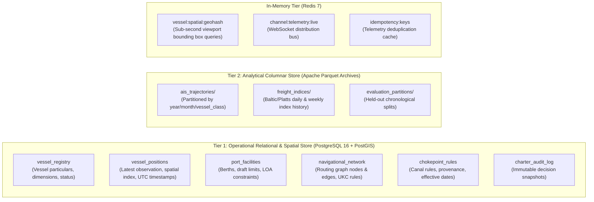
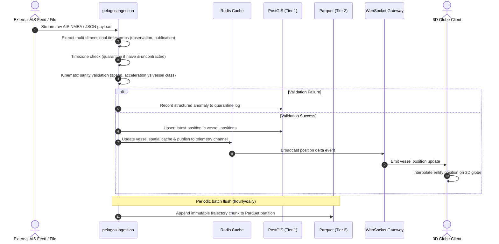
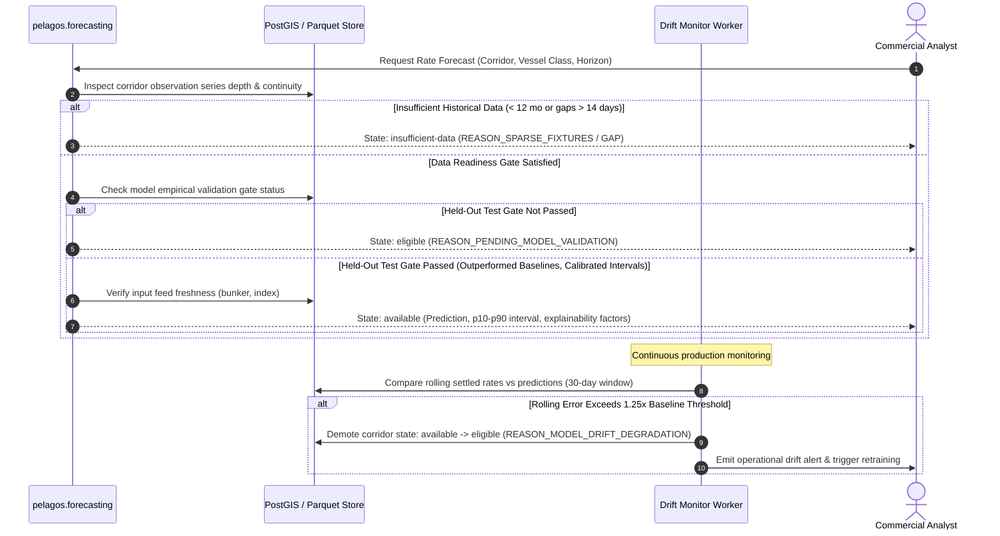
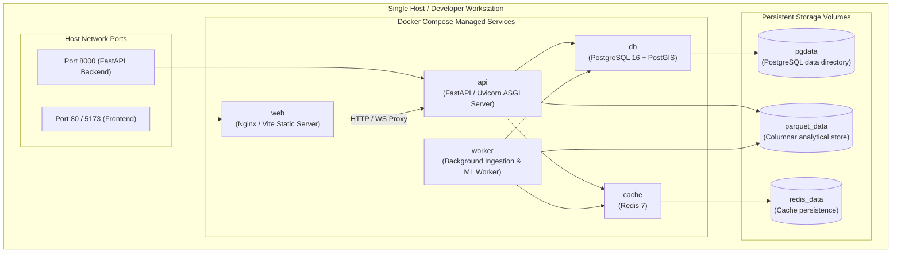

# Pelagos System Architecture Specification

## 1. Purpose
This document defines the high-level system architecture, component decomposition, interface boundaries, data flows, and deployment topology for the Pelagos Maritime Freight Forecasting and Vessel Chartering Optimization Platform. It establishes the architectural baseline for Milestone D3 and serves as the primary implementation blueprint for subsequent engineering milestones.

## 2. Scope
This specification governs:
* Structural decomposition of the Pelagos backend into decoupled logical modules within a Python modular monolith.
* Integration architecture between the Python backend and the repurposed God's Eye View (CesiumJS/Vite) 3D visual client.
* Inter-component data flows, communication protocols (REST, WebSockets), and data persistence boundaries.
* Fault isolation, resilience mechanisms, and failure domain boundaries.
* Deployment topology using Docker Compose, adhering to confirmed constraints excluding Kubernetes from the initial baseline.

Out of scope:
* Low-level database table schemas (governed by future data implementation specs).
* Specific machine learning model hyperparameter tuning (governed by future `ML-001`).
* Detailed mathematical solver formulation (governed by future optimization specs).
* Implementation code.

## 3. Background and Context
Pelagos serves as an intelligent maritime intelligence command center. The project builds upon the existing God's Eye View (GEV) 3D geospatial visualization baseline, repurposing its rich camera, HUD, and layer-rendering capabilities for commercial maritime operations while decoupling it from proprietary basemap tokens.

The architecture directly addresses the foundational mandates established in [PROJECT_OVERVIEW.md](../PROJECT_OVERVIEW.md) and formal requirements specified in [Functional Requirements Specification (`REQ-FR-001`)](../requirements/functional-requirements.md) and [Nonfunctional Requirements Specification (`REQ-NFR-001`)](../requirements/nonfunctional-requirements.md):
1. Implementation of a modular monolith architecture avoiding premature microservice complexity ([ADR-0001](./adr/adr-0001-modular-monolith-architecture.md)).
2. Dual-tier storage separating high-throughput operational state from analytical time-series archives ([ADR-0002](./adr/adr-0002-dual-tier-storage-strategy.md)).
3. Single-host containerized orchestration via Docker Compose ([ADR-0003](./adr/adr-0003-container-orchestration-docker-compose.md)).
4. Core algorithmic independence prohibiting OpenAI or closed-source proprietary APIs in critical paths ([ADR-0004](./adr/adr-0004-core-technology-independence.md)).
5. Decoupling of the 3D client from commercial Cesium Ion billing accounts ([ADR-0005](./adr/adr-0005-frontend-integration-and-basemap-strategy.md)).

## 4. Requirements and Constraints

### 4.1 Confirmed Architectural Constraints
* **Language & Runtime:** Backend must be implemented in Python 3.11+ using FastAPI. Compulsory project decision ([DOC-002 Section 5](../PROJECT_OVERVIEW.md)).
* **Orchestration Boundary:** Multi-container deployment managed exclusively via Docker Compose. Kubernetes, Helm, and distributed cluster managers are strictly excluded from the baseline ([REQ-NFR-ABM-003](../requirements/nonfunctional-requirements.md)).
* **API Independence:** Core execution paths (routing, forecasting, optimization) must operate completely independently of OpenAI or third-party proprietary SaaS APIs ([REQ-NFR-DCT-001](../requirements/nonfunctional-requirements.md)).
* **Safety Disclaimer:** The system is explicitly NOT a navigation-grade safety system and must present a persistent visual disclaimer ([REQ-NFR-SBL-001](../requirements/nonfunctional-requirements.md)).
* **Data Integrity:** Absolute prohibition of unlabelled synthetic observations in production pipelines ([REQ-NFR-DIP-001](../requirements/nonfunctional-requirements.md)).
* **Temporal Governance:** All internal timestamps normalized to ISO 8601 UTC with discrete multi-dimensional tracking (`observation_time`, `publication_time`, `ingestion_time`, `processing_time`) ([REQ-NFR-DIP-003](../requirements/nonfunctional-requirements.md)).

### 4.2 Proposed Architectural Decisions
* **Application Topology:** Modular monolith structure organized into dedicated domain modules (`ingestion`, `routing`, `forecasting`, `commercial`, `optimization`, `disruption`) communicating via strictly typed interfaces ([REQ-NFR-ABM-001](../requirements/nonfunctional-requirements.md)).
* **Storage Tiers:** PostgreSQL 16 + PostGIS for operational state; Apache Parquet for historical telemetry and market archives ([REQ-NFR-ABM-002](../requirements/nonfunctional-requirements.md)).
* **In-Memory Caching:** Redis for live spatial entity caches and pub/sub WebSocket event dissemination.

---

## 5. Design and Specification

### 5.1 System Overview & Component Diagram

The Pelagos system consists of three primary tiers: the 3D Command Viewport (Frontend), the Core Backend (Modular Monolith), and the Storage & Cache Tier.

```mermaid
graph TB
    subgraph Frontend ["Presentation Tier (God's Eye View Baseline)"]
        UI_Globe["3D Command Viewport (CesiumJS)"]
        UI_HUD["Maritime Intelligence HUD & Analyst Deck"]
        UI_Filters["Fleet & Corridor Filter Toolbar"]
        UI_Disruption["Scenario & Disruption Controls"]
    end

    subgraph Backend ["Core Application Tier (Python / FastAPI Modular Monolith)"]
        API_GW["FastAPI API Router & Gateway"]
        
        subgraph Modules ["Domain Subsystems (Encapsulated Modules)"]
            MOD_INGEST["Data Ingestion Subsystem (pelagos.ingestion)"]
            MOD_ROUTE["Operational Routing Engine (pelagos.routing)"]
            MOD_FORECAST["Freight Forecasting Engine (pelagos.forecasting)"]
            MOD_COMMERCIAL["Cargo Demand & Laycan Module (pelagos.commercial)"]
            MOD_OPT["Charter Optimization Engine (pelagos.optimization)"]
            MOD_DISRUPT["Geopolitical Disruption Subsystem (pelagos.disruption)"]
        end
    end

    subgraph Storage ["Storage & Cache Tier"]
        DB_PG[("PostgreSQL 16 + PostGIS<br/>(Operational & Geospatial Store)")]
        DB_PARQUET[("Apache Parquet Data Lake<br/>(Historical Telemetry & Market Archives)")]
        CACHE_REDIS[("Redis 7<br/>(Live Entity Cache & Pub/Sub)")]
    end

    UI_Globe <-->|WebSockets (Live AIS)| API_GW
    UI_HUD <-->|REST API (JSON)| API_GW
    UI_Filters -->|REST API| API_GW
    UI_Disruption -->|REST API| API_GW

    API_GW --> MOD_INGEST
    API_GW --> MOD_ROUTE
    API_GW --> MOD_FORECAST
    API_GW --> MOD_COMMERCIAL
    API_GW --> MOD_OPT
    API_GW --> MOD_DISRUPT

    MOD_INGEST -->|Write Validated Entities| DB_PG
    MOD_INGEST -->|Publish Position Delta| CACHE_REDIS
    MOD_INGEST -->|Flush Immutable Batches| DB_PARQUET

    MOD_ROUTE -->|Query Fairways & Bathymetry| DB_PG
    MOD_FORECAST -->|Read Historic Series| DB_PARQUET
    MOD_FORECAST -->|Read Current Index| DB_PG
    MOD_COMMERCIAL -->|Read Vessel Availability| DB_PG
    MOD_OPT -->|Read Candidate Vessels & Routes| DB_PG
    MOD_DISRUPT -->|Query Conflict Zones| DB_PG
```

---

### 5.2 Subsystem Responsibilities and Module Contracts

#### 1. Presentation Tier (Repurposed God's Eye View Frontend)
* **Technology:** Vanilla JavaScript (ES modules), Vite build tooling, CesiumJS 3D runtime.
* **Responsibilities:**
  * Interactive 3D globe visualization supporting pan, orbit, tilt, and continuous zoom ([REQ-FR-SAV-001](../requirements/functional-requirements.md)).
  * Rendering commercial vessel entities with categorical symbology (Capesize, Panamax, Supramax, Handysize, Tanker, Container) and status tooltips ([REQ-FR-SAV-002](../requirements/functional-requirements.md)).
  * Distinct line-style rendering for historical recorded tracks vs. computed operational voyage trajectories ([REQ-FR-SAV-003](../requirements/functional-requirements.md)).
  * Layer overlays for maritime chokepoints, canals, ports, and Traffic Separation Schemes ([REQ-FR-SAV-004](../requirements/functional-requirements.md)).
  * Side-by-side visual route comparison under disruption scenarios ([REQ-FR-GDS-002](../requirements/functional-requirements.md)).
  * Display of non-navigation-grade safety banner ([REQ-NFR-SBL-001](../requirements/nonfunctional-requirements.md)).
* **Integration Boundary:** Frontend connects to backend exclusively through:
  * `GET /api/v1/vessels/snapshot`: Structured JSON snapshot of active vessels within viewport bounds (compatible with GEV `vesselSnapshot` parser).
  * `WS /api/v1/telemetry/live`: Live delta feed emitting validated vessel position pings.
  * `POST /api/v1/routes/evaluate`: Submits origin, destination, and vessel parameters; returns GeoJSON voyage trajectories and clearance profiles.
  * `POST /api/v1/charter/recommend`: Submits laycan, cargo tonnage, and port pairs; returns ranked procurement decisions.

#### 2. Data Ingestion Subsystem (`pelagos.ingestion`)
* **Responsibilities:**
  * Ingestion of live AIS telemetry (AISStream WebSocket / provider batch files) and market freight indices ([REQ-FR-DII-001](../requirements/functional-requirements.md), [REQ-FR-DII-005](../requirements/functional-requirements.md)).
  * Validation pipeline: spatial bounds validation, coordinate sanity checks, and vessel-class kinematic plausibility checks ([REQ-FR-DII-002](../requirements/functional-requirements.md)).
  * Temporal normalization: enforcing multi-dimensional UTC temporal tracking (`observation_time`, `publication_time`, `ingestion_time`, `processing_time`) and quarantining ambiguous timezone-naive inputs with structured code `ANOMALY_AMBIGUOUS_TIMEZONE` ([REQ-NFR-DIP-003](../requirements/nonfunctional-requirements.md)).
  * Rigorous provenance tagging, license attachment, and rejection of records lacking verifiable metadata ([REQ-FR-DII-003](../requirements/functional-requirements.md)).
  * Quarantine isolation for anomalous or synthetic data fixtures ([REQ-FR-DII-004](../requirements/functional-requirements.md), [REQ-NFR-DIP-002](../requirements/nonfunctional-requirements.md)).
  * Resumption and deduplication via deterministic idempotency keys ([REQ-NFR-ARG-003](../requirements/nonfunctional-requirements.md)).

#### 3. Operational Maritime Routing Engine (`pelagos.routing`)
* **Responsibilities:**
  * Calculation of feasible voyage corridors based on verified maritime fairway graphs ([REQ-FR-OMR-001](../requirements/functional-requirements.md)).
  * Strict prohibition of geometric shortest paths, unconstrained great-circle arcs, or land-crossing straight-line fallbacks ([REQ-FR-OMR-002](../requirements/functional-requirements.md)).
  * Dynamic passage feasibility checks against authoritative waterway rules (vessel class, dynamic restriction conditions, source provenance, effective date, and rule freshness) for Suez, Panama, and major straits ([REQ-FR-OMR-001](../requirements/functional-requirements.md), [REQ-FR-OMR-003](../requirements/functional-requirements.md)).
  * Bathymetric under-keel clearance (UKC) evaluation against vessel operational draft.
  * Environmental weather adjustment integrating wave height, surface current, and wind vectors ([REQ-FR-OMR-004](../requirements/functional-requirements.md)).
  * Explicit emission of `unsupported-route` or `insufficient-data` outcomes when navigational network coverage or vessel parameters are missing or unverified.

#### 4. Freight Rate Forecasting Engine (`pelagos.forecasting`)
* **Responsibilities:**
  * Generation of route-conditioned freight rate predictions ($/ton or $/day) across configurable horizons (7, 15, 30, 60 days) ([REQ-FR-FRF-001](../requirements/functional-requirements.md)).
  * Enforcement of the four-state forecast availability lifecycle: `unavailable`, `insufficient-data`, `eligible`, and `available` ([REQ-FR-FRF-002](../requirements/functional-requirements.md)).
  * Data-readiness gate evaluation: validating observation depth (provisional 12-month candidate window) and fixture continuity.
  * Empirical out-of-sample held-out validation gate: benchmarking against persistence, rolling moving average, and FFA curves on genuine out-of-sample data partitions (provisional 90-day window) with zero data leakage.
  * Prediction interval calibration verifying nominal 80% (p10–p90) and 95% coverage targets on real-world observations ([REQ-FR-FRF-004](../requirements/functional-requirements.md)).
  * Continuous model drift monitoring with automated demotion back to `eligible` (`REASON_MODEL_DRIFT_DEGRADATION`) if rolling error exceeds degradation thresholds (provisional 1.25&times; multiplier).
  * Strict separation between baseline empirical forecasts and user-driven scenario simulations ([REQ-FR-FRF-003](../requirements/functional-requirements.md)).

#### 5. Commercial Cargo & Laycan Subsystem (`pelagos.commercial`)
* **Responsibilities:**
  * Regional and port-pair cargo volume demand estimation across commodity sectors ([REQ-FR-CDV-001](../requirements/functional-requirements.md)).
  * Commercial fleet availability search filtering candidate vessels capable of meeting laycan cancelling dates ([REQ-FR-CDV-002](../requirements/functional-requirements.md)).
  * Pruning vessels violating physical berth restrictions (draft, LOA, beam) or port equipment limitations at load/discharge ports ([REQ-FR-CPO-003](../requirements/functional-requirements.md)).
  * Sanctions compliance screening flagging vessels on OFAC, EU, or UN watchlists ([REQ-NFR-SBL-002](../requirements/nonfunctional-requirements.md)).

#### 6. Charter Optimization Engine (`pelagos.optimization`)
* **Responsibilities:**
  * Evaluating total procurement and voyage costs across competing charter structures: Spot voyage charter, Consecutive Voyage Charter (CVC), and short-term Time Charter (TC) ([REQ-FR-CPO-001](../requirements/functional-requirements.md), [REQ-FR-CPO-002](../requirements/functional-requirements.md)).
  * Quantitative incorporation of fuel consumption, canal tolls, demurrage exposure, and ballast repositioning costs.
  * Deterministic, explainable ranking of candidate vessels outputting actionable commercial recommendations.
  * Immutable persistence of optimization input snapshots for comprehensive decision replay and auditability ([REQ-NFR-OAS-002](../requirements/nonfunctional-requirements.md)).

#### 7. Geopolitical Disruption Subsystem (`pelagos.disruption`)
* **Responsibilities:**
  * Explicit modeling of four structured disruption factor families: chokepoint transit restrictions, conflict zones, port congestion surges, and regulatory carbon compliance levies ([REQ-FR-GDS-001](../requirements/functional-requirements.md)).
  * Dynamic rerouting evaluation calculating distance, transit day, fuel cost, and insurance premium deltas ([REQ-FR-GDS-002](../requirements/functional-requirements.md)).

---

### 5.3 Storage Architecture and Dual-Tier Strategy

To satisfy [REQ-NFR-ABM-002](../requirements/nonfunctional-requirements.md) and [ADR-0002](./adr/adr-0002-dual-tier-storage-strategy.md), Pelagos employs a two-tier storage hierarchy:



* **Tier 1 (Operational Store):**
  * Implemented using PostgreSQL 16 with PostGIS extension.
  * Owns operational state, entity relationships, fairway routing topology, canal advisories, user settings, and audit logs.
  * Optimized for low-latency point lookups, spatial intersections (`ST_DWithin`, `ST_Intersects`), and transactional integrity.
* **Tier 2 (Analytical Store):**
  * Implemented using compressed Apache Parquet files organized into chronological partitions (`year=YYYY/month=MM/`).
  * Owns multi-million row historical AIS trajectory archives, historical freight fixture records, and held-out model validation datasets.
  * Queried in-process using high-performance columnar engines (DuckDB / Polars) during ML model training and validation gates, completely isolating analytical scans from live transactional workloads.
* **In-Memory Cache (Redis 7):**
  * Maintains live geospatial indexes for active vessels to satisfy sub-second viewport query budgets ([REQ-NFR-PER-002](../requirements/nonfunctional-requirements.md)).
  * Acts as the pub/sub event bus decoupling ingestion parsers from WebSocket streaming endpoints.

---

### 5.4 Primary System Data Flows

#### Flow 1: Live Telemetry Ingestion and Client Visualization


#### Flow 2: Voyage Routing & Feasibility Evaluation
```mermaid
sequenceDiagram
    autonumber
    actor User as Chartering Operator
    participant Client as Web Client
    participant API as FastAPI Gateway
    participant Routing as pelagos.routing
    participant DB as PostGIS Fairway Store
    participant Weather as Weather Data Provider

    User->>Client: Select Origin, Destination, Vessel Class, Laycan
    Client->>API: POST /api/v1/routes/evaluate
    API->>Routing: Calculate route feasibility (origin, dest, vessel_params)
    Routing->>DB: Query verified fairway network graph
    alt Fairway Graph Incomplete
        Routing-->>API: Status: unsupported-route (missing network coverage)
        API-->>Client: Display explicit unsupported corridor warning
    else Fairway Graph Verified
        Routing->>DB: Retrieve canal & chokepoint rules (effective date, freshness)
        Routing->>Routing: Evaluate UKC, beam, air draft vs dynamic passage rules
        alt Vessel Exceeds Waterway Limits
            Routing->>Routing: Prune canal passage; evaluate cape diversion
        end
        Routing->>Weather: Query wave height & current fields along corridor
        Routing->>Routing: Apply weather-adjusted speed and fuel penalty
        Routing-->>API: Return GeoJSON route, waypoints, transit days, fuel profile
        API-->>Client: Render operational route trajectory on 3D globe
    end
```

#### Flow 3: Four-State Freight Forecasting & Evaluation Lifecycle


---

### 5.5 Failure Isolation and Process Boundaries

To satisfy [REQ-NFR-ARG-001](../requirements/nonfunctional-requirements.md) (Graceful Degradation) and [REQ-NFR-ARG-002](../requirements/nonfunctional-requirements.md) (Fault Isolation):
1. **Process Boundary Isolation:**
   - Background ingestion pipelines and heavy ML training/validation tasks run in dedicated worker processes (`worker` container), decoupled from the user-facing web server (`api` container).
   - Ingestion pipeline halts or third-party feed crashes do not terminate the API server, disrupt active 3D visualization sessions, or degrade cached operational views.
2. **Database Connection Pooling:**
   - Asynchronous connection pooling (SQLAlchemy / asyncpg) with strict execution timeouts (p95 < 5s for routing queries).
   - Analytical queries are restricted to the Parquet/DuckDB tier to prevent long-running table locks on operational PostGIS tables.
3. **Graceful Degradation on Input Failures:**
   - If live telemetry feeds drop, the system flags entities as `stale` or `refreshing` (reusing GEV's existing `vesselSnapshot` freshness states) rather than dropping vessels or fabricating positions.
   - If weather data is unavailable, routes are calculated using calm-water hydrodynamic baselines and explicitly tagged with `WEATHER_ADVISORY_UNAVAILABLE`.
   - If market data is interrupted, corridors automatically downgrade from `available` to `insufficient-data` with `REASON_STALE_INPUTS`.

---

### 5.6 Deployment Topology & Container Boundaries

Adhering to [REQ-NFR-ABM-003](../requirements/nonfunctional-requirements.md) and [ADR-0003](./adr/adr-0003-container-orchestration-docker-compose.md), the system is packaged as a multi-container Docker Compose application:



* **`web`**: Serves the repurposed God's Eye View client assets (HTML5, vanilla JS, CesiumJS bundles).
* **`api`**: Runs the Python FastAPI application handling REST endpoints and WebSocket telemetry broadcast.
* **`worker`**: Python worker executing scheduled ingestion pipelines, batch validations, and rolling drift evaluations.
* **`db`**: Official PostgreSQL 16 container with PostGIS 3.4 extensions.
* **`cache`**: Official Redis 7 Alpine container configured with append-only persistence.

---

## 6. Dependencies and Interfaces

### 6.1 Internal Subsystem Interfaces
* `pelagos.ingestion.contracts`: Pydantic models for raw and normalized telemetry observations.
* `pelagos.routing.interface`: Service boundary taking route requests and returning `VoyagePlan` models with GeoJSON geometries and waypoint clearance tables.
* `pelagos.forecasting.lifecycle`: State machine evaluating corridor state and returning `ForecastResult` distributions.
* `pelagos.optimization.solver`: Optimization engine taking laycan constraints and returning ranked `CharterRecommendation` objects.

### 6.2 External System Interfaces
* **AISStream WebSocket (`wss://stream.aisstream.io/v0/stream`):** Live AIS feed.
* **Open Navigation Networks (OSM / OpenSeaMap):** GeoJSON / Shapefile fairway graphs.
* **NOAA / Copernicus Weather Feeds:** GRIB2 / NetCDF surface wave and current vectors.
* **Open Basemap Tile Services (CartoDB / OSM):** XYZ raster tile endpoints for basemap decoupling.

---

## 7. Failure Modes and Limitations

* **Single-Host Capacity Limit:** Docker Compose on a single developer workstation is bounded by host RAM and disk I/O. Mitigated by Parquet columnar compression and strict viewport downsampling ([REQ-NFR-PER-001](../requirements/nonfunctional-requirements.md)).
* **Open-Ocean AIS Latency:** Terrestrial AIS feeds lose coverage beyond 30–50 nautical miles from shore. Mitigated by explicit `coverage` indicators and refusal to interpolate speculative open-ocean voyages.
* **Non-Navigation-Grade Limitation:** Under no circumstances may Pelagos route outputs be used as primary ECDIS or bridge navigation instructions.

---

## 8. Security, Privacy and Licensing

* **Open-Source Dependency Compliance:** All third-party Python packages and npm libraries must carry permissive licenses (MIT, Apache 2.0, BSD). Copyleft licenses (AGPL-3.0) are strictly prohibited in core modules ([REQ-NFR-DCT-003](../requirements/nonfunctional-requirements.md)).
* **Credential Hygiene:** No API tokens (Cesium Ion, AISStream keys) are committed to version control; configuration is injected exclusively via `.env` files and Docker environment variables.
* **Sanctions & Compliance:** All candidate charter vessels are checked against published OFAC SDN lists ([REQ-NFR-SBL-002](../requirements/nonfunctional-requirements.md)).

---

## 9. Testing and Verification

* **Unit Testing:** Modular test suites (`tests/unit/`) validating each module independently using mock fixtures.
* **Synthetic Test Fixture Isolation:** Test suites using synthetic data must maintain `is_synthetic: true` markers and execute in dedicated test directories ([REQ-NFR-DIP-002](../requirements/nonfunctional-requirements.md)).
* **Integration Testing:** End-to-end API pipeline tests (`tests/integration/`) testing container interaction, PostGIS queries, and WebSocket streaming.
* **Deterministic Replay Testing:** Validating that optimization recommendations yield identical results given identical inputs ([REQ-NFR-OAS-002](../requirements/nonfunctional-requirements.md)).

---

## 10. Traceability

### 10.1 Upstream Traceability
* **Project Overview:** Directly realizes the vision, boundaries, and technical direction of [DOC-002](../PROJECT_OVERVIEW.md) Sections 1, 3, 4, 5, and 6.
* **Functional Requirements:** Realizes all 24 requirements in [REQ-FR-001](../requirements/functional-requirements.md) (`SAV`, `DII`, `FRF`, `CDV`, `CPO`, `OMR`, `GDS`).
* **Nonfunctional Requirements:** Implements all 18 requirements in [REQ-NFR-001](../requirements/nonfunctional-requirements.md) (`DIP`, `PER`, `ARG`, `ABM`, `DCT`, `SBL`, `OAS`).

### 10.2 Traceability to Architecture Decision Records (ADRs)
* Realizes [ADR-0001: Modular Monolith Backend Architecture](./adr/adr-0001-modular-monolith-architecture.md).
* Realizes [ADR-0002: Dual-Tier Storage Strategy](./adr/adr-0002-dual-tier-storage-strategy.md).
* Realizes [ADR-0003: Container Orchestration via Docker Compose](./adr/adr-0003-container-orchestration-docker-compose.md).
* Realizes [ADR-0004: Core Technology Independence & Proprietary API Exclusion](./adr/adr-0004-core-technology-independence.md).
* Realizes [ADR-0005: Frontend Integration and Basemap Decoupling](./adr/adr-0005-frontend-integration-and-basemap-strategy.md).

---

## 11. Open Questions
* **OQ-ARCH-01: In-Process vs External Task Queue:** For background ML model evaluation and trajectory batch processing, should the Python modular monolith use a lightweight in-process worker (e.g., `asyncio` background task pool) or a dedicated Celery/RQ Redis worker container?
* **OQ-ARCH-02: Spatial Tile Vector Pipeline:** Should maritime fairway networks and port polygons be served to the 3D client as pre-generated GeoJSON layers or dynamic Mapbox Vector Tiles (MVT) generated on-the-fly via PostGIS `ST_AsMVT`?

---

## 12. Change History

| Version | Date | Author | Description |
|---|---|---|---|
| 1.0.0 | 2026-10-14 | Project Agent | Initial draft of Pelagos System Architecture Specification (ARCH-001) under Milestone D3. Defines modular monolith decomposition, GEV frontend integration, dual-tier storage, failure isolation, and container boundaries. Status: drafting. |
