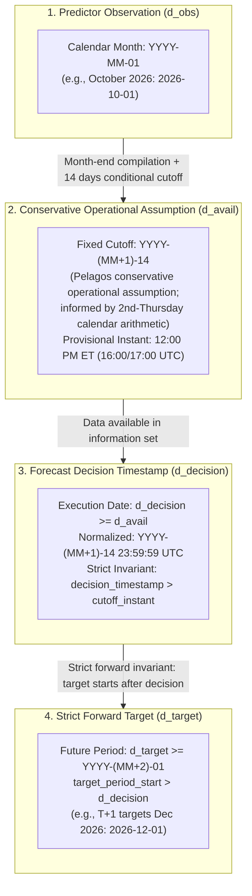

# Pelagos — Stage C3.1.2: Forecast Horizon Semantics, Conservative Publication Availability & Historical Feature Coverage Report

> [!NOTE]
> **Research Note Boundary (`DOC-001` Section 6):** This document records Stage C3.1 / C3.1.2 empirical methodology, data availability audits, and dataset construction invariants. Experimental datasets evaluated here do **not** alter the production baseline; **`persistence` remains the active production forecast benchmark**.

**Baseline Commit Reference:** `c0fee195265c2d3db68fed28d9a4bb2c07536103` (implemented & finalized post-`7c0137fe8b60cb3951bd31dd7350513b524a67e0`)  
**Milestone:** Stage C3.1 / C3.1.2 Methodological Corrections (Traces to [`DATA-001`](../data/data-architecture.md) Section 5.2, [`ML-001`](./freight-index-and-forecasting-specification.md), and Stage C1.3.2)  
**Production Baseline Status:** Persistence ($y_{t+h} \approx y_t$) remains the active production benchmark. No models trained or promoted in C3.1.2.  
**Corridors Evaluated:** Pacific Northwest to Japan Bulk (`PNW-JPN-BULK`), US Gulf to Japan Bulk (`USG-JPN-BULK`).  
**Forecast Horizons:** $T+1$ month ($h=1$), $T+3$ months ($h=3$), $T+6$ months ($h=6$).

---

## 1. Executive Summary & C3.1.2 Methodological Mandates

Stage C3.1.2 resolves critical methodological and temporal requirements identified during the audit of the historical feature dataset for advanced freight forecasting:

1. **Strict Forward-Forecast Semantics ($M_{\text{obs}} + h + 1 = M_{\text{decision}} + h$):**
   - **Distinction Between Forecast and Nowcast:** In prior C1 and initial C3.1 milestones, horizon offsets were indexed relative to the observation month ($d_{\text{target}} = d_{\text{obs}} + h$). When a monthly freight rate represents month $M$, it is compiled and released post-month-end in month $M+1$ (for instance, the inspected `GTR11052026.pdf` carried October 2026 Figure 20 ocean rates on Thursday, November 5, 2026, while the SODA view metadata recorded `rowsUpdatedAt = 2026-11-05T17:16:28Z`). Even if observed on Day 5 or under Pelagos's fixed Day 14 operational cutoff, November 2026 has already begun. Estimating November during November is technically a **nowcast** ($\text{target\_period\_start} \le \text{decision\_date}$).
   - **Strict Forward Requirement:** Under strict forward semantics, the target period must begin strictly after the decision timestamp ($\text{target\_period\_start\_utc} > \text{decision\_timestamp}$). Thus, the earliest monthly period eligible for a forward forecast from a decision made in month $M+1$ is month $M+2$ (December 2026 for an October 2026 observation).
   - **Preservation of C1 Baselines:** C1 baseline evaluation was conducted on historical observation-relative series where the target offset was $h$ months. Those published evaluation metrics remain valid historical benchmark baselines. The platform supports both modes via `TemporalAvailabilityPolicy(horizon_alignment="strict_forward" | "observation_relative")`.

2. **Authoritative USDA AMS GTR Schedule References & Pelagos Operational Availability Cutoff:**
   - **Feed Investigation:** AgTransport SODA dataset [`ehs5-yac3`](https://agtransport.usda.gov/Bulk/Vessel-Rates/ehs5-yac3) provides monthly representative dry bulk grain freight rates formatted as `YYYY-MM-01T00:00:00.000`. The feed does **not** provide record-level publication release timestamps. Historical records strictly preserve `observed_publication_time = None` rather than synthesizing fictitious point-in-time timestamps.
   - **Traceable Authoritative USDA AMS References & Verification Scope:**
     - [USDA AMS GTR Portal](https://www.ams.usda.gov/services/transportation-analysis/gtr): Confirms weekly Thursday publication of the Grain Transportation Report (GTR), without advertising a guaranteed 12:00 noon Eastern release SLA.
     - [USDA AMS GTR Datasets](https://www.ams.usda.gov/services/transportation-analysis/gtr-datasets): Distinguishes weekly *Table 1: Grain transport cost indicators* (USDA/AMS index) from monthly U.S.-to-Japan ocean rates in **Figure 20 (*"Grain vessel rates, U.S. to Japan"*, O'Neil Commodity Consulting)**.
     - [USDA AMS GTR Archive (2020–2026)](https://www.ams.usda.gov/services/transportation-analysis/gtr/archive) and inspected issues ([`GTR10012026.pdf`](https://www.ams.usda.gov/sites/default/files/media/GTR10012026.pdf), [`GTR10082026.pdf`](https://www.ams.usda.gov/sites/default/files/media/GTR10082026.pdf), [`GTR11052026.pdf`](https://www.ams.usda.gov/sites/default/files/media/GTR11052026.pdf)): Provide several inspected examples of Figure 20 appearing in first-Thursday editions and confirm Thursday issue dating across 2020–2026, while revealing that 1996–2019 issues are absent online and documenting a **7-week lapse in `archive-2025` between `2025-09-25` and `2025-11-20`**. Meanwhile, [`api/views/ehs5-yac3.json`](https://agtransport.usda.gov/api/views/ehs5-yac3.json) recorded `rowsUpdatedAt = 2026-11-05T17:16:28+00:00` (`12:16:28 PM EST`).
     - **Unverified Historical Deadline:** Taken together, this USDA evidence does **not** establish that Figure 20 is consistently published by the second Thursday following every observation month; the monthly Figure 20 publication deadline has **not** been independently verified across the historical period.
   - **Calendar Arithmetic & 5-Day Lag Defect:** Across all calendar configurations, any month's 1st Thursday falls on days 1–7 and its 2nd Thursday falls on days 8–14. A 5-day post-month-end lag fails to cover 1st Thursdays whenever a month begins on Friday (Day 7) or Saturday (Day 6) and misses all 2nd-Thursday calendar dates.
   - **Pelagos Conservative Operational Assumption (Day 14 Cutoff):**
     - Pelagos retains a fixed availability cutoff of **14 calendar days post-month-end** (`publication_lag_days = 14`), with provisional intraday instant at **12:00 PM America/New_York** (`conservative_availability_cutoff` = 16:00 UTC EDT / 17:00 UTC EST).
     - This policy is a **Pelagos conservative operational assumption**, informed by the weekly Thursday GTR publication pattern and second-Thursday calendar arithmetic (days 8–14) — it is **not** an observed timestamp, is **not** a proven upper bound for monthly Figure 20 publication, and does **not** guarantee availability during Federal holidays, exceptional release delays, incomplete archival periods (`1996–2019`), or Federal government shutdowns/lapses (such as October 2013, Dec 2018 – Jan 2019, or the empirical 7-week lapse in `archive-2025`).
     - **Strict Intraday Ordering:** Forecast decision execution is normalized to **23:59:59 UTC** on Day 14 (`decision_timestamp`). Enforcing $\text{decision\_timestamp} > \text{conservative\_availability\_cutoff}$ gives a 7h 59m 59s buffer past 12:00 PM Eastern (and still follows observed updates such as `12:16:28 PM EST` on `2026-11-05`).

3. **Enforcement of Six Temporal Invariants:**
   All 2,148 rows generated across both routes and three horizons adhere strictly to six structural temporal invariants with zero lookahead leakage:
   - Invariant 1: $\text{availability\_date} \le \text{decision\_date}$ and $\text{decision\_timestamp} > \text{conservative\_availability\_cutoff}$.
   - Invariant 2: $\text{target\_availability\_date} > \text{decision\_date}$ and $\text{target\_cutoff} > \text{decision\_timestamp}$.
   - Invariant 3: $\text{target\_period\_start\_utc} > \text{decision\_timestamp}$ (under `strict_forward`).
   - Invariant 4: No future observations, rolling statistics, or regime knowledge in feature vectors.
   - Invariant 5: Cross-corridor features obey identical availability constraints.
   - Invariant 6: Historical and inference rows follow identical temporal rules.

4. **Test Verification:**
   - [`tests/test_forecast_dataset.py`](../../tests/test_forecast_dataset.py) validated all invariants (`60 passed in 70.39s` at C3.1.2 closure; remains green under Stage C3.3/Stage D verification).

---

## 2. Platform Data Inventory Across 7 Domains

An exhaustive inventory was conducted across the active SQLite database (`pelagos.db`), partitioned Parquet analytical archives (`parquet_data/freight/`), source acquisition adapters, and route intelligence repositories.

| Domain # | Data Domain | Primary Source | Coverage Span | Genuine Obs. Count | Missingness Rate (%) | Monthly Modeling Sufficiency | Usability Status | Justification & Policy |
|:---:|:---|:---|:---:|:---:|:---:|:---:|:---:|:---|
| **1** | **Historical Freight Rates** | USDA AMS Grain Transportation Report (canonical & reconciled) | 1996-01-01 to 2026-10-01 (370 consecutive months) | 1,110 (370/route) | **0.0%** | **Sufficient** (Continuous 30.8-year series) | **Usable** (Target & autoregressive predictors) | Zero missing months across `PNW-JPN-BULK`, `USG-JPN-BULK`, and `SPREAD-USG-PNW-JPN`. 10 historical values reconstructed via verified spatial spreads. |
| **2** | **Bilateral Maritime Trade Volumes** | USDA FAS GATS / Indian DGCI&S | 2024-10-01 to 2024-12-01 (3 months) | **13** (`8` US + `5` IN) | **99.1%** | **Insufficient** (No pre-2024 historical observations) | **Excluded** from C3.1 historical training sets | Verified directly in `pelagos.db` `trade_observations` (`8` USDA FAS GATS US $\rightarrow$ JP grain exports Oct–Dec 2024; `5` Indian DGCI&S exports Oct–Nov 2024; matches [`genuine_trade_flows.json`](../../backend/pelagos/data/genuine_trade_flows.json) 13/13). Synthesizing 30 years of trade history is prohibited. *(During Stage C3.3 housekeeping, `generate_feature_inventory()` in [`dataset.py`](../../backend/pelagos/forecasting/dataset.py) was updated to query DB counts dynamically, returning `13` instead of a prior hardcoded `11`.)* |
| **3** | **Oceanographic Buoy & Marine Meteorology** | NOAA NDBC / INCOIS Moored Buoys | 2024-10-15 to 2026-10-30 | 13 | **99.9%** | **Insufficient** (Isolated point snapshots) | **Excluded** from C3.1 historical training sets | Buoys 46041 (Cape Elizabeth, WA), 42001 (Mid Gulf, LA), and AD01 (Arabian Sea) measure departure fairways only. Open-ocean transit unmonitored. |
| **4** | **Commercial Marine Bunker Fuel Prices** | Bunker Fuel Prices API (`bunkerfuelprices.com`) | 2026-11-06 (Single-day spot quotes) | 5 | **100.0%** | **Insufficient** (Zero historical depth prior to Nov 2026) | **Excluded** from C3.1 historical training sets | Free public API exposes current spot indications only (`ARBUE`, `DKSKA`; corridor hubs unquoted). No historical time-series available. Substituting crude oil proxies (WTI/Brent) violates genuine data policy. |
| **5** | **Port & Route Structural Characteristics** | UNECE UN/LOCODE, World Port Index (Pub 150), Corridor Catalog | Invariant static metadata | 18 (eligible corridor ports) | **0.0%** | **Sufficient** (Structural invariant metadata) | **Usable** (Benchmark distance, corridor length, vessel class) | Invariant nautical benchmark distances (4,520 NM for PNW vs 9,150 NM for USG) and Panamax bulk vessel limits provide cross-route differentiation (zero within-corridor variance). |
| **6** | **Historical Macroeconomic Market Regimes** | Pelagos Macroeconomic Market Regime Definitions (Stage C1.3.2) | 1996-01-01 to 2026-10-01 (370 consecutive months) | 370 | **0.0%** | **Sufficient** (Continuous 4-regime classification) | **Usable** (Regime binary flags and categorical codes) | Canonical C1.3.2 definitions: `PRE_SUPERCYCLE` (1996–2006), `SUPERCYCLE_PEAK_CRASH` (2007–2009), `POST_SUPERCYCLE` (2010–2019), and `PANDEMIC_DISRUPTION` (2020–2026). |
| **7** | **Cross-Corridor Freight Rates & Inter-Corridor Spread** | Simultaneous USDA AMS Monthly Observations | 1996-01-01 to 2026-10-01 (370 consecutive months) | 370 | **0.0%** | **Sufficient** (Synchronous bilateral series) | **Usable** (Competitor rate lags, corridor spread lags, spread rolling MA) | Both corridors export US bulk grain to Japan and compete directly for global Panamax tonnage. Observed on identical monthly dates. |

---

## 3. Forecast Horizon Semantics & Publication Availability Architecture

### 3.1 Strict Forward vs. Observation-Relative Semantics

| Dimension | Observation-Relative Semantics (C1 / C3.1 Baseline) | Strict Forward Semantics (C3.1.2 Standard) |
|:---|:---|:---|
| **Horizon Alignment Formula** | $d_{\text{target}} = \text{add\_months}(d_{\text{obs}}, h)$ | $d_{\text{target}} = \text{add\_months}(d_{\text{obs}}, h + 1) = \text{add\_months}(d_{\text{decision\_month}}, h)$ |
| **Target Period Start Invariant** | None ($\text{target\_period\_start}$ may precede $\text{decision\_date}$) | Enforced: $\text{target\_period\_start} > \text{decision\_date}$ |
| **Economic Meaning of $T+1$** | Estimate of month $M+1$ made in month $M+1$ post-release (**Nowcast**) | Forecast of month $M+2$ made in month $M+1$ (**Strict Forward Forecast**) |
| **October 2026 Decision ($d_{\text{dec}}=\text{2026-11-14}$)** | $T+1$ targets November 2026 ($d_{\text{target}}=\text{2026-11-01}$) | $T+1$ targets December 2026 ($d_{\text{target}}=\text{2026-12-01}$) |
| **September 2026 Decision ($d_{\text{dec}}=\text{2026-10-14}$)** | $T+1$ targets October 2026 (Labeled: \$38 PNW / \$76 USG) | $T+1$ targets November 2026 (Unlabeled inference row) |
| **August 2026 Decision ($d_{\text{dec}}=\text{2026-09-14}$)** | $T+1$ targets September 2026 (Labeled) | $T+1$ targets October 2026 (Latest labeled historical row) |
| **Labeled Sample Count ($T+1$)** | 357 rows | **356 rows** |
| **Unlabeled Inference Rows ($T+1$)** | 1 row | **2 rows** |

### 3.2 Six Formal Temporal Invariants
Every row in `ForecastDatasetRow` enforces the following invariants upon instantiation:

1. **Predictor Availability Invariant:** $\text{availability\_date} \le \text{decision\_date}$ and $\text{decision\_timestamp} > \text{conservative\_availability\_cutoff}$. Every feature predictor must strictly clear the conditional availability cutoff before forecast execution.
2. **Target Isolation Invariant:** $\text{target\_availability\_date} > \text{decision\_date}$ and $\text{target\_cutoff} > \text{decision\_timestamp}$. The target observation cutoff strictly succeeds the decision timestamp.
3. **Strict Forward Period Invariant:** $\text{target\_period\_start\_utc} > \text{decision\_timestamp}$ (and date-level $\text{target\_period\_start} > \text{decision\_date}$). The forward target monthly period cannot have begun prior to or on the decision timestamp.
4. **Zero Lookahead in Predictors:** No future observations, future statistics, or future regime information enter feature engineering. Rolling averages and standard deviations are computed strictly using observations up to $d_{\text{obs}}$.
5. **Cross-Corridor Synchronization:** Competitor rate features and inter-corridor spreads are filtered by both $\text{availability\_date}(\text{competitor}) \le \text{decision\_date}$ and strict timestamp ordering $\text{conservative\_availability\_cutoff}(\text{competitor}) < \text{decision\_timestamp}$.
6. **Symmetric Invariance:** Historical labeled rows and real-time inference rows follow identical alignment rules, schema, and feature definitions.

### 3.3 Publication Availability Findings: USDA AMS GTR

#### 1. Verified Schedule Facts vs. Pelagos Operational Assumptions

| Aspect | Classification | Factual Grounding & Policy Meaning |
|:---|:---:|:---|
| **Weekly Thursday GTR Pattern (2020–2026)** | **Verified Source Fact** | Confirmed by [USDA AMS GTR Portal](https://www.ams.usda.gov/services/transportation-analysis/gtr) and [2020–2026 Archives](https://www.ams.usda.gov/services/transportation-analysis/gtr/archive): indexed editions carry Thursday dates (`52` issues in 2020, `51` in 2021, `52` in 2022–2024, `45` in 2025, `45` in 2026 through Nov 5), with no advertised 12:00 noon Eastern SLA and a 7-week lapse in 2025 (`2025-09-25` to `2025-11-20`). |
| **Monthly Ocean Rates & Inspected 1st-Thursday Examples** | **Verified Source Fact** | Confirmed via [GTR Datasets](https://www.ams.usda.gov/services/transportation-analysis/gtr-datasets) and inspected [`GTR10012026.pdf`](https://www.ams.usda.gov/sites/default/files/media/GTR10012026.pdf), [`GTR10082026.pdf`](https://www.ams.usda.gov/sites/default/files/media/GTR10082026.pdf), and [`GTR11052026.pdf`](https://www.ams.usda.gov/sites/default/files/media/GTR11052026.pdf) (`Figure 20: Grain vessel rates, U.S. to Japan`, O'Neil Commodity Consulting), distinct from weekly `Table 1`. |
| **Absence of Row Timestamps (`ehs5-yac3`)** | **Verified Source Fact** | Confirmed by inspecting SODA [`ehs5-yac3`](https://agtransport.usda.gov/resource/ehs5-yac3.json): records expose `YYYY-MM-01T00:00:00.000` only (`observed_publication_time = None`), with view `rowsUpdatedAt` at `2026-11-05T17:16:28+00:00` (`12:16:28 PM EST`). |
| **Monthly Figure 20 2nd-Thursday Deadline (1996–2026)** | **Unverified Across Historical Period** | Pre-2020 archives are absent online (`1996–2019`), disruptions occur (`archive-2025`), and inspected first-Thursday examples do **not** verify consistent publication by the 2nd Thursday for every observation month. |
| **Thursday Calendar Bounds** | **Mathematical Fact** | The 1st Thursday of any month occurs on days 1–7; the 2nd Thursday occurs on days 8–14. |
| **5-Day Lag Defect** | **Mathematical Fact** | A 5-day lag fails to cover 1st Thursdays in Friday/Saturday starting months (Days 6–7) and misses all 2nd-Thursday calendar dates (Days 8–14). |
| **14-Day Availability Cutoff (`12:00 PM ET`)** | **Pelagos Conservative Operational Assumption** | Fixed `publication_lag_days = 14` with provisional `12:00 PM America/New_York` instant (`16:00 UTC EDT` / `17:00 UTC EST`), informed by weekly Thursday GTR publication and 2nd-Thursday calendar arithmetic; *not* a proven upper bound for monthly Figure 20 publication, *not* an observed timestamp, and subject to holiday, delay, archive-gap, and shutdown caveats. |

> [!WARNING]
> **Unverified Historical Deadline & Caveats:** The 14-day cutoff (`12:00 PM Eastern` provisional instant) does **not** guarantee availability during Federal holidays, release delays (`12:16:28 PM EST` SODA update on `2026-11-05`), incomplete online archive periods (`1996–2019`), extended lapses (7-week lapse in `archive-2025`), or Federal government shutdowns (October 2013; Dec 2018 – Jan 2019).

---

## 4. Reconciled Forecasting Dataset Sample Sizes

### 4.1 Strict Forward Semantics (C3.1.2 Standard)

Both corridors (`PNW-JPN-BULK` and `USG-JPN-BULK`) possess identical observation spans (370 months, Jan 1996 to Oct 2026). With a mandatory 12-month burn-in lookback window (Jan 1996 – Dec 1996), exactly **358 decision steps** are evaluated (origins Jan 1997 – Oct 2026; decisions Feb 1997 – Nov 2026):

| Corridor | Horizon | Target Offset | Labeled Historical Rows | Unlabeled Inference Rows | Total Rows | Decision Date Range | Target Date Range | Latest Labeled Target Date |
|:---|:---:|:---:|:---:|:---:|:---:|:---:|:---:|:---:|
| `PNW-JPN-BULK` | **$T+1$** | +2 months | **356** | **2** | 358 | 1997-02-14 to 2026-11-14 | 1997-03-01 to 2026-12-01 | 2026-10-01 (\$38.00) |
| `PNW-JPN-BULK` | **$T+3$** | +4 months | **354** | **4** | 358 | 1997-02-14 to 2026-11-14 | 1997-05-01 to 2027-02-01 | 2026-10-01 (\$38.00) |
| `PNW-JPN-BULK` | **$T+6$** | +7 months | **351** | **7** | 358 | 1997-02-14 to 2026-11-14 | 1997-08-01 to 2027-05-01 | 2026-10-01 (\$38.00) |
| **PNW Subtotal** | **All Horizons** | — | **1,061** | **13** | **1,074** | 1997-02-14 to 2026-11-14 | 1997-03-01 to 2027-05-01 | — |
| `USG-JPN-BULK` | **$T+1$** | +2 months | **356** | **2** | 358 | 1997-02-14 to 2026-11-14 | 1997-03-01 to 2026-12-01 | 2026-10-01 (\$76.00) |
| `USG-JPN-BULK` | **$T+3$** | +4 months | **354** | **4** | 358 | 1997-02-14 to 2026-11-14 | 1997-05-01 to 2027-02-01 | 2026-10-01 (\$76.00) |
| `USG-JPN-BULK` | **$T+6$** | +7 months | **351** | **7** | 358 | 1997-02-14 to 2026-11-14 | 1997-08-01 to 2027-05-01 | 2026-10-01 (\$76.00) |
| **USG Subtotal** | **All Horizons** | — | **1,061** | **13** | **1,074** | 1997-02-14 to 2026-11-14 | 1997-03-01 to 2027-05-01 | — |
| **Combined Total** | **Both Corridors** | — | **2,122** | **26** | **2,148** | 1997-02-14 to 2026-11-14 | 1997-03-01 to 2027-05-01 | — |

> [!IMPORTANT]
> **Generated Dataset Snapshot Accounting:** `2,148 rows` (`2,122 labeled + 26 inference`) is a **generated dataset snapshot** across 2 routes $\times$ 3 horizons $\times$ 358 steps, distinct from the **`1,110` unique database `FreightObservation` rows** (`370` PNW + `370` USG + `370` spread). Sample counts are invariant between Day 5 and Day 14 cutoffs because both precede `M+2-01`.

### 4.2 Observation-Relative Semantics (C1 / C3.1 Baseline Standard)

| Corridor | Forecast Horizon | Target Offset | Labeled Historical Rows | Unlabeled Inference Rows | Total Rows | Target Date Range | Latest Labeled Target Date |
|:---|:---:|:---:|:---:|:---:|:---:|:---:|:---:|
| **`PNW-JPN-BULK`** | **$T+1$ / $T+3$ / $T+6$** | +1 / +3 / +6 | `357` / `355` / `352` | `1` / `3` / `6` | `358` each | `1997-02-01` to `2027-04-01` | `2026-10-01` (\$38.00) |
| **`USG-JPN-BULK`** | **$T+1$ / $T+3$ / $T+6$** | +1 / +3 / +6 | `357` / `355` / `352` | `1` / `3` / `6` | `358` each | `1997-02-01` to `2027-04-01` | `2026-10-01` (\$76.00) |
| **Combined** | **All Horizons** | — | **2,128** | **20** | **2,148** | `1997-02-01` to `2027-04-01` | — |

---

## 5. Canonical Macroeconomic Market Regimes (Traced to C1.3.2)

Target-date macroeconomic regime segmentation binds strictly to [`regimes.py`](../../backend/pelagos/forecasting/regimes.py) (`classify_target_date_regime`):

| Regime Identifier | Display Name | Canonical Date Range | Total Calendar Months | Labeled Samples under $T+1$ Strict Forward | Target Dates Included | Economic Characterization |
|:---|:---|:---:|:---:|:---:|:---:|:---|
| `PRE_SUPERCYCLE` | Pre-Supercycle | **1996-01-01 to 2006-12-01** | **132** | **118** | 1997-03-01 to 2006-12-01 | Baseline era preceding commodity boom; moderate spot rates. |
| `SUPERCYCLE_PEAK_CRASH` | Supercycle Peak & Crash | **2007-01-01 to 2009-12-01** | **36** | **36** | 2007-01-01 to 2009-12-01 | Historic freight peaks (>130 \$/MT) followed by 2008 GFC collapse. |
| `POST_SUPERCYCLE` | Post-Supercycle | **2010-01-01 to 2019-12-01** | **120** | **120** | 2010-01-01 to 2019-12-01 | Prolonged fleet overcapacity and subdued freight volatility. |
| `PANDEMIC_DISRUPTION` | Pandemic & Disruption | **2020-01-01 to 2026-10-01** | **82** | **82** | 2020-01-01 to 2026-10-01 | COVID-19 bottlenecks, bunker volatility, and geopolitical shocks. |
| **Total Labeled** | **All Regimes** | **1996-01-01 to 2026-10-01** | **370** | **356** | 1997-03-01 to 2026-10-01 | Continuous 30.8-year monthly history without gaps. |

---

## 6. Feature Catalog & Subset Structure

The **34 usable features** (`USABLE_FEATURE_NAMES` in [`features.py`](../../backend/pelagos/forecasting/features.py)) are deterministic transformations (`21` derived freight rate calculations + `13` deterministic calendar transforms, C1.3.2 date-anchored regime flags, and static corridor distance) rather than 34 independent external signals:

| Subset Name | Feature Count | Target Model Families | Collinearity & Inclusion Policy |
|:---|:---:|:---|:---|
| **`all`** | 34 | Full catalog extraction, auditing | All 34 historically usable features across freight transforms, calendar transforms, C1.3.2 regimes, and static route distance. |
| **`linear_non_redundant`** | 13 | OLS, Ridge, Lasso, ElasticNet | Omits invariant `route_benchmark_distance_nm` ($\sigma^2=0$); omits `regime_pre_supercycle` reference dummy; retains harmonic seasonality (`origin_sin/cos_month`). |
| **`tree_based`** | 25 | Random Forest, LightGBM | Non-linear momentum terms, rolling averages, integer `origin_month`/`origin_quarter`, categorical `regime_code`, and cross-corridor features. |
| **`autoregressive`** | 6 | Pure AR models | `rate_lag_0`, `rate_lag_1`, `rate_lag_2`, `rate_lag_3`, `rate_lag_6`, `rate_lag_12`. |
| **`univariate`** | 30 | Single-corridor models | Own-corridor features excluding competitor rates and spreads. |

---

## 7. Implementation Artifacts & Testing

- **Code Artifacts:** [`dataset.py`](../../backend/pelagos/forecasting/dataset.py), [`features.py`](../../backend/pelagos/forecasting/features.py), [`__init__.py`](../../backend/pelagos/forecasting/__init__.py)
- **Verification Suite:** [`tests/test_forecast_dataset.py`](../../tests/test_forecast_dataset.py) (`TestTemporalAlignmentAndLeakage`, `TestRouteSeparationAndCrossCorridor`, `TestFeatureCalculationPrecision`, `TestMissingDataAndFeatureSubsets`, `TestFeatureInventoryAndAvailabilityMatrix`, `TestTemporalAvailabilityAndPublicationLag`, `TestFeatureRedundancyAndSubsets`, `TestC312StrictForwardSemanticsAndAvailability` — `60 passed` at closure and maintained cleanly).

---

## 8. Security, Privacy & Licensing

- Underlying historical ocean freight series derive from USDA AMS Grain Transportation Report / O'Neil Commodity Consulting (`U.S. Public Domain` / cited USDA attribution).

---

## 9. Traceability

- **Upstream:** [`DATA-001`](../data/data-architecture.md) Section 5.2, [`ML-001`](./freight-index-and-forecasting-specification.md), [`OD-ROUT-06-01`](../routing/od-rout-06-01-forecasting-horizons-amendment-proposal.md), [`REQ-FR-FRF-001`](../requirements/functional-requirements.md), [`REQ-NFR-DIP-001`](../requirements/nonfunctional-requirements.md)
- **Downstream:** [`REPORT-C32-ML-BENCHMARK-001`](./c3-2-candidate-ml-benchmarking-report.md), [`SPEC-C33-REGIME-001`](./c3-3-implementation-specification.md)

---

## 10. Change History

| Version | Date | Author | Description |
|---|---|---|---|
| 1.0.0 | 2026-11-09 | Implementation Agent | Initial Stage C3.1 dataset preparation and 7-domain feature audit (commit `7c0137f`). |
| 1.1.0 | 2026-11-10 | Implementation Agent | Stage C3.1.2 strict-forward semantics, Day 14 provisional operational cutoff qualification, USDA AMS GTR archive verification, and timestamp boundary tests. |
| 1.2.0 | 2026-11-11 | Implementation Agent | Promoted from session artifact to permanent `docs/forecasting/` catalog conforming to `DOC-001`; reflected C3.3 live DB count fix (`13` trade rows) in `generate_feature_inventory()`. |

