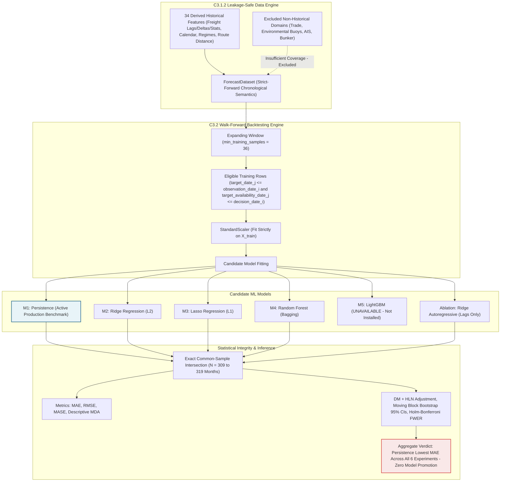

# Pelagos — Stage C3.2: Feature-Based Candidate Model Benchmarking Report

> [!NOTE]
> **Research Note Boundary (`DOC-001` Section 6):** This report documents empirical Stage C3.2 walk-forward experiments and does **not** promote any experimental model. **`persistence` remains the active production forecast benchmark.**

**Document ID:** `REPORT-C32-ML-BENCHMARK-001`  
**Milestone:** Stage C3.2 — Candidate Model Benchmarking  
**Baseline Commit Reference:** `7c0137fe8b60cb3951bd31dd7350513b524a67e0`  
**Reproducibility Artifact:** [`c32_ml_benchmark_results.json`](./artifacts/c32_ml_benchmark_results.json) (SHA-256 prefix `fcb70886136fd6c5`)  
**Status:** Verified & Completed

---

## 1. Executive Summary & Empirical Verdict

### 1.1 Objective & Context
Stage C3.2 conducts a formal out-of-sample empirical evaluation of feature-driven machine learning models for bulk agricultural grain freight forecasting within Pelagos. Using the 34 engineered historical features curated in Stage C3.1 ([`features.py`](../../backend/pelagos/forecasting/features.py)) — derived deterministically from existing monthly freight observations, calendar harmonics/indices, C1.3.2 regime labels, and static corridor distance rather than 34 independent external signals — alongside the strict-forward horizon semantics finalized in Stage C3.1.2 ([`dataset.py`](../../backend/pelagos/forecasting/dataset.py)), this stage benchmarks regularized linear models (Ridge, Lasso) and nonlinear tree ensembles (Random Forest, LightGBM) against the operational **Persistence (M1)** benchmark across two direct corridors:
- **`PNW-JPN-BULK`**: U.S. Pacific Northwest to Japan (bulk grain).
- **`USG-JPN-BULK`**: U.S. Gulf Coast to Japan (bulk grain).

Each corridor was evaluated across three operational forecast horizons: **$T+1$**, **$T+3$**, and **$T+6$** months under an expanding-window chronological walk-forward design (`min_training_samples = 36`, `seed = 42`).

### 1.2 Core Empirical Findings

> [!IMPORTANT]
> **Aggregate Empirical Verdict: Persistence (M1) achieves the lowest common-sample MAE across all six corridor/horizon experiments (`PNW-JPN-BULK` and `USG-JPN-BULK` at $T+1, T+3, T+6$).**
> No candidate machine learning model improved aggregate MAE over Persistence or qualified for production promotion.

Key quantitative findings from [`c32_ml_benchmark_results.json`](./artifacts/c32_ml_benchmark_results.json):
1. **Aggregate Linear Model Degradation:** Ridge (M2) and Lasso (M3) increased common-sample MAE relative to Persistence by **+13.47% to +44.48%** on `PNW-JPN-BULK` and **+13.71% to +43.80%** on `USG-JPN-BULK`. Every linear candidate across all 6 corridor/horizon combinations is classified `NOT_BETTER_THAN_BASELINE` under C1.3.3 research criteria (at `PNW-JPN-BULK`, Holm-adjusted $p \le 0.0189$; at `USG-JPN-BULK`, raw DM/HLN $p \le 0.0665$ and bootstrap 95% CIs strictly negative for $T+3, T+6$ and Lasso $T+1$, while Holm-adjusted $p$ spans `0.0516`–`0.1293`).
2. **Aggregate Random Forest Degradation:** Random Forest (M4) increased common-sample MAE by **+15.01% to +23.78%** on `PNW-JPN-BULK` and **+10.95% to +23.77%** on `USG-JPN-BULK` (`NOT_BETTER_THAN_BASELINE` at $T+1, T+3$ on both corridors and $T+6$ on PNW; `INCONCLUSIVE` at `USG-JPN-BULK` $T+6$ with Holm $p = 0.4702$).
3. **Scoped Feature Ablation Finding:** Restricting L2 Ridge exclusively to 6 pure autoregressive freight lags (`ridge_autoregressive`) achieved lower out-of-sample MAE and RMSE than the 13-feature `linear_non_redundant` Ridge model (`ridge`) across all 6 tested corridor/horizon combinations (e.g., `USG-JPN-BULK` $T+6$ MAE `12.95` vs `16.81`; `PNW-JPN-BULK` $T+6$ MAE `8.51` vs `10.20`). **Conclusion:** The tested additional feature groups did not improve the evaluated Ridge configuration on these two monthly freight corridors and this historical evaluation period.
4. **Regime Heterogeneity & Observed Exceptions:** While Persistence has the lowest aggregate MAE across all 6 full-sample experiments and dominates during `SUPERCYCLE_PEAK_CRASH` (2007–2009), isolated sub-regime point-MAE exceptions occurred in calmer or recent regimes — notably `PNW-JPN-BULK` Pandemic $T+1$ (Ridge MAE `2.58` vs Persistence `2.64`), `USG-JPN-BULK` Post-Supercycle $T+6$ (Ridge AR MAE `5.16` vs Persistence `6.18`), and `USG-JPN-BULK` Pandemic $T+6$ (Random Forest MAE `8.99` vs Persistence `10.84`). None of these regime-level exceptions are statistically significant ($p \ge 0.1064$, all `INCONCLUSIVE`), and they do not establish regime-specific model superiority.
5. **Descriptive Directional Accuracy (MDA):** Across all evaluated ML models and horizons, descriptive non-flat MDA spanned **46.08% to 60.19%** over `309`–`319` eligible non-flat pairs per experiment. Persistence produces 100% flat predictions (`y_hat = y_t`, `0` eligible non-flat directional pairs), yielding `None` (`N/A`) for MDA by definition.

### 1.3 Why Persistence Remains the Production Baseline
1. **Superior Aggregate Accuracy Across All Corridors and Horizons:** No tested ML estimator beat Persistence MAE on the common evaluation sample ($N = 309$–$319$ months), failing the `REQ-FR-FRF-002` empirical validation gate for model promotion.
2. **Shock Resilience:** Dry bulk ocean freight follows persistent regime levels punctuated by rapid macro spikes (`SUPERCYCLE_PEAK_CRASH` 2007–2009); parametric linear/tree combinations overfit historical lag volatility and suffer steep out-of-sample variance penalties (`+13%` to `+44%` higher MAE).
3. **Lack of Long-History Exogenous Predictors:** Genuine non-freight external series (bilateral trade, buoys, bunker quotes, AIS density) lack pre-2024 historical continuity and remain excluded, preventing ML models from observing physical drivers independent of the lagged rate series.
4. **Governance Enforcement:** [`service.py`](../../backend/pelagos/forecasting/service.py) and `DEFAULT_BASELINE_MODEL` ([`schemas.py`](../../backend/pelagos/forecasting/schemas.py)) remain untouched at `"persistence"`.

---

## 2. Environment, Dependency Audit & Reproducibility Configuration

### 2.1 Dependency Audit
| Package | Status | Usage in Stage C3.2 |
| :--- | :--- | :--- |
| **`scikit-learn`** (`1.5.x`) | Operational | `Ridge`, `Lasso`, `RandomForestRegressor`, `StandardScaler`. |
| **`numpy`** (`2.4.2`) | Operational | Vectorized feature extraction, block bootstrap sampling. |
| **`scipy`** (`1.14.x`) | Operational | Installed dependency (`sklearn` emits SciPy/NumPy minor version compatibility warning). |
| **`lightgbm`** | **Not Installed** | Gracefully reported as `UNAVAILABLE (dependency lightgbm not installed)` without installing external dependencies or substituting models. |

### 2.2 Reproducibility Metadata
From [`c32_ml_benchmark_results.json`](./artifacts/c32_ml_benchmark_results.json):
- **Benchmark Routine:** `execute_comprehensive_ml_benchmarks` ([`ml_benchmarks.py`](../../backend/pelagos/forecasting/ml_benchmarks.py))
- **Routes Evaluated:** `PNW-JPN-BULK`, `USG-JPN-BULK`
- **Horizons Evaluated:** `1`, `3`, `6` months (under C3.1.2 `strict_forward` semantics)
- **Feature Horizon Burn-In:** `burn_in_months = 12` (dataset rows start `1997-01-01` after consuming Jan–Dec 1996 lag burn-in)
- **Walk-Forward Minimum Training Samples:** `min_training_samples = 36`
- **Random Seed:** `seed = 42` (`DEFAULT_RANDOM_SEED`, applied deterministically to `Ridge`, `Lasso`, `RandomForestRegressor`, and `moving_block_bootstrap_ci`)
- **Bootstrap Parameters:** `n_boot = 1000`, `alpha = 0.05`, `block_length = max(horizon, 3)` (`3` for $T+1$ & $T+3$, `6` for $T+6$)
- **Skipped Walk-Forward Origins (`insufficient_training_history (<36)`):**
  - $T+1$: `37` initial steps skipped out of `356` labeled rows (`319` evaluated).
  - $T+3$: `39` initial steps skipped out of `354` labeled rows (`315` evaluated).
  - $T+6$: `42` initial steps skipped out of `351` labeled rows (`309` evaluated).

---

## 3. Feature Provenance & Candidate Model Specifications

### 3.1 Provenance of the 34 C3.1 Historical Features
The **34 engineered historical features** (`USABLE_FEATURE_NAMES` in [`features.py`](../../backend/pelagos/forecasting/features.py)) do **not** represent 34 independent external data signals. Rather, `21` columns are deterministic mathematical transformations of the two monthly USDA AMS GTR / O'Neil Commodity Consulting freight rate series (`PNW-JPN-BULK`, `USG-JPN-BULK`), while `13` are deterministic calendar transforms (`7`), C1.3.2 macroeconomic regime boundary indicators (`5`), and static corridor distance (`1` invariant scalar).

All non-freight external domains remain **strictly excluded** from historical ML training due to insufficient historical coverage:
- **Trade volumes (`trade_volume_grain_us_jp`, USDA FAS GATS / Indian DGCI&S):** Verified total of **13 records** in `pelagos.db` (`8` USDA FAS GATS US $\rightarrow$ JP grain exports Oct–Dec 2024 + `5` Indian DGCI&S exports Oct–Nov 2024; >99% historical missingness across 1996–2024). *(Stage C3.3 housekeeping updated `generate_feature_inventory()` in [`dataset.py`](../../backend/pelagos/forecasting/dataset.py) to query this DB count dynamically instead of an earlier hardcoded `11`.)*
- **Environmental buoy observations (NOAA NDBC / INCOIS):** `13` snapshot records across `46041` (`6`), `42001` (`5`), `AD01` (`2`); <0.1% coverage.
- **Commercial bunker fuel prices:** `5` spot records (`ARBUE`, `DKSKA`, Nov 2026); zero pre-Nov 2026 history, corridor hubs unquoted.
- **AIS fleet density (NOAA MarineCadastre):** `120` rows from single-day sample (`2024-01-01`).

### 3.2 Model Specifications & Hyperparameters (`ML_CANDIDATE_CONFIGS`)
| Model ID | Display Name | Model Family | Feature Subset (`Count`) | Scaling | Exact Hyperparameters |
| :--- | :--- | :--- | :--- | :---: | :--- |
| **`persistence`** | M1: Persistence (Operational Baseline) | `deterministic_baseline` | `rate_lag_0` (`1`) | None | `{}` (direct pass-through `y_{t+h|t} = y_t`) |
| **`ridge`** | M2: Ridge Regression (L2 Regularized) | `regularized_linear` | `linear_non_redundant` (`13`) | `StandardScaler` (train-only) | `{"alpha": 1.0, "random_state": 42}` |
| **`lasso`** | M3: Lasso Regression (L1 Feature Selection) | `sparse_linear` | `linear_non_redundant` (`13`) | `StandardScaler` (train-only) | `{"alpha": 0.1, "max_iter": 2000, "random_state": 42}` |
| **`random_forest`** | M4: Random Forest Regressor | `tree_ensemble` | `tree_based` (`25`) | None | `{"n_estimators": 50, "max_depth": 5, "min_samples_split": 4, "random_state": 42, "n_jobs": -1}` |
| **`lightgbm`** | M5: LightGBM Regressor (GBDT) | `gradient_boosted_trees` | `tree_based` (`25`) | None | `{"n_estimators": 100, "max_depth": 4, "learning_rate": 0.05, "random_state": 42, "verbose": -1}` *(UNAVAILABLE)* |
| **`ridge_autoregressive`** | Ablation: Ridge Autoregressive (Lags Only) | `regularized_linear` | `autoregressive` (`6`) | `StandardScaler` (train-only) | `{"alpha": 1.0, "random_state": 42}` |

---

## 4. Walk-Forward Integrity & Temporal Availability Verification

Every evaluation step obeys strict C3.1.2 chronological and publication-availability semantics ([`dataset.py`](../../backend/pelagos/forecasting/dataset.py) & [`ml_benchmarks.py`](../../backend/pelagos/forecasting/ml_benchmarks.py)):
1. **Training Cutoff Invariant (`target_date_j <= obs_date_i` and `target_availability_date_j <= decision_date_i`):** At step $i$, row $j < i$ is eligible only if its target period has already closed on or before `observation_date_i` and cleared its Day 14 provisional operational cutoff (`conservative_availability_cutoff`) on or before `decision_date_i`. Equivalence audits across all 6 datasets show `0` differences against timestamp gating.
2. **Train-Only Preprocessing Isolation:** `StandardScaler` is instantiated inside every walk-forward iteration, fitted strictly on `X_train`, and applied to `X_test`.
3. **Physical Clamping:** Predictions are bounded below at `MIN_TREND_RATE_CLAMP_USD_MT = 0.10` USD/MT.
4. **Common-Sample Alignment:** Both summary metrics (`evaluate_common_sample_comparison`, rounded 2dp) and statistical tests (`statistical_testing.py`, rounded 4dp) align all models onto identical `target_date` intersections ($N = 319, 315, 309$).

---

## 5. Verified Aggregate Benchmark Grid Results

*(Verified identical against [`c32_ml_benchmark_results.json`](./artifacts/c32_ml_benchmark_results.json).)*

### 5.1 Pacific Northwest Corridor (`PNW-JPN-BULK`)

#### Table 5.1.1: `PNW-JPN-BULK` Horizon $T+1$ ($N = 319$, Target Dates `2000-04-01` to `2026-10-01`)
| Model | MAE | RMSE | MASE | Rel MAE | Mean Diff (4dp) | HLN Stat | Raw $p$ | Holm $p$ | 95% Bootstrap CI | Classification |
| :--- | :---: | :---: | :---: | :---: | :---: | :---: | :---: | :---: | :---: | :--- |
| **Persistence (M1)** | **3.49** | **5.91** | **1.97** | `0.00%` | — | — | — | — | — | **ACTIVE BASELINE** |
| **Ridge (M2)** | 4.19 | 7.38 | 2.45 | `+20.06%` | `-0.6976` | `-4.0441` | `0.0001` | **0.0003** | `[-1.1781, -0.2230]` | `NOT_BETTER_THAN_BASELINE` |
| **Lasso (M3)** | 3.96 | 6.98 | 2.31 | `+13.47%` | `-0.4682` | `-3.1571` | `0.0017` | **0.0022** | `[-0.8505, -0.0750]` | `NOT_BETTER_THAN_BASELINE` |
| **Random Forest (M4)** | 4.32 | 7.26 | 2.49 | `+23.78%` | `-0.8359` | `-4.4778` | `0.0000` | **0.0000** | `[-1.3384, -0.3678]` | `NOT_BETTER_THAN_BASELINE` |
| **Ridge AR (Ablation)** | 3.97 | 6.63 | 2.27 | `+13.75%` | `-0.4789` | `-3.2830` | `0.0011` | **0.0022** | `[-0.8191, -0.1846]` | `NOT_BETTER_THAN_BASELINE` |
| **LightGBM (M5)** | — | — | — | — | — | — | — | — | — | `UNAVAILABLE` |

#### Table 5.1.2: `PNW-JPN-BULK` Horizon $T+3$ ($N = 315$, Target Dates `2000-08-01` to `2026-10-01`)
| Model | MAE | RMSE | MASE | Rel MAE | Mean Diff (4dp) | HLN Stat | Raw $p$ | Holm $p$ | 95% Bootstrap CI | Classification |
| :--- | :---: | :---: | :---: | :---: | :---: | :---: | :---: | :---: | :---: | :--- |
| **Persistence (M1)** | **5.28** | **9.03** | **3.10** | `0.00%` | — | — | — | — | — | **ACTIVE BASELINE** |
| **Ridge (M2)** | 7.42 | 12.65 | 4.38 | `+40.53%` | `-2.1370` | `-2.9601` | `0.0033` | **0.0132** | `[-3.4616, -1.1068]` | `NOT_BETTER_THAN_BASELINE` |
| **Lasso (M3)** | 7.21 | 12.47 | 4.28 | `+36.55%` | `-1.9244` | `-2.7523` | `0.0063` | **0.0189** | `[-3.1991, -0.8998]` | `NOT_BETTER_THAN_BASELINE` |
| **Random Forest (M4)** | 6.14 | 10.38 | 3.60 | `+16.29%` | `-0.8562` | `-2.1337` | `0.0336` | **0.0336** | `[-1.5192, -0.1944]` | `NOT_BETTER_THAN_BASELINE` |
| **Ridge AR (Ablation)** | 6.42 | 10.95 | 3.82 | `+21.59%` | `-1.1335` | `-2.4828` | `0.0136` | **0.0272** | `[-1.9248, -0.4783]` | `NOT_BETTER_THAN_BASELINE` |
| **LightGBM (M5)** | — | — | — | — | — | — | — | — | — | `UNAVAILABLE` |

#### Table 5.1.3: `PNW-JPN-BULK` Horizon $T+6$ ($N = 309$, Target Dates `2001-02-01` to `2026-10-01`)
| Model | MAE | RMSE | MASE | Rel MAE | Mean Diff (4dp) | HLN Stat | Raw $p$ | Holm $p$ | 95% Bootstrap CI | Classification |
| :--- | :---: | :---: | :---: | :---: | :---: | :---: | :---: | :---: | :---: | :--- |
| **Persistence (M1)** | **7.06** | **11.49** | **4.26** | `0.00%` | — | — | — | — | — | **ACTIVE BASELINE** |
| **Ridge (M2)** | 10.20 | 15.28 | 6.12 | `+44.48%` | `-3.1379` | `-3.4362` | `0.0007` | **0.0028** | `[-4.6781, -1.7723]` | `NOT_BETTER_THAN_BASELINE` |
| **Lasso (M3)** | 10.15 | 15.41 | 6.10 | `+43.77%` | `-3.0915` | `-3.3157` | `0.0010` | **0.0030** | `[-4.7361, -1.7312]` | `NOT_BETTER_THAN_BASELINE` |
| **Random Forest (M4)** | 8.12 | 12.91 | 4.73 | `+15.01%` | `-1.0668` | `-1.5550` | `0.1210` | **0.1210** | `[-2.1768, -0.0205]` | `NOT_BETTER_THAN_BASELINE` |
| **Ridge AR (Ablation)** | 8.51 | 14.30 | 5.22 | `+20.54%` | `-1.4567` | `-2.0376` | `0.0424` | **0.0848** | `[-2.6427, -0.3218]` | `NOT_BETTER_THAN_BASELINE` |
| **LightGBM (M5)** | — | — | — | — | — | — | — | — | — | `UNAVAILABLE` |

### 5.2 U.S. Gulf Corridor (`USG-JPN-BULK`)

#### Table 5.2.1: `USG-JPN-BULK` Horizon $T+1$ ($N = 319$, Target Dates `2000-04-01` to `2026-10-01`)
| Model | MAE | RMSE | MASE | Rel MAE | Mean Diff (4dp) | HLN Stat | Raw $p$ | Holm $p$ | 95% Bootstrap CI | Classification |
| :--- | :---: | :---: | :---: | :---: | :---: | :---: | :---: | :---: | :---: | :--- |
| **Persistence (M1)** | **5.47** | **9.08** | **2.21** | `0.00%` | — | — | — | — | — | **ACTIVE BASELINE** |
| **Ridge (M2)** | 6.22 | 11.03 | 2.46 | `+13.71%` | `-0.7518` | `-2.2513` | `0.0251` | **0.0516** | `[-1.6909, +0.0801]` | `NOT_BETTER_THAN_BASELINE` |
| **Lasso (M3)** | 6.22 | 10.89 | 2.46 | `+13.71%` | `-0.7500` | `-2.3945` | `0.0172` | **0.0516** | `[-1.6026, -0.0008]` | `NOT_BETTER_THAN_BASELINE` |
| **Random Forest (M4)** | 6.77 | 10.54 | 2.76 | `+23.77%` | `-1.3042` | `-5.3482` | `0.0000` | **0.0000** | `[-1.9544, -0.7117]` | `NOT_BETTER_THAN_BASELINE` |
| **Ridge AR (Ablation)** | 5.90 | 10.05 | 2.40 | `+7.86%` | `-0.4299` | `-1.9756` | `0.0491` | **0.0516** | `[-0.9281, +0.0434]` | `NOT_BETTER_THAN_BASELINE` |
| **LightGBM (M5)** | — | — | — | — | — | — | — | — | — | `UNAVAILABLE` |

#### Table 5.2.2: `USG-JPN-BULK` Horizon $T+3$ ($N = 315$, Target Dates `2000-08-01` to `2026-10-01`)
| Model | MAE | RMSE | MASE | Rel MAE | Mean Diff (4dp) | HLN Stat | Raw $p$ | Holm $p$ | 95% Bootstrap CI | Classification |
| :--- | :---: | :---: | :---: | :---: | :---: | :---: | :---: | :---: | :---: | :--- |
| **Persistence (M1)** | **8.55** | **14.43** | **3.50** | `0.00%` | — | — | — | — | — | **ACTIVE BASELINE** |
| **Ridge (M2)** | 11.86 | 22.88 | 4.60 | `+38.71%` | `-3.3109` | `-1.9529` | `0.0517` | **0.1293** | `[-6.3289, -1.0437]` | `NOT_BETTER_THAN_BASELINE` |
| **Lasso (M3)** | 11.74 | 23.01 | 4.54 | `+37.31%` | `-3.1924` | `-1.8416` | `0.0665` | **0.1293** | `[-6.3064, -0.9313]` | `NOT_BETTER_THAN_BASELINE` |
| **Random Forest (M4)** | 9.91 | 16.06 | 4.05 | `+15.91%` | `-1.3548` | `-2.4008` | `0.0169` | **0.0676** | `[-2.3493, -0.4267]` | `NOT_BETTER_THAN_BASELINE` |
| **Ridge AR (Ablation)** | 10.00 | 17.65 | 4.12 | `+16.96%` | `-1.4464` | `-2.0305` | `0.0431` | **0.1293** | `[-2.6988, -0.4515]` | `NOT_BETTER_THAN_BASELINE` |
| **LightGBM (M5)** | — | — | — | — | — | — | — | — | — | `UNAVAILABLE` |

#### Table 5.2.3: `USG-JPN-BULK` Horizon $T+6$ ($N = 309$, Target Dates `2001-02-01` to `2026-10-01`)
| Model | MAE | RMSE | MASE | Rel MAE | Mean Diff (4dp) | HLN Stat | Raw $p$ | Holm $p$ | 95% Bootstrap CI | Classification |
| :--- | :---: | :---: | :---: | :---: | :---: | :---: | :---: | :---: | :---: | :--- |
| **Persistence (M1)** | **11.69** | **18.71** | **4.81** | `0.00%` | — | — | — | — | — | **ACTIVE BASELINE** |
| **Ridge (M2)** | 16.81 | 27.51 | 7.02 | `+43.80%` | `-5.1266` | `-2.3958` | `0.0172` | **0.0672** | `[-9.0270, -2.4579]` | `NOT_BETTER_THAN_BASELINE` |
| **Lasso (M3)** | 16.78 | 27.51 | 7.01 | `+43.54%` | `-5.0930` | `-2.4035` | `0.0168` | **0.0672** | `[-8.9776, -2.4429]` | `NOT_BETTER_THAN_BASELINE` |
| **Random Forest (M4)** | 12.97 | 19.67 | 5.25 | `+10.95%` | `-1.2843` | `-1.1825` | `0.2379` | **0.4702** | `[-3.0322, +0.5074]` | `INCONCLUSIVE` |
| **Ridge AR (Ablation)** | 12.95 | 22.77 | 5.45 | `+10.78%` | `-1.2613` | `-1.1896` | `0.2351` | **0.4702** | `[-3.0714, +0.4781]` | `INCONCLUSIVE` |
| **LightGBM (M5)** | — | — | — | — | — | — | — | — | — | `UNAVAILABLE` |

---

## 6. Descriptive Mean Directional Accuracy (MDA) & Regime Breakdown

### 6.1 Descriptive MDA Across All Experiments
| Experiment | Model | Valid Steps ($N$) | Flat Pred Count (`Rate`) | Eligible Directional Comparisons | Descriptive MDA (%) |
| :--- | :--- | :---: | :---: | :---: | :---: |
| **`PNW-JPN-BULK` $T+1$** | `persistence` | 319 | 319 (`1.0000`) | 0 | `None` |
| **`PNW-JPN-BULK` $T+1$** | `ridge` / `lasso` / `random_forest` / `ridge_autoregressive` | 319 | 0 (`0.0000`) | 317 | `52.05%` / `53.31%` / `49.84%` / `52.37%` |
| **`PNW-JPN-BULK` $T+3$** | `persistence` | 315 | 315 (`1.0000`) | 0 | `None` |
| **`PNW-JPN-BULK` $T+3$** | `ridge` / `lasso` / `random_forest` / `ridge_autoregressive` | 315 | 0 (`0.0000`) | 315 | `53.65%` / `53.02%` / `50.79%` / `52.06%` |
| **`PNW-JPN-BULK` $T+6$** | `persistence` | 309 | 309 (`1.0000`) | 0 | `None` |
| **`PNW-JPN-BULK` $T+6$** | `ridge` / `lasso` / `random_forest` / `ridge_autoregressive` | 309 | 0 (`0.0000`) | 309 | `57.28%` / `57.93%` / `57.93%` / `54.69%` |
| **`USG-JPN-BULK` $T+1$** | `persistence` | 319 | 319 (`1.0000`) | 0 | `None` |
| **`USG-JPN-BULK` $T+1$** | `ridge` / `lasso` / `random_forest` / `ridge_autoregressive` | 319 | 0 (`0.0000`) | 319 | `57.05%` / `56.74%` / `46.08%` / `56.74%` |
| **`USG-JPN-BULK` $T+3$** | `persistence` | 315 | 315 (`1.0000`) | 0 | `None` |
| **`USG-JPN-BULK` $T+3$** | `ridge` / `lasso` / `random_forest` / `ridge_autoregressive` | 315 | 0 (`0.0000`) | 315 | `56.83%` / `57.78%` / `51.75%` / `52.38%` |
| **`USG-JPN-BULK` $T+6$** | `persistence` | 309 | 309 (`1.0000`) | 0 | `None` |
| **`USG-JPN-BULK` $T+6$** | `ridge` / `lasso` / `random_forest` / `ridge_autoregressive` | 309 | 0 (`0.0000`) | 309 | `57.61%` / `55.99%` / `60.19%` / `60.19%` |

### 6.2 Explicit Regime Exceptions & Statistical Interpretation
Across the 24 `(corridor, horizon, regime)` target-date slices (`81+36+120+82=319` at $T+1$, `77+36+120+82=315` at $T+3$, `71+36+120+82=309` at $T+6$), **18 sub-regime pairs** showed candidate MAE below Persistence MAE, including the three notable cases below:

| Experiment | Regime ($N$) | Model vs Persistence | Candidate MAE vs Persistence MAE | DM/HLN $p$-Value | 95% Bootstrap CI | Classification |
| :--- | :--- | :--- | :---: | :---: | :---: | :--- |
| **`PNW-JPN-BULK` $T+1$** | `PANDEMIC_DISRUPTION` (`82`) | **Ridge** (`lasso`: `2.61`, `ridge_ar`: `2.59`) | **`2.58` vs `2.64`** | `0.6517` | `[-0.1930, +0.3617]` | `INCONCLUSIVE` |
| **`USG-JPN-BULK` $T+6$** | `POST_SUPERCYCLE` (`120`) | **Ridge AR** | **`5.16` vs `6.18`** | `0.1714` | `[-0.1801, +2.0395]` | `INCONCLUSIVE` |
| **`USG-JPN-BULK` $T+6$** | `PANDEMIC_DISRUPTION` (`82`) | **Random Forest** (`ridge_ar`: `9.97`) | **`8.99` vs `10.84`** | `0.1477` | `[+0.0128, +4.5287]` | `INCONCLUSIVE` |

None of these sub-regime differences achieve statistical significance ($p \ge 0.1064$, all `INCONCLUSIVE`), and Persistence retains clear superiority in aggregate and during `SUPERCYCLE_PEAK_CRASH`.

### 6.3 Feature Ablation Comparison (`ridge` vs `ridge_autoregressive`)
Restricting L2 Ridge to 6 AR lags (`autoregressive`) lowered MAE relative to 13-feature `ridge` (`linear_non_redundant`) in all 6 corridor-horizon evaluations (`PNW`: `4.19 -> 3.97`, `7.42 -> 6.42`, `10.20 -> 8.51`; `USG`: `6.22 -> 5.90`, `11.86 -> 10.00`, `16.81 -> 12.95`), confirming that tested non-AR additions did not improve Ridge on these monthly series.

---

## 7. Implementation Artifacts, Traceability & Change History

- **Implementation & Tests:** [`ml_benchmarks.py`](../../backend/pelagos/forecasting/ml_benchmarks.py), [`statistical_testing.py`](../../backend/pelagos/forecasting/statistical_testing.py), [`test_candidate_ml_benchmarks.py`](../../tests/test_candidate_ml_benchmarks.py) (`13` tests verified passing).
- **Upstream:** [`RES-C31-001`](./c3-1-feature-coverage-and-forecast-dataset.md), [`ML-001`](./freight-index-and-forecasting-specification.md), [`REQ-FR-FRF-001`](../requirements/functional-requirements.md), [`REQ-FR-FRF-002`](../requirements/functional-requirements.md)
- **Downstream:** [`SPEC-C33-REGIME-001`](./c3-3-implementation-specification.md), [`REPORT-C33-REGIME-001`](./c3-3-regime-aware-forecasting-report.md)

| Version | Date | Author | Description |
|---|---|---|---|
| 1.0.0 | 2026-11-11 | Implementation Agent | Promoted verified Stage C3.2 ML benchmarking report and linked permanent [`c32_ml_benchmark_results.json`](./artifacts/c32_ml_benchmark_results.json) artifact under `DOC-001`. |

